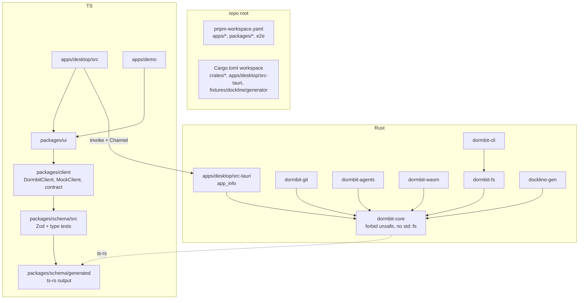

# Design Document

## Overview
This design sets up everything later specs build on: the pnpm and Cargo workspaces in the §6 layout, the lint and format rules, a hardened Tauri shell with one command (`app_info`), the shared Rust/TypeScript contracts, the test tools, the evidence runner, the Dockline fixture, the Kiro configuration from §10-11, and CI.

Decisions that shape the rest of the project:
- **One source for each type.** Rust types in `dormbit-core` are the source. ts-rs writes TypeScript types; hand-written Zod schemas validate them at runtime; type-level tests prove the two agree; a two-way round trip (PROP-11 setup) proves the JSON agrees.
- **Least privilege from the first commit.** The shell has no fs, shell, or dialog permission, no `core:*` permission by default, and a guard test that fails when any of that changes.
- **Fixed inputs.** The Dockline fixture is generated by code with fixed signatures, fixed times, and fixed tar headers, then committed once. A regenerate-and-compare test keeps the committed tar honest.
- **Evidence is a file.** `scripts/evidence/run.sh` turns a command run into a JSON record with the commit SHA, so a result counts only when it was recorded.

Out of scope: every §6 command other than `app_info` (owned by later specs), the design system and screens (`native-experience`), and the WebAssembly bindings (`judge-demo`).

## Architecture



### Repo layout after Task 9

```
apps/
  desktop/            React entry (src/), Vite config, src-tauri/ (Rust, tauri.conf.json, capabilities/)
  demo/               Vite + React placeholder (judge-demo fills it in)
crates/
  dormbit-core/       Vfs, models, errors (forbid unsafe, no std::fs)
  dormbit-fs/         skeleton (scope-and-discovery, transactional-restore)
  dormbit-git/        skeleton (scope-and-discovery)
  dormbit-agents/     skeleton (intelligence-and-brief)
  dormbit-wasm/       skeleton (judge-demo)
  dormbit-cli/        skeleton binary
packages/
  schema/             generated/ (ts-rs), src/ (Zod), test/
  client/             DormbitClient, MockClient, runClientContract
  ui/                 placeholder export (native-experience fills it in)
fixtures/
  dockline/           dockline-invoices.tar, dockline-invoices.sidecar.json, generator/
  golden/             insta snapshots
  malicious/          README only (rust-security fills it in)
e2e/                  Playwright + axe
docs/{product,architecture,adr,security,status,evidence,release,submission,kiro}/
scripts/              check-*.{sh,mjs}, gen-schema.sh, schema-parity.sh, evidence/, hooks/, kiro/
.github/workflows/    ci.yml
.githooks/            pre-commit (exists)
.kiro/                specs/, steering/, agents/, hooks/, skills/, settings/mcp.json
```
Empty folders get a one-line `README.md` that says which spec fills them, so Git keeps them and the Layout_Check passes.

### Ownership
The Agent (main agent) writes this whole spec, including `crates/**` skeletons, because no security module exists yet. From Task 15 on, the single-writer rule in `security.md` applies. Generated files (`packages/schema/generated/**`, `fixtures/golden/**`, the Dockline tar and Sidecar) are regenerated only by the Agent at merge points.

## Components and Interfaces

### 1. Workspace configuration (Task 9)

**Root `package.json`**
```json
{
  "name": "dormbit",
  "private": true,
  "packageManager": "pnpm@11.23.0",
  "engines": { "node": "24.19.0" },
  "scripts": {
    "build": "pnpm -r build",
    "lint": "eslint . --max-warnings 0",
    "typecheck": "pnpm -r typecheck",
    "test": "vitest run",
    "format:check": "prettier --check \"**/*.{ts,tsx,css,json,md}\""
  }
}
```
Exact versions for every npm dependency are set at install time from the then-current releases, saved without range prefixes (pnpm `save-prefix` set to empty in the workspace config). TypeScript, ESLint, typescript-eslint, React 19, Vite, Vitest, Zod 4, and Prettier are chosen as a set that typescript-eslint supports (see Open questions).

**Root `Cargo.toml`** (abridged)
```toml
[workspace]
resolver = "3"
members = ["crates/*", "apps/desktop/src-tauri", "fixtures/dockline/generator"]

[workspace.package]
edition = "2024"
version = "0.1.0"
license = "MIT"

[workspace.lints.rust]
unsafe_code = "deny"

[workspace.lints.clippy]
all = { level = "deny", priority = -1 }

[workspace.dependencies]
serde = { version = "=…", features = ["derive"] }
serde_json = "=…"
thiserror = "=…"
uuid = "=1.29.0"
sha2 = "=0.11.1"
tar = "=0.4.46"
flate2 = { version = "=1.1.10", default-features = false, features = ["rust_backend"] }
git2 = { version = "=0.21.0", default-features = false, features = ["vendored-libgit2"] }
cap-std = "=4.0.3"
ignore = "=0.4.34"
unicode-normalization = "=0.1.26"
ts-rs = "=12.0.1"
wasm-bindgen = "=0.2.130"
tauri = "=2.12.5"
tauri-build = "=2.7.4"
proptest = "=1.12.0"
insta = "=1.49.0"
```
Versions marked `…` are the current releases at Task 9. The others come from `docs/status/environment.md`. Every member has `[lints] workspace = true`.

**Lint and format files**
- `rustfmt.toml`: `edition = "2024"`, `max_width = 100`.
- `crates/dormbit-core/src/lib.rs`:
  ```rust
  #![forbid(unsafe_code)]
  #![cfg_attr(not(test), deny(clippy::unwrap_used, clippy::expect_used, clippy::panic))]
  ```
- `crates/dormbit-core/clippy.toml`: `disallowed-types` and `disallowed-methods` entries for `std::fs::*`, `std::process::Command`, `std::net::*` with the reason "core uses Vfs only (security.md)". `scope-and-discovery` extends this file.
- `tsconfig.base.json`: `strict`, `noUncheckedIndexedAccess`, `exactOptionalPropertyTypes`, plus `noImplicitOverride`, `verbatimModuleSyntax`, `moduleResolution: "bundler"`, `target: "ES2022"`.
- `packages/schema/test/strict-canary.ts`:
  ```ts
  // strict (strictNullChecks): null is not assignable to string
  // @ts-expect-error
  const a: string = null;
  // noUncheckedIndexedAccess: xs[0] is number | undefined
  const xs: number[] = [];
  // @ts-expect-error
  const b: number = xs[0];
  // exactOptionalPropertyTypes: undefined is not assignable to an optional prop
  // @ts-expect-error
  const c: { p?: string } = { p: undefined };
  export { a, b, c };
  ```
- `eslint.config.js` (flat config):
  ```js
  export default [
    { linterOptions: { noInlineConfig: true, reportUnusedDisableDirectives: 'error' } },
    ...tseslint.configs.strictTypeChecked,
    jsxA11y.flatConfigs.recommended,
    { plugins: { 'react-hooks': reactHooks },
      rules: { 'react-hooks/rules-of-hooks': 'error', 'react-hooks/exhaustive-deps': 'error' } },
    { rules: { 'no-restricted-syntax': ['error',
        { selector: "JSXAttribute[name.name='dangerouslySetInnerHTML']", message: 'Raw HTML is banned (NAT-2).' },
        { selector: "Property[key.name='dangerouslySetInnerHTML']", message: 'Raw HTML is banned (NAT-2).' }] } },
    { ignores: ['**/dist/**', 'packages/schema/generated/**', '**/target/**'] },
  ];
  ```
- `.prettierrc.json` and `.prettierignore` (ignores `packages/schema/generated/`, `fixtures/`, `**/target/`).

**Checks** (all exit 0 on success, 1 with a list of failures)
| Script | Checks |
|---|---|
| `scripts/check-layout.sh` | Requirement 1 paths |
| `scripts/check-deps.sh` | `cargo tree -p dormbit-core -e normal` and `-p dormbit-wasm` against the forbidden lists; `cargo tree -e features -i git2` for `https`/`ssh` |
| `scripts/check-pins.mjs` | exact npm versions; Cargo `[workspace.dependencies]` start with `=`; Node and pnpm versions agree with `.mise.toml`; no tsconfig turns off a strict flag; `rust-toolchain.toml` channel and targets |

**Package names**: Rust `dormbit-core`, `dormbit-fs`, `dormbit-git`, `dormbit-agents`, `dormbit-wasm`, `dormbit-cli`, `dormbit-desktop` (`apps/desktop/src-tauri`), `dockline-gen`; npm `@dormbit/schema`, `@dormbit/client`, `@dormbit/ui`, `@dormbit/desktop`, `@dormbit/demo`, `e2e`.

### 2. Hardened Tauri shell (Task 10)

**`tauri.conf.json`** (security-relevant fields)
```json
{
  "productName": "DORMBIT",
  "identifier": "io.github.amirmlotfy.dormbit",
  "app": {
    "withGlobalTauri": false,
    "windows": [{ "label": "main", "title": "DORMBIT", "minWidth": 1100, "minHeight": 720 }],
    "security": {
      "csp": "default-src 'self'; script-src 'self'; style-src 'self'; img-src 'self' data: blob:; font-src 'self'; connect-src ipc: http://ipc.localhost; object-src 'none'; base-uri 'none'; form-action 'none'; frame-src 'none'",
      "freezePrototype": true
    }
  },
  "bundle": {
    "macOS": { "signingIdentity": "-", "minimumSystemVersion": "13.0" }
  }
}
```
The window has no `url` field, so it loads the bundled `index.html`. `devUrl` points to the local Vite server for `tauri dev` only.

**`build.rs`**
```rust
fn main() {
    tauri_build::try_build(
        tauri_build::Attributes::new()
            .app_manifest(tauri_build::AppManifest::new().commands(&["app_info"])),
    )
    .expect("tauri build"); // build scripts may panic; core lints don't apply here
}
```

**`capabilities/main.json`**
```json
{ "identifier": "main", "windows": ["main"], "permissions": ["allow-app-info"] }
```
No `core:*` entry at first. If the window or the Channel needs a core permission, it is added by its exact name with a comment in the Allowlist_Guard's expected set. `core:default` and any `core:path:*` permission are never added (Open question 10 in requirements.md).

**`app_info` command**
```rust
// apps/desktop/src-tauri/src/commands/app_info.rs
#[derive(Clone, Serialize, Deserialize, TS)]
#[ts(export)]
pub struct AppInfo {
    pub name: String,          // "DORMBIT"
    pub version: String,       // env!("CARGO_PKG_VERSION") of src-tauri
    pub core_version: String,  // dormbit_core::VERSION
    pub profile: BuildProfile, // Debug | Release, from cfg!(debug_assertions)
    pub min_macos: String,     // "13.0"
}

#[derive(Clone, Serialize, Deserialize, TS)]
#[serde(tag = "kind", rename_all = "snake_case")]
#[ts(export)]
pub enum AppInfoEvent { Info { info: AppInfo }, Done }

#[tauri::command]
pub async fn app_info(on_event: tauri::ipc::Channel<AppInfoEvent>) -> Result<AppInfo, DormbitError> {
    let info = AppInfo::current();
    on_event.send(AppInfoEvent::Info { info: info.clone() }).map_err(DormbitError::ipc)?;
    on_event.send(AppInfoEvent::Done).map_err(DormbitError::ipc)?;
    Ok(info)
}
```
`AppInfo` and `AppInfoEvent` live in `dormbit-core::model::app` so ts-rs exports them with the other types; the command fills them in. `DormbitError::ipc` maps a Channel send failure to `CANCELLED` (the WebView went away) with the message "window closed"; see Error Handling.

**UI side** (`apps/desktop/src/appInfo.ts`): a small function, not a full client, because `TauriClient` belongs to `native-experience`.
```ts
export async function loadAppInfo(onEvent: (e: AppInfoEvent) => void): Promise<AppInfo>;
// creates a Channel, parses each message with AppInfoEventSchema, parses the return with AppInfoSchema,
// and throws DormbitError { code: 'IPC_SCHEMA_MISMATCH', retryable: false } on any parse failure.
```
The window shows "DORMBIT 0.1.0" from the `info` event.

**Allowlist_Guard** (`apps/desktop/src-tauri/tests/allowlist.rs`)
```rust
const PLAN_COMMANDS: [&str; 28] = ["app_info", "scope_pick", /* … §6 order … */ "adapters_list"];
const EXPECTED_PERMISSIONS: &[&str] = &["allow-app-info"]; // grows with each spec's commands
const BANNED_PREFIXES: &[&str] = &["fs:", "shell:", "dialog:", "http:", "opener:", "process:", "core:path:"];

fn check(caps: &[Capability], handlers: &[String], manifest: &[String],
         cargo_toml: &str, package_json: &str, tauri_features: &[String]) -> Vec<Violation>;
```
Inputs are read from the repo: every `capabilities/*.json`; the identifiers inside `generate_handler![...]` in `src/lib.rs`; the list inside `.commands(&[...])` in `build.rs`; `Cargo.toml`; `apps/desktop/package.json`; and the enabled features of `tauri` from `cargo metadata`. Self-tests call `check` with bad inputs (Requirement 10.7). Later specs add their commands to `EXPECTED_PERMISSIONS`, `build.rs`, and `generate_handler!` in the same commit.

### 3. Shared contracts (Task 11)

**Rust side** (`crates/dormbit-core/src/model/`)
```rust
pub struct SafeU64(u64);
pub struct SafeU64Overflow(pub u64);
impl SafeU64 {
    pub const MAX: u64 = (1 << 53) - 1;
    pub fn new(v: u64) -> Result<Self, SafeU64Overflow>;
    pub fn get(self) -> u64;
}
```
`SafeU64::new` returns `Err(SafeU64Overflow)`, a plain Rust error that isn't a `DormbitError`; callers that read sizes from untrusted input map it to their own code (for example `CAPSULE_MALFORMED` in the verifier). It serializes as a JSON number and is exported as `number` with `#[ts(type = "number")]`.

```rust
#[derive(Debug, Clone, Copy, PartialEq, Eq, Serialize, Deserialize, TS)]
#[serde(rename_all = "SCREAMING_SNAKE_CASE")]
#[ts(export)]
pub enum ErrorCode {
    ScopeDenied, PathUnsafe, PlanDigestMismatch, FileChangedDuringCapture,
    CapsuleMalformed, CapsuleTruncated, CapsuleHashMismatch, CapsuleVersionUnsupported,
    RestoreDestExists, RestoreCollision, RestoreVolumeUnsupported, RestoreInsufficientSpace,
    Cancelled,
}

#[derive(Debug, Clone, PartialEq, Eq, Serialize, Deserialize, TS, thiserror::Error)]
#[error("{code:?}: {message}")]
#[ts(export)]
pub struct DormbitError { pub code: ErrorCode, pub message: String, pub retryable: bool }

impl DormbitError {
    pub fn new(code: ErrorCode, message: impl Into<String>) -> Self; // retryable = code.retryable()
}
impl ErrorCode { pub const fn retryable(self) -> bool; }
```
Every §8 model (`ScopeGrant`, `ProjectRecord`, `GitSnapshot`, `CapturePlan`, `ApprovedPlan`, `Finding`, `Brief`, `VerificationReport`, `RestoreJournal`, `RestoreReport`) is declared field for field as §8 lists it, with `#[derive(Serialize, Deserialize, TS, PartialEq, Debug, Clone)]` and `#[ts(export)]`. IDs are `String` newtypes holding UUIDs. Timestamps are RFC 3339 UTC strings. Enum values in §8 (`Read|CapsuleLibrary|RestoreTarget`, `Match|Mismatch|NotInRegistry`, `Staged|…|Cleaned`) are serialized exactly as written. Owning specs extend these types; each extension updates Rust, Zod, the MockClient data, and the Parity_Harness strategies in the same commit.

**Home redaction at the IPC boundary** (`apps/desktop/src-tauri/src/redact.rs`): `fn redact_home(s: &str, home: &Path) -> String` replaces the home prefix with `~`. Every command's error path calls it on `message` before returning (Requirement 14.7). Core never reads `HOME`.

**Export** (`scripts/gen-schema.sh`): sets `TS_RS_EXPORT_DIR` to the absolute path of `packages/schema/generated`, clears that folder's `.ts` files, runs `cargo test -p dormbit-core --locked export_bindings`, then writes a sorted `index.ts` that re-exports every file. ts-rs is configured so `Option<T>` stays `T | null` (no `#[ts(optional)]`), and serde has no `skip_serializing_if`.

**Zod side** (`packages/schema/src/`)
```ts
export const ErrorCodeSchema = z.enum([
  'SCOPE_DENIED', /* … the 13 Rust codes … */ 'CANCELLED', 'IPC_SCHEMA_MISMATCH',
]);
export const DormbitErrorSchema = z.strictObject({
  code: ErrorCodeSchema, message: z.string(), retryable: z.boolean(),
});
export const AppInfoSchema = z.strictObject({
  name: z.literal('DORMBIT'), version: z.string(), core_version: z.string(),
  profile: z.enum(['debug', 'release']), min_macos: z.string(),
});
export const AppInfoEventSchema = z.discriminatedUnion('kind', [
  z.strictObject({ kind: z.literal('info'), info: AppInfoSchema }),
  z.strictObject({ kind: z.literal('done') }),
]);
// …one schema per generated type
```
Type tests (`packages/schema/test/types.test-d.ts`, run by `vitest --typecheck` inside `pnpm typecheck`):
```ts
expectTypeOf<z.infer<typeof AppInfoSchema>>().toEqualTypeOf<AppInfo>();
```
`ErrorCodeSchema` is compared with `ErrorCode | 'IPC_SCHEMA_MISMATCH'`. A Vitest test lists every export in `generated/index.ts` and fails for any type without a `<Type>Schema` export.

**Client** (`packages/client/src/`)
```ts
export interface DormbitClient {
  appInfo(onEvent?: (e: AppInfoEvent) => void): Promise<AppInfo>;
  scopePick(kind: ScopeKind): Promise<ScopeGrant | null>;
  scopeList(): Promise<ScopeGrant[]>;
  scopeRevoke(scopeId: ScopeId): Promise<void>;
  discoveryStart(scopeId: ScopeId, onEvent: JobListener<DiscoveryResult>): Promise<JobId>;
  discoveryCancel(jobId: JobId): Promise<void>;
  projectsList(): Promise<ProjectRecord[]>;
  projectGet(projectId: ProjectId): Promise<ProjectRecord>;
  projectSetDormant(projectId: ProjectId, dormant: boolean): Promise<ProjectRecord>;
  evidenceGet(projectId: ProjectId): Promise<Finding[]>;
  planCreate(projectId: ProjectId): Promise<CapturePlan>;
  planSetDecision(planId: PlanId, itemPath: string, decision: Decision): Promise<CapturePlan>;
  planApprove(planId: PlanId, input: PlanApproveInput): Promise<ApprovedPlan>;
  captureStart(planId: PlanId, onEvent: JobListener<CaptureResult>): Promise<JobId>;
  jobCancel(jobId: JobId): Promise<void>;
  capsulePick(): Promise<CapsuleRef | null>;
  capsulesList(): Promise<CapsuleRef[]>;
  verifyStart(capsuleId: CapsuleId, onEvent: JobListener<VerificationReport>): Promise<JobId>;
  restoreTargetPick(): Promise<ScopeGrant | null>;
  restorePrecheck(input: RestoreInput): Promise<PrecheckReport>;
  restoreStart(input: RestoreInput, onEvent: JobListener<RestoreReport>): Promise<JobId>;
  restoreRecover(request: RecoverRequest): Promise<RecoverResult>;
  briefGet(projectId: ProjectId): Promise<Brief>;
  briefExport(projectId: ProjectId): Promise<ExportResult>;
  settingsGet(): Promise<Settings>;
  settingsSet(patch: SettingsPatch): Promise<Settings>;
  consentSet(adapterId: AdapterId, granted: boolean): Promise<ConsentRecord>;
  adaptersList(): Promise<AdapterInfo[]>;
}
export type JobListener<R> = (event: JobEvent<R>) => void;
export type JobEvent<R> =
  | { kind: 'state'; state: string }
  | { kind: 'progress'; files_done: number; files_total: number; bytes_done: number; bytes_total: number }
  | { kind: 'done'; result: R }
  | { kind: 'failed'; error: DormbitError }
  | { kind: 'cancelled' };
```
`itemPath` is a path relative to the project root inside an approved plan, never an absolute path. The method names and `appInfo` are fixed here. Argument and result types not in §8 (`DiscoveryResult`, `CaptureResult`, `CapsuleRef`, `PrecheckReport`, `RecoverRequest`, `RecoverResult`, `ExportResult`, `Settings`, `SettingsPatch`, `ConsentRecord`, `AdapterInfo`, `PlanApproveInput`, `RestoreInput`, `Decision`) start as minimal Rust structs in `dormbit-core::model::ipc` and are finalized by the owning spec: scope-and-discovery (scope, discovery, projects), capsule-and-verification (plan, capture, capsules, verify), transactional-restore (restore), intelligence-and-brief (evidence, brief, consent, adapters), native-experience (settings).

`MockClient` (`packages/client/src/mock/`) holds a Dockline-shaped dataset (one Read grant, Dockline plus two small projects, a plan, a capsule, a verification report, a restore report, a brief). Job methods drive a timer-free step loop: `state` → `progress` per file → `done`, so tests don't wait. `new MockClient({ overrides: { projectGet: new DormbitError(...) } })` replaces one method's result. Every return passes through the method's Zod schema before it leaves the mock.

`runClientContract(makeClient)` (`packages/client/src/contract.ts`) is a Vitest suite: each method resolves to schema-valid data or rejects with a valid DormbitError; job methods end with exactly one of `done`, `failed`, or `cancelled`.

### 4. Parity_Harness (Task 11, PROP-11 setup)
```
scripts/schema-parity.sh
  1. cargo test -p dormbit-core --locked --test schema_parity -- write_samples   → target/schema-parity/rust/*.jsonl
  2. pnpm --filter @dormbit/schema exec vitest run test/parity.test.ts           → reads rust/*, writes ts/*.jsonl
  3. cargo test -p dormbit-core --locked --test schema_parity -- read_samples    → reads ts/*
```
- Rust strategies: one hand-written `arb_<type>()` per exported type in `crates/dormbit-core/tests/support/arb.rs`. Strings include non-ASCII, NFC/NFD pairs, `~`, quotes, and empty strings. SafeU64 values span 0 to 2^53 - 1. `Option` fields are `None` in about one case in four.
- TS arbitraries: built from the Zod schemas' shapes in `packages/schema/test/arb.ts` with fast-check.
- Comparison is on parsed JSON values (key order ignored), so formatting differences don't count.
- Case counts: `PROPTEST_CASES` and `FC_NUM_RUNS`, default 256, CI 512. Phase 10 runs 10,000.

### 5. Test tooling (Task 12)
- **Rust:** `proptest` and `insta` as workspace dev-dependencies. Each crate's snapshot tests use `insta::with_settings!({ snapshot_path => "<repo>/fixtures/golden/<area>" })` through a helper macro in `dormbit-core/tests/support`. CI sets `CI=true` and `INSTA_UPDATE=no`.
- **TypeScript:** root `vitest.config.ts` with a `projects` list for `packages/*` and `apps/*`; jsdom environment for UI packages; `@testing-library/react` and `@testing-library/user-event`; `fast-check`.
- **E2E:** `e2e/package.json` with `@playwright/test` and `@axe-core/playwright`; `playwright.config.ts` with Chromium, WebKit, and Firefox projects and a `webServer` running `vite preview` of `apps/demo`. `e2e/smoke/placeholder.spec.ts` loads the page and runs `new AxeBuilder({ page }).analyze()`, failing on any `critical` violation. Browsers are installed with `pnpm --filter e2e exec playwright install chromium webkit firefox` after the User approves.

### 6. Evidence_Runner (Task 12)
```
scripts/evidence/run.sh <command> [args...]
  env (optional): EVIDENCE_TASK=P02-T04, PROPTEST_CASES, FC_NUM_RUNS
```
Steps:
1. If `$# -eq 0`: print usage to stderr, exit 2.
2. `stamp=$(date -u +%Y%m%dT%H%M%SZ)`; `slug` = first two argv words, lowercased, non-alphanumerics replaced by `-`, at most 40 characters; `name="$stamp-$slug"`.
3. `sha=$(git rev-parse HEAD)`; `dirty` = whether `git status --porcelain` prints anything.
4. Run `"$@"` with stdout and stderr both sent through `tee` to `.scratch/logs/$name.log`; capture the command's exit code from `PIPESTATUS`. If the command isn't found, the shell gives 127.
5. Rewrite the log, replacing `$HOME` with `~` (fixed-string replacement, not a regex built from the path).
6. Parse counts with fixed patterns:
   - cargo: `test result: (ok|FAILED). N passed; M failed; K ignored` (summed over all lines)
   - Vitest: `Tests  N passed | M failed | K skipped` (any subset)
   - Playwright: `N passed`, `M failed`, `K skipped` on the final summary lines
7. Write the Evidence record with `node scripts/evidence/write-record.mjs`, which takes values as arguments and builds JSON with `JSON.stringify`, so no value is spliced into JSON text by the shell.
8. Exit with the command's exit code.

The script uses `set -u` and `set -o pipefail`, quotes every expansion, and passes `shellcheck`. A test script `scripts/evidence/test-run.sh` runs it on `true`, `false`, a missing command, a fake cargo summary printed by `printf`, and no arguments, and checks each record.

### 7. Dockline_Generator (Task 12)
```
fixtures/dockline/generator/
  Cargo.toml        package dockline-gen (binary), deps: git2, tar, sha2, serde_json, dormbit-core (for GitSnapshot)
  src/main.rs       --out <dir>
  src/tree.rs       Project tree file contents (static strings)
  src/history.rs    24 commits, branches, stash, working changes
  src/stores.rs     synthetic Claude Code JSONL and Kiro export zip
  src/pack.rs       deterministic ustar writer and stored-zip writer
  src/sidecar.rs    Sidecar JSON
```
Build order inside a fresh temp folder (`<tmp>/home` is empty and is used as `HOME` and `XDG_CONFIG_HOME` for the process):
1. `Repository::init` on `<tmp>/work/dockline-invoices`, then overwrite `.git/config` with fixed content: `[core] repositoryformatversion = 0, filemode = true, bare = false, logallrefupdates = false, ignorecase = true, precomposeunicode = true`, and `[init] defaultBranch = main`. Remove `description`, `info/exclude`, and anything under `hooks/` that libgit2 created, then write a fixed `description` and an empty `info/exclude`.
2. Commit history: a fixed list of 24 entries `(branch, author, date, summary, file changes)`. Authors are `Mara Quill <mara@dockline.invalid>` and `Theo Brandt <theo@dockline.invalid>`. Dates run from 2025-03-03 to 2025-05-23 with offset `-07:00` or `-08:00` as the date requires. 17 commits are on `main`; `feature/pdf-export` branches from the 17th and adds 7, including `WIP: pdf totals`. Each commit uses `Signature::new(name, email, &Time::new(secs, offset))` for author and committer.
3. Stash: change `server/routes/invoices.ts`, `stash_save` with a fixed stasher signature dated 2025-05-22 and message `WIP on feature/pdf-export: rate limits`, which restores the clean tree.
4. Working changes: modify `src/pdf/renderInvoice.ts` and `docs/ROADMAP.md`; add untracked `notes/pdf-ideas.md`; write the ignored `.env`, `data/dev.sqlite` (the 16-byte header `SQLite format 3\0` followed by zero bytes, not a usable database), `dist/index.html`, and `node_modules/.placeholder`.
5. Agent stores: `agent-stores/claude/projects/-Users-dockline-demo-Projects-dockline-invoices/<fixed uuid>.jsonl` with 6 lines of session metadata and placeholder message text "synthetic message, not real", and `agent-stores/kiro-export/dockline-pdf-export.zip`, written as a stored (uncompressed) zip with fixed DOS timestamps, containing `session.json` and `messages.jsonl`.
6. Sidecar: compute `git_snapshot` with `git2` (status counts, stash count via `stash_foreach`, HEAD) into the `dormbit-core` `GitSnapshot` type, hash every regular file with `sha2`, and write the Sidecar with sorted keys and a trailing newline.
7. Pack: walk `<tmp>/work` sorted by path bytes, write ustar headers as listed in Requirement 19.2, then two zero blocks. Files marked executable in the tree table get `0755`; nothing in Dockline is executable by default.
8. Write `<out>/dockline-invoices.tar`, compute its SHA-256 into the Sidecar's `fixture_sha256`, write `<out>/dockline-invoices.sidecar.json`, and remove `<tmp>`.

`logallrefupdates = false` keeps libgit2 from writing reflogs that would carry the current time. The stash reflog is written with the fixed stasher signature. If the Fixture_Check finds another time- or machine-dependent file, the generator is fixed rather than the check widened.

### 8. Kiro configuration (Task 13)

**Steering**
| File | `inclusion` | Pattern | Content |
|---|---|---|---|
| `product.md` | always | | truthfulness, the four outcomes, no deletion, no code execution, local-first |
| `tech.md` | always | | stack, pinned versions, the commands in this design |
| `structure.md` | always | | §6 layout, module boundaries, generated files regenerated only by the Agent |
| `security.md` | always | | hard rules (Requirement 20.5) |
| `definition-of-done.md` | always | | ledger statuses, evidence rules, review loop (`APPROVED` trigger, `max_iterations: 3`) |
| `project-status.md` | always | | `#[[file:docs/status/HANDOFF.md]]` |
| `rust.md` | fileMatch | `**/*.rs` | Rust conventions, error codes, no `unwrap` in core |
| `frontend.md` | fileMatch | `apps/**`, `packages/**` | React, Zod at the boundary, no raw HTML |
| `ui-design.md` | fileMatch | `packages/ui/**` | §9 tokens and rules; token-file reference added in Task 34 |
| `testing.md` | fileMatch | `**/*.test.ts`, `**/*.test.tsx`, `**/tests/**`, `e2e/**` | test layers, case counts, evidence runner |
| `hackathon.md` | manual | | §0 rules checklist, §22 approval gates |
| `release.md` | manual | | release steps and checks |

**Custom agents** (`.kiro/agents/<name>.md`, front matter keys confirmed in Task 13)
| Agent | Extra steering | Skills | Shell allow | Shell ask |
|---|---|---|---|---|
| `architect` | none | none | none | none |
| `rust-security` | `rust.md`, `testing.md` | none | `cargo *` | none |
| `frontend` | `frontend.md`, `ui-design.md`, `testing.md` | `visual-qa` | `pnpm *` | none |
| `qa` | `rust.md`, `frontend.md`, `testing.md` | `visual-qa`, `release-gate` | `cargo test *`, `pnpm test*`, `pnpm exec vitest *`, `pnpm exec playwright *`, `scripts/evidence/run.sh *` | none |
| `release` | `release.md`, `hackathon.md` | `release-gate`, `demo-video` | `pnpm tauri build*`, `cargo build *`, `codesign *`, `hdiutil *`, `shasum *`, `ffmpeg *`, `ffprobe *`, `whisper-cli *`, `magick *`, `exiftool *`, `scripts/evidence/run.sh *` | `gh *` |
| `reviewer` | `rust.md`, `frontend.md`, `testing.md` | none | same as `qa` | none |

Every agent lists the six `always` files in `resources` too. `qa` test folders are `**/tests/**`, `**/*.test.ts`, `**/*.test.tsx`, `**/*.test-d.ts`, `**/*.spec.ts`, and `**/proptest-regressions/**`. MCP access: `frontend` and `qa` get `playwright/*`; no agent gets `playwright-chrome/*`.

**Hooks**
| File | Trigger | Matcher | Action |
|---|---|---|---|
| `format.json` | `PostFileSave` | `\.(rs\|ts\|tsx\|css\|json\|md)$` | `scripts/hooks/format.sh` |
| `stop-gate.json` | `Stop` | | `scripts/hooks/stop-gate.sh` |
| `secret-scan.json` | `PreToolUse` | `write` | `scripts/hooks/secret-scan.sh` |
| `security-tests.json` | `PostFileSave` | `crates/dormbit-(core\|fs)/src/(path\|scope\|capsule\|verify\|restore\|rename)` | `scripts/hooks/security-tests.sh` |
| `task-tests.json` | `PostTaskExec` | | `scripts/hooks/task-tests.sh` |
| `review-reminder.json` | `PostTaskExec` | | agent prompt (Requirement 22.13) |
| `release-gate.json` | `PreTaskExec` | | `scripts/hooks/release-gate.sh` |

Hook script rules:
- Read stdin once into a variable and extract fields with `jq -r` (the field names come from the Task 4 payload record). Values are only ever passed as quoted arguments.
- `format.sh`: `realpath` the path; require it to start with the repo root plus `/`, to be a regular file, and to match the extension list; then `rustfmt --edition 2024 -- "$path"` for `.rs` or `pnpm exec prettier --write -- "$path"` otherwise.
- `stop-gate.sh`: if `cargo` or `pnpm` isn't on `PATH`, or `Cargo.toml` or `node_modules/` is missing, exit 0. Run `cargo check --workspace --locked --message-format short` and `pnpm typecheck`. The counter file holds one integer.
- `secret-scan.sh`: pipe the written content to `gitleaks stdin --redact --no-banner`; exit 2 on findings or if gitleaks is missing.
- `security-tests.sh`: `cargo test -p dormbit-core -p dormbit-fs --locked security_fast` with `PROPTEST_CASES=64`.
- `task-tests.sh`: map the task's spec name to its test command through `scripts/hooks/task-tests.json` (spec name → argv list) and run it through the Evidence_Runner.
- `release-gate.sh`: block only `release-and-submission` tasks 5-17 (P12-P18). Checks: the newest file in `docs/evidence/runs/` has `exit_code` 0, and `git diff --quiet <its git.sha> HEAD -- . ':!docs/'` succeeds, so no code changed after that run (committing the record itself only touches `docs/`); `gitleaks git --redact --no-banner` finds nothing; `LICENSE` exists; `git check-ignore .kiro` prints nothing.

**Skills**: `.kiro/skills/visual-qa/SKILL.md` (screenshot every state at 1x and 2x, compare, log defects), `release-gate/SKILL.md` (the release-gate checks run by hand), `demo-video/SKILL.md` (the Phase 15 pipeline). If the payload check fails, `task-tests/SKILL.md` is added too.

**MCP_Config**
```json
{
  "mcpServers": {
    "playwright": {
      "command": "npx",
      "args": ["@playwright/mcp@<exact version>", "--isolated", "--output-dir", ".scratch/playwright",
               "--allowed-origins", "http://localhost:*;https://amirmlotfy.github.io"]
    },
    "playwright-chrome": {
      "command": "npx",
      "args": ["@playwright/mcp@<exact version>", "--extension"],
      "disabled": true
    }
  }
}
```
Per Playwright MCP's docs, allowed origins are a convenience filter, not a security boundary.

**`.kiroignore`**: `target/`, `node_modules/`, `media/raw/`, `.scratch/`.

**Check_Config** (`scripts/kiro/check-config.mjs`): parses front matter with a small YAML subset parser and JSON with `JSON.parse`, then checks Requirements 20-23.

### 9. CI_Workflow (Task 14)
```yaml
name: ci
on: { push: {}, pull_request: {} }
permissions: { contents: read }
concurrency: { group: ci-${{ github.ref }}, cancel-in-progress: true }
env: { CI: "true", PROPTEST_CASES: "512", FC_NUM_RUNS: "512", INSTA_UPDATE: "no" }
jobs:
  rust:     # macos-15: fmt --check, clippy -D warnings, cargo test --workspace --locked
  ts:       # macos-15: mise (Node, pnpm from .mise.toml), install --frozen-lockfile, lint, typecheck, test
  wasm:     # macos-15: cargo build -p dormbit-wasm --target wasm32-unknown-unknown --release --locked; wasm-bindgen 0.2.130
  contracts:# macos-15: gen-schema.sh + git diff --exit-code packages/schema/generated; schema-parity.sh; Fixture_Check
  e2e:      # macos-15: build apps/demo; playwright install chromium webkit firefox; playwright test
  security: # macos-15: checkout fetch-depth 0; gitleaks git (pinned release, checksum verified); cargo deny check; pnpm audit --audit-level high
  meta:     # macos-15: check-layout, check-deps, check-pins, check-config, actionlint, shellcheck
```
- Third-party actions are pinned to full commit SHAs with the version in a comment.
- `cargo-deny` 0.20.2 and `wasm-bindgen-cli` 0.2.130 are installed with `cargo install --locked --version` and cached.
- `deny.toml`: `[advisories]` deny vulnerabilities and unmaintained crates with a reviewed ignore list (empty at start); `[licenses]` allow MIT, Apache-2.0, Apache-2.0 WITH LLVM-exception, BSD-2-Clause, BSD-3-Clause, ISC, Unicode-3.0, Zlib, and MPL-2.0, and deny anything else until reviewed; `[bans]` deny `openssl-sys` and `libssh2-sys`; `[sources]` allow only crates.io.

### 10. SECURITY.md and Devpost draft (Task 14)
- `SECURITY.md` sections: Supported versions, Reporting a vulnerability, What DORMBIT protects, Stated limits, No telemetry.
- `docs/submission/devpost-draft.md` sections: Name and tagline; Inspiration; What it does; How we built it; Challenges; Accomplishments; What we learned; What's next; How we used Kiro; Testing instructions; Built with; Category (Frankenstein); Links; Team; Bonus prizes; Open items (every `TBD (Task N)`).

## Data Models

**AppInfo / AppInfoEvent**: see Components §2.

**ErrorCode and retryability**
| Code | Retryable | Meaning |
|---|---|---|
| `SCOPE_DENIED` | false | Access outside a grant, or an unknown grant or project ID |
| `PATH_UNSAFE` | false | A path failed validation |
| `PLAN_DIGEST_MISMATCH` | false | Approval didn't match the current plan |
| `FILE_CHANGED_DURING_CAPTURE` | true | A source file changed during capture; capture can be run again |
| `CAPSULE_MALFORMED` | false | Capsule structure is invalid |
| `CAPSULE_TRUNCATED` | false | Capsule ends early or has no trailer |
| `CAPSULE_HASH_MISMATCH` | false | Stored bytes don't match their hash |
| `CAPSULE_VERSION_UNSUPPORTED` | false | Unknown marker or schema version |
| `RESTORE_DEST_EXISTS` | false | The target or a variant of it exists |
| `RESTORE_COLLISION` | false | Paths collide after normalization or case-folding |
| `RESTORE_VOLUME_UNSUPPORTED` | false | The volume lacks exclusive rename |
| `RESTORE_INSUFFICIENT_SPACE` | true | Not enough free space; can retry after freeing space |
| `CANCELLED` | false | The user or the window cancelled the job |
| `IPC_SCHEMA_MISMATCH` (Client-only) | false | A response failed Zod validation |

**Adding a code** (used by later specs): add the variant to `ErrorCode` with its `retryable` value, add the string to `ErrorCodeSchema`, add a row to this table in the owning spec's design, and update §8 with the User's approval. The parity test (Requirement 14.6) fails until both sides match.

**Evidence record** (`docs/evidence/runs/<stamp>-<slug>.json`)
```json
{
  "schema_version": 1,
  "task": "P02-T04",
  "command": ["cargo", "test", "--workspace"],
  "cwd": "~/Desktop/Kiro/DORMBIT",
  "started_at": "2026-11-06T18:02:11Z",
  "finished_at": "2026-11-06T18:03:40Z",
  "duration_ms": 89012,
  "exit_code": 0,
  "counts": { "passed": 41, "failed": 0, "skipped": 0 },
  "counts_source": "cargo",
  "env": { "PROPTEST_CASES": "10000" },
  "git": { "sha": "<40 hex>", "dirty": false },
  "host": { "os": "macOS 26.6.2", "arch": "arm64" },
  "log": ".scratch/logs/20261106T180211Z-cargo-test.log"
}
```
`task` is `null` when `EVIDENCE_TASK` isn't set. `counts` is `null` when `counts_source` is `unknown`. The values shown are an example of the format, not results.

**Sidecar**
```ts
type Sidecar = {
  schema_version: 1;
  fixture_sha256: string;               // SHA-256 of dockline-invoices.tar
  demo_clock: '2025-06-02T16:00:00Z';
  git_snapshot: GitSnapshot;            // §8 shape, for dockline-invoices/
  agent_metadata: {
    claude_code: SessionMeta[];
    kiro_export: SessionMeta[];
  };
  expected_hashes: Record<string, string>; // tar path → SHA-256, every regular file
};
type SessionMeta = {
  session_id: string; working_directory: string; started_at: string;
  ended_at: string | null; git_branch: string | null; tool_version: string | null;
};
```
`SessionMeta` uses the AGT-1 metadata fields. `intelligence-and-brief` may rename fields when its adapter types land; the Sidecar is then regenerated.

## Correctness Properties

### Property 1 (PROP-11 setup): Schema round trip
*For any* value of any type exported to `packages/schema/generated/`, generated in Rust, serializing it to JSON, parsing it with the matching Zod schema, and serializing the result gives JSON equal to the original; and *for any* value generated in TypeScript from the same schema, Rust deserializes it and re-serializes it to equal JSON.
**Validates: Requirements 11.1, 11.4, 11.5, 12.1, 12.4, 14.2, 15.1, 15.2, 15.3, 15.4, 15.5**

### Property 2: The Dockline generator is deterministic
*For any* two runs of the Dockline_Generator with different output folders, start times, `TZ` values, and umasks, the two tars have the same entry paths, types, modes, sizes, and contents for every entry except `dockline-invoices/.git/index`, and the two Sidecars are equal except for `fixture_sha256` and the `expected_hashes` entry for `dockline-invoices/.git/index`.
**Validates: Requirements 19.1, 19.2, 19.3, 19.5**

## Error Handling
- **`app_info`:** if a Channel send fails, the WebView is gone; the command returns `CANCELLED` with message "window closed", which no one may see. The UI maps any Zod failure to `IPC_SCHEMA_MISMATCH` and shows "DORMBIT couldn't read its version. Restart the app." with no payload in logs.
- **MockClient:** overrides return exactly the configured DormbitError, so UI error states can be tested per code.
- **Scripts:** every check script prints one line per failure and exits 1; usage errors exit 2. No script deletes anything outside `.scratch/` or its own temp folder.
- **Hooks:** blocking hooks (`secret-scan`, `release-gate`) fail closed: when they can't check, they block and say why. Non-blocking hooks (`format`, `security-tests`, `task-tests`) exit 0 when they have nothing to do. `stop-gate` stops after 3 failures in a row so it can't loop.
- **Fixture generator:** any Git or I/O error stops the run with a non-zero exit, and nothing is written to `--out` unless both files are complete (both are written to temp names in `--out` and renamed at the end).

## Testing Strategy
- **Unit (Rust):** `ErrorCode::retryable` table; `SafeU64::new` at 2^53 - 1 and 2^53; `redact_home`; the Allowlist_Guard's `check` with bad inputs; Dockline tar header encoding.
- **Unit (TS):** Lint_Canary; Strict_Canary through `pnpm typecheck`; schema coverage test; `loadAppInfo` with a mocked IPC (valid, version `9.9.9`, invalid payload); MockClient job sequences and cancel.
- **Contract:** `runClientContract` against MockClient.
- **Property:** Property 1 through the Parity_Harness (256 local default, 512 CI, 10,000 in Phase 10). Property 2 as a proptest in `fixtures/dockline/generator/tests/determinism.rs` that varies output folder name, `TZ`, and umask over 8 cases (each case runs the full generator, so the count is small), plus the Fixture_Check against the committed files on every CI run.
- **Golden:** none in this spec beyond the committed Dockline tar and Sidecar; the insta path is set up for later specs.
- **E2E:** the placeholder Playwright test with axe on 3 browsers.
- **Build:** `pnpm -r build`, `cargo build --workspace --locked`, `pnpm --filter ./apps/desktop tauri build --bundles app` with `codesign -dv` showing `Signature=adhoc`.
- **Config:** Layout_Check, Dependency_Check, Pin_Check, Check_Config, `actionlint`, `shellcheck`.
- **Kiro (manual, Task 13):** each Hook fired once with its expected result; secret-scan blocks a fake secret generated at test time; a denied write by `architect`; one allowed, one asked, and one denied shell command.
Every run that counts goes through the Evidence_Runner or CI.

## Security Considerations
- The WebView gets one permission. Folder pickers, when they arrive in Task 15, are opened from Rust, so no `dialog:*` permission is ever granted.
- No `core:path:*` permission, so the WebView can't learn the home folder path.
- `freezePrototype` blocks prototype pollution from reaching the IPC bridge.
- The CSP has no inline or eval script and no remote origin; `connect-src` is limited to Tauri IPC.
- Home paths are replaced with `~` in error messages and evidence logs before anything is committed or shown.
- Hook scripts never splice payload values into shell code. Blocking hooks fail closed.
- Fake secrets for the secret-scan test are generated at run time and never committed (CAP-3 rule).
- The fixture uses `.invalid` emails, a fictional home path, and values containing `fake`, and is scanned by gitleaks.
- CI has read-only token permissions, pinned actions, and verified tool downloads.

## Open questions
1. **TypeScript version.** The Task 3 spike used TypeScript 7.0.2. If the current typescript-eslint release doesn't support that version's API, Task 9 pins the newest TypeScript that typescript-eslint supports and records the choice in `tech.md`.
2. **Hook payload fields.** The Task 4 probes are still pending. The stdin field names in the hook scripts (`tool_input` content, file path, task identifier) are filled in from `.scratch/hook-probe/` in Task 13. Requirement 22.15 covers the case where task hooks can't identify the task.
3. **`core:*` permissions for Channels.** It isn't confirmed whether Channel delivery needs any `core:*` permission. Task 10 starts with none and adds only the exact permission a failing test shows is needed.
4. **Tauri macros and `unsafe_code = "deny"`.** If code generated by `tauri::generate_context!` trips the workspace `unsafe_code` lint in `src-tauri`, Task 10 allows it only on that macro call with a comment, and the single-`unsafe` rule in §6 still applies to hand-written code.
5. **jq.** Hook scripts use `jq`. Task 13 checks that `jq` is on `PATH` for hook processes; if it isn't, the scripts parse stdin with `node -e` instead, still passing values only as arguments.
