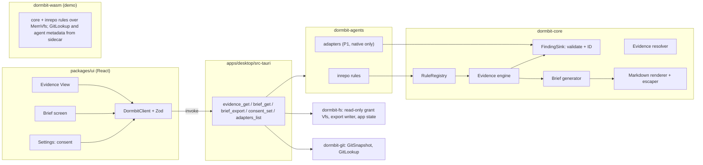

# Design Document

## Overview
This design covers the evidence engine, in-repo agent file parsing, the Resurrection Brief, its export, the Evidence View and Brief screens (P06, Tasks 27-30), and the P1 agent adapters (P07, Tasks 31-33).

The work splits into four parts:
- **Evidence engine** in `dormbit-core`. A rule registry runs fact rules over a project's `Vfs`, `GitSnapshot`, and optional restore facts, then derived rules over the Confirmed results. Every `Finding` carries a status, a rule ID, and at least one `EvidenceRef`. A resolver checks that each reference still points at what it cites (PROP-12).
- **Brief generator** in `dormbit-core`. It turns Findings into a structured `Brief` and renders it to deterministic Markdown. Every non-template line cites a Finding ID. The four outcomes are typed so that "session resumed" and "builds" can't be stated as anything but "not performed" and "unknown".
- **`dormbit-agents` crate**. Module `inrepo` holds the in-repo parsers (Kiro tasks and steering, `AGENTS.md`, `CLAUDE.md`, `.cursor/rules`, `.specstory/`) as rules that plug into the core registry. Module `adapters` (feature `adapters`, native only, P1) holds the consent-gated, metadata-only readers for Claude Code, Codex, and Kiro export zips.
- **Commands and screens**. Tauri commands `evidence_get`, `brief_get`, `brief_export`, `consent_set`, and `adapters_list`, plus the Evidence View, Brief, and Settings consent UI.

Nothing in this spec runs project code, runs the git CLI, or writes to a source project.

## Architecture



**Crate boundaries**
- `dormbit-core` (`#![forbid(unsafe_code)]`, no `std::fs`, no `std::process`): `evidence::{model, registry, engine, sink, rules, resolve, limits}` and `brief::{model, generate, render, escape, template}`. It uses only the `Vfs` trait, the injected `Clock`, and the `GitLookup` trait defined here.
- `dormbit-agents` (`#![forbid(unsafe_code)]`, no `std::fs`, no `std::process`): depends only on `dormbit-core`. Feature `inrepo` (default) has no native dependencies, so `dormbit-wasm` can link it. Feature `adapters` (P1) adds the adapter framework and is enabled only in `src-tauri` and `dormbit-cli`.
- `dormbit-fs`: provides the read-only grant `Vfs` (scope-and-discovery Task 15), a one-shot export writer, and atomic app-state JSON for consent records.
- `dormbit-git`: provides `GitSnapshot` (scope-and-discovery Task 17) and a native `GitLookup` over git2 (no network features).
- `src-tauri`: command handlers in `src/commands/{evidence.rs, brief.rs, agents.rs}`. The handlers build the registry, choose the `Vfs` for each evidence source, and own the cache.

**Data flow for one project**
1. `evidence_get` looks up the project's cached `EvidenceResult`. On a miss it builds `EvidenceInput` from the project's Read grant `Vfs`, the walker's `FileIndex`, the `GitSnapshot`, and (P1) adapter session refs, then runs the engine.
2. The engine runs every fact rule in registry order, then every derived rule, sending each emitted Finding through `FindingSink`, which validates it and assigns its ID.
3. `brief_get` calls the generator with the `EvidenceResult` and, if a restore ID is given, the `RestoreFacts` from that restore's report (transactional-restore Task 26). The generator emits extra `restore.*` Findings through the same sink.
4. The renderer produces Markdown. `brief_export` writes those exact bytes.

## Components and Interfaces

### Evidence model (`dormbit-core::evidence::model`)

```rust
#[derive(Clone, Copy, Debug, PartialEq, Eq, PartialOrd, Ord, Serialize, Deserialize, TS)]
pub enum Status { Confirmed, Inferred, Unknown, Unsupported }

/// Stable rule identifier such as "work.todo". Serialized as a string.
#[derive(Clone, Copy, Debug, PartialEq, Eq, Hash, PartialOrd, Ord)]
pub struct RuleId(pub &'static str);

/// "F-" + 12 lowercase hex characters.
#[derive(Clone, Debug, PartialEq, Eq, Hash, PartialOrd, Ord, Serialize, Deserialize, TS)]
pub struct FindingId(String);

#[derive(Clone, Debug, PartialEq, Eq, Serialize, Deserialize, TS)]
pub struct Finding {
    pub id: FindingId,
    pub rule: String,                 // RuleId as string on the wire
    pub statement: Vec<Span>,
    pub status: Status,
    pub evidence: Vec<EvidenceRef>,   // non-empty, enforced by FindingSink
}

/// Statement pieces. Only `Text` comes from DORMBIT's templates.
#[derive(Clone, Debug, PartialEq, Eq, Serialize, Deserialize, TS)]
#[serde(tag = "t", content = "v")]
pub enum Span {
    Text(String),    // fixed template text
    Quote(String),   // Untrusted text, rendered escaped
    Code(String),    // Untrusted text, rendered as a code span (paths, keys, commands)
    Count(u64),
}
```

### Evidence references (`dormbit-core::evidence::model`)

```rust
#[derive(Clone, Debug, PartialEq, Eq, PartialOrd, Ord, Serialize, Deserialize, TS)]
#[serde(tag = "kind")]
pub enum EvidenceSource {
    Project { project_id: ProjectId },
    Capsule { capsule_id: CapsuleId },
    Restore { restore_id: RestoreId },
    AgentStore { grant_id: ScopeId },     // P1
}

#[derive(Clone, Debug, PartialEq, Eq, PartialOrd, Ord, Serialize, Deserialize, TS)]
#[serde(tag = "kind")]
pub enum EvidenceRef {
    FileLines {
        source: EvidenceSource,
        path: RelPath,                    // validated relative path, never absolute
        start_line: u32,                  // 1-based, inclusive
        end_line: u32,                    // inclusive
        anchor: Option<String>,           // literal that must occur in the range, e.g. "TODO" or a key name
    },
    GitObject { source: EvidenceSource, object: GitObjectRef },
    ManifestKey {
        source: EvidenceSource,
        path: RelPath,                    // e.g. "package.json" or capsule "manifest.json"
        pointer: String,                  // RFC 6901 JSON Pointer, e.g. "/scripts/test"
    },
    FileStat { source: EvidenceSource, path: RelPath, stat: StatRecord },
}

#[derive(Clone, Debug, PartialEq, Eq, PartialOrd, Ord, Serialize, Deserialize, TS)]
#[serde(tag = "kind")]
pub enum GitObjectRef {
    Commit { oid: String },
    Ref { name: String },                 // "refs/heads/feature/pdf-export", "refs/stash"
    ConfigKey { key: String },            // "core.fsmonitor"; never the value
}

#[derive(Clone, Debug, PartialEq, Eq, PartialOrd, Ord, Serialize, Deserialize, TS)]
pub struct StatRecord {
    pub kind: StatKind,                   // File | Dir | Symlink | Absent
    pub size: Option<u64>,
    pub mtime: Option<Timestamp>,
    pub aggregate: Option<DirAggregate>,  // used by specstory.meta
}

#[derive(Clone, Debug, PartialEq, Eq, PartialOrd, Ord, Serialize, Deserialize, TS)]
pub struct DirAggregate { pub files: u32, pub earliest_mtime: Timestamp, pub latest_mtime: Timestamp }
```

`FileLines` carries no hash of the cited lines. A hash of a line from an Example env file would be a fingerprint of its value, so resolution uses the line range plus the `anchor` literal instead.

### Rule registry and engine (`dormbit-core::evidence::{registry, engine, sink}`)

```rust
pub enum Phase { Fact, Derived }

pub struct RuleSpec {
    pub id: RuleId,
    pub phase: Phase,
    pub allowed: &'static [Status],
    pub section: SectionId,               // brief section its Findings feed
    pub order: u16,                       // registry order, used for sorting
}

pub trait FactRule: Send + Sync {
    fn spec(&self) -> &'static RuleSpec;
    fn run(&self, cx: &FactCtx<'_>, out: &mut FindingSink<'_>) -> Result<(), DormbitError>;
}

pub trait DerivedRule: Send + Sync {
    fn spec(&self) -> &'static RuleSpec;
    /// Receives only Confirmed Findings. No Vfs, Git, or restore access exists in this signature.
    fn run(&self, confirmed: &[Finding], out: &mut FindingSink<'_>);
}

pub struct RuleRegistry { /* fact: Vec<Box<dyn FactRule>>, derived: Vec<Box<dyn DerivedRule>> */ }

impl RuleRegistry {
    pub fn builder() -> RegistryBuilder;          // panics in tests on duplicate RuleId
    pub fn core() -> RegistryBuilder;             // all rules defined in dormbit-core
    pub fn spec(&self, id: &str) -> Option<&'static RuleSpec>;
}
// Callers: RuleRegistry::core().extend(dormbit_agents::inrepo::rules()).build()

pub struct FactCtx<'a> {
    project: &'a ProjectRecord,
    files: &'a FileIndex,
    vfs: &'a dyn Vfs,
    git: Option<&'a GitSnapshot>,
    limits: &'a Limits,
    budget: &'a Budget,                           // discovery time bound (DSC-2)
}

impl FactCtx<'_> {
    /// Refuses Sensitive files, gitignored and rebuildable files, `.git/`, `.specstory/`
    /// contents, symlinks, files over `max_text_file_bytes`, and non-UTF-8 files.
    pub fn read_text(&self, path: &RelPath) -> Result<TextFile, Skip>;
    pub fn stat(&self, path: &RelPath) -> StatRecord;          // never follows symlinks
    pub fn files(&self) -> impl Iterator<Item = &IndexedFile>; // sorted by path
    pub fn git(&self) -> Option<&GitSnapshot>;
    pub fn redact(&self, text: &str) -> Span;                  // CAP-3 Secret detector
}

pub struct FindingSink<'a> { /* registry, findings: BTreeMap<FindingId, Finding>, diagnostics */ }

impl FindingSink<'_> {
    /// Validates rule registration, allowed status, non-empty evidence, and safe paths.
    /// On failure, records `Diagnostic::RuleViolation { rule }` and returns None.
    pub fn emit(&mut self, rule: &'static RuleSpec, status: Status,
                statement: Vec<Span>, evidence: Vec<EvidenceRef>) -> Option<FindingId>;
}

pub fn evaluate(reg: &RuleRegistry, input: &EvidenceInput<'_>, limits: &Limits) -> EvidenceResult;
```

**Finding IDs.** `id = "F-" + hex(sha256(rule_id || 0x00 || canonical_json(sorted evidence)))[0..12]`. The same rule and evidence always give the same ID, so identical emissions merge. Two different Findings that collide on 48 bits are reported as a `RuleViolation` diagnostic, and Property 2 checks that the generated corpus has no collisions.

**Ordering.** Findings are sorted by `(section, rule order, first evidence ref)`. The `FileIndex` is sorted by path before rules see it, so directory listing order never reaches the output.

**Limits** (`dormbit-core::evidence::limits::Limits`, configurable, documented in this design): `max_text_file_bytes = 1 MiB`, `max_findings_per_rule = 200`, `max_quote_chars = 200`, `max_excerpt_lines = 40`, `max_headings = 10`. These defaults are chosen by this spec (see Open questions).

### Rule list

| Rule ID | Phase | Status | Evidence | Brief section | Req |
|---|---|---|---|---|---|
| `identity.name` | Fact | Confirmed | ManifestKey `/name` or FileStat root (per `ProjectRecord.name.source`) | Identity | 12.2 |
| `stack.manifest` | Fact | Confirmed | FileStat | Technologies | 4.1 |
| `stack.dependency` | Fact | Confirmed | ManifestKey `/dependencies/<n>` | Technologies | 4.2 |
| `stack.framework` | Derived | Inferred | union of dependency refs | Technologies | 4.3 |
| `toolchain.file` | Fact | Confirmed | FileLines / ManifestKey `/engines/<n>` | Technologies, First steps | 4.4-4.6 |
| `cmd.documented` | Fact | Confirmed | ManifestKey `/scripts/<n>` / FileLines | First steps | 5.1, 5.2 |
| `env.example_key` | Fact | Confirmed | FileLines, anchor = key | Missing information | 6.1 |
| `env.example_skipped` | Fact | Confirmed | FileStat | Missing information | 6.5 |
| `sensitive.present` | Fact | Confirmed | FileStat only | Missing information | 6.4 |
| `work.todo` | Fact | Confirmed | FileLines, anchor = token | Unfinished work | 7.1 |
| `work.skipped_test` | Fact | Confirmed | FileLines, anchor = marker | Unfinished work | 7.2 |
| `git.branch`, `git.detached` | Fact | Confirmed | GitObject Ref / Commit | Repo state | 8.2, 8.3 |
| `git.feature_branch` | Derived | Inferred | from `git.branch` | Repo state | 8.4 |
| `git.uncommitted` | Fact | Confirmed | GitObject HEAD + FileStat per path | Repo state | 8.1 |
| `git.wip_commit` | Fact | Confirmed | GitObject Commit | Repo state | 8.5 |
| `git.stash` | Fact | Confirmed | GitObject Ref `refs/stash` | Repo state | 8.6 |
| `git.upstream` | Fact | Confirmed | GitObject Ref | Repo state | 8.7 |
| `git.absent` | Fact | Confirmed | FileStat `.git` Absent | Repo state | 8.8 |
| `docs.present` | Fact | Confirmed | FileStat (+ FileLines for H1) | Docs | 12.2 |
| `kiro.tasks_progress`, `kiro.subtasks_progress` | Fact | Confirmed | FileLines | Unfinished work | 9.3, 9.5 |
| `kiro.task_unchecked` | Fact | Confirmed | FileLines | Unfinished work | 9.4 |
| `kiro.steering` | Fact | Confirmed | FileLines / FileStat | Context references | 9.10 |
| `agent.instructions` | Fact | Confirmed | FileStat (+ FileLines per heading) | Context references | 10.1-10.3 |
| `specstory.meta` | Fact | Confirmed | FileStat with `aggregate` | Context references | 10.4 |
| `prerun.lifecycle_script` | Fact | Confirmed | ManifestKey `/scripts/postinstall` etc. | Pre-run checks | 12.8 |
| `prerun.editor_autorun` | Fact | Confirmed | ManifestKey in `.vscode/tasks.json` | Pre-run checks | 12.8 |
| `prerun.git_risky_config` | Fact | Confirmed | GitObject ConfigKey | Pre-run checks | 12.8 |
| `prerun.none` | Fact | Confirmed | FileStat per checked source | Pre-run checks | 12.9 |
| `work.area` | Derived | Inferred | union of grouped refs | Unfinished work | 3.5 |
| `unknown.pause_reason`, `unknown.builds`, `unknown.deploy_target` | Fact | Unknown | FileStat root | Missing information | 3.3 |
| `scan.partial`, `scan.skipped_files`, `scan.truncated` | Fact | Confirmed | FileStat root | Missing information | 7.4, 7.5, 11.1 |
| `source.unsupported` | Fact | Unsupported | FileStat | Missing information | 4.7, 9.8 |
| `restore.verified`, `restore.not_restored`, `restore.git_match` | Fact (brief) | Confirmed | ManifestKey capsule `manifest.json` `/totals`, `/excluded`, `/git` + FileStat restored root | Verified content | 12.10 |
| `restore.none` | Fact (brief) | Unknown | FileStat project root | Verified content | 13.3 |
| `adapter.session` (P1) | Fact | Confirmed | FileStat (agent store) | Context references | 21.2 |
| `adapter.format_unsupported` (P1) | Fact | Unsupported | FileStat (agent store) | Context references | 20.3, 20.4 |
| `adapter.claude_code.retention` (P1) | Derived | Inferred | from `adapter.session` | Context references | 22.5 |
| `adapter.claude_code.retention_setting` (P1) | Fact | Unknown | FileStat grant root | Missing information | 22.6 |

`work.area` groups Confirmed `work.todo`, `work.skipped_test`, `kiro.task_unchecked`, and `git.feature_branch` source facts that share a path segment or spec name with the branch name (for Dockline, `pdf` / `pdf-export`). Its statement lists counts ("Unfinished work around `pdf-export`: 4 unchecked tasks, 2 TODO/FIXME, 1 skipped test"). It never states why the work stopped.

**Stack detection table.** A fixed table in `evidence::rules::stack` maps npm package names to labels (`react` → React, `vite` → Vite, `typescript` → TypeScript, `fastify` → Fastify, `drizzle-orm` → Drizzle) and label combinations to frameworks (React + Vite → "React + Vite frontend"). Adding entries beyond Dockline's stack is P1 item 6 ("detection of more frameworks").

**Manifest parsing.** JSON manifests (`package.json`, `.vscode/tasks.json`) use `serde_json`; `.vscode/tasks.json` first has `//` and `/* */` comments stripped outside strings. TOML files (`Cargo.toml`, `rust-toolchain.toml`) are read line by line and cited with `FileLines`, because the plan's crate list has no TOML parser (see Open questions).

### Evidence resolver (`dormbit-core::evidence::resolve`)

```rust
pub enum Resolution { Resolved, Stale, Missing, NotAccessible }

pub trait GitLookup {
    fn has_commit(&self, oid: &str) -> bool;
    fn ref_target(&self, name: &str) -> Option<String>;
    fn has_config_key(&self, key: &str) -> bool;
}

pub trait SourceMap {
    /// None when the grant was revoked or the capsule/restore is not in the registry.
    fn vfs(&self, source: &EvidenceSource) -> Option<&dyn Vfs>;
    fn git(&self, source: &EvidenceSource) -> Option<&dyn GitLookup>;
}

pub fn resolve(r: &EvidenceRef, sources: &dyn SourceMap) -> Result<Resolution, DormbitError>;
pub fn excerpt(r: &EvidenceRef, sources: &dyn SourceMap, limits: &Limits)
    -> Result<Option<Excerpt>, DormbitError>;   // None for AgentStore sources and non-FileLines refs

pub struct Excerpt { pub start_line: u32, pub lines: Vec<Span> }   // Secret-detector redacted
```

Natively, `GitLookup` is implemented in `dormbit-git` over git2. In core and the demo it is implemented over the `GitSnapshot` plus the core ref reader (`.git/HEAD`, `refs/`, `packed-refs`). Path checks (`PATH_UNSAFE`) reuse the RST-2 path validator.

### In-repo parsers (`dormbit-agents::inrepo`)

```rust
pub fn rules() -> Vec<RegisteredRule>;     // KiroTasksRule, KiroSteeringRule, InstructionsRule, SpecstoryRule

pub struct TaskCount { pub done: u32, pub total: u32, pub sub_done: u32, pub sub_total: u32,
                       pub first_line: u32, pub last_line: u32, pub unchecked: Vec<(u32, String)> }
pub fn count_tasks(text: &str) -> TaskCount;   // pure; used by the rule and by Property 8
```

**How Dockline's "3 of 7 tasks complete" is derived**
1. The walker (scope-and-discovery Task 16) lists `.kiro/specs/pdf-export/tasks.md` in the `FileIndex` as a text file of the Read grant.
2. `KiroTasksRule` matches every `FileIndex` path of the form `.kiro/specs/<name>/tasks.md` and reads it with `FactCtx::read_text`.
3. `count_tasks` walks the lines once. It tracks fenced code blocks: a line whose first non-space characters (at most 3 spaces of indent) are 3 or more backticks or tildes opens a fence, and a line with the same character repeated at least as many times closes it. Lines inside a fence are ignored.
4. A line outside a fence that matches `^- \[(.)\]\*?( |$)` at column 0 is a top-level task. A line that matches `^[ \t]+- \[(.)\]\*?( |$)` is a subtask.
5. A top-level task is complete when the captured marker is `x` or `X`. Any other marker, including a space, counts as not complete.
6. For Dockline the fixture generator writes 7 top-level task lines, 3 of them `[x]`. The rule emits:
   - one `kiro.tasks_progress` Finding with statement spans `Code(".kiro/specs/pdf-export/tasks.md")`, `Text(": ")`, `Count(3)`, `Text(" of ")`, `Count(7)`, `Text(" tasks complete")`, citing `FileLines` from the first to the last top-level task line with anchor `- [`;
   - four `kiro.task_unchecked` Findings, each quoting a task title and citing its line.
7. The Evidence View's Overview tab shows the progress statement. The brief lists it first under Unfinished work. The golden snapshot pins the plain text "3 of 7 tasks complete".

`SpecstoryRule` uses only `FactCtx::stat` and the `FileIndex` entries under `.specstory/` to fill `DirAggregate`. `read_text` refuses `.specstory/` paths, so the rule has no way to open them.

### Brief generator and renderer (`dormbit-core::brief`)

```rust
pub struct BriefInput<'a> {
    pub evidence: &'a EvidenceResult,
    pub restore: Option<&'a RestoreFacts>,     // from the RestoreReport (transactional-restore Task 26)
    pub app_version: &'a str,
    pub clock: &'a dyn Clock,
}

pub struct RestoreFacts {
    pub restore_id: RestoreId,
    pub capsule_id: CapsuleId,
    pub verified: bool,                        // all files verified, 0 mismatches, post-commit re-hash passed
    pub files_verified: u64,
    pub mismatches: u64,
    pub not_restored: Vec<(ReasonCode, u64)>,  // e.g. GitHooks, Sensitive, Symlink
    pub git_head_match: Option<bool>,
}

pub fn generate(input: &BriefInput<'_>, reg: &RuleRegistry) -> Brief;
pub fn render_markdown(brief: &Brief) -> String;
pub fn check_citations(markdown: &str, index: &[Finding]) -> Result<(), CitationError>; // test oracle
```

`generate` adds the `restore.*` Findings through a `FindingSink` before building sections, so they are in `evidence_index` and pass the same validation. Sections are filled by rule `section` in registry order. Next steps are built only from `kiro.task_unchecked`, `work.todo`, `work.skipped_test`, `git.uncommitted`, and `git.stash`, with fixed templates such as "Review unchecked task: …", "Review TODO at `path:line`", "Review stash `stash@{0}`".

**Escaping (`brief::escape`).** `Span::Quote` text goes through `escape_inline`: control characters, tabs, and line breaks become one space; bidi controls U+202A-U+202E and U+2066-U+2069 become `\u{XXXX}`; `&`, `<`, `>` become entities; Markdown punctuation is backslash-escaped. `Span::Code` text gets the same control and bidi handling, then is wrapped in a backtick run one longer than its longest internal run, with a space pad when it starts or ends with a backtick. `Span::Text` is template text and is written as is.

**Template lines (`brief::template::TEMPLATE_LINES`).** The citation checker accepts a line without a citation only if it matches one of these:
- the empty line
- `# Resurrection Brief`
- `Generated by DORMBIT <semver> on <YYYY-MM-DD>. Paths are relative to the project root; ~ is your home folder.`
- `## Outcomes`, `## Evidence index`, and `## <title>` for each of the 11 BRF-1 section titles
- `- Context reconstructed (inferred from evidence). <n> findings: <a> Confirmed, <b> Inferred, <c> Unknown, <d> Unsupported.`
- `- AI session resumed: not performed.`
- `- No findings for this section.`
- `| Finding | Status | Rule | Evidence |` and `|---|---|---|---|`

Every other line must contain at least one `[F-xxxxxxxxxxxx]` whose ID is in `evidence_index`. Evidence index rows start with `| F-xxxxxxxxxxxx |`, which the checker counts as a citation of that row's own Finding.

**Rendered shape (Dockline, illustrative IDs and counts)**

```markdown
# Resurrection Brief

Generated by DORMBIT 1.0.0 on 2026-11-20. Paths are relative to the project root; ~ is your home folder.

## Outcomes

- Files restored and verified. <n> files, 0 mismatches. [F-5d0e2b81c9aa]
- Context reconstructed (inferred from evidence). <n> findings: <a> Confirmed, <b> Inferred, <c> Unknown, <d> Unsupported.
- AI session resumed: not performed.
- Builds/runs: unknown (never executed). [F-0b7f13c2d4e6]

## Unfinished work

- `.kiro/specs/pdf-export/tasks.md`: 3 of 7 tasks complete. [F-9e41a07d2c13]
- TODO at `src/pdf/renderInvoice.ts:<line>`: <escaped comment text> [F-…]

## Context references

- Claude Code session `<id>`, last active <date>, branch `feature/pdf-export`, not resumed by DORMBIT. [F-…]
```

### Export (`src-tauri` + `dormbit-fs::export`)

```rust
// dormbit-fs
pub struct WrittenFile { pub display_path: String, pub bytes: u64, pub sha256: [u8; 32] }
/// Opens `parent` with cap-std, creates `name` with create_new, writes, calls sync_all.
pub fn write_new_file(parent: &Path, name: &OsStr, bytes: &[u8]) -> Result<WrittenFile, DormbitError>;
```

`brief_export` renders the brief, then opens the save dialog from Rust with the same Rust-side dialog used by `scope_pick` (scope-and-discovery Task 15). No dialog permission is granted to the WebView. The chosen path is used once and is not stored as a grant. `write_new_file` returns `EXPORT_DEST_EXISTS` if the name exists and `EXPORT_WRITE_FAILED` if a write or sync fails after creation; it never deletes.

BRF-3 (P1) reuses the restore target's `cap-std` handle from transactional-restore and the same create-new write, after the RST-4 re-hash, then appends an `added_files` entry to the `RestoreReport`.

### Tauri commands (`apps/desktop/src-tauri/src/commands`)

```rust
#[tauri::command] async fn evidence_get(state: State<'_, App>, req: EvidenceGetReq) -> Result<EvidenceGetRes, DormbitError>;
#[tauri::command] async fn brief_get(state: State<'_, App>, req: BriefGetReq) -> Result<BriefGetRes, DormbitError>;
#[tauri::command] async fn brief_export(app: AppHandle, state: State<'_, App>, req: BriefGetReq) -> Result<WrittenFileDto, DormbitError>;
#[tauri::command] async fn consent_set(state: State<'_, App>, req: ConsentSetReq) -> Result<AdapterStatus, DormbitError>;   // P1
#[tauri::command] async fn adapters_list(state: State<'_, App>) -> Result<Vec<AdapterStatus>, DormbitError>;              // P1
```

```ts
// packages/client: DormbitClient additions (types generated by ts-rs, validated with Zod)
evidenceGet(req: { projectId: ProjectId; findingId?: FindingId; statuses?: Status[] }): Promise<EvidenceGetRes>;
briefGet(req: { projectId: ProjectId; restoreId?: RestoreId }): Promise<{ brief: Brief; markdown: string }>;
briefExport(req: { projectId: ProjectId; restoreId?: RestoreId }): Promise<{ displayPath: string; bytes: number; sha256: string }>;
consentSet(req: { adapterId: AdapterId; granted: boolean; consentTextVersion: number }): Promise<AdapterStatus>;
adaptersList(): Promise<AdapterStatus[]>;

type EvidenceGetRes = {
  findings: Finding[];
  counts: Record<Status, number>;
  diagnostics: Diagnostic[];
  partial: boolean;
  detail?: { findingId: FindingId; refs: { ref: EvidenceRef; resolution: Resolution; excerpt?: Excerpt }[] };
};
```

All five names are already in the §6 allowlist. Every input is an ID; unknown IDs return `SCOPE_DENIED`. The agent store folder pick uses the existing `scope_pick` command with `kind: "AgentStore"` and an `adapterId` (see Open questions).

### Adapter framework (`dormbit-agents::adapters`, feature `adapters`, P1)

```rust
pub enum AdapterId { ClaudeCode, Codex, KiroExport }

pub struct FormatSpec {
    pub id: &'static str,                 // "claude_code.session_jsonl"
    pub matches: fn(&RelPath) -> bool,    // allowlist pattern relative to the grant root
    pub support: Support,                 // Supported | Unsupported { reason: &'static str }
}

pub trait Adapter: Send + Sync {
    fn id(&self) -> AdapterId;
    fn formats(&self) -> &'static [FormatSpec];
    fn read(&self, store: &GuardedStore<'_>, limits: &AdapterLimits) -> AdapterOutput;
}

/// Wraps the grant's read-only Vfs. `open` refuses deny-listed names and any path
/// that matches no Supported format, before calling the inner Vfs.
pub struct GuardedStore<'a> { inner: &'a dyn Vfs, formats: &'static [FormatSpec] }

pub struct SessionRef {                   // the only data an adapter returns about a session
    pub adapter: AdapterId,
    pub session_id: String,
    pub cwd_display: Option<String>,      // "~/…"
    pub first_ts: Option<Timestamp>,
    pub last_ts: Option<Timestamp>,
    pub branch: Option<String>,
    pub tool_version: Option<String>,
    pub file: RelPath,                    // cited with FileStat only
}

pub struct AdapterOutput { pub sessions: Vec<SessionRef>, pub unsupported: Vec<(RelPath, &'static str)>,
                           pub skipped: SkipCounts, pub partial: bool }

pub struct AdapterLimits { pub max_files: u32, pub max_file_bytes: u64, pub max_line_bytes: u32,
                           pub max_entry_bytes: u64, pub max_ratio: u32 }
```

**Metadata-only parsing.** Each JSONL line is parsed into a struct whose only fields are the confirmed metadata keys, with `#[serde(default)]` and no `flatten` or catch-all map. `serde_json` skips every other field with `IgnoredAny`, so message content is never stored in a value. The line buffer is reused and cleared after each line. `SessionRef` has no field that could hold content.

**Deny-list.** `GuardedStore::open` checks the deny-list first: any final component equal to `.credentials.json`, or equal to `auth.json`, is refused with `SCOPE_DENIED` and never reaches the inner `Vfs`. The allowlist check then refuses any path that matches no Supported format. Directory listings return names only; the deny-listed names are dropped from all counts and outputs.

**Consent and grants.** Consent records live in `consent.json` in Application Support, written atomically by `dormbit-fs`. `src-tauri` builds a `GuardedStore` only when both the consent record and its linked `AgentStore` grant exist. Adapter constructors take a `GuardedStore`, never a path, so tests can only pass synthetic stores. Revoking consent removes the record, calls `scope_revoke` on the linked grant, and clears the adapter cache and any `adapter.*` Findings from the evidence cache.

**Per-adapter formats**

| Adapter | Format | Path pattern (from grant root) | Initial support |
|---|---|---|---|
| Claude Code | `claude_code.session_jsonl` | `<project>/<session>.jsonl` (or `projects/<project>/<session>.jsonl`) | Unsupported until field names confirmed (Req 22.3) |
| Claude Code | `claude_code.subagents` | `<project>/<session>/subagents/**` | Unsupported: not read |
| Codex | `codex.history_jsonl` | `history.jsonl` | Unsupported until confirmed (Req 23.2) |
| Codex | `codex.sessions` | layout not documented | Unsupported until confirmed |
| Kiro export | `kiro_export.session_json` | `*.zip` at top level, entry `session.json` | Unsupported until confirmed (Req 24.4) |
| Kiro local store | `kiro.local_store` | none | Unsupported: undocumented, not read |
| Cursor | `cursor.history` | none | Unsupported |

Formats move to Supported only in the task that confirms them and records the source in `docs/product/research.md`.

**Retention note.** For a project with at least one attached Claude Code session, the derived rule `adapter.claude_code.retention` emits: "Claude Code deletes local transcripts after `cleanupPeriodDays` (documented default: 30 days). Context at risk." A fact rule emits the Unknown `adapter.claude_code.retention_setting`: "Your `cleanupPeriodDays` setting: Unknown (DORMBIT does not read Claude Code settings)."

**Kiro export zips.** The adapter reads the zip central directory, looks up the exact entry name `session.json`, checks its declared uncompressed size against `max_entry_bytes` and its ratio against `max_ratio`, then decompresses that entry only, stopping at `max_entry_bytes` even if the header lied. Entry names are compared as strings and never turned into paths.

**Keys_Probe.** `dormbit-cli agents keys-probe <file>` streams a JSON or JSONL file and prints `key.path<TAB>type<TAB>count` lines, with array indexes collapsed to `[]`. It never prints values. It lives in `dormbit-cli` so the app can't run it.

## Data Models

**Finding** (§8): `{id, rule, statement, status, evidence[EvidenceRef]}`. `statement` is `Span[]`; the plain-text form (spans joined, `Count` printed in decimal) is what the UI and golden snapshots show.

**EvidenceResult**
- `project_id: ProjectId`
- `findings: Finding[]` (sorted as above)
- `diagnostics: Diagnostic[]` (`RuleViolation{rule}`, `IdCollision{rule}`)
- `partial: bool`, `bound_hit?: Depth|FileCount|Time`

**Brief** (§8): `{sections[], outcomes{files, context, session, build}, evidence_index}`, plus header fields `schema_version`, `project_id`, `restore_id?`, `generated_at`, `app_version`.
- `sections: BriefSection[]`, `BriefSection { id: SectionId, title, lines: BriefLine[] }`
- `BriefLine { spans: Span[], cites: FindingId[] }` (`cites` non-empty)
- `outcomes.files: { kind: "Verified", files, mismatches, cite } | { kind: "NoVerifiedRestore", cite }`
- `outcomes.context: { confirmed, inferred, unknown, unsupported }` (counted from `evidence_index`)
- `outcomes.session: "NotPerformed"` (the only variant)
- `outcomes.build: { kind: "UnknownNeverExecuted", cite }` (the only variant)
- `evidence_index: Finding[]` (every Finding of the evidence result plus the `restore.*` Findings)

`SectionId` order: `Identity, Technologies, RepoState, Docs, VerifiedContent, UnfinishedWork, NextSteps, ContextReferences, MissingInformation, FirstSteps, PreRunChecks`.

**ConsentRecord (P1)**: `{adapter_id, granted_at, consent_text_version, grant_id?}`.

**AdapterStatus (P1)**: `{adapter_id, consent: {granted_at, version} | null, grant_id?, formats[{id, support, reason?}], sessions_matched, sessions_unmatched, partial, priority: "P1"}`.

**SessionRef (P1)**: as defined above. The capsule's `manifest.json` `agent_refs[]` (capsule-and-verification) stores the same fields and nothing more.

**RestoreReport addition (BRF-3, P1)**: `added_files[{path, bytes, sha256, not_in_capsule: true}]` and `not_written[{path, reason: "exists"}]`.

All types export through ts-rs into `packages/schema/generated` and get Zod schemas in `packages/schema`, covered by the PROP-11 parity tests.

## Correctness Properties

### Property 1: Every finding's evidence resolves, and every brief line cites an existing finding (PROP-12)
*For any* generated project tree (random manifests, scripts, `.nvmrc`, Example env files, source files with TODO/FIXME and skip markers, `tasks.md` files, instruction files, `.specstory/` entries, and a matching `GitSnapshot`) and any optional `RestoreFacts`, every Evidence reference of every emitted Finding resolves to `Resolved` against the unchanged sources, and every line of `render_markdown(generate(..))` is a Template line or contains at least one citation whose Finding ID is in `evidence_index`.
**Validates: Requirements 1.7, 2.2, 2.3, 2.4, 2.5, 12.3, 12.4, 12.6**

### Property 2: Findings are well formed
*For any* generated project, every emitted Finding has a status from the four, a rule ID registered in the Rule_Registry, a status in that rule's `allowed` list, at least one Evidence reference, and exactly the five serialized fields, and no two distinct Findings share an ID. A rule stub that emits an invalid Finding produces a `RuleViolation` diagnostic and no Finding.
**Validates: Requirements 1.1, 1.6, 1.7, 1.8, 1.9, 1.10**

### Property 3: Evidence and briefs are deterministic
*For any* generated project and any permutation of the Vfs directory listing order, two evidence runs with the same Clock produce byte-identical serialized `EvidenceResult`s, and rendering the same Brief twice produces byte-identical Markdown.
**Validates: Requirements 1.9, 11.2, 12.12**

### Property 4: Inferred findings come only from Confirmed findings, and Standing Unknowns are always present
*For any* generated project, every Inferred Finding's evidence set is a subset of the union of the evidence of Confirmed Findings in the same result, and the result contains exactly one Unknown Finding for each of `unknown.pause_reason`, `unknown.builds`, and `unknown.deploy_target`.
**Validates: Requirements 1.3, 3.3, 3.4, 3.5**

### Property 5: Secret values and sensitive contents never leave the source
*For any* generated project whose Example env files have runtime-generated random values, whose Sensitive files contain runtime-generated sentinel strings, and whose documented commands include strings the Secret detector flags, none of those values or sentinels appears in the serialized Findings, Brief JSON, Markdown, excerpts, or captured log output, and a recording Vfs shows no read of any Sensitive file's contents.
**Validates: Requirements 2.6, 5.5, 6.2, 6.3, 14.8**

### Property 6: Untrusted text can't create markup
*For any* Unicode string placed in a `Quote` or `Code` span (including `<script>`, `](javascript:`, backtick runs, `#`, `|`, line breaks, control characters, and bidi controls), the rendered line contains no unescaped `<` outside code spans, no line break from that string, no bidi control character, and a code-span delimiter longer than any backtick run inside the string. The rendered line has the same line count and the same leading characters (list marker or heading marker) as a render with that string replaced by `x`.
**Validates: Requirements 14.1, 14.2, 14.3, 14.4, 14.5**

### Property 7: The four outcomes are always separate and fixed
*For any* evidence result and any optional `RestoreFacts`, the Markdown contains exactly one line for each of the four outcomes, in order, starting with the BRF-2 wording; the session line is exactly "- AI session resumed: not performed."; the build line starts with "- Builds/runs: unknown (never executed)."; the files line reads "Files restored and verified." only when `RestoreFacts.verified` is true; and the word "resumed" appears only in the session line and in "not resumed by DORMBIT".
**Validates: Requirements 13.1, 13.2, 13.3, 13.4, 13.5, 13.6, 13.7**

### Property 8: Task counts match the checkbox lines
*For any* generated `tasks.md` (random mix of top-level and indented checkbox lines with markers from {space, x, X, -, ~, other}, optional `*`, prose lines, and fenced code blocks that contain checkbox lines), `count_tasks` returns `done` equal to the number of top-level lines outside fences with marker `x` or `X`, `total` equal to the number of top-level checkbox lines outside fences, and subtask counts that exclude top-level lines.
**Validates: Requirements 9.1, 9.2, 9.5, 9.6, 9.7**

### Property 9: Export never overwrites
*For any* existing file at the chosen export path (random contents), `write_new_file` returns `EXPORT_DEST_EXISTS` and the existing file's bytes are unchanged; on success exactly one new file exists, with bytes equal to `brief_get`'s `markdown`. The same holds for the BRF-3 write into a restored project.
**Validates: Requirements 15.3, 15.5, 15.7, 16.2**

### Property 10: No message content appears in adapter output (P1)
*For any* synthetic agent store whose session lines contain runtime-generated sentinel strings in every non-allowlisted field (message text, tool output, file contents, nested objects), and any synthetic Kiro export zip whose `messages.jsonl` and `sub-executions/*.jsonl` contain sentinels, no sentinel appears in `AdapterOutput`, adapter Findings, the Brief, `adapters_list` output, the adapter cache, or captured logs, and the zip reader never decompresses an entry other than `session.json`.
**Validates: Requirements 19.2, 19.3, 24.2**

### Property 11: Credential files and unsupported files are never opened (P1)
*For any* synthetic agent store tree that places `.credentials.json` and `auth.json` at random depths, adds files that match no Supported format, and adds symlinks, a recording Vfs under `GuardedStore` shows zero `open` or `read` calls on deny-listed paths, zero `open` calls on paths outside the Supported formats, and no symlink followed; deny-listed names appear in no output.
**Validates: Requirements 19.4, 19.5, 19.6, 22.7, 23.4**

### Property 12: No consent, no reads; never any writes (P1)
*For any* sequence of `consent_set` calls (grant and revoke across adapters) interleaved with adapter runs, an adapter issues zero Vfs calls whenever its own Consent record or linked grant is missing, consent for one adapter never enables another, a revoke leaves no cached metadata for that adapter, and no adapter run issues a write call.
**Validates: Requirements 18.1, 18.4, 18.6, 18.7, 19.1**

### Property 13: Session references are always labeled (P1)
*For any* set of `SessionRef`s attached to a project, every rendered brief line and every Evidence View row for a session reference contains "not resumed by DORMBIT", session references appear only in the Context references section, and the session outcome stays "AI session resumed: not performed.".
**Validates: Requirements 13.4, 21.1, 21.2, 24.7**

### Property 14: The Keys_Probe prints no values (P1)
*For any* generated JSON or JSONL input whose string, number, and boolean values are runtime-generated sentinels distinct from its key names, the Keys_Probe output contains every key path and type and none of the sentinels.
**Validates: Requirements 25.1, 25.2**

## Error Handling

| Code | Raised by | When | Retryable | UI |
|---|---|---|---|---|
| `SCOPE_DENIED` | Command_Layer, GuardedStore | Unknown project, finding, restore, or adapter ID; agent store pick without consent; a deny-listed path reached `open` | false | "Not available." with no detail about the target |
| `PATH_UNSAFE` | Evidence_Resolver | An Evidence reference path is absolute, has `..`, NUL or control characters, or leaves its grant | false | "This reference can't be opened safely." |
| `CANCELLED` | Brief_Exporter | The user closed the save dialog | true | Nothing shown |
| `EXPORT_DEST_EXISTS` (proposed) | Brief_Exporter | A file exists at the chosen path | true | "A file with that name exists. Choose another name." |
| `EXPORT_WRITE_FAILED` (proposed) | Brief_Exporter | A write or sync failed after the file was created | true | Names the partial file's `~` path and says it was left in place |

Conditions that are results, not errors:
- `Unsupported` Findings for unreadable sources and formats.
- `partial: true` with a `scan.partial` Finding when a bound is hit.
- `Stale`, `Missing`, and `NotAccessible` resolution states, shown next to the reference with a text label.
- `RuleViolation` and `IdCollision` diagnostics. They are shown only in the dev build's diagnostics panel, and any diagnostic fails the golden and property tests.

`DormbitError.message` never contains Finding statements, excerpts, env key names, or absolute paths.

## Testing Strategy

**Unit tests (Rust, `cargo test`)**
- One test module per rule in `crates/dormbit-core/src/evidence/rules/*` and `crates/dormbit-agents/src/inrepo/*`: positive, negative, malformed input, and limit cases.
- `escape_inline` and code-span tests with fixed hostile strings.
- `count_tasks` table tests: code fences, `- [ ]*`, CRLF line endings, unknown markers, empty file.
- Resolver tests for each `Resolution` state and for `PATH_UNSAFE`.
- A test that scans the source of `dormbit-core` and `dormbit-agents` for `std::process` and `Command::new` and fails on any match (Requirement 5.4).

**Property tests (proptest in Rust; fast-check in TypeScript)**
- Properties 1-14 above. Generators live in `crates/dormbit-core/tests/support/gen.rs` and `crates/dormbit-agents/tests/support/synthetic.rs` and build trees in `MemVfs`. Secret-like values and sentinels are generated at runtime and never committed (CAP-3 rule).
- Case counts: 10,000 cases locally and 512 in CI. Properties 5, 6, 9, 10, 11, 12, and 14 are security properties and always run at those counts.
- A `RecordingVfs` test wrapper (in `dormbit-core` behind the `test-support` feature) logs every `list`, `stat`, `open`, `read`, and attempted write.

**Golden tests (insta)**
- Snapshots stored under `fixtures/golden/` with `insta::with_settings!(snapshot_path = ...)`:
  - `fixtures/golden/evidence/dockline.findings.snap`: the full `EvidenceResult` JSON for Dockline, loaded from `fixtures/dockline/dockline-invoices.tar` into `MemVfs` with the sidecar Git snapshot and a fixed Clock. It must show the unfinished PDF export with line references, branch `feature/pdf-export`, 2 modified files, 1 untracked file, 1 stash, and "3 of 7 tasks complete".
  - `fixtures/golden/brief/dockline-no-restore.md.snap` and `fixtures/golden/brief/dockline-verified.md.snap`: rendered Markdown without and with `RestoreFacts`.
  - `fixtures/golden/brief/hostile-text.md.snap`: a synthetic project whose README, TODOs, commit summary, and task titles contain HTML, Markdown links, bidi controls, and backticks.
  - (P1) `fixtures/golden/agents/dockline-claude-code.snap` and `dockline-kiro-export.snap`: adapter output for the synthetic stores in the Dockline fixture.
- Every golden test also runs `check_citations` and asserts zero diagnostics. Goldens are regenerated only by the main agent at merge points.

**Integration tests**
- `src-tauri` command tests with a mocked dialog: `evidence_get` with and without `findingId`, `brief_get`, `brief_export` success, cancel, existing file, and failed write; `consent_set` grant and revoke; `adapters_list`.
- `dormbit-cli evidence <path>` and `dormbit-cli brief <path>` smoke tests on an extracted Dockline under `.scratch/`.

**Component tests (Vitest + Testing Library)**
- Evidence View: status filter and counts, finding detail with excerpt and resolution labels, Overview task progress, loading, empty, error, and partial states, Zod rejection of a malformed response.
- Brief screen: outcomes, citation controls, export outcomes for each error code.
- A hostile-text test that renders statements containing `` and Markdown links, and asserts no `img`, `script`, `iframe`, or `a[href^="javascript:"]` element exists.
- (P1) Settings consent: consent text shown before the picker, revoke clears the adapter list.

**E2E**
- Playwright against the desktop UI with `MockClient`: Evidence View and Brief screen keyboard navigation and axe checks. Native E2E through WebdriverIO is P1 and owned by the native-experience spec.

Every run that counts is recorded through `scripts/evidence/run.sh` or CI.

## Security Considerations

**Trust boundaries.** Project files, Git data, and agent stores are untrusted input. The WebView renders untrusted text and is not trusted with paths. Rust is trusted.

**Agent-store privacy (§7 threat), formalized**

| Threat | Mitigation | Proven by |
|---|---|---|
| Adapter reads a store without the user's agreement | Consent record and linked `AgentStore` grant both required before a `GuardedStore` exists (Req 18.1) | Property 12, command tests |
| Discovery or evidence rules walk an agent store | Distinct grant kind; discovery and the engine accept only Read grants (Req 18.5) | Command tests |
| Message content leaks into output, cache, logs, or capsule `agent_refs[]` | Allowlist structs, `IgnoredAny`, `SessionRef` has no content field, buffer cleared (Req 19.2, 19.3) | Property 10 |
| Credential file opened | Deny-list checked in `GuardedStore::open` before the inner Vfs; allowlist of format paths (Req 19.4, 19.5) | Property 11 |
| Writes into an agent store | Read-only Vfs type with no write method (Req 19.1) | Property 12, type check |
| Zip bomb in a Kiro export | Declared size and ratio checks, bounded decompression, single entry (Req 24.2, 24.3) | Fixture zip tests |
| Undocumented format misparsed | Formats start Unsupported until confirmed from official docs or a user-run Keys_Probe (Req 22.3, 23.2, 24.4) | `adapters_list` tests |
| Development agent reads real transcripts | Kiro permissions deny `~/.claude/**` and `~/.codex/**`; adapters take a `GuardedStore`, never a path; tests build synthetic stores only (Req 19.10) | Permissions file, test review |

**Other mitigations in this spec**
- No code execution: no `std::process` in `dormbit-core` or `dormbit-agents`; documented commands and lifecycle scripts are listed, never run.
- Secrets: Sensitive files are never read; Example env values are never copied; the CAP-3 Secret detector redacts commands, quotes, and excerpts.
- XSS and Markdown injection: escaping in the renderer, React text nodes in the Evidence View, react-markdown without raw HTML in the Brief screen, and the strict CSP and lint rule from NAT-1.
- Git: no git CLI; remote URLs only from the redacted list; risky config keys listed by key, never by value.
- Export: one create-new file at a path the user chose in a Rust-opened dialog; no overwrite and no delete.

## Open questions
- **TOML parsing.** The §6 crate list has no TOML parser. This design cites `Cargo.toml` and `rust-toolchain.toml` with `FileLines` found by line scanning. Adding a TOML crate needs an ADR and cargo-deny review.
- **Zip reader.** The §6 crate list has no zip crate, and Task 33 needs one. Task 7.1 proposes it through an ADR and cargo-deny before any zip code is written. If none is approved, the Kiro export format stays Unsupported.
- **`dormbit-wasm` and `dormbit-agents`.** The §6 diagram shows the demo using only `dormbit-core`. The demo needs "3 of 7 tasks complete", so this design lets `dormbit-wasm` link the `inrepo` feature of `dormbit-agents`, which has no native dependencies. The `adapters` feature is never built for WebAssembly; the demo's agent metadata comes from the sidecar.
- **`scope_pick` for agent stores.** This design reuses `scope_pick` with `kind: "AgentStore"` and an `adapterId` instead of adding a command, because §6's allowlist has no adapter-pick command. The scope-and-discovery spec must accept that kind, and §8 `ScopeGrant.kind` needs the new value.
- **Default limits.** `max_text_file_bytes = 1 MiB`, `max_findings_per_rule = 200`, `max_quote_chars = 200`, `max_excerpt_lines = 40`, and `max_headings = 10` are not in the plan. They are chosen here and are configurable. `AdapterLimits` defaults are set in Task 31 and documented in this file.
- **Ownership of `Finding`.** `ProjectRecord.stacks` is `[Finding]`, and discovery (Task 16) runs before Task 27. This spec owns the `Finding` and `EvidenceRef` types in `dormbit-core::evidence`. If Task 16 lands first with a stub, Task 27 replaces it and moves stack detection into the `stack.*` rules. The scope-and-discovery draft uses rule IDs of the form `stack.<ecosystem>.<name>` and writes manifest keys as `package.json#dependencies.react`; this design uses `stack.dependency` and JSON Pointer (`/dependencies/react`). The two specs need one convention before Task 16 starts.
- **Status glyphs.** §9 gives glyphs for Unknown (?) and Unsupported (⊘) but none for Confirmed and Inferred. Every status always shows its text label; glyphs for the other two come from the native-experience design system.
- **Steering copy (BRF-3).** The plan says the brief may also be written "as a Kiro steering file" without naming an inclusion mode. This design uses `inclusion: manual` so the brief isn't loaded into every agent turn by default.
- **Synthetic agent stores in Dockline.** The Dockline tar must keep its synthetic Claude Code store and Kiro export zip outside the Dockline project root, so discovery never treats them as project files. The fixture generator (Task 12) needs to confirm this layout.
- **Discovery over a folder that contains `~/.claude`.** If a user grants a Read scope such as `~`, discovery could walk agent stores as ordinary files. That walk belongs to the scope-and-discovery spec. This spec only guarantees that the Evidence_Engine never reads Sensitive files and that adapters never open deny-listed files.
