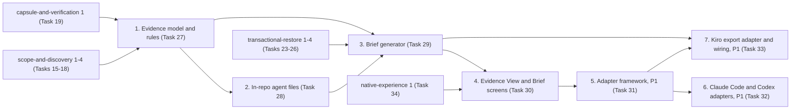

# Implementation Plan

- [ ] 1. Evidence model and rules (P06-T01, Task 27)
  - Depends on: `scope-and-discovery` tasks 1-4 (P03-T01..T04, Tasks 15-18) for grant Vfs, `FileIndex`, `ProjectRecord`, `GitSnapshot`, and the project commands
  - Depends on: `capsule-and-verification` task 1 (P04-T01, Task 19) for the CAP-2 sensitive-file classifier and the CAP-3 Secret detector
  - [ ] 1.1 Define the evidence model types
    - `Status`, `RuleId`, `FindingId`, `Finding`, `Span`, `EvidenceSource`, `EvidenceRef`, `GitObjectRef`, `StatRecord`, `DirAggregate`, `EvidenceResult`, `Diagnostic` in `crates/dormbit-core/src/evidence/model.rs`
    - ts-rs export to `packages/schema/generated`; Zod schemas in `packages/schema`; add them to the PROP-11 parity tests
    - _Requirements: 1.1, 1.7, 1.10_
  - [ ] 1.2 Build the rule registry and finding sink
    - `RuleSpec`, `FactRule`, `DerivedRule`, `RuleRegistry::{builder, core}` in `evidence/registry.rs`; `FindingSink::emit` in `evidence/sink.rs` with rule, status, evidence, and path validation and `RuleViolation` diagnostics
    - Finding ID = `"F-"` + first 12 hex of SHA-256 over rule ID and canonical sorted evidence; merge identical emissions; `IdCollision` diagnostic
    - Sort findings by section, rule order, and first evidence ref
    - _Requirements: 1.6, 1.8, 1.9, 11.2_
  - [ ] 1.3 Add the guarded read context and limits
    - `FactCtx` in `evidence/engine.rs`: `read_text` refuses Sensitive, gitignored, rebuildable, `.git/`, `.specstory/`, symlinks, files over `max_text_file_bytes`, and non-UTF-8; `stat` never follows symlinks; `files()` sorted by path; `redact()` uses the CAP-3 detector
    - `Limits` in `evidence/limits.rs` with the defaults from design.md
    - _Requirements: 5.5, 6.3, 7.3, 7.4, 10.5, 11.3, 11.4_
  - [ ] 1.4 Implement manifest, stack, and toolchain rules
    - `stack.manifest`, `stack.dependency`, `toolchain.file` (`.nvmrc` line 1, `rust-toolchain.toml` `channel` line, `package.json` `/engines/*`), `source.unsupported` on parse failure, in `evidence/rules/stack.rs` and `rules/toolchain.rs`
    - Stack detection table with React, Vite, TypeScript, Fastify, Drizzle
    - _Requirements: 4.1, 4.2, 4.4, 4.5, 4.6, 4.7_
  - [ ] 1.5 Implement documented-command rules
    - `cmd.documented` from `package.json` `/scripts/*` and from `sh`/`bash`/`shell`/`console`/`zsh` fences in root `README*` and `docs/**/*.md`; "listed, not run" in every statement; Secret detector redaction
    - Add the source-scan test that fails on `std::process` or `Command::new` in `dormbit-core`
    - _Requirements: 5.1, 5.2, 5.3, 5.4, 5.5_
  - [ ] 1.6 Implement Example env and sensitive-file rules
    - `env.example_key` (key name only, key as anchor), `env.example_skipped`, `sensitive.present` (file stat only) in `evidence/rules/env.rs`
    - The parser keeps only the key slice of each line; no value is bound to any variable that outlives the line
    - _Requirements: 6.1, 6.2, 6.4, 6.5_
  - [ ] 1.7 Implement TODO/FIXME and skipped-test rules
    - `work.todo` (whole word, case-sensitive, quote truncated to `max_quote_chars`), `work.skipped_test` with the marker list from Requirement 7.2, `scan.skipped_files`, `scan.truncated`
    - _Requirements: 7.1, 7.2, 7.3, 7.4, 7.5_
  - [ ] 1.8 Implement Git work-state rules
    - `git.uncommitted`, `git.branch`, `git.detached`, `git.wip_commit` (HEAD summary only), `git.stash`, `git.upstream` ("as of last fetch"), `git.absent`, all from `GitSnapshot` and the core ref reader; remotes only from `remotes_redacted`
    - _Requirements: 8.1, 8.2, 8.3, 8.5, 8.6, 8.7, 8.8, 8.9, 8.10_
  - [ ] 1.9 Implement identity, docs, and pre-run rules
    - `identity.name`, `docs.present`, `prerun.lifecycle_script` (`preinstall`, `install`, `postinstall`, `prepare`), `prerun.editor_autorun` (`.vscode/tasks.json` with comments stripped, `runOptions.runOn == "folderOpen"`), `prerun.git_risky_config` (GIT-1 keys, never values), `prerun.none`
    - _Requirements: 12.8, 12.9_
  - [ ] 1.10 Implement derived rules and standing findings
    - Derived: `stack.framework`, `git.feature_branch`, `work.area`; derived rules receive only Confirmed Findings and set evidence to the union of their sources
    - Fact: `unknown.pause_reason`, `unknown.builds`, `unknown.deploy_target` (file stat of root), `scan.partial` naming the bound hit
    - Review every rule template against Requirement 3.2 and 3.6 and list the templates in a test so a new template needs review
    - _Requirements: 3.1, 3.2, 3.3, 3.4, 3.5, 3.6, 4.3, 8.4, 11.1_
  - [ ] 1.11 Implement the evidence resolver
    - `resolve` and `excerpt` in `evidence/resolve.rs`; `GitLookup` over `GitSnapshot` plus the core ref reader; native `GitLookup` in `crates/dormbit-git`; `PATH_UNSAFE` via the RST-2 path validator; `NotAccessible` for revoked grants; no excerpt for agent store sources
    - _Requirements: 2.1, 2.2, 2.3, 2.4, 2.5, 2.6, 2.7, 2.8, 2.9_
  - [ ] 1.12 Write property test for evidence resolution
    - **Property 1: Every finding's evidence resolves, and every brief line cites an existing finding (PROP-12)** (findings half: every emitted reference resolves to `Resolved`)
    - Generators in `crates/dormbit-core/tests/support/gen.rs`; test in `crates/dormbit-core/tests/evidence_props.rs`
    - **Validates: Requirements 1.7, 2.2, 2.3, 2.4, 2.5**
  - [ ] 1.13 Write property test for finding shape
    - **Property 2: Findings are well formed**
    - **Validates: Requirements 1.1, 1.6, 1.7, 1.8, 1.9, 1.10**
  - [ ] 1.14 Write property test for evidence determinism
    - **Property 3: Evidence and briefs are deterministic** (evidence half, with shuffled Vfs listing order)
    - **Validates: Requirements 1.9, 11.2**
  - [ ]* 1.15 Write property test for derived findings and Standing Unknowns
    - **Property 4: Inferred findings come only from Confirmed findings, and Standing Unknowns are always present**
    - **Validates: Requirements 1.3, 3.3, 3.4, 3.5**
  - [ ] 1.16 Write property test for secret values and sensitive contents
    - **Property 5: Secret values and sensitive contents never leave the source**
    - Use `RecordingVfs` (`test-support` feature); generate values and sentinels at runtime; never commit them
    - **Validates: Requirements 2.6, 5.5, 6.2, 6.3, 14.8**
  - [ ] 1.17 Add Dockline golden findings and the CLI command
    - `crates/dormbit-core/tests/evidence_golden.rs` loads `fixtures/dockline/dockline-invoices.tar` into `MemVfs` with the sidecar Git snapshot and a fixed Clock; insta snapshot at `fixtures/golden/evidence/dockline.findings.snap`; assert zero diagnostics
    - `dormbit-cli evidence <path>` prints findings with status, rule ID, and `path:start-end`
    - _Requirements: 4.8, 7.6, 8.11_
  - [ ] 1.18 Checkpoint: run `cargo test -p dormbit-core` and `cargo test -p dormbit-cli` and record evidence with `scripts/evidence/run.sh`

- [ ] 2. In-repo agent files (P06-T02, Task 28)
  - Depends on: task 1
  - [ ] 2.1 Scaffold the `dormbit-agents` crate
    - `crates/dormbit-agents` with `#![forbid(unsafe_code)]`, dependency on `dormbit-core` only, feature `inrepo` (default) and empty feature `adapters`; `inrepo::rules()` registers into `RuleRegistry`
    - Extend the `std::process` source-scan test to this crate
    - _Requirements: 5.4, 10.6_
  - [ ] 2.2 Implement Kiro task counting
    - Pure `count_tasks` in `inrepo/kiro_tasks.rs` with fence tracking, top-level and indented checkbox patterns, optional `*`, CRLF handling; `KiroTasksRule` emits `kiro.tasks_progress`, `kiro.task_unchecked`, `kiro.subtasks_progress`, and `source.unsupported`
    - _Requirements: 9.1, 9.2, 9.3, 9.4, 9.5, 9.6, 9.7, 9.8_
  - [ ] 2.3 Write property test for task counting
    - **Property 8: Task counts match the checkbox lines**
    - **Validates: Requirements 9.1, 9.2, 9.5, 9.6, 9.7**
  - [ ] 2.4 Implement the steering-file rule
    - `kiro.steering` per `.kiro/steering/*.md`, quoting the front-matter `inclusion` value and citing its line, or a file stat when absent
    - _Requirements: 9.10_
  - [ ] 2.5 Implement the agent instruction rule
    - `agent.instructions` for `AGENTS.md`, `CLAUDE.md`, and files in `.cursor/rules/`: line count, up to `max_headings` H1/H2 headings quoted with their lines
    - _Requirements: 10.1, 10.2, 10.3_
  - [ ] 2.6 Implement the `.specstory/` metadata rule
    - `specstory.meta` built from `FileIndex` entries and `stat` only, filling `DirAggregate`; a test asserts zero `open` calls under `.specstory/` with `RecordingVfs`
    - _Requirements: 10.4, 10.5_
  - [ ] 2.7 Add fixture parsing tests and the Dockline task count
    - Small synthetic trees per parser in `crates/dormbit-agents/tests/inrepo.rs`; update `fixtures/golden/evidence/dockline.findings.snap` so it contains "3 of 7 tasks complete" for `.kiro/specs/pdf-export/tasks.md`
    - _Requirements: 9.9_
  - [ ] 2.8 Checkpoint: run `cargo test -p dormbit-agents` and `cargo test -p dormbit-core` and record evidence with `scripts/evidence/run.sh`

- [ ] 3. Brief generator (P06-T03, Task 29)
  - Depends on: task 1, task 2
  - Depends on: `transactional-restore` tasks 1-4 (P05-T01..T04, Tasks 23-26) for the `RestoreReport` behind the Verified content section and the files outcome
  - [ ] 3.1 Define the Brief model types
    - `Brief`, `BriefSection`, `BriefLine`, `SectionId`, `Outcomes` (`FilesOutcome`, `ContextOutcome`, `SessionOutcome::NotPerformed`, `BuildOutcome::UnknownNeverExecuted`) in `crates/dormbit-core/src/brief/model.rs`; ts-rs and Zod; PROP-11 parity
    - _Requirements: 12.1, 13.4, 13.5_
  - [ ] 3.2 Map restore reports to restore findings
    - `RestoreFacts` from the transactional-restore `RestoreReport`; `restore.verified`, `restore.not_restored`, `restore.git_match`, `restore.none` emitted through `FindingSink`, citing capsule `manifest.json` keys and a file stat of the restored root
    - _Requirements: 12.10, 13.2, 13.3_
  - [ ] 3.3 Build sections, next steps, and outcomes
    - `brief::generate` fills the 11 sections in BRF-1 order by rule section; next steps only from `kiro.task_unchecked`, `work.todo`, `work.skipped_test`, `git.uncommitted`, `git.stash`; `evidence_index` holds every Finding; context counts from the index
    - _Requirements: 12.2, 12.3, 12.4, 12.7, 12.11, 13.4, 13.5, 13.6_
  - [ ] 3.4 Implement untrusted-text escaping
    - `brief/escape.rs`: `escape_inline` (controls and line breaks to space, bidi controls to `\u{XXXX}`, `& < >` to entities, Markdown punctuation backslash-escaped) and `code_span` (longer backtick delimiter)
    - _Requirements: 14.1, 14.2, 14.3, 14.4, 14.5_
  - [ ] 3.5 Implement the Markdown renderer and citation checker
    - `brief/render.rs` and `brief/template.rs`: header, outcomes block with the BRF-2 wording, sections, evidence index table, `[F-…]` citations, `~` paths; `check_citations` against `TEMPLATE_LINES`
    - _Requirements: 12.5, 12.6, 12.12, 12.13, 13.1, 13.7_
  - [ ] 3.6 Write property test for brief citations
    - **Property 1: Every finding's evidence resolves, and every brief line cites an existing finding (PROP-12)** (brief half: `check_citations` passes on every generated brief)
    - **Validates: Requirements 12.3, 12.4, 12.6**
  - [ ] 3.7 Write property test for untrusted text
    - **Property 6: Untrusted text can't create markup**
    - **Validates: Requirements 14.1, 14.2, 14.3, 14.4, 14.5**
  - [ ] 3.8 Write property test for the four outcomes
    - **Property 7: The four outcomes are always separate and fixed**
    - **Validates: Requirements 13.1, 13.2, 13.3, 13.4, 13.5, 13.6, 13.7**
  - [ ]* 3.9 Write property test for brief determinism
    - **Property 3: Evidence and briefs are deterministic** (brief half)
    - **Validates: Requirements 12.12**
  - [ ] 3.10 Add golden Markdown snapshots
    - `fixtures/golden/brief/dockline-no-restore.md.snap`, `dockline-verified.md.snap`, and `hostile-text.md.snap` (insta); each test also runs `check_citations` and asserts zero diagnostics
    - Add `dormbit-cli brief <path> [--restore <id>]`
    - _Requirements: 12.2, 12.6, 13.1, 14.1_
  - [ ] 3.11 Implement the create-new export writer
    - Owner: rust-security (new write API in `dormbit-fs`)
    - `dormbit-fs::export::write_new_file` with cap-std, `create_new`, `sync_all`; `EXPORT_DEST_EXISTS`, `EXPORT_WRITE_FAILED`; never deletes
    - _Requirements: 15.3, 15.5, 15.6_
  - [ ] 3.12 Write property test for export
    - **Property 9: Export never overwrites**
    - **Validates: Requirements 15.3, 15.5, 15.7**
  - [ ] 3.13 Add the `brief_get` and `brief_export` commands
    - `apps/desktop/src-tauri/src/commands/brief.rs`; `brief_export` takes only IDs, opens the save dialog from Rust with default name `<project-slug>-resurrection-brief.md`, returns `CANCELLED` on cancel, writes the same bytes `brief_get` returns; logs IDs and counts only
    - Command tests with a mocked dialog for success, cancel, existing file, and failed write
    - _Requirements: 14.8, 15.1, 15.2, 15.4, 15.7, 17.2_
  - [ ]* 3.14 Write the brief into the restored project (BRF-3, P1)
    - Owner: rust-security (writes into the restore destination)
    - Depends on: `transactional-restore` task 4 (P05-T04, Task 26)
    - After the RST-4 re-hash of a Verified restore, create-new `RESURRECTION_BRIEF.md` (and, if opted in, `.kiro/steering/resurrection-brief.md` with `inclusion: manual`); record `added_files` or `not_written` in the `RestoreReport`; extend Property 9 to this write
    - _Requirements: 16.1, 16.2, 16.3, 16.4, 16.5, 16.6_
  - [ ] 3.15 Checkpoint: run `cargo test -p dormbit-core`, `cargo test -p dormbit-fs`, and `cargo test --workspace` and record evidence with `scripts/evidence/run.sh`

- [ ] 4. Evidence View and Brief screens (P06-T04, Task 30)
  - Depends on: task 3
  - Depends on: `native-experience` task 1 (P08-T01, Task 34) for Tabs, StatusPill, EvidenceChip, and state components
  - [ ] 4.1 Add the `evidence_get` command and evidence cache
    - `apps/desktop/src-tauri/src/commands/evidence.rs`: status filter, counts, diagnostics, `partial`, optional `findingId` detail with resolutions and excerpts; `SCOPE_DENIED` for unknown IDs; cache per project, cleared on rescan and on `scope_revoke`; logs IDs and counts only
    - _Requirements: 2.1, 2.10, 11.5, 14.8, 17.1_
  - [ ] 4.2 Add client methods and mocks
    - `evidenceGet`, `briefGet`, `briefExport` in `packages/client` (`DormbitClient`, `TauriClient`, `MockClient` with Dockline data); Zod validation on every response
    - _Requirements: 17.2, 17.3_
  - [ ] 4.3 Build the Evidence tab
    - Finding list (TanStack Virtual) with status text label, rule ID, statement as text nodes, `path:start-end` refs; status filter with counts; detail pane with resolution labels and excerpt with line numbers
    - _Requirements: 14.6, 17.4, 17.5, 17.6_
  - [ ] 4.4 Show Kiro task progress in the Overview tab
    - Render the `kiro.tasks_progress` statement with a citation control that opens the Finding
    - _Requirements: 17.7_
  - [ ] 4.5 Build the Brief screen
    - Outcomes, sections, evidence index; citation controls that open the Finding in the Evidence View; react-markdown with no raw HTML plugin; Export button handling the saved path, `CANCELLED`, and `EXPORT_DEST_EXISTS`
    - _Requirements: 14.7, 17.8, 17.9_
  - [ ] 4.6 Add states and accessibility
    - Loading, empty, error, and partial states on both screens; keyboard access; VoiceOver labels; status never shown by color alone
    - _Requirements: 17.10, 17.11_
  - [ ] 4.7 Write component tests
    - Vitest and Testing Library for filters, detail, Overview progress, Brief citations and export outcomes, Zod rejection, and a hostile-text test asserting no `img`, `script`, `iframe`, or `javascript:` link is created
    - _Requirements: 14.6, 14.7, 17.3, 17.5, 17.9_
  - [ ] 4.8 Checkpoint: run `pnpm -r test` and `cargo test --workspace` and record evidence with `scripts/evidence/run.sh`

- [ ]* 5. Adapter framework (P1) (P07-T01, Task 31)
  - Depends on: tasks 1-4
  - Property tests inside this task are required whenever this task is done
  - [ ] 5.1 Store consent records and add `consent_set`
    - `ConsentRecord` in `consent.json` under Application Support via the `dormbit-fs` atomic writer; `consent_set` grant and revoke; revoke calls `scope_revoke` on the linked grant and clears adapter caches and `adapter.*` Findings
    - _Requirements: 18.2, 18.6, 18.7_
  - [ ] 5.2 Add the agent store grant kind
    - Owner: rust-security (scope registry)
    - Depends on: `scope-and-discovery` task 1 (P03-T01, Task 15)
    - `AgentStore` grant kind linked to an adapter ID; `scope_pick` with `kind: "AgentStore"` returns `SCOPE_DENIED` without consent; discovery and the evidence engine reject this kind
    - _Requirements: 18.3, 18.4, 18.5_
  - [ ] 5.3 Implement `GuardedStore`
    - `crates/dormbit-agents/src/adapters/guard.rs`: deny-list check before allowlist check before the inner read-only Vfs; no symlink following; `AdapterLimits` with documented defaults
    - _Requirements: 19.1, 19.4, 19.5, 19.6, 19.7_
  - [ ] 5.4 Define the adapter trait and metadata-only parsing
    - `Adapter`, `FormatSpec`, `SessionRef`, `AdapterOutput`; a shared JSONL line reader that parses into allowlist structs with `IgnoredAny` and reuses one cleared buffer; findings cite file stats only; `~` display paths
    - _Requirements: 19.2, 19.3, 19.8, 19.9_
  - [ ] 5.5 Add `adapters_list` and format reporting
    - `apps/desktop/src-tauri/src/commands/agents.rs`; formats table from design.md, including Kiro local store and Cursor history as Unsupported; `adapter.format_unsupported` Findings
    - _Requirements: 20.1, 20.2, 20.3, 20.4_
  - [ ] 5.6 Build the Settings consent UI
    - Consent text (fields read, never message content or credential files, not resumed by DORMBIT) shown before the picker; per-adapter toggle; revoke
    - _Requirements: 18.8_
  - [ ] 5.7 Write property test for credential and unsupported files
    - **Property 11: Credential files and unsupported files are never opened (P1)**
    - **Validates: Requirements 19.4, 19.5, 19.6**
  - [ ] 5.8 Write property test for consent gating
    - **Property 12: No consent, no reads; never any writes (P1)**
    - **Validates: Requirements 18.1, 18.4, 18.6, 18.7, 19.1**
  - [ ] 5.9 Checkpoint: run `cargo test -p dormbit-agents --features adapters`, `cargo test --workspace`, and `pnpm -r test` and record evidence with `scripts/evidence/run.sh`

- [ ]* 6. Claude Code and Codex adapters (P1) (P07-T02, Task 32)
  - Depends on: task 5
  - Property tests inside this task are required whenever this task is done
  - [ ] 6.1 Add the Keys_Probe
    - `dormbit-cli agents keys-probe <file>` prints `key.path<TAB>type<TAB>count`, never values; development agents run it only on synthetic fixtures
    - _Requirements: 25.1, 25.2, 25.3_
  - [ ] 6.2 Write property test for the Keys_Probe
    - **Property 14: The Keys_Probe prints no values (P1)**
    - **Validates: Requirements 25.1, 25.2**
  - [ ] 6.3 Confirm Claude Code field names
    - Check official Claude Code documentation for the session JSONL field names (working directory, timestamp, Git branch, tool version); record links in `docs/product/research.md`; if not documented, ask the user to run the Keys_Probe on a file of their own and share only its output; until then the format stays Unsupported
    - _Requirements: 22.3_
  - [ ] 6.4 Implement the Claude Code adapter
    - `adapters/claude_code.rs`: `<project>/<session>.jsonl` under the grant's `projects` folder; session ID from the file stem; cwd matched to project roots after NFC; `subagents/` and settings never opened; unmatched count in `adapters_list`
    - _Requirements: 22.1, 22.2, 22.4, 22.7, 22.8_
  - [ ] 6.5 Add the retention note
    - Derived `adapter.claude_code.retention` ("context at risk", documented 30-day default) and Unknown `adapter.claude_code.retention_setting`
    - _Requirements: 22.5, 22.6_
  - [ ] 6.6 Implement the Codex adapter
    - `adapters/codex.rs`: grant root as `CODEX_HOME`; confirm `history.jsonl` and session layouts from official Codex docs and record links in `docs/product/research.md`; parse only confirmed formats with the shared allowlist reader; otherwise report Unsupported and open nothing; never open `auth.json`
    - _Requirements: 23.1, 23.2, 23.3, 23.4, 23.5_
  - [ ] 6.7 Add synthetic stores and goldens
    - Generators in `crates/dormbit-agents/tests/support/synthetic.rs` (in memory or temp folders only); golden `fixtures/golden/agents/dockline-claude-code.snap` from the Dockline fixture's synthetic store
    - _Requirements: 19.10_
  - [ ] 6.8 Write property test for message content
    - **Property 10: No message content appears in adapter output (P1)** (JSONL stores)
    - **Validates: Requirements 19.2, 19.3**
  - [ ] 6.9 Write property test for credential files in Claude Code and Codex stores
    - **Property 11: Credential files and unsupported files are never opened (P1)** (with `~/.claude`- and `~/.codex`-shaped synthetic trees)
    - **Validates: Requirements 22.7, 23.4**
  - [ ] 6.10 Show session metadata in the Agent context tab
    - Session rows with session ID, `~` working directory, timestamps, branch, tool version, and the label "not resumed by DORMBIT"; no resume, open, or replay action
    - _Requirements: 21.1, 21.3_
  - [ ] 6.11 Checkpoint: run `cargo test -p dormbit-agents --features adapters`, `cargo test -p dormbit-cli`, and `pnpm -r test` and record evidence with `scripts/evidence/run.sh`

- [ ]* 7. Kiro export adapter and wiring (P1) (P07-T03, Task 33)
  - Depends on: task 5, task 3
  - Property tests inside this task are required whenever this task is done
  - [ ] 7.1 Approve a zip reader dependency
    - The `architect` agent writes an ADR choosing a pinned zip reader with no network or filesystem side effects; check it with cargo-deny; if none is approved, keep the Kiro export format Unsupported and stop this task
    - _Requirements: 24.2, 24.3_
  - [ ] 7.2 Confirm `session.json` field names
    - Check Kiro's chat export documentation; record links in `docs/product/research.md`; if fields aren't documented, ask the user to run the Keys_Probe on an export of their own; until then the format stays Unsupported
    - _Requirements: 24.4_
  - [ ] 7.3 Implement the Kiro export adapter
    - `adapters/kiro_export.rs`: top-level `*.zip` only; exact entry name `session.json`; size and ratio checks before and during decompression; no other entry decompressed; entry names never used as paths; Kiro local storage never read
    - _Requirements: 24.1, 24.2, 24.3, 24.5, 24.6_
  - [ ] 7.4 Wire session references into the brief
    - Attached `adapter.session` Findings go to Context references with "not resumed by DORMBIT"; update `fixtures/golden/brief/dockline-verified.md.snap` and add `fixtures/golden/agents/dockline-kiro-export.snap`
    - _Requirements: 21.2, 24.7_
  - [ ] 7.5 Write property test for zip contents
    - **Property 10: No message content appears in adapter output (P1)** (Kiro export zips)
    - **Validates: Requirements 24.2**
  - [ ] 7.6 Write property test for session labels
    - **Property 13: Session references are always labeled (P1)**
    - **Validates: Requirements 13.4, 21.1, 21.2, 24.7**
  - [ ] 7.7 Add fixture zip tests
    - A fixture zip with valid `session.json`, one whose `session.json` declares a size over `max_entry_bytes`, one whose header understates its size, and one with traversal-style entry names; each has an expected Supported or Unsupported result
    - _Requirements: 24.3, 24.5_
  - [ ] 7.8 Checkpoint: run `cargo test -p dormbit-agents --features adapters`, `cargo test --workspace`, and `pnpm -r test` and record evidence with `scripts/evidence/run.sh`

## Task Dependency Graph



Waves run in order; tasks in the same wave can run in parallel. Waves 4 and 5 are P1 and are cut first when behind.

```json
{
  "waves": [
    { "id": 0, "tasks": ["1"] },
    { "id": 1, "tasks": ["2"] },
    { "id": 2, "tasks": ["3"] },
    { "id": 3, "tasks": ["4"] },
    { "id": 4, "tasks": ["5"] },
    { "id": 5, "tasks": ["6", "7"] }
  ]
}
```
