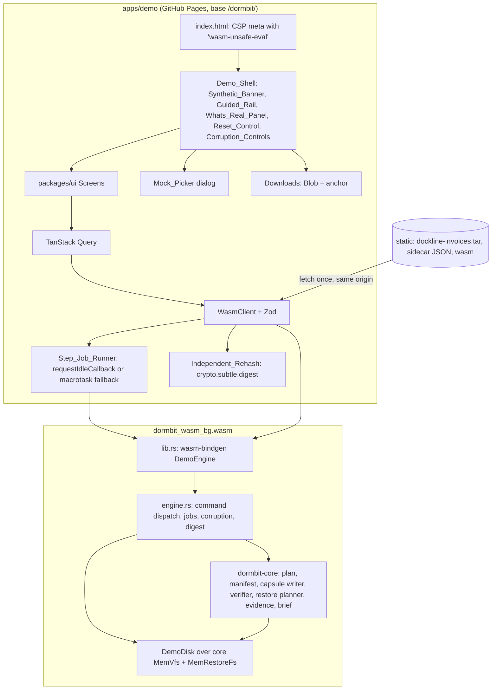

# Design Document

## Overview
The judge demo is a static web app (`apps/demo`) that runs the real DORMBIT core in the browser. `dormbit-core` is compiled to `wasm32-unknown-unknown` inside the `dormbit-wasm` crate, which adds an in-memory filesystem (MemVfs), step jobs, demo-only controls (corruption, reset, downloads), and wasm-bindgen bindings. A `WasmClient` implements the same `DormbitClient` interface as `TauriClient`, so the demo shows the same `packages/ui` Screens as the native app. WebCrypto re-hashes restored files and the capsule as an independent check.

ADR-001 recorded the go decision: all core dependencies compile for wasm32, a capsule-shaped tar had identical bytes natively and in WebAssembly, and WebCrypto matched the Rust digest. The wasm build was 1.24 MB raw, 780 KB after `wasm-opt -Oz`, and 330 KB gzipped.

Design rules:
- **Truthful by construction.** Every hash, count, and verdict on screen comes from computation on bytes in memory. Anything precomputed (Git snapshot, agent metadata), mocked (folder picker), fixed (clock), or paced is labeled in the Whats_Real_Panel.
- **Nothing leaves the tab.** No sign-in, no analytics, no storage APIs, no requests beyond the demo's own static assets. Reload and Reset both give the Pristine state.
- **Same contract as native.** WasmClient passes the shared client contract suite, and PROP-10 holds the wasm capsule bytes to the native golden bytes.

## Architecture



**Crate layout (`crates/dormbit-wasm/`)**
- `src/lib.rs`: the wasm-bindgen surface (`DemoEngine`). Thin. Converts JSON in and out.
- `src/engine.rs`: plain Rust. Command dispatch to `dormbit-core`, job table, corruption controls, State digest, golden capture. Compiles natively too, so Rust tests and the PROP-10 corpus generator call it directly.
- `src/demo_disk.rs`: demo controls over the core's in-memory filesystem (volume info, byte flips, the pending fault, canonical digest).
- `src/fixture.rs`: loads the Dockline tar and Sidecar into MemVfs and checks expected hashes.
- `tests/`: native unit tests, the 12-step headless flow, and the PROP-10 corpus generator.

Dependencies stay within the ADR-001 set plus what `dormbit-core` already uses (`serde`, `serde_json`, `tar`). JSON strings cross the wasm boundary, so no `serde-wasm-bindgen` or `js-sys` is needed. Any new dependency must pass `cargo build --target wasm32-unknown-unknown` before merging (ADR-001).

**Ownership.** `crates/dormbit-wasm` is written by `rust-security`, the only agent that can write `crates/**` (master plan §10). `apps/demo` and `packages/**` are written by `frontend`. `.github/workflows/pages.yml` is written by `release`. Tests and evidence are written by `qa`.

## Components and Interfaces

### MemVfs and DemoDisk (`crates/dormbit-wasm/src/demo_disk.rs`)
The demo doesn't define its own filesystem. It reuses the core's in-memory implementations:
- `MemVfs` (`crates/dormbit-core/src/vfs/mem.rs`, defined by scope-and-discovery) implements the read-only `ReadVfs` trait used by the walker, planner, writer's source reads, and verifier.
- `MemRestoreFs` (in `dormbit-core`, defined by transactional-restore) implements the `RestoreFs` write trait: create-new files and directories, `RENAME_EXCL`-style commit, and staging removal that requires an `OwnerTokenProof`.

In this spec, "MemVfs" means both over one shared in-memory tree. If the two core types can't share a tree as defined, Task 38 adds the smallest adapter that makes them share one, in `dormbit-core` and reviewed with transactional-restore. `dormbit-wasm` adds only the demo controls:

```rust
pub struct DemoDisk {
    fs: SharedMemTree,                // the tree behind MemVfs and MemRestoreFs
    capacity: u64,                    // fixed, larger than the dataset (Req 3.4)
    pending_fault: Option<PendingFault>,
}

pub struct ByteChange { pub capsule_offset: u64, pub region: Region, pub old: u8, pub new: u8 }
pub enum Region { Object { manifest_path: String }, Marker, Header, Manifest, Padding, Trailer, EndOfArchive }

impl DemoDisk {
    pub fn from_tar(bytes: &[u8], root: &RelPath) -> Result<Self, DormbitError>;
    pub fn volume_info(&self) -> VolumeInfo;   // case-insensitive, exclusive rename supported, free = capacity - used
    pub fn flip_byte(&mut self, path: &RelPath, offset: u64, xor: u8) -> Result<(u8, u8), DormbitError>;
    pub fn arm(&mut self, fault: PendingFault);
    pub fn canonical_digest(&self) -> [u8; 32];
}
```
- Exclusive rename fails with `RESTORE_DEST_EXISTS` when the target, or a case or NFC variant of it, exists. Lookups are case-insensitive and NFC-insensitive while names are stored as written, which matches the default APFS behavior that RST-1 and RST-2 guard against.
- `from_tar` accepts only directory, regular-file, and symlink entries, and rejects absolute paths, `..`, NUL, and duplicate names. The fixture is ours, but the loader still treats it as input.
- `flip_byte` requires `xor != 0`, so every control changes the byte.

### DemoEngine (`crates/dormbit-wasm/src/lib.rs`)

```rust
#[wasm_bindgen]
pub struct DemoEngine { inner: engine::Engine }

#[wasm_bindgen]
impl DemoEngine {
    /// Loads the tar and Sidecar into a fresh MemVfs. Errors are DormbitError JSON.
    #[wasm_bindgen(constructor)]
    pub fn new(fixture_tar: &[u8], sidecar_json: &str) -> Result<DemoEngine, JsValue>;

    /// One §6 command. `args_json` and the result use the same JSON shapes as the Tauri commands.
    /// `fresh_ids_json` is an array of host-generated UUIDs (crypto.randomUUID()) the core's IdGen may use.
    pub fn call(&mut self, command: &str, args_json: &str, fresh_ids_json: &str) -> Result<String, JsValue>;

    /// Advances a job by one work budget. Returns a JSON array of JobEvent values.
    /// Maps to the core's `Budget { max_bytes, max_ops }` (capsule-and-verification design).
    pub fn job_step(&mut self, job_id: &str, max_bytes: u32, max_ops: u32) -> Result<String, JsValue>;

    pub fn capsule_bytes(&self, capsule_id: &str) -> Result<Vec<u8>, JsValue>;
    pub fn restored_files(&self, op_id: &str) -> Result<String, JsValue>;            // [{rel_path, sha256}]
    pub fn restored_file_bytes(&self, op_id: &str, rel_path: &str) -> Result<Vec<u8>, JsValue>;

    /// control: "stored_file" | "capsule_bytes" | "after_verification". `offset_seed` and `xor` come from crypto.getRandomValues.
    pub fn corrupt(&mut self, control: &str, capsule_id: &str, target_json: &str, offset_seed: u32, xor: u8) -> Result<String, JsValue>;  // ByteChange JSON

    pub fn state_digest(&self) -> String;                                           // hex SHA-256

    /// PROP-10: capture with the Golden inputs and return the capsule bytes.
    pub fn golden_capture(fixture_tar: &[u8], sidecar_json: &str, golden_inputs_json: &str) -> Result<Vec<u8>, JsValue>;
    /// PROP-10 corpus replay: capture an arbitrary generated tree and plan.
    pub fn capture_tree(input_json: &str) -> Result<Vec<u8>, JsValue>;
}
```

Command coverage in the demo:

| §6 command | Demo behavior |
|---|---|
| `app_info` | version plus `build: "wasm"` |
| `scope_pick`, `restore_target_pick`, `capsule_pick` | resolve the Virtual path the Visitor chose in the Mock_Picker into a grant or capsule reference |
| `scope_list`, `scope_revoke` | in-memory grants |
| `discovery_start`, `discovery_cancel` | real walker over MemVfs, as a job |
| `projects_list`, `project_get`, `project_set_dormant` | real; Git snapshot taken from the Sidecar |
| `evidence_get` | real evidence rules over MemVfs, with Git and agent facts from the Sidecar |
| `plan_create`, `plan_set_decision`, `plan_approve` | real |
| `capture_start`, `verify_start`, `restore_start`, `job_cancel` | real, as step jobs |
| `restore_precheck` | real, using `MemVfs::volume_info` |
| `restore_recover` | real journal check; after Reset or reload there is never anything to recover |
| `brief_get`, `brief_export` | real; `brief_export` returns Markdown text for the download |
| `settings_get`, `settings_set` | fixed demo defaults, kept in memory |
| `consent_set`, `adapters_list` | synthetic adapter entries from the Sidecar, marked precomputed |

### Damage after verification
The control must show the journey-6 path: damage after verification is caught during restore, the restore rolls back, and the destination is never created. If the bytes changed right away, the restore pre-check could catch them first. So `corrupt("after_verification", ...)` stores a `PendingFault` (capsule, object, offset, xor) and returns the planned ByteChange. `restore_start` applies the flip to the capsule bytes in MemVfs after pre-checks pass and before the executor reads that object. The executor's re-hash then fails with `CAPSULE_HASH_MISMATCH`, the journal rolls back, and the staging folder is removed. The Demo_Shell describes this as "a byte changes on the virtual disk after verification, while the restore runs".

### Offsets for the other controls
- **Damage a stored file:** the Visitor picks a captured file (default `src/pdf/renderInvoice.ts`). The engine maps `offset_seed` into that object's stored data range in the capsule and flips one byte.
- **Damage capsule bytes:** the engine maps `offset_seed` onto every capsule byte outside object data (marker, tar headers, manifest, padding, trailer, end-of-archive blocks) and flips one byte. PROP-3 (capsule-and-verification) says any single-byte flip fails verification, so every offset in this region must be rejected.

### WasmClient (`apps/demo/src/client/WasmClient.ts`)

```ts
export class WasmClient implements DormbitClient {
  constructor(
    private engine: () => DemoEngine,                       // current instance; replaced on Reset
    private picker: MockPicker,                             // opens the Mock_Picker, resolves a Virtual path or null
    private runner: StepJobRunner,
  ) {}

  private call<T>(command: DemoCommand, args: object, schema: z.ZodType<T>): T {
    let raw: string;
    try {
      raw = this.engine().call(command, JSON.stringify(args), JSON.stringify(freshIds(8)));
    } catch (e) {
      throw parseEngineError(e);                            // DormbitError JSON, or a fatal error for a wasm trap
    }
    const parsed = schema.safeParse(JSON.parse(raw));
    if (!parsed.success) throw clientError('IPC_SCHEMA_MISMATCH');
    return parsed.data;
  }

  async scopePick(kind: ScopeKind) {
    const choice = await this.picker.open({ kind });        // labeled mock dialog (Req 5.1)
    return choice ? this.call('scope_pick', { kind, virtual_path: choice }, schemas.ScopeGrant) : null;
  }
  // ...every other DormbitClient method maps to call() or runner.start()
}

const freshIds = (n: number) => Array.from({ length: n }, () => crypto.randomUUID());
```
- WasmClient uses the same Zod schemas and the same `IPC_SCHEMA_MISMATCH` client code as TauriClient (native-experience design).
- A wasm trap (a Rust panic surfaces as a `WebAssembly.RuntimeError`) is treated as fatal. The Demo_Shell shows an error state with Reset, because the engine instance may be inconsistent.
- WasmClient runs `runClientContract` from `packages/client`.

### Step_Job_Runner (`apps/demo/src/jobs/runner.ts`)

```ts
type WorkBudget = { maxBytes: number; maxOps: number };

export function runJob<R>(engine: DemoEngine, jobId: string, onEvent: JobListener<R>, signal: AbortSignal,
                          budget: WorkBudget = DEFAULT_BUDGET): Promise<{ result: R; realElapsedMs: number }>;

const schedule: (cb: (d: { timeRemaining(): number; didTimeout: boolean }) => void) => void =
  typeof requestIdleCallback === 'function'
    ? (cb) => { requestIdleCallback(cb, { timeout: IDLE_TIMEOUT_MS }); }
    : (cb) => { const ch = new MessageChannel(); ch.port1.onmessage = () => cb(sliceDeadline(FALLBACK_SLICE_MS)); ch.port2.postMessage(0); };
```
- Each callback calls `engine.job_step(jobId, budget.maxBytes, budget.maxOps)` while time remains, parses the events with Zod, and forwards them.
- The budget is counted in bytes and operations, not time. The core's clock is the fixed demo clock, so the core can't measure time; the runner owns time slicing.
- WebKit doesn't expose `requestIdleCallback` in all versions, and Node doesn't have it, so the macrotask fallback is a required path and is tested.
- On `signal` abort (Cancel or Reset) the runner stops scheduling and calls `job_cancel`; the engine reports `CANCELLED`.
- `realElapsedMs` is `performance.now()` at the final event minus `performance.now()` at the first `job_step` call. It is wall time and excludes Pacing, which the UI applies afterwards.
- `DEFAULT_BUDGET`, `IDLE_TIMEOUT_MS`, and `FALLBACK_SLICE_MS` are set in Task 38 from measurements and recorded in the evidence log.

### Pacing (`apps/demo/src/shell/Paced.tsx`)
Pacing only delays when a state is displayed. It holds each capture, verify, or restore state on screen for at least `MIN_STATE_DISPLAY_MS`. The values shown for each state (counts, hashes) are the real ones recorded when that state happened. Each paced step shows "Paced for readability. Real time: N ms" using `realElapsedMs`. Under reduced motion, Pacing still applies but nothing animates.

### Independent_Rehash (`apps/demo/src/rehash.ts`)

```ts
export async function sha256Hex(bytes: Uint8Array): Promise<string> {
  const digest = await crypto.subtle.digest('SHA-256', bytes);
  return [...new Uint8Array(digest)].map(b => b.toString(16).padStart(2, '0')).join('');
}

export async function rehashRestore(engine: DemoEngine, opId: string): Promise<RehashRow[]>;   // per file: rust, webcrypto, match
export async function rehashCapsule(engine: DemoEngine, capsuleId: string, rustFileSha256: string): Promise<RehashRow>;
```
`crypto.subtle` needs a secure context. GitHub Pages serves HTTPS, and tests run on `localhost`. If `crypto.subtle` is missing, the Demo_Shell shows the unsupported-browser state (Requirement 16.4).

### Demo_Shell and routes (`apps/demo/src/`)
React Router hash routes, so GitHub Pages serves every step URL from `index.html` with no rewrites.

| Step | Route | Content |
|---|---|---|
| 1 | `#/step/1-discover` | Mock_Picker, then Shelf with discovery progress |
| 2 | `#/step/2-details` | Evidence View, Overview tab |
| 3 | `#/step/3-inspect` | Evidence View, Evidence tab: stack findings and the unfinished PDF export |
| 4 | `#/step/4-plan` | Preservation Plan |
| 5 | `#/step/5-approve` | Preservation Plan summary rail and Approve |
| 6 | `#/step/6-capture` | Capsule Creation |
| 7 | `#/step/7-verify` | Integrity Verification with the WebCrypto capsule re-hash |
| 8 | `#/step/8-restore` | Restore Wizard against `demo:/Restores` (refused collision, then a new name), then Restoration Result |
| 9 | `#/step/9-independent` | Independent check: per-file Rust vs WebCrypto table, HEAD and refs check, working-tree check marked not run in browser |
| 10 | `#/step/10-brief` | Resurrection Brief and brief download |
| 11 | `#/step/11-corrupt` | Corruption_Controls |
| 12 | `#/step/12-observe` | The resulting VerificationReport or Restoration Result, then Reset |

`#/` redirects to `#/step/1-discover`. A route to a locked step redirects to the first step not done (Requirement 8.3). The capsule download is available from step 7 on.

Layout:
- **Synthetic_Banner:** a `role="region"` landmark labeled with its text. It is `position: sticky; top: 0`. Modal overlays start below the banner height (`top: var(--banner-height)`), so dialogs never cover it. The Mock_Picker's own text also says the folders are virtual, because a modal makes the rest of the page inert for assistive technology.
- **Guided_Rail:** a left column at desktop widths. Below the breakpoint it collapses into a step menu showing "Step N of 12: Title". Each step shows done, current, or locked with a glyph and label.
- **Whats_Real_Panel:** a Sheet opened from the header, also linked from the first step.
- **Reset_Control:** a header button, always reachable, with a confirmation Dialog.

Whats_Real_Panel content:

| Real (runs in this tab) | Precomputed, mocked, or fixed |
|---|---|
| Discovery walker, evidence rules, plan, capsule writer, verifier, restore pre-checks and executor, brief: `dormbit-core` compiled to WebAssembly | Files: synthetic Dockline Invoices, in browser memory only |
| SHA-256 in Rust (`sha2`) and separately in WebCrypto | Folder picker: a mock that lists virtual folders |
| Git HEAD and refs check after restore (core ref reader) | Git snapshot: precomputed from the fixture repo, because git2 runs natively only |
| Corruption: real byte changes in memory, caught by the real verifier and restore | Agent metadata: precomputed synthetic records |
| | Clock: fixed demo clock; IDs: `crypto.randomUUID()` |
| | Working-tree status check: native only, not run here |
| | Pacing: the steps marked "paced", with their real time shown |

### Downloads (`apps/demo/src/download.ts`)
`new Blob([bytes])`, `URL.createObjectURL`, a temporary `<a download>` clicked once, then `URL.revokeObjectURL`. File names: `dockline-invoices.dormbit`, `dockline-invoices-DAMAGED.dormbit` after a Corruption_Control, and `dockline-invoices-brief.md`. Nothing is written without a click.

### Reset (`apps/demo/src/shell/reset.ts`)
1. Abort every running job through its `AbortSignal`.
2. Call `free()` on the current `DemoEngine` and build a new one from the tar and Sidecar bytes kept in memory since first load (no network request).
3. Clear the TanStack Query cache, pacing timers, the rail progress, and any object URLs.
4. Record the new `state_digest()` and compare it with the digest recorded at first load. A mismatch shows an error state; it would mean state leaked through module-level storage.

### Static assets and build (`apps/demo/vite.config.ts`, `scripts/build-wasm.sh`)
- `scripts/build-wasm.sh`: `cargo build -p dormbit-wasm --target wasm32-unknown-unknown --release`, then `wasm-bindgen --target web --out-dir apps/demo/src/wasm/pkg`, then `wasm-opt -Oz`. The `pkg` folder is build output and is gitignored.
- The Vite config sets `base: '/dormbit/'` and copies `fixtures/dockline/dockline-invoices.tar` and the Sidecar into the build output at build time, so the committed fixture stays the single source.
- The wasm module loads with `init(new URL(..., import.meta.url))`. GitHub Pages serves `.wasm` as `application/wasm`, so streaming compilation works; `init` falls back to `ArrayBuffer` compilation otherwise.
- `apps/demo/index.html` carries the CSP meta tag:

```html
<meta http-equiv="Content-Security-Policy"
      content="default-src 'self'; script-src 'self' 'wasm-unsafe-eval'; style-src 'self'; img-src 'self' data: blob:; font-src 'self'; connect-src 'self'; object-src 'none'; base-uri 'self'; form-action 'none'">
```
`frame-ancestors` is ignored in a meta tag and GitHub Pages can't set headers, so framing can't be blocked. The demo has no sign-in or private data, so the impact is low (see Security Considerations). The CSP applies to the production build; E2E runs against `vite preview` of that build, not the dev server.

### Pages workflow (`.github/workflows/pages.yml`, owner: release)
- Triggers: push to `main` and `workflow_dispatch`.
- Permissions: `contents: read`, `pages: write`, `id-token: write`.
- Build job: checkout; Rust from `rust-toolchain.toml` with the `wasm32-unknown-unknown` target; `wasm-bindgen-cli` 0.2.130; binaryen; Node 24 and pnpm from `.mise.toml`; `pnpm install --frozen-lockfile`; `scripts/build-wasm.sh`; `pnpm --filter ./apps/demo build`; upload `apps/demo/dist` as the Pages artifact.
- Deploy job: `actions/deploy-pages`. Third-party actions are pinned to full commit SHAs.
- Smoke job: Playwright against the deployed URL: banner visible, step 1 completes.
- The footer shows the short commit SHA and "Preview" until the release-and-submission spec promotes it.

## Data Models

**Sidecar** (written by the foundation generator, read by `fixture.rs`). Fields the demo depends on:
```ts
type Sidecar = {
  schema_version: number;
  fixture_sha256: string;                         // SHA-256 of dockline-invoices.tar
  demo_clock: string;                             // fixed RFC 3339 timestamp
  git_snapshot: GitSnapshot;                      // master plan §8 shape
  agent_metadata: { claude_code: SessionMeta[]; kiro_export: SessionMeta[] };   // metadata only
  expected_hashes: Record<RelPath, string>;       // per-file SHA-256
};
```

**Golden inputs** (from capsule-and-verification task 2):
```ts
type GoldenInputs = { clock: string; ids: string[]; decisions: Record<RelPath, 'include' | 'exclude'>; acks: Ack[] };
```

**Demo state** (inside `engine::Engine`): MemVfs, scope grants, project records, plans and approvals, capsule registry, VerificationReports, restore journals and reports, job table, pending fault. `state_digest()` hashes a canonical encoding: MemVfs nodes sorted by path (path, kind, mode, bytes or target), then each table sorted by ID, with the `IdGen`-assigned IDs replaced by their sequence numbers so two engines that did the same work compare equal.

**ByteChange** (returned by `corrupt`): `{control, capsule_offset, region, manifest_path?, old, new}`.

**RehashRow**: `{rel_path, rust_sha256, webcrypto_sha256, match}`.

**JobEvent**, **DormbitError**, **VerificationReport**, **RestoreReport**, **Brief**: the master plan §8 shapes via `packages/schema`.

## Correctness Properties

### Property 1: WebAssembly capsule bytes equal native bytes (PROP-10)
*For any* input tree and approved plan in the generated corpus, and for the Dockline fixture under the Golden inputs, the capsule bytes produced by the Wasm_Core equal the bytes produced by the native build for the same input, byte for byte, including length.
**Validates: Requirements 21.1, 21.2, 21.3, 21.4**

### Property 2: Reset returns to the Pristine state and is idempotent
*For any* sequence of demo actions (grant, discover, set decisions, approve, start and cancel jobs, capture, verify, refused and successful restores, any Corruption_Control), applying Reset gives a State digest equal to the first-load digest, an empty query cache, and the rail at step 1; applying Reset again gives the same digest.
Justification: Reset is how a judge repeats a test. Any leftover state (a pending fault, a staging folder, a cached VerificationReport) would make the next run show a result that the fresh demo would not. The property is checked at the app level as well as the engine level, because the riskiest leaks are JS-side caches and module-level state that survive a new engine instance.
**Validates: Requirements 12.2, 12.3, 12.4, 12.5, 15.4**

### Property 3: Every single-byte corruption control is rejected
*For any* Corruption_Control, any `offset_seed`, and any non-zero `xor`, applied to a verified Dockline capsule: after Damage a stored file or Damage capsule bytes, verification reports Failed and `restore_start` is refused; after Damage after verification, the restore fails, the destination folder does not exist, no staging folder remains, every pre-existing MemVfs node is unchanged, and the report shows 0 writes outside the destination.
Justification: the demo invites judges to break capsules. One accepted offset would be a false public claim. This applies PROP-3 (capsule-and-verification) and PROP-5 (transactional-restore) to the exact capsule and controls the demo ships.
**Validates: Requirements 11.3, 11.4, 11.5, 11.6, 11.7, 11.8, 11.9, 11.10**

### Property 4: Shown hashes agree with WebCrypto
*For any* byte string written into MemVfs, and for every restored file and capsule in a demo run, the hex SHA-256 the Wasm_Core reports equals the hex SHA-256 from `crypto.subtle.digest`.
Justification: the demo's claim of an independent check depends on two separate implementations agreeing, and on the hex encoding and byte selection on both sides being right. A disagreement on good data would make the check useless.
**Validates: Requirements 6.1, 6.2, 6.3, 13.2**

## Error Handling

| Situation | Code or state | What the Visitor sees |
|---|---|---|
| Tar or Sidecar fetch or parse fails | load error state | "The synthetic dataset didn't load" with the cause; step 1 not started; Retry reloads the page |
| Expected hash differs at load | load error state | the first mismatching Virtual path; step 1 not started |
| No WebAssembly or no `crypto.subtle` | unsupported state | which feature is missing; no step started |
| Restore into existing folder or case variant | `RESTORE_DEST_EXISTS` | pre-check row Failed, Error_Presenter copy, name Field focused |
| Damaged capsule verified | `CAPSULE_HASH_MISMATCH`, `CAPSULE_MALFORMED`, or `CAPSULE_TRUNCATED` | Failed report naming the damaged file or region; restore Start disabled |
| Damage after verification during restore | `CAPSULE_HASH_MISMATCH` | Restoration Result: rolled back, destination not created, 0 writes outside destination |
| Cancel or Reset during a job | `CANCELLED` | cancelled state; nothing committed |
| Engine result fails Zod | `IPC_SCHEMA_MISMATCH` (client) | error state with Reset |
| wasm trap | fatal error state | "The demo engine stopped"; Reset builds a new engine |

All error copy comes from the native-experience Error_Presenter, so codes and wording match the native app.

## Testing Strategy
Results count only when recorded through `scripts/evidence/run.sh` or CI.

- **Rust unit (`cargo test -p dormbit-wasm`):** MemVfs exclusive rename (absent target, existing target, case variant, NFC variant); `volume_info`; capacity accounting; `flip_byte` rejects `xor == 0`; `from_tar` rejects absolute, `..`, NUL, duplicate, and special entries; fixture load checks every expected hash; canonical digest is order-independent.
- **Rust integration:** the 12 steps headless through `engine::Engine`, asserting the DEM-3 contents (Requirement 4), the plan groups, `RESTORE_DEST_EXISTS`, and each corruption outcome.
- **wasm build:** `cargo build -p dormbit-wasm --target wasm32-unknown-unknown --release` in CI (Requirement 3.7); wasm size recorded per build.
- **PROP-10 golden:** Vitest loads the `--target web` output with `initSync(bytes)` in Node 24, runs `golden_capture`, and compares bytes with the Golden capsule; Playwright repeats it in Chromium, WebKit, and Firefox on a test-only parity page built from the same wasm file.
- **PROP-10 differential:** `crates/dormbit-wasm/tests/prop10_corpus.rs` uses proptest to generate trees and plans, runs `engine::capture_tree` natively, and writes `{input, len, sha256, bytes_b64}` per case to `.scratch/prop10/corpus.jsonl`. `apps/demo/test/prop10.test.ts` replays each case through the wasm `capture_tree` and reports the first differing offset on failure. 10,000 cases locally, 512 in CI.
- **Properties 2-4 (fast-check in Vitest, wasm in Node):** 10,000 runs locally, 512 in CI. Node has no `requestIdleCallback`, so these runs also exercise the runner's fallback path.
- **Vitest:** WasmClient against `runClientContract`; Mock_Picker cancel; rail gating; Pacing label and `realElapsedMs`; download bytes and names; Reset clears caches; Whats_Real_Panel text.
- **Playwright E2E (Chromium, WebKit, Firefox × 390×844, 820×1180, 1440×900):** all 12 steps; refused collision; each Corruption_Control; Reset; downloads with `page.waitForEvent('download')` and a SHA-256 of the saved file equal to the shown `file_sha256`; banner visible at every step and with each dialog open (center point of the banner hit-tests to the banner); request log limited to the demo origin under `/dormbit/`; cookies and storage empty at the end; any `securitypolicyviolation` event fails the run; keyboard-only run of all 12 steps; `prefers-reduced-motion` emulation finds no running animation.
- **axe (`@axe-core/playwright`):** every step in each browser; zero critical.
- **Bundle scan:** the production `dist/` contains none of `showDirectoryPicker`, `showOpenFilePicker`, `showSaveFilePicker`, `webkitdirectory`, `type="file"`, and no analytics hosts.
- **Pages smoke:** the deployed URL shows the banner and completes step 1.

## Security Considerations
- **No reach into the Visitor's device:** no File System Access API, no file inputs, no drop targets, no storage APIs. Writes happen only through Visitor-started downloads.
- **CSP:** `'wasm-unsafe-eval'` is the only relaxation, and it allows WebAssembly compilation, not JavaScript `eval`. Inline scripts are blocked. The `<style>` element and inline-script bans hold because Vite emits external CSS and JS; React style props use the CSSOM, which CSP doesn't block. Task 38 checks WebKit under this CSP.
- **Framing:** a meta-tag CSP can't set `frame-ancestors`, and Pages can't add headers. A hostile page could frame the demo, but there is no account, no private data, and nothing that leaves memory, so the impact is limited to misleading presentation. Recorded as a stated limit.
- **Untrusted text:** fixture text is ours but is rendered through the same Safe_Markdown and React text paths as native, so the demo exercises the native rules.
- **Fixture parsing:** `from_tar` validates entry types and paths even though the fixture is committed by the project.
- **Secrets in the fixture:** the `.env` holds obviously fake values and is Excluded: sensitive, so the demo never shows or captures it. Secret-like test strings for CAP-3 are generated at runtime, never committed (CAP-3).
- **Supply chain:** `wasm-bindgen =0.2.130`, lockfiles, actions pinned to commit SHAs, no analytics or CDN dependencies.
- **Stated limits shown to judges:** SHA-256 shows integrity, not authorship (VER-2), and the browser demo can't run the native working-tree status check.

## Open questions
1. **Sidecar and Golden capsule paths.** The plan doesn't name the Sidecar file, the prepared corrupted capsule, or the Golden capsule file. This design reads whatever paths the foundation generator (Task 12) and capsule-and-verification task 2 (Task 20) write. Those specs fix the names.
2. **Golden decisions.** PROP-10 needs one fixed decision for `data/dev.sqlite`. The Golden inputs come from capsule-and-verification task 2 so both builds use the same set.
3. **One tree for reads and writes.** scope-and-discovery defines `MemVfs` (read side) and transactional-restore defines `MemRestoreFs` (write side), both in `dormbit-core`. The demo needs both over one tree so that a restore's output can be re-read and re-hashed. If they don't share a tree as specified, Task 38 adds a shared-tree adapter in `dormbit-core`, reviewed with transactional-restore.
4. **Budget names.** capsule-and-verification defines `Budget { max_bytes, max_ops }` and transactional-restore uses `StepBudget`. This design uses `max_bytes` and `max_ops` and follows whichever single type the core settles on.
5. **Where the executor runs.** transactional-restore keeps the executor in `dormbit-fs`, generic over `RestoreFs` and `JournalStore`, and notes that either `dormbit-fs` builds for wasm32 with its `cap-std` parts behind a `native` feature or the generic executor moves to core. The demo needs one of those to land in Task 24 or 25.
6. **Damage-after-verification code.** transactional-restore proposes new codes such as `RESTORE_VERIFY_FAILED`. If the restore's re-hash failure uses one of those instead of `CAPSULE_HASH_MISMATCH`, Requirement 11.9 and the tests follow it.
7. See the requirements Open questions for host IDs, the damage-after-verification error code, the Pages preview, the repo name, and downloads.
