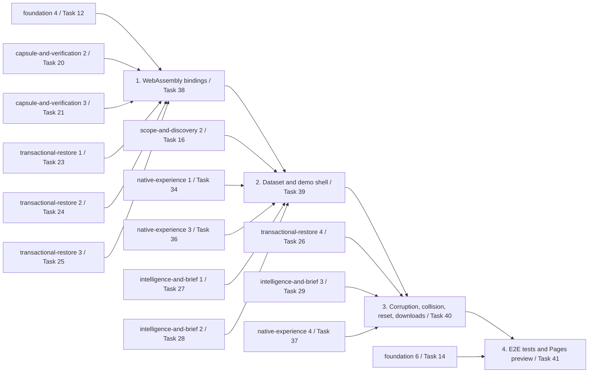

# Implementation Plan

- [ ] 1. WebAssembly bindings (P09-T01, Task 38)
  - Owner: rust-security (`crates/dormbit-wasm`, the only writer for `crates/**`); frontend for the TypeScript subtasks
  - Depends on: capsule-and-verification task 2 (Task 20, manifest and writer, native golden bytes)
  - Depends on: capsule-and-verification task 3 (Task 21, verifier)
  - Depends on: transactional-restore task 1 (Task 23, restore pre-checks)
  - Depends on: transactional-restore task 2 (Task 24, transactional executor)
  - Depends on: transactional-restore task 3 (Task 25, journal and recovery)
  - Depends on: foundation task 4 (Task 12, Dockline tar and Sidecar)
  - [ ] 1.1 Create the `dormbit-wasm` crate skeleton
    - `crates/dormbit-wasm` with `lib.rs` (bindings), `engine.rs`, `demo_disk.rs`, `fixture.rs`; `wasm-bindgen =0.2.130`; `flate2` `rust_backend` only through `dormbit-core`; builds for the host and `wasm32-unknown-unknown`
    - _Requirements: 3.1, 3.6, 3.7_
  - [ ] 1.2 Implement DemoDisk over the core's in-memory filesystem
    - reuse `MemVfs` (scope-and-discovery) and `MemRestoreFs` (transactional-restore) over one shared tree, adding a shared-tree adapter in `dormbit-core` only if needed (design Open question 3); case-insensitive and NFC-insensitive lookup; exclusive rename returning `RESTORE_DEST_EXISTS`; `volume_info` (case-insensitive, exclusive rename, fixed capacity); `flip_byte` with non-zero `xor`; `canonical_digest`
    - _Requirements: 3.2, 3.3, 3.4, 10.2, 10.3_
  - [ ] 1.3 Write MemVfs unit tests
    - exclusive rename with absent, existing, case-variant, and NFC-variant targets; existing nodes unchanged after a refused rename; capacity accounting; digest independent of insertion order
    - _Requirements: 3.3, 3.4, 10.4_
  - [ ] 1.4 Implement the fixture loader
    - `MemVfs::from_tar` accepting only directory, file, and symlink entries and rejecting absolute, `..`, NUL, and duplicate paths; Sidecar parsing; per-file comparison with `expected_hashes`; error on any mismatch
    - _Requirements: 4.1, 4.9, 4.10, 4.11_
  - [ ] 1.5 Implement `engine::Engine` command dispatch
    - the §6 command set per the design table, JSON in and out with the Tauri command shapes, DormbitError JSON on failure; fixed demo clock from the Sidecar; IDs from the `fresh_ids_json` pool
    - _Requirements: 3.1, 3.5_
  - [ ] 1.6 Implement step jobs in the engine
    - job table; `job_step(job_id, max_bytes, max_ops)` mapped to the core `Budget` returning JobEvent JSON with real file and byte counts; `job_cancel` reporting `CANCELLED`
    - _Requirements: 19.1, 19.4, 7.3_
  - [ ] 1.7 Expose the wasm-bindgen surface
    - `DemoEngine::new`, `call`, `job_step`, `capsule_bytes`, `restored_files`, `restored_file_bytes`, `state_digest`, `golden_capture`, `capture_tree` (`corrupt` is added in task 3)
    - _Requirements: 3.1, 21.1_
  - [ ] 1.8 Write the build script
    - `scripts/build-wasm.sh`: release build for `wasm32-unknown-unknown`, `wasm-bindgen --target web` into `apps/demo/src/wasm/pkg`, `wasm-opt -Oz`; add `apps/demo/src/wasm/pkg` to `.gitignore`; record raw, optimized, and gzipped sizes
    - _Requirements: 3.7_
  - [ ] 1.9 Write the Independent_Rehash module
    - `apps/demo/src/rehash.ts`: `sha256Hex` with `crypto.subtle.digest`, `rehashRestore`, `rehashCapsule`
    - _Requirements: 6.2, 6.3, 6.5_
  - [ ] 1.10 Write the Step_Job_Runner
    - `apps/demo/src/jobs/runner.ts`: `requestIdleCallback` with a `MessageChannel` fallback, Work budget, `AbortSignal` cancel, `realElapsedMs`; measure and record `DEFAULT_BUDGET`, `IDLE_TIMEOUT_MS`, `FALLBACK_SLICE_MS`
    - _Requirements: 19.1, 19.2, 19.3, 19.4, 7.2_
  - [ ] 1.11 Add the CSP meta tag and check WebKit
    - `apps/demo/index.html` CSP from the design; minimal Playwright page loads the wasm and completes discovery in WebKit with no `securitypolicyviolation`
    - _Requirements: 18.1, 18.2, 18.3, 18.5_
  - [ ] 1.12 Write the PROP-10 golden test
    - Vitest: `initSync` the web build in Node 24, `golden_capture` with the Golden inputs, compare bytes and length with the Golden capsule, report the first differing offset
    - **Property 1: WebAssembly capsule bytes equal native bytes (PROP-10)**
    - **Validates: Requirements 21.1, 21.4**
  - [ ] 1.13 Write the PROP-10 differential property test
    - native proptest generator `crates/dormbit-wasm/tests/prop10_corpus.rs` writing `.scratch/prop10/corpus.jsonl`; Vitest replay through wasm `capture_tree`; 10,000 cases locally, 512 in CI
    - **Property 1: WebAssembly capsule bytes equal native bytes (PROP-10)**
    - **Validates: Requirements 21.2, 21.4**
  - [ ] 1.14 Checkpoint: run `scripts/evidence/run.sh cargo test -p dormbit-wasm`, `scripts/evidence/run.sh cargo build -p dormbit-wasm --target wasm32-unknown-unknown --release`, and `scripts/evidence/run.sh pnpm --filter ./apps/demo test`

- [ ] 2. Dataset and demo shell (P09-T02, Task 39)
  - Owner: frontend; rust-security for any engine change
  - Depends on: task 1
  - Depends on: native-experience task 1 (Task 34, design system)
  - Depends on: native-experience task 3 (Task 36, Shelf, Evidence, Plan, Capture, Verification Screens)
  - Depends on: intelligence-and-brief task 1 (Task 27, evidence model and rules)
  - Depends on: intelligence-and-brief task 2 (Task 28, in-repo agent files, "3 of 7 tasks complete")
  - Depends on: scope-and-discovery task 2 (Task 16, walker and metadata)
  - [ ] 2.1 Scaffold `apps/demo`
    - Vite with `base: '/dormbit/'`; copy the Dockline tar and Sidecar from `fixtures/dockline/` into the build output; hash router with the step routes from the design; locked-step redirect
    - _Requirements: 20.1, 20.2, 8.3_
  - [ ] 2.2 Implement WasmClient
    - `apps/demo/src/client/WasmClient.ts`: every `DormbitClient` method, Zod validation, `IPC_SCHEMA_MISMATCH`, wasm traps treated as fatal, host IDs from `crypto.randomUUID()`
    - _Requirements: 3.5, 5.3_
  - [ ] 2.3 Run the client contract suite against WasmClient
    - `runClientContract` from `packages/client`, wasm loaded in Node
    - _Requirements: 5.3_
  - [ ] 2.4 Build the Synthetic_Banner
    - exact text "Synthetic Demo — No Local Files Accessed"; sticky; landmark; no dismiss control; overlays offset below the banner height
    - _Requirements: 1.1, 1.2, 1.3, 1.4, 1.5_
  - [ ] 2.5 Build the Guided_Rail
    - 12 steps with number and title; done, current, locked with glyph and label; collapses into a step menu on narrow viewports; polite live region for step changes
    - _Requirements: 8.1, 8.2, 16.3, 17.3, 17.5_
  - [ ] 2.6 Build the Whats_Real_Panel
    - Sheet with the real vs precomputed table from the design; lists paced steps
    - _Requirements: 14.1, 14.2, 14.3, 14.4, 14.5_
  - [ ] 2.7 Build the Mock_Picker
    - Dialog titled as a mock folder picker that lists only `demo:/` Virtual paths; cancel returns no grant
    - _Requirements: 5.1, 5.2, 5.3, 5.4, 2.2_
  - [ ] 2.8 Add the load, error, and unsupported states
    - fetch tar and Sidecar once and keep the bytes; load error names the cause; unsupported state when WebAssembly or `crypto.subtle` is missing
    - _Requirements: 4.11, 16.4, 12.6_
  - [ ] 2.9 Wire steps 1-5
    - discovery through the Mock_Picker; Evidence View overview with `feature/pdf-export`; stack, TODO and FIXME with line ranges, skipped test, "3 of 7 tasks complete"; plan groups; Approve gated on `data/dev.sqlite` and showing the digest
    - _Requirements: 8.4, 8.5, 8.6, 8.7, 8.8, 8.9_
  - [ ] 2.10 Write the dataset content tests
    - Vitest with wasm in Node: every DEM-3 item in Requirement 4 present, `.env` values never in any engine output, `node_modules/` and `dist/` placeholders classified rebuildable
    - _Requirements: 4.2, 4.3, 4.4, 4.5, 4.6, 4.7, 4.8, 4.9_
  - [ ] 2.11 Write Vitest tests for the shell
    - banner on every route; rail gating; Mock_Picker cancel; Whats_Real_Panel text; no storage API calls
    - _Requirements: 1.2, 8.3, 5.4, 14.1, 15.3_
  - [ ] 2.12 Checkpoint: run `scripts/evidence/run.sh pnpm --filter ./apps/demo test` and `scripts/evidence/run.sh cargo test -p dormbit-wasm`

- [ ] 3. Corruption tests, collision, reset, downloads (P09-T03, Task 40)
  - Owner: frontend; rust-security for `corrupt` and the pending fault in `crates/dormbit-wasm`
  - Depends on: task 2
  - Depends on: transactional-restore task 4 (Task 26, restore report and screens)
  - Depends on: intelligence-and-brief task 3 (Task 29, brief generator)
  - Depends on: native-experience task 4 (Task 37, Restore, Result, Brief Screens)
  - [ ] 3.1 Wire steps 6 and 7 with Pacing
    - Capsule Creation on step jobs; Integrity Verification with the WebCrypto capsule re-hash; seal pressed only for Verified; `Paced.tsx` with "Paced for readability. Real time: N ms"
    - _Requirements: 9.1, 9.2, 6.3, 6.4, 7.1, 7.2, 7.3_
  - [ ] 3.2 Wire step 8 with the refused collision
    - pre-seed `demo:/Restores/dockline-invoices` in the Pristine state; `RESTORE_DEST_EXISTS` for the same name and a case variant; existing folder unchanged; new name restores and commits with exclusive rename
    - _Requirements: 9.3, 10.1, 10.2, 10.3, 10.4, 10.5_
  - [ ] 3.3 Wire step 9, the independent check
    - per-file Rust vs WebCrypto table; HEAD and refs check; working-tree status check marked not run in the browser
    - _Requirements: 9.4, 9.5, 6.2, 6.4, 6.5_
  - [ ] 3.4 Wire step 10, the brief
    - Resurrection Brief with the Four outcomes as separate items
    - _Requirements: 9.6_
  - [ ] 3.5 Implement the Corruption_Controls in the engine
    - `DemoEngine::corrupt` for `stored_file`, `capsule_bytes`, `after_verification`; offset mapping into object data or non-object regions; `PendingFault` applied by `restore_start` after pre-checks pass; restore refused while the latest verification is Failed
    - _Requirements: 11.3, 11.5, 11.7, 11.8, 11.9, 11.11_
  - [ ] 3.6 Build the Corruption_Controls UI and step 12
    - three controls with seeds and `xor` from `crypto.getRandomValues`; show region, offset, old and new byte; text that the damage is simulated on virtual bytes; step 12 shows the Failed report or the rolled-back Restoration Result with 0 writes outside the destination
    - _Requirements: 11.1, 11.2, 11.4, 11.6, 11.10, 11.11_
  - [ ] 3.7 Implement Reset
    - abort jobs; `free()` the engine and rebuild from in-memory bytes; clear query cache, pacing timers, rail, object URLs; compare `state_digest()` with the first-load digest
    - _Requirements: 12.1, 12.2, 12.3, 12.5, 12.6, 15.4_
  - [ ] 3.8 Implement downloads
    - capsule `.dormbit` from `capsule_bytes`, labeled `-DAMAGED` after a control; brief Markdown from `brief_export`; Blob and object URL only on click
    - _Requirements: 13.1, 13.2, 13.3, 13.4, 2.5_
  - [ ] 3.9 Write property test for Reset
    - fast-check action sequences over WasmClient with wasm in Node; 10,000 runs locally, 512 in CI
    - **Property 2: Reset returns to the Pristine state and is idempotent**
    - **Validates: Requirements 12.2, 12.3, 12.4, 12.5, 15.4**
  - [ ] 3.10 Write property test for the Corruption_Controls
    - fast-check over control, `offset_seed`, and non-zero `xor` against a verified Dockline capsule; 10,000 runs locally, 512 in CI
    - **Property 3: Every single-byte corruption control is rejected**
    - **Validates: Requirements 11.3, 11.4, 11.5, 11.6, 11.7, 11.8, 11.9, 11.10**
  - [ ] 3.11 Write property test for hash agreement
    - fast-check byte strings written to MemVfs plus every restored file and the capsule from a full run; Rust hex equals WebCrypto hex
    - **Property 4: Shown hashes agree with WebCrypto**
    - **Validates: Requirements 6.1, 6.2, 6.3, 13.2**
  - [ ] 3.12 Checkpoint: run `scripts/evidence/run.sh pnpm --filter ./apps/demo test` and `scripts/evidence/run.sh cargo test -p dormbit-wasm`

- [ ] 4. E2E tests and Pages preview (P09-T04, Task 41)
  - Owner: qa (tests); release (`.github/workflows/pages.yml`)
  - Depends on: task 3
  - Depends on: foundation task 6 (Task 14, CI)
  - [ ] 4.1 Configure Playwright for the demo
    - projects for Chromium, WebKit, and Firefox; viewports 390×844, 820×1180, 1440×900; tests run against `vite preview` of the production build under `/dormbit/`
    - _Requirements: 16.1, 16.2_
  - [ ] 4.2 Write the 12-step E2E test
    - all 12 steps in order in every browser and viewport; banner hit-test at every step and with each dialog open
    - _Requirements: 8.1, 8.4, 8.5, 8.6, 8.7, 8.8, 8.9, 9.1, 9.2, 9.3, 9.4, 9.5, 9.6, 1.2, 1.3, 16.1, 16.2_
  - [ ] 4.3 Write the destructive-path E2E tests
    - refused collision and case variant; each Corruption_Control and its outcome; Reset back to step 1; downloads saved and hashed equal to the shown `file_sha256`
    - _Requirements: 10.2, 10.3, 11.4, 11.6, 11.10, 12.2, 12.5, 13.1, 13.2_
  - [ ] 4.4 Write the privacy and CSP E2E checks
    - request log limited to the demo origin under `/dormbit/`; cookies, `localStorage`, `sessionStorage`, IndexedDB empty; fail on `securitypolicyviolation`; reload gives step 1
    - _Requirements: 15.2, 15.3, 15.4, 15.5, 18.4_
  - [ ] 4.5 Write the bundle scan
    - fail if `dist/` contains `showDirectoryPicker`, `showOpenFilePicker`, `showSaveFilePicker`, `webkitdirectory`, `type="file"`, or analytics code
    - _Requirements: 2.1, 2.4, 15.1_
  - [ ] 4.6 Add the parity page check in each browser
    - test-only parity page built from the same wasm; in-browser Golden capsule SHA-256 and length equal the Golden capsule
    - **Property 1: WebAssembly capsule bytes equal native bytes (PROP-10)**
    - **Validates: Requirements 21.3, 21.4**
  - [ ] 4.7 Add axe, keyboard, and reduced-motion checks
    - axe on every step in each browser with zero critical; keyboard-only run of all 12 steps, the controls, Reset, and downloads; reduced-motion emulation finds no running animation
    - _Requirements: 17.1, 17.2, 17.4, 17.5_
  - [ ] 4.8 Write `pages.yml`
    - `.github/workflows/pages.yml` per the design: wasm build, `pnpm --filter ./apps/demo build`, upload `apps/demo/dist`, deploy with `actions/deploy-pages`; actions pinned to commit SHAs; footer shows "Preview" and the short SHA
    - _Requirements: 20.1, 20.3_
  - [ ] 4.9 Deploy the preview and run the smoke test
    - Playwright against the live URL: banner visible, step 1 completes; record the URL in the evidence log
    - _Requirements: 20.4_
  - [ ] 4.10 Checkpoint: run `scripts/evidence/run.sh pnpm exec playwright test e2e/demo` and record the CI run link for `pages.yml`

## Task Dependency Graph



```json
{
  "waves": [
    { "id": 0, "tasks": ["1"] },
    { "id": 1, "tasks": ["2"] },
    { "id": 2, "tasks": ["3"] },
    { "id": 3, "tasks": ["4"] }
  ]
}
```
