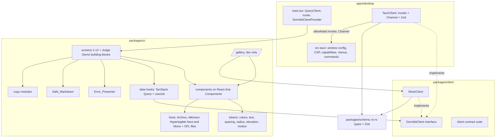

# Design Document

## Overview
This design covers the DORMBIT user interface: the `packages/ui` design system and screens, the `apps/desktop` app shell, the `TauriClient`, and the Phase 11 audits. It implements the requirements in this spec's `requirements.md`, which formalize NAT-1, NAT-2, UX-1, and master plan §9.

Three rules shape the design:
- **One UI, three backends.** Every Screen talks to the core through the `DormbitClient` interface. `MockClient` backs development and tests (Phase 08 starts right after foundation), `TauriClient` backs the native app, and `WasmClient` (judge-demo spec) backs the browser demo.
- **The WebView is untrusted territory.** It renders project text that DORMBIT didn't write. It has no `fs` or `shell` plugin, sends IDs instead of paths, renders Markdown without raw HTML, and makes no network requests. The Rust scope layer remains the real security boundary (master plan §0, Tauri 2).
- **Status is never color alone.** Every status is a glyph plus a word, and the capsule seal is pressed only after verification passes.

Phase 08 builds and polishes Screens against `MockClient` data that follows the `packages/schema` types. The owning specs connect each Screen to real Commands: Shelf in scope-and-discovery task 4 (Task 18), Plan, Capture, and Verification in capsule-and-verification task 4 (Task 22), Restore Wizard and Result in transactional-restore task 4 (Task 26), Evidence View and Brief in intelligence-and-brief task 4 (Task 30). Phase 11 then audits the wired app and the demo.

## Architecture



**Module boundaries**
- `packages/ui` depends on `packages/client` (interface only) and `packages/schema`. It never imports `@tauri-apps/api` or `dormbit-wasm`.
- `TauriClient` lives in `apps/desktop/src/client/`, so the demo bundle never contains Tauri code. `WasmClient` lives in `apps/demo` (judge-demo spec).
- `packages/client` holds the interface, `MockClient`, and a contract suite `runClientContract(makeClient)` that every implementation runs.
- User-facing strings live in `packages/ui/src/copy/*.ts`, so the Copy_Audit and the denylist test can read them in one place.
- Rust work in this spec is limited to `apps/desktop/src-tauri` window settings and menus. All Commands come from the owning specs.

**Ownership.** The `frontend` agent writes `apps/**` and `packages/**` (not `packages/schema/generated`). The `qa` agent writes tests, `e2e/**`, and `docs/evidence/**`. No security-critical Rust is in this spec.

## Components and Interfaces

### Client interface (defined by foundation task 3, used here)
The authoritative signatures come from `packages/client` (foundation task 3, Task 11). This listing shows how the UI uses them. Method names map one to one to the §6 Commands.

```ts
// packages/client/src/DormbitClient.ts (shape as used by packages/ui)
export interface DormbitClient {
  appInfo(onEvent?: (e: AppInfoEvent) => void): Promise<AppInfo>;
  scopePick(kind: ScopeKind): Promise<ScopeGrant | null>;         // Rust opens the picker
  scopeList(): Promise<ScopeGrant[]>;
  scopeRevoke(scopeId: ScopeId): Promise<void>;
  discoveryStart(scopeId: ScopeId, onEvent: JobListener<DiscoveryResult>): Promise<JobId>;
  discoveryCancel(jobId: JobId): Promise<void>;
  projectsList(): Promise<ProjectRecord[]>;
  projectGet(projectId: ProjectId): Promise<ProjectRecord>;
  projectSetDormant(projectId: ProjectId, dormant: boolean): Promise<ProjectRecord>;
  evidenceGet(projectId: ProjectId): Promise<Finding[]>;
  planCreate(projectId: ProjectId): Promise<CapturePlan>;
  planSetDecision(planId: PlanId, itemPath: RelPath, decision: Decision): Promise<CapturePlan>;
  planApprove(planId: PlanId, input: { digest: string; acks: Ack[]; library: ScopeId }): Promise<ApprovedPlan>;
  captureStart(planId: PlanId, onEvent: JobListener<CaptureResult>): Promise<JobId>;
  jobCancel(jobId: JobId): Promise<void>;
  capsulePick(): Promise<CapsuleRef | null>;                       // Rust opens the picker
  capsulesList(): Promise<CapsuleRef[]>;
  verifyStart(capsuleId: CapsuleId, onEvent: JobListener<VerificationReport>): Promise<JobId>;
  restoreTargetPick(): Promise<ScopeGrant | null>;                 // Rust opens the picker
  restorePrecheck(input: RestoreInput): Promise<PrecheckReport>;
  restoreStart(input: RestoreInput, onEvent: JobListener<RestoreReport>): Promise<JobId>;
  restoreRecover(request: RecoverRequest): Promise<RecoverResult>;
  briefGet(projectId: ProjectId): Promise<Brief>;
  briefExport(projectId: ProjectId): Promise<ExportResult>;        // Rust opens the save dialog
  settingsGet(): Promise<Settings>;
  settingsSet(patch: SettingsPatch): Promise<Settings>;
  consentSet(adapterId: AdapterId, granted: boolean): Promise<ConsentRecord>;
  adaptersList(): Promise<AdapterInfo[]>;
}

export type RestoreInput = { capsuleId: CapsuleId; targetScopeId: ScopeId; newFolderName: string };

export type JobListener<R> = (event: JobEvent<R>) => void;
export type JobEvent<R> =
  | { kind: 'state'; state: string }                                // step state machine
  | { kind: 'progress'; filesDone: number; filesTotal: number; bytesDone: number; bytesTotal: number }
  | { kind: 'done'; result: R }
  | { kind: 'failed'; error: DormbitError }
  | { kind: 'cancelled' };
```

`RestoreInput.newFolderName` is a single name component, not a path. Rust validates it (RST-1, RST-2). No method takes an absolute path (Requirement 26.5, SCP-1).

### TauriClient (`apps/desktop/src/client/TauriClient.ts`)

```ts
import { invoke, Channel } from '@tauri-apps/api/core';
import { schemas } from '@dormbit/schema';           // Zod schemas from packages/schema

async function call<T>(command: AllowlistedCommand, args: object, schema: z.ZodType<T>): Promise<T> {
  let raw: unknown;
  try {
    raw = await invoke(command, args);
  } catch (e) {
    throw toDormbitError(e);                         // valid DormbitError passes through; anything else -> retryable:false
  }
  const parsed = schema.safeParse(raw);
  if (!parsed.success) {
    logSchemaFailure(command, parsed.error.issues.map(i => i.path.join('.')));  // no payload (Req 3.4)
    throw clientError('IPC_SCHEMA_MISMATCH');        // retryable:false (Req 26.3)
  }
  return parsed.data;
}

function jobChannel<R>(schema: z.ZodType<JobEvent<R>>, onEvent: JobListener<R>): Channel<unknown> {
  const ch = new Channel<unknown>();
  ch.onmessage = (raw) => {
    const parsed = schema.safeParse(raw);
    onEvent(parsed.success ? parsed.data : { kind: 'failed', error: clientError('IPC_SCHEMA_MISMATCH') });
  };
  return ch;
}
```

- `AllowlistedCommand` is a string-literal union of the §6 Command names. A type test fails if a name outside the allowlist is used (Requirement 26.1).
- In release builds, `call` does not log arguments or payloads (Requirement 3.3).
- Each Job method creates a Channel, passes it as the `onEvent` argument, and resolves with the `JobId`.

### Data layer (`packages/ui/src/data/`)
TanStack Query holds request/response data. Job progress goes through a small `useJob(jobId)` store built on `useSyncExternalStore`, not the query cache, because Channel events arrive as a stream.

| Query key | Method | Invalidated by |
|---|---|---|
| `['app-info']` | `appInfo` | never |
| `['scopes']` | `scopeList` | `scopePick`, `scopeRevoke` |
| `['projects']` | `projectsList` | discovery `done`, `scopeRevoke`, `projectSetDormant` |
| `['project', id]` | `projectGet` | `projectSetDormant`, capture `done`, verify `done`, restore `done` |
| `['evidence', id]` | `evidenceGet` | discovery `done`, `scopeRevoke` |
| `['plan', planId]` | `planCreate` result, then `planSetDecision` results | `planSetDecision`, `planApprove` |
| `['capsules']` | `capsulesList` | capture `done`, verify `done`, `capsulePick` |
| `['brief', projectId]` | `briefGet` | restore `done` |
| `['settings']` | `settingsGet` | `settingsSet`, `consentSet` |
| `['adapters']` | `adaptersList` | `consentSet` |

QueryClient defaults:
- `retry: (count, err) => isDormbitError(err) && err.retryable && count < 2` for queries (Requirement 26.7).
- `retry: false` for every mutation. Commands that open native pickers or dialogs are mutations, so a picker is never reopened automatically.
- `refetchOnWindowFocus: false`, so focusing the window never starts a scan.
- On `scopeRevoke` success, `queryClient.removeQueries` drops every key whose data belongs to the revoked scope (Requirement 15.2). The same happens for adapter data on consent withdrawal (Requirement 15.3).

Screens call only hooks such as `useProjects()`, `usePlan(planId)`, `useApprovePlan()`, and `useJob(jobId)` (Requirement 26.6).

### App shell and routes (`packages/ui/src/routes.tsx`, mounted in `apps/desktop`)
`apps/desktop` mounts the route table with React Router's hash router. Hash routing works under Tauri's asset protocol and the Vite dev server with no server-side fallback.

| # | Screen | Route | Sidebar item |
|---|---|---|---|
| 1 | Welcome | `/welcome` | none (onboarding) |
| 2 | Privacy & Permissions | `/privacy` | none (onboarding) |
| 3 | Folder Selection | `/folders` | none (onboarding) |
| 4 | Shelf | `/shelf` | Shelf |
| 5 | Evidence View | `/projects/:projectId/:tab` (`overview`, `evidence`, `files`, `git`, `agents`, `history`) | Shelf |
| 6 | Preservation Plan | `/projects/:projectId/plan` | Shelf |
| 7 | Capsule Creation | `/projects/:projectId/capture/:jobId` | Shelf |
| 8 | Integrity Verification | `/capsules` (list state), `/capsules/:capsuleId` | Capsules |
| 9 | Restore Wizard | `/restores` (list state), `/restores/new?capsule=:capsuleId` | Restores |
| 10 | Restoration Result | `/restores/:opId` | Restores |
| 11 | Resurrection Brief | `/projects/:projectId/brief` | Shelf |
| 12 | Settings | `/settings/:section` (`scopes`, `consent`, `defaults`, `privacy`, `about`) | Settings |
| 13 | Judge Demo | `apps/demo`, see judge-demo spec | n/a |
| dev | Gallery | `/gallery`, `/gallery/:entry` | none |

- First-launch routing: if `scopeList()` has no `Read` grant, `/` redirects to `/welcome`; otherwise to `/shelf` (Requirement 6.1).
- On start, the shell calls `restoreRecover({ action: 'list' })`. If it reports an unfinished restore, a Dialog offers "Discard staging folder". Only a confirmed click calls `restoreRecover({ action: 'discard', opId })` (Requirements 13.4, 13.5). The exact request shape comes from transactional-restore task 3 (Task 25).
- The Gallery route is registered only when `import.meta.env.DEV` is true, so Vite removes it from release bundles (Requirement 20.4).
- Window settings in `tauri.conf.json`: `minWidth: 1100`, `minHeight: 720`, `titleBarStyle: "Overlay"`, `hiddenTitle: true`, and a traffic-light inset. The App_Shell header carries `data-tauri-drag-region` (Requirement 5.2, 5.3).

### Native menus and shortcuts (`apps/desktop/src-tauri/src/menu.rs`)
Menus are built in Rust with Tauri's core menu API, so no plugin is added (Requirement 1.6). A menu click emits an app event that the shell turns into a route change.

| Menu | Item | Shortcut |
|---|---|---|
| DORMBIT | About DORMBIT, Settings…, Quit | ⌘, for Settings, ⌘Q |
| Edit | Undo, Redo, Cut, Copy, Paste, Select All (native roles) | standard |
| Go | Shelf, Capsules, Restores | ⌘1, ⌘2, ⌘3 |
| Window | Minimize, Zoom (native roles) | standard |

Shelf search focus uses ⌘F. The full map is listed in Settings → About (Requirement 21.6). The NAT-1 test from foundation task 2 (Task 10) is re-run after the menu change to confirm no new plugin or Command.

### Design system inventory (`packages/ui/src/components/`)
Components from master plan Task 34 are built on React Aria Components (RAC) where RAC has a matching primitive. A few support components are added because several Screens need them; they are marked "support".

| Component | Built on | Notes |
|---|---|---|
| Button | RAC `Button` | Primary uses Signal fill with Graphite text (5.7:1). |
| Field | RAC `TextField`, `Label`, `Input`, `FieldError` | Edge border; error text in Fail. |
| Checkbox | RAC `Checkbox` | Checked state shows a check glyph, not only a fill. |
| Tabs | RAC `Tabs`, `TabList`, `Tab`, `TabPanel` | Arrow-key navigation. |
| List | RAC `GridList` + TanStack Virtual | `aria-rowcount` and `aria-rowindex` kept correct while virtualized. |
| Table | RAC `Table` + TanStack Virtual | Column headers; sortable headers announce the sort. |
| Tree | RAC `Tree` | Files tab and plan groups. |
| StatusPill | support for Status marker | Glyph (SVG, `aria-hidden`) plus visible label. |
| EvidenceChip | RAC `Button` | Finding status marker plus rule ID; opens the evidence reference. |
| ProgressSteps | `<ol>` with `aria-current="step"` + RAC `ProgressBar` | Capture, verify, restore state machines. |
| Toast | RAC toast region, or a `role="status"` region if the toast API is not stable in the pinned RAC version | Escape dismisses. |
| Dialog | RAC `Dialog`, `Modal` | Focus trapped, returned on close. |
| Sheet | RAC `Modal` anchored to the window edge | Same focus rules as Dialog. |
| EmptyState, ErrorState, Skeleton | plain components | ErrorState renders through Error_Presenter. |
| CapsuleSeal | inline SVG | See below. |
| SafeMarkdown | react-markdown | support. See below. |
| PathText | support | Atkinson Hyperlegible Mono, middle truncation, full Display path in the accessible name. |
| HashText | support | Atkinson Hyperlegible Mono, shortened display, full hash in the accessible name, copy button. |
| ErrorNotice | support | Inline Error_Presenter output with optional Retry. |

### Status markers (`packages/ui/src/components/StatusPill.tsx`)
```ts
type StatusKind = 'verified' | 'needs-decision' | 'failed' | 'unknown' | 'unsupported'
                | 'confirmed' | 'inferred';

const STATUS: Record<StatusKind, { glyph: GlyphId; glyphColor: ColorToken; labelColor: TextToken; label: string }> = {
  verified:         { glyph: 'check',   glyphColor: 'ok',        labelColor: 'ok',           label: 'Verified' },
  'needs-decision': { glyph: 'diamond', glyphColor: 'warn',      labelColor: 'warn-text',    label: 'Needs decision' },
  failed:           { glyph: 'x',       glyphColor: 'fail',      labelColor: 'fail',         label: 'Failed' },
  unknown:          { glyph: 'question',glyphColor: 'edge',      labelColor: 'steel',        label: 'Unknown' },
  unsupported:      { glyph: 'ban',     glyphColor: 'edge',      labelColor: 'steel',        label: 'Unsupported' },
  confirmed:        { glyph: 'TBD-34',  glyphColor: 'ok',        labelColor: 'ink',          label: 'Confirmed' },
  inferred:         { glyph: 'TBD-34',  glyphColor: 'edge',      labelColor: 'ink',          label: 'Inferred' },
};
```
- Glyphs are SVG shapes matching ✓ ◆ ✕ ? ⊘, drawn with `aria-hidden="true"`. As graphics, they need 3:1 (WCAG 1.4.11). On Plate, Edge (4.05:1), Fail (5.58:1), and Ok (5.81:1) meet it, and the Warn glyph sits on its own fill with Ink (8.94:1). Drawing them as SVG keeps axe from treating them as text.
- Labels always use a text token (Requirement 19.3).
- Confirmed and Inferred glyphs are picked in Task 34 (requirements Open question 1).

### Capsule seal (`packages/ui/src/components/CapsuleSeal.tsx`)
```ts
type SealState = 'none' | 'unverified' | 'pressed' | 'failed';
function sealState(latest?: VerificationReport): SealState;          // 'pressed' iff latest?.status === 'Verified'
function sealPattern(capsuleId: CapsuleId): SealRidge[];             // pure; reads only the 16 UUID bytes
```
- `sealPattern` turns each of the capsule ID's 16 bytes into one ridge arc (start angle and sweep), drawn as concentric arcs. It reads nothing but the ID (Requirement 11.5).
- `pressed` adds an inset shadow (elevation level 1 inverted) and an Ok ring. `failed` shows the ring in Fail with the ✕ marker. `unverified` shows the ridges in Edge with no ring.
- The component always renders a text label next to it ("Verified", "Not verified", "Verification failed") and an accessible name such as "Capsule seal, verified" (Requirements 11.8, 22.4).
- The seal is a visual ID. It is not a signature, and the copy never calls it one.

### Safe_Markdown (`packages/ui/src/components/SafeMarkdown.tsx`)
```tsx
<ReactMarkdown
  skipHtml                                  // raw HTML dropped (Req 2.1); rehype-raw is never installed
  components={{
    a:   ({ children, href }) => <span className="md-link">{children}{href ? <> (<PathText value={href} />)</> : null}</span>,
    img: ({ alt }) => <span className="md-img">[image: {alt ?? ''}]</span>,   // no request (Req 2.3)
  }}
>
  {source}
</ReactMarkdown>
```
- Links never navigate (Requirement 2.2). Opening a URL would need an opener or shell plugin, which NAT-1 forbids.
- The default URL transform stays on as a second layer.
- A lint rule and a dependency check fail the build if `rehype-raw` is added.

### Error_Presenter (`packages/ui/src/errors/`)
```ts
type ErrorCopy = { title: string; body: string; action?: 'retry' | 'open-settings-scopes' | 'review-plan' | 'choose-name' | 'choose-destination' };
export const ERROR_COPY = { /* table below */ } satisfies Record<DormbitErrorCode | ClientErrorCode, ErrorCopy>;
```
`satisfies Record<...>` makes the mapping total at compile time (Requirement 25.1). The code is always shown in Atkinson Hyperlegible Mono beside the message. Retry appears only when `retryable` is true.

| Code | Title | Body | Action |
|---|---|---|---|
| `SCOPE_DENIED` | No access to that folder | DORMBIT can only read folders you granted. | Open Settings → Scopes |
| `PATH_UNSAFE` | Unsafe path refused | A path was absolute, contained `..`, or had invalid characters. Nothing was written. | none |
| `PLAN_DIGEST_MISMATCH` | The plan changed | The plan no longer matches what you approved. Review it and approve again. | Review plan |
| `FILE_CHANGED_DURING_CAPTURE` | A file changed during capture | A file changed while it was being read. No capsule was saved. | Retry when retryable |
| `CAPSULE_MALFORMED` | Capsule structure is invalid | This capsule failed strict parsing. It can't be restored. | none |
| `CAPSULE_TRUNCATED` | Capsule is incomplete | The capsule ends before its trailer. It can't be restored. | none |
| `CAPSULE_HASH_MISMATCH` | Stored content doesn't match | Some content doesn't match its recorded SHA-256. Damaged files are listed. | none |
| `CAPSULE_VERSION_UNSUPPORTED` | Unsupported capsule version | This version of DORMBIT can't read this capsule format. Status: Unsupported. | none |
| `RESTORE_DEST_EXISTS` | That folder already exists | A folder with this name, or a case or Unicode variant of it, exists. DORMBIT never overwrites. | Choose another name |
| `RESTORE_COLLISION` | Paths would collide | Two capsule paths would become the same file on this volume. Restore refused. | none |
| `RESTORE_VOLUME_UNSUPPORTED` | Volume not supported | The destination volume can't do an exclusive rename. Use an APFS or HFS+ volume. | Choose another destination |
| `RESTORE_INSUFFICIENT_SPACE` | Not enough free space | The destination doesn't have room for this restore. | Choose another destination |
| `CANCELLED` | Cancelled | Shown as the cancelled Screen state, not an error (Requirement 25.5). | none |
| `IPC_SCHEMA_MISMATCH` (client) | Unexpected response | The app received data it couldn't validate. Nothing was changed by the UI. | none |
| unknown code | Unexpected error | Shows the code. | Retry when retryable |

The Rust `message` is shown under the body as detail text. Rust produces it already redacted (paths as `~`, no contents).

### Tokens (`packages/ui/src/tokens/tokens.ts` and generated `tokens.css`)
```ts
export const color = {
  plate: '#F6F7F5', panel: '#ECEEEA', rule: '#D3D7D3', edge: '#737B76',
  ink: '#1A1E1C', steel: '#59625D',
  graphite: '#0F1211', graphite2: '#181C1A', onDark: '#E8EBE7', onDarkMuted: '#9AA29D',
  signal: '#FF4F00', ok: '#1B6E45', okDark: '#3DBE7E', warn: '#F2B200', fail: '#C21F1A', failDark: '#FF6B5E',
} as const;
export const text = { signalText: '#B83A00', signalTextDark: '#FF5F1A', warnText: '#8A5A00' } as const;
export const space = (n: number) => `${n * 4}px`;                  // 4px grid
export const radius = { sm: '6px', md: '10px', lg: '14px' } as const;
export const elevation = { 1: '...', 2: '...', 3: '...' } as const; // exactly three levels
export const motion = { fast: '120ms', base: '160ms', slow: '200ms', easing: 'ease-out' } as const;
```
`tokens.css` sets the CSS custom properties and this block:
```css
@media (prefers-reduced-motion: reduce) {
  *, *::before, *::after { animation-duration: 0ms !important; transition-duration: 0ms !important; }
}
```

Measured contrast (WCAG formula, values from ADR-011):

| Token | Ratio | Allowed use |
|---|---|---|
| Ink `#1A1E1C` | 15.68 on Plate | body text |
| Steel `#59625D` | 5.87 on Plate, 5.40 on Panel | secondary text |
| Edge `#737B76` | 4.05 on Plate, 3.73 on Panel | control borders, icons |
| Signal `#FF4F00` | 3.07 on Plate, 5.71 on Graphite | fills, focus rings, Large text; never on Panel (2.82) |
| `--signal-text #B83A00` | 5.36 on Plate, 4.94 on Panel | orange text on light surfaces |
| `--signal-text-dark #FF5F1A` | 6.19 on Graphite | orange text on dark surfaces |
| Ok `#1B6E45` / Ok-dark `#3DBE7E` | 5.81 on Plate / 7.95 on Graphite | Verified |
| Warn `#F2B200` | Ink on Warn 8.94, 9.99 on Graphite | Needs decision fill |
| `--warn-text #8A5A00` | 5.52 on Plate | Needs decision label |
| Fail `#C21F1A` / Fail-dark `#FF6B5E` | 5.58 on Plate / 6.74 on Graphite | Failed |
| On-dark `#E8EBE7` / On-dark-muted `#9AA29D` | 15.67 / 7.20 on Graphite | text on dark surfaces |

### Fonts (`packages/ui/src/fonts/`)
Archivo (variable width and weight), Atkinson Hyperlegible Next, and Atkinson Hyperlegible Mono as Latin-subset `woff2` files, each with its `OFL-*.txt`. `fonts.css` declares the `@font-face` rules with relative `url()` values that Vite rewrites to bundled asset paths. Stacks:
- interface and brief: `"Atkinson Next", system-ui, sans-serif`
- headings: `"Archivo", "Arial Narrow", system-ui, sans-serif`
- paths and hashes: `"Atkinson Mono", ui-monospace, "SF Mono", Menlo, monospace`

### Screens (`packages/ui/src/screens/`)
Each Screen folder has the Screen component, its State_Matrix entry, and MockClient scenarios for each state.

| Screen | Key parts |
|---|---|
| Welcome | tagline, version from `app_info`, Continue |
| Privacy & Permissions | the four promises (local-only, no deletion, no code execution, consent for agent histories), the stated limits from §7 |
| Folder Selection | Choose folder (calls `scope_pick`), granted list with PathText, discovery ProgressSteps with real counts |
| Shelf | virtualized Table; columns name, path, stacks, Git, activity, size, seal; search, sort, filter, multi-select; dormant mark toggle |
| Evidence View | Tabs; EvidenceChip list with status filter and hidden count; evidence reference viewer showing cited lines as plain text |
| Preservation Plan | Tree of the six groups; decision controls (none on Excluded: sensitive); summary rail with totals, digest (HashText), outstanding items, library picker, Approve |
| Capsule Creation | ProgressSteps for the capture states; byte and file counters; Cancel; post-approval files list |
| Integrity Verification | capsule list state; checks Table with markers; failed files; registry marker; limits text; CapsuleSeal |
| Restore Wizard | capsule, destination (`restore_target_pick`), name Field; pre-check list; Start; Job ProgressSteps |
| Restoration Result | RST-7 sections; writes outside destination as a number; Git checks; rollback message |
| Resurrection Brief | SafeMarkdown sections in Atkinson Hyperlegible Next; four outcome rows with markers; citation links to Evidence View; Export |
| Settings | sections scopes, consent, defaults, data and privacy, about and licenses (fonts, notices, shortcuts) |

Four outcome rows on the Brief use these markers: "Files restored and verified" with Verified or Failed from the restore report; "Context reconstructed (inferred from evidence)" with the Inferred marker; "AI session resumed: not performed" with Unsupported; "Builds/runs: unknown (never executed)" with Unknown.

## Data Models
The UI consumes the master plan §8 models through `packages/schema`. Fields the UI depends on:

- `ScopeGrant` `{id, kind: Read|CapsuleLibrary|RestoreTarget, root_display, granted_at, via: NativePicker}`. The UI shows `root_display` only.
- `ProjectRecord` `{id, scope_id, rel_root, name{value, source}, stacks[Finding], git?, activity{latest_mtime, scanned, partial}, size{total, rebuildable, partial}, docs[], manifests[], agent_artifacts[], marks{dormant}, preservation{last_capsule?, last_verified_at?, last_verified_restore?}}`. Shelf columns and partial marks come from `activity.partial` and `size.partial`.
- `GitSnapshot` `{head{branch?, detached, commit, time, summary}, upstream?{ahead, behind, as_of_last_fetch}, status{modified, staged, untracked, deleted, conflicted}, stash_count, worktree_external, submodules[], lfs_detected, risky_config[], remotes_redacted[]}`.
- `CapturePlan` `{plan_id, items[{path, kind, size, decision, reason, editable, warning?}], groups, git_treatment, totals, digest}`. The decision control renders only when `editable` is true.
- `ApprovedPlan` `{digest, approved_at, acks[], overrides[]}`.
- `Finding` `{id, rule, statement, status, evidence[EvidenceRef]}`.
- `Brief` `{sections[], outcomes{files, context, session, build}, evidence_index}`.
- `VerificationReport` `{capsule_id, file_sha256, manifest_sha256, checks[{id, status, detail}], failed_files[], registry_match: Match|Mismatch|NotInRegistry, status}`.
- `RestoreJournal` `{op_id, staging, owner_token, state: Staged|Written|Verified|Committed|Cleaned}`. The UI sees only what `restore_recover` returns.
- `RestoreReport`: the RST-7 fields.
- `DormbitError` `{code, message, retryable}`.

UI-only models:
```ts
type ScreenState = 'loading' | 'empty' | 'error' | 'partial' | 'cancelled' | 'ready';
type StateMatrixEntry = { screen: ScreenId; state: ScreenState; reachable: true; scenario: MockScenarioId }
                      | { screen: ScreenId; state: ScreenState; reachable: false; reason: string };
type ClientErrorCode = 'IPC_SCHEMA_MISMATCH';
```

## Correctness Properties
The master plan assigns no PROP-n to this spec ("none (UI)", §12). The properties below are spec-local. Their tests are optional fast-check tests in Vitest; they don't replace the component and E2E tests.

### Property 1: Safe_Markdown never emits raw HTML or fetches
*For any* Markdown string, including generated HTML tags, `javascript:` links, and image syntax, the DOM rendered by Safe_Markdown contains no element outside its allowed set, no `<a>` with an `href`, no ``, and no `<script>`, `<iframe>`, `<object>`, or `<style>`.
**Validates: Requirements 2.1, 2.2, 2.3**

### Property 2: The seal is pressed only for Verified
*For any* sequence of VerificationReports for a capsule ID, the Capsule_Seal is pressed exactly when the last report's status is Verified, and for any capsule ID the seal pattern is the same on every render.
**Validates: Requirements 11.5, 11.6, 11.7**

### Property 3: Every status has a glyph and a label
*For any* `StatusKind`, the rendered StatusPill has a non-empty visible text label in a text token, an `aria-hidden` glyph, and an accessible name equal to the label.
**Validates: Requirements 19.2, 19.3, 22.2**

### Property 4: The Error_Presenter is total
*For any* DormbitError (known code or arbitrary string code, either `retryable` value), the Error_Presenter renders a title, a body containing the code, and a Retry action exactly when `retryable` is true.
**Validates: Requirements 25.1, 25.2, 25.3, 25.4**

### Property 5: TauriClient never passes unvalidated data
*For any* value returned by a mocked `invoke` or sent on a mocked Channel, the TauriClient either returns a value that parses under the Command's Zod schema or rejects with a DormbitError whose `retryable` is false.
**Validates: Requirements 26.2, 26.3, 26.4**

## Error Handling
- **Command errors:** valid DormbitErrors pass through TauriClient unchanged and reach the Error_Presenter. Retryable errors get a Retry action. Queries retry automatically at most twice, and only when retryable.
- **Invalid responses:** a Zod failure becomes `IPC_SCHEMA_MISMATCH` (client-side, not retryable). The log line names the Command and schema path only.
- **Job errors:** a `failed` event moves the Screen to its error state, with the code shown. A `cancelled` event moves it to the cancelled state, with copy that says what was not saved or written.
- **Refusals are not crashes:** `RESTORE_DEST_EXISTS`, `RESTORE_COLLISION`, `RESTORE_VOLUME_UNSUPPORTED`, and `RESTORE_INSUFFICIENT_SPACE` appear on the failing pre-check row and keep Start disabled.
- **Picker cancel:** a `null` result from `scopePick`, `capsulePick`, or `restoreTargetPick` is not an error. The Screen stays as it was.
- **Render errors:** each route has a React error boundary that shows ErrorState with a "Reload screen" action. It never shows a stack trace in release builds.

## Testing Strategy
All runs that count are recorded through `scripts/evidence/run.sh` or CI.

- **Unit and component (Vitest, Testing Library):** every component; every Screen in each reachable State_Matrix state using MockClient scenarios; Error_Presenter mapping; seal state and pattern; query invalidation and retry rules; Settings revoke clears cached queries.
- **Contract:** `runClientContract` against MockClient and against TauriClient with `invoke` and `Channel` mocked.
- **Property (fast-check, optional):** Properties 1-5, 10,000 runs locally and 512 in CI.
- **Contrast:** a Vitest that computes WCAG ratios from `tokens.ts`, checks the plan table to one decimal, and checks every text/background pair declared by components against 4.5:1 or 3:1 for Large text.
- **Build checks:** built CSS has no `http:`/`https:` font URLs; release bundle has no `/gallery`; no `rehype-raw` dependency; lint bans `dangerouslySetInnerHTML`; NAT-1 config test (from foundation task 2) re-run.
- **Screenshot (Playwright):** every Gallery entry, compared with approved baselines.
- **Network (Playwright):** every Screen walkthrough asserts zero requests to non-local origins.
- **Accessibility (Playwright + `@axe-core/playwright`):** axe on every reachable state, zero critical in Phase 08, zero open WCAG 2.1 A/AA violations at the Phase 11 close; reduced-motion emulation asserts no running animations; keyboard-only walkthroughs of journeys 1, 2, 3, 5, 6, and 9.
- **Native visual QA:** `screencapture -l <window-id>` with a Swift window-ID helper at 1x and 2x. Needs the user to grant Screen Recording to Kiro (noted in `docs/evidence/P00-T03-spikes.md`).
- **Manual:** VoiceOver spot check per native Screen, recorded in the accessibility report.
- **Copy:** a Vitest that scans `packages/ui/src/copy/` and the demo copy modules for denylisted phrases, plus the manual Copy_Audit.

## Security Considerations
- **Untrusted text:** React escaping everywhere, Safe_Markdown for Markdown, no navigating links, no remote images, and the lint ban on `dangerouslySetInnerHTML` (master plan §7, XSS row).
- **CSP:** the Native_Shell CSP from foundation task 2 stays strict: no `'unsafe-inline'` or `'unsafe-eval'` in `script-src`; `connect-src` limited to Tauri IPC; `font-src` and `img-src` limited to the bundle plus `data:` and `blob:`.
- **IPC:** IDs instead of paths; only allowlisted Commands; every response validated. Tauri's docs say capabilities don't protect against wrong scope checks in Rust, so the UI never assumes it is a security boundary.
- **No telemetry, no network:** no analytics code; Playwright asserts zero outside requests.
- **Logs:** Display paths only; no payload logging in release; schema failures log paths into the schema, not data.
- **Screenshots and validation:** visual QA uses the Dockline fixture and synthetic data only. Validation clones live in `.scratch/validation/` (gitignored), are shallow, skip LFS smudge (`GIT_LFS_SKIP_SMUDGE=1`), and are never built or run. Results in `docs/product/validation.md` name the public repos and contain no data from the user's own projects unless the user consents.

## Open questions
1. **Client-side error code.** §8 lists no code for "response failed validation". This design adds the client-only code `IPC_SCHEMA_MISMATCH`, never produced by Rust. The foundation spec should confirm or rename it in `packages/schema`.
2. **RAC with TanStack Virtual.** The plan names both. If RAC's `GridList` or `Table` conflicts with TanStack Virtual windowing (focus or row counts), Task 34 records the conflict and picks one approach for List and Table, keeping keyboard and VoiceOver behavior as the deciding test.
3. **`restore_recover` request shape.** The list-then-discard flow here assumes `restore_recover` can report pending restores and discard one. transactional-restore task 3 defines the real shape.
4. **Shortcut map.** The plan asks for keyboard shortcuts but lists none. The table above uses macOS conventions (⌘, and ⌘Q) plus ⌘1-⌘3 and ⌘F. Confirm at the P08 gate.
5. **Confirmed and Inferred glyphs.** See requirements Open question 1.
6. **Restore history list.** §6 has no command that lists past restore reports, and the transactional-restore design flags the same gap. Until the plan adds one, the Restores list state shows restores finished in the current session (from Job results) and anything `restore_recover` reports, and says that older reports are not listed. Adding a command needs a plan update and an allowlist change.
7. **New error codes from sibling specs.** transactional-restore proposes codes beyond §8 (for example `RESTORE_NOT_VERIFIED` and `RESTORE_VERIFY_FAILED`). When a code is added to the `packages/schema` code union, `satisfies Record<...>` forces an `ERROR_COPY` entry for it. Until then the unknown-code fallback shows it.
