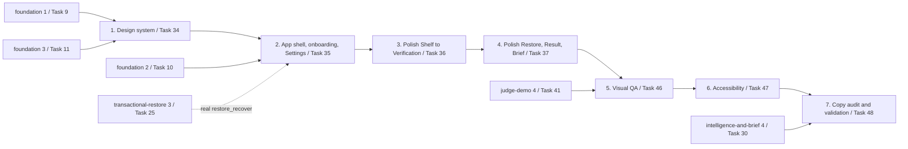

# Implementation Plan

- [ ] 1. Design system (P08-T01, Task 34)
  - Phase 08 runs in parallel from the foundation spec, against `MockClient`.
  - Depends on: foundation task 1 (Task 9, monorepo scaffold)
  - Depends on: foundation task 3 (Task 11, shared contracts, `DormbitClient`, `MockClient`)
  - Owner: frontend
  - [ ] 1.1 Create the token module
    - `packages/ui/src/tokens/tokens.ts` with the 8 colors, 3 text tokens, 4 px spacing scale, radii 6/10/14, three elevation levels, motion 120-200 ms ease-out
    - generate `packages/ui/src/tokens/tokens.css` custom properties, including the `prefers-reduced-motion: reduce` block that sets durations to 0 ms
    - _Requirements: 16.1, 16.2, 18.1, 18.2, 18.3, 23.1_
  - [ ] 1.2 Write the contrast test
    - Vitest in `packages/ui/src/tokens/contrast.test.ts` computing WCAG ratios on Paper and Ink on Sage; assert the plan values to one decimal
    - assert every text/background pair declared in a component token map meets 4.5:1, or 3:1 for Large text
    - _Requirements: 16.3, 16.4, 16.5, 16.6_
  - [ ] 1.3 Bundle the fonts
    - `woff2` files and `OFL.txt` for Inter, Newsreader, JetBrains Mono in `packages/ui/src/fonts/`; `@font-face` with relative URLs; the three font stacks
    - build test: the built CSS contains no `http:` or `https:` font URL
    - _Requirements: 4.3, 17.1, 17.2, 17.3_
  - [ ] 1.4 Build Button, Field, Checkbox, Tabs on React Aria Components
    - visible focus ring at 3:1 or better; checked state uses a glyph, not only a fill
    - _Requirements: 21.1, 21.2, 21.3, 22.1, 19.5_
  - [ ] 1.5 Build List and Table (RAC with TanStack Virtual) and Tree
    - keep `aria-rowcount` and `aria-rowindex` correct while virtualized; record any RAC and TanStack Virtual conflict per design Open question 2
    - _Requirements: 21.3, 22.5, 7.3_
  - [ ] 1.6 Build StatusPill and EvidenceChip
    - SVG glyphs for ✓ ◆ ✕ ? ⊘ with `aria-hidden`, labels in text tokens; pick and document glyphs for Confirmed and Inferred
    - _Requirements: 19.1, 19.2, 19.3, 19.4, 19.5, 22.2_
  - [ ] 1.7 Build ProgressSteps, Toast, Dialog, Sheet
    - `aria-current="step"`, polite live region for step changes only, focus trap and focus return, Escape to close
    - _Requirements: 21.3, 21.4, 22.3_
  - [ ] 1.8 Build EmptyState, ErrorState, Skeleton, ErrorNotice, and the Error_Presenter
    - `packages/ui/src/errors/` with `ERROR_COPY satisfies Record<...>` for every §8 code plus `IPC_SCHEMA_MISMATCH`; Retry only when retryable; code shown in JetBrains Mono
    - _Requirements: 25.1, 25.2, 25.3, 25.4, 25.5_
  - [ ] 1.9 Build CapsuleSeal
    - pure `sealPattern(capsuleId)` from the 16 ID bytes; `sealState(latest)` pressed only for Verified; text label and accessible name
    - _Requirements: 11.5, 11.6, 11.7, 11.8, 22.4_
  - [ ] 1.10 Build SafeMarkdown, PathText, HashText
    - react-markdown with `skipHtml`, non-navigating links, image alt-text placeholders; add a dependency check that fails if `rehype-raw` is present
    - _Requirements: 2.1, 2.2, 2.3, 2.4_
  - [ ] 1.11 Create the dev-only `/gallery` route and the State_Matrix format
    - register only when `import.meta.env.DEV`; build test fails if a release bundle contains the route
    - _Requirements: 20.2, 20.3, 20.4_
  - [ ] 1.12 Add Playwright screenshot tests and axe for the Gallery
    - baseline every entry; zero critical axe violations; zero requests to non-local origins
    - _Requirements: 20.5, 24.1, 4.4_
  - [ ]* 1.13 Write property tests for Safe_Markdown, StatusPill, CapsuleSeal, and Error_Presenter
    - **Property 1: Safe_Markdown never emits raw HTML or fetches**
    - **Property 2: The seal is pressed only for Verified**
    - **Property 3: Every status has a glyph and a label**
    - **Property 4: The Error_Presenter is total**
    - **Validates: Requirements 2.1, 2.2, 2.3, 11.5, 11.6, 11.7, 19.2, 19.3, 22.2, 25.1, 25.2, 25.3, 25.4**
  - [ ] 1.14 Checkpoint: run `scripts/evidence/run.sh pnpm --filter ./packages/ui test` and `scripts/evidence/run.sh pnpm exec playwright test e2e/gallery`

- [ ] 2. App shell, onboarding, Settings (P08-T02, Task 35)
  - Depends on: task 1
  - Depends on: foundation task 2 (Task 10, hardened Tauri shell)
  - Owner: frontend
  - [ ] 2.1 Configure the window
    - `apps/desktop/src-tauri/tauri.conf.json`: `minWidth` 1100, `minHeight` 720, overlay title bar, hidden title, inset traffic lights; `data-tauri-drag-region` on the shell header
    - _Requirements: 5.2, 5.3_
  - [ ] 2.2 Build the App_Shell and route table
    - `packages/ui/src/routes.tsx` with the routes in design; sidebar Shelf, Capsules, Restores, Settings; full-window onboarding; hash router in `apps/desktop`
    - _Requirements: 5.1, 5.4, 5.5, 6.1_
  - [ ] 2.3 Implement TauriClient
    - `apps/desktop/src/client/TauriClient.ts`: `call()` and `jobChannel()` with Zod parsing, `toDormbitError`, `IPC_SCHEMA_MISMATCH`; `AllowlistedCommand` union; no payload logging in release; IDs only, no absolute paths
    - _Requirements: 3.3, 3.4, 26.1, 26.2, 26.3, 26.4, 26.5_
  - [ ] 2.4 Run the client contract suite against TauriClient
    - `runClientContract` from `packages/client` with `invoke` and `Channel` mocked; also run it against MockClient
    - _Requirements: 26.8_
  - [ ]* 2.5 Write property test for TauriClient validation
    - **Property 5: TauriClient never passes unvalidated data**
    - **Validates: Requirements 26.2, 26.3, 26.4**
  - [ ] 2.6 Set up TanStack Query and the data hooks
    - `packages/ui/src/data/`: query keys and invalidation from design; retry only when retryable, at most twice; no mutation retries; `refetchOnWindowFocus: false`; `useJob` store
    - _Requirements: 26.6, 26.7_
  - [ ] 2.7 Build Welcome, Privacy & Permissions, Folder Selection
    - Privacy copy states local-only, no deletion, no code execution, consent for agent histories; Folder Selection calls `scope_pick`, shows `root_display`, starts discovery with real counts; picker cancel is not an error
    - _Requirements: 6.1, 6.2, 6.3, 6.4, 6.5, 6.6_
  - [ ] 2.8 Build Settings
    - sections scopes, consent, defaults, data and privacy, about and licenses; revoke calls `scope_revoke` and removes cached queries for that scope; consent withdrawal clears adapter data; version from `app_info`; font licenses; shortcut list
    - _Requirements: 15.1, 15.2, 15.3, 15.4, 15.5, 21.6_
  - [ ] 2.9 Add the crash-recovery prompt
    - on start, call `restore_recover` to list unfinished restores; Dialog offers discard; discard only on confirmation
    - Depends on: transactional-restore task 3 (Task 25) for the real command; built against MockClient until then
    - _Requirements: 13.4, 13.5_
  - [ ] 2.10 Add native menus and shortcuts
    - `apps/desktop/src-tauri/src/menu.rs` with Tauri's core menu API; app events mapped to routes; ⌘, for Settings, ⌘1-⌘3 for destinations, ⌘F for Shelf search
    - _Requirements: 1.6, 21.5_
  - [ ] 2.11 Re-run the NAT-1 configuration test and add a release devtools check
    - confirm no `fs` or `shell` plugin, only allowlisted Commands, strict CSP, devtools off in release
    - _Requirements: 1.1, 1.2, 1.3, 1.4, 1.5, 4.2_
  - [ ] 2.12 Checkpoint: run `scripts/evidence/run.sh pnpm --filter ./packages/ui test`, `scripts/evidence/run.sh pnpm --filter ./apps/desktop test`, and `scripts/evidence/run.sh cargo test --manifest-path apps/desktop/src-tauri/Cargo.toml`

- [ ] 3. Polish Shelf, Evidence, Plan, Capture, Verification (P08-T03, Task 36)
  - Depends on: task 2
  - Real-data wiring happens in parallel in scope-and-discovery task 4 (Task 18), capsule-and-verification task 4 (Task 22), and intelligence-and-brief task 4 (Task 30). This task works on MockClient scenarios and doesn't wait for them.
  - Owner: frontend
  - [ ] 3.1 Polish the Shelf
    - dense virtualized Table with name, middle-truncated PathText, stack chips, branch and dirty marks, activity, size, seal; search, sort, filter, multi-select by keyboard; manual dormant mark only; "as of last fetch"; partial marks
    - _Requirements: 7.1, 7.2, 7.3, 7.4, 7.5, 7.6, 21.1_
  - [ ] 3.2 Polish the Evidence View
    - six tabs; EvidenceChip list with status filter and hidden count; evidence reference viewer as plain text; no sensitive file contents; `.env.example` key names only; Agent context tab without consent
    - _Requirements: 8.1, 8.2, 8.3, 8.4, 8.5, 8.6, 2.4_
  - [ ] 3.3 Polish the Preservation Plan
    - six groups with reason codes; summary rail with totals, digest, outstanding items; no include control on Excluded: sensitive; Approve disabled with reason; library choice; `PLAN_DIGEST_MISMATCH` reload
    - _Requirements: 9.1, 9.2, 9.3, 9.4, 9.5, 9.6_
  - [ ] 3.4 Polish Capsule Creation
    - ProgressSteps from Job `state` events; counters from `progress` events; Cancel to `job_cancel`; `FILE_CHANGED_DURING_CAPTURE` names the file; post-approval files listed; hand-off to verification
    - _Requirements: 10.1, 10.2, 10.3, 10.4, 10.5, 10.6, 22.3_
  - [ ] 3.5 Polish Integrity Verification
    - checks Table with markers; failed files by manifest path; registry marker with NotInRegistry as Unknown; VER-2 limits text; seal; `capsule_pick` path; capsule list state for the Capsules sidebar item
    - _Requirements: 11.1, 11.2, 11.3, 11.4, 11.6, 11.7, 11.9_
  - [ ] 3.6 Fill the State_Matrix for these five Screens
    - MockClient scenarios for loading, empty, error, partial, cancelled; not-reachable entries with reasons; add each to the Gallery
    - _Requirements: 20.1, 20.2, 20.3_
  - [ ] 3.7 Write component tests for the five Screens
    - each reachable state renders; keyboard paths for search, filter, decisions, approve, cancel
    - _Requirements: 7.2, 9.4, 10.3, 21.1_
  - [ ] 3.8 Checkpoint: run `scripts/evidence/run.sh pnpm --filter ./packages/ui test` and `scripts/evidence/run.sh pnpm exec playwright test e2e/gallery`

- [ ] 4. Polish Restore, Result, Brief (P08-T04, Task 37)
  - Depends on: task 3
  - Real-data wiring happens in parallel in transactional-restore task 4 (Task 26) and intelligence-and-brief task 4 (Task 30).
  - Owner: frontend
  - [ ] 4.1 Polish the Restore Wizard
    - capsule, `restore_target_pick`, folder-name Field; pre-check list with markers and codes; Start disabled on any failure; `RESTORE_DEST_EXISTS` copy; Job steps with real counts; list state for the Restores sidebar item
    - _Requirements: 12.1, 12.2, 12.3, 12.4, 12.5_
  - [ ] 4.2 Polish the Restoration Result
    - every RST-7 section; writes outside destination as a number; HEAD and refs check; working-tree status check; rollback states the destination was not created
    - _Requirements: 13.1, 13.2, 13.3_
  - [ ] 4.3 Polish the Resurrection Brief
    - SafeMarkdown in Newsreader; four outcome rows with exact BRF-2 wording and markers; citation links to the Evidence View; Export calls `brief_export`
    - _Requirements: 14.1, 14.2, 14.3, 14.4, 2.1_
  - [ ] 4.4 Complete the State_Matrix for all 12 native Screens
    - test that iterates the State_Matrix and renders every reachable state; fails on a missing entry
    - _Requirements: 20.1, 20.2, 20.3_
  - [ ] 4.5 Run the Phase 08 exit checks
    - Playwright walkthrough of journeys 1-6 and 9-10 on MockClient; axe zero critical on every reachable state; zero non-local requests; reduced-motion emulation finds no running animation
    - _Requirements: 24.1, 4.4, 23.2, 23.3_
  - [ ] 4.6 Checkpoint: run `scripts/evidence/run.sh pnpm --filter ./packages/ui test` and `scripts/evidence/run.sh pnpm exec playwright test e2e/desktop-ui`

- [ ] 5. Visual QA (P11-T01, Task 46)
  - Depends on: task 4
  - Depends on: judge-demo task 4 (Task 41, demo E2E and Pages preview)
  - Needs the user to grant Screen Recording to Kiro when asked.
  - Owner: qa (capture and defect log), frontend (fixes)
  - [ ] 5.1 Write the native capture script
    - `screencapture -l <window-id>` with a small Swift window-ID helper; captures every reachable State_Matrix state at 1x and 2x using the Dockline fixture only
    - _Requirements: 27.1, 27.3_
  - [ ] 5.2 Capture the web build with Playwright MCP
    - every reachable state of the desktop UI on MockClient and of the demo, at device scale 1 and 2
    - _Requirements: 27.2, 27.3_
  - [ ] 5.3 Open the defect log
    - `docs/evidence/P11-T01-visual-qa.md` with Screen, state, scale, and before image per defect
    - _Requirements: 27.4_
  - [ ] 5.4 Fix the defects and record after images
    - update Gallery screenshot baselines only for approved fixes
    - _Requirements: 27.4, 27.5, 20.5_
  - [ ] 5.5 Checkpoint: run `scripts/evidence/run.sh pnpm exec playwright test e2e/gallery` and confirm the defect log has no open entries

- [ ] 6. Accessibility (P11-T02, Task 47)
  - Depends on: task 5
  - Owner: qa (tests and report), frontend (fixes)
  - [ ] 6.1 Run axe in CI on every reachable state
    - desktop UI on MockClient and every demo step; WCAG 2.1 A and AA tags; fail on critical; record every other violation
    - _Requirements: 24.1, 24.2_
  - [ ] 6.2 Write the keyboard-only walkthrough
    - Playwright with no pointer events for journeys 1, 2, 3, 5, 6, and 9; check focus order, focus visibility, and focus return
    - _Requirements: 24.3, 21.1, 21.2, 21.4_
  - [ ] 6.3 Run the VoiceOver spot check
    - checklist per native Screen: names, Status marker labels, seal name, live-region announcements, table headers
    - _Requirements: 24.4, 22.1, 22.2, 22.3, 22.4, 22.5_
  - [ ] 6.4 Check reduced motion natively and on the web
    - Playwright emulation plus the macOS "Reduce motion" setting in the native app
    - _Requirements: 23.1, 23.2, 23.3_
  - [ ] 6.5 Check that color is never the only signal
    - review every status, selection, error, and focus state in grayscale screenshots from task 5
    - _Requirements: 19.5_
  - [ ] 6.6 Write the accessibility report
    - `docs/evidence/P11-T02-accessibility.md`: axe results, false positives with reasons, walkthrough and VoiceOver results; zero open WCAG A/AA violations
    - _Requirements: 24.2, 24.4, 24.5_
  - [ ] 6.7 Checkpoint: run `scripts/evidence/run.sh pnpm exec playwright test e2e/a11y`

- [ ] 7. Copy audit and accuracy validation (P11-T03, Task 48; validation is P1)
  - Depends on: task 6
  - Depends on: intelligence-and-brief task 4 (Task 30) for the evidence and brief used in validation
  - Owner: qa (audit and scoring), frontend (copy fixes)
  - [ ] 7.1 Move remaining user-facing strings into copy modules
    - `packages/ui/src/copy/` and the demo's copy module; no inline user-facing strings left in Screens
    - _Requirements: 28.1_
  - [ ] 7.2 Write the copy denylist test
    - Vitest scanning the copy modules for overclaims (builds, runs, works, session resumed, context restored, encrypted, signed, authenticated, abandoned, inactive); fails on any hit
    - _Requirements: 28.2, 28.3, 28.4, 28.5, 28.6, 28.7_
  - [ ] 7.3 Run the manual Copy_Audit and fix overclaims
    - review every Screen against the four outcomes, AGT-2 wording, VER-2 limits, and INT-3; record in `docs/evidence/P11-T03-copy-audit.md`
    - _Requirements: 28.1, 28.2, 28.3, 28.4, 28.5, 28.6, 28.8_
  - [ ]* 7.4 (P1) Pick and clone 5 public repos
    - 5 different stacks; `GIT_LFS_SKIP_SMUDGE=1 git clone --depth 1` into `.scratch/validation/`; nothing run, built, or installed
    - _Requirements: 29.1, 29.2, 29.3_
  - [ ]* 7.5 (P1) Score findings
    - run `dormbit-cli evidence` on each clone; score every Confirmed finding against its source; record whether every Inferred finding cites evidence
    - _Requirements: 29.4, 29.5_
  - [ ]* 7.6 (P1) Write the validation report
    - `docs/product/validation.md` with repos, scoring sheet, percentage correct against the 90% target, and a stated miss if it falls short; include the user's own projects only with consent at that time
    - _Requirements: 29.6, 29.7_
  - [ ] 7.7 Checkpoint: run `scripts/evidence/run.sh pnpm --filter ./packages/ui test` and record the copy audit and, if run, the validation scoring sheet

## Task Dependency Graph

Phase 08 (tasks 1-4) starts after foundation and runs in parallel with Phases 03-07 against `MockClient`. Phase 11 (tasks 5-7) waits for the judge demo.



```json
{
  "waves": [
    { "id": 0, "tasks": ["1"] },
    { "id": 1, "tasks": ["2"] },
    { "id": 2, "tasks": ["3"] },
    { "id": 3, "tasks": ["4"] },
    { "id": 4, "tasks": ["5"] },
    { "id": 5, "tasks": ["6"] },
    { "id": 6, "tasks": ["7"] }
  ]
}
```
