# Design Document

## Overview
This spec takes the finished product through proof, packaging, publishing, and submission. It has four stages:

1. **Prove** (P10): run every attack fixture and property at campaign counts, run integration and supply-chain checks, and get the security review to `APPROVED` through the reviewer loop.
2. **Package and publish** (P12-P13): build an ad-hoc-signed DMG in a tag-triggered workflow, test it as a judge would (browser download, quarantine set, Open Anyway), promote the demo to production with a daily smoke test until Jan 29, 2027, audit the repo from a fresh clone, and publish `v1.0.0` with `SHA256SUMS`.
3. **Show** (P14-P16): real-state screenshots, a scripted video under 3:00 built with ffmpeg and checked by machine before the User watches it, and a YouTube upload that goes Public only after approval.
4. **Submit and audit** (P17-P18): Devpost content that cites only real paths and recorded numbers, submitted only after approval, then a final audit and report.

Rules that run through every stage:
- **Nothing public happens without an Approval record.** Every §22 gate is a hard stop (Requirement 21).
- **Nothing is reported that wasn't seen.** Uploads and submissions count only after a confirmation page or a Logged-out check.
- **Every number has a source.** Results come from Evidence records or CI runs, and the Claims_Check enforces that in the Devpost text.
- **Automation is a convenience.** Browser_Automation runs only in the User's own Chrome with the extension they approved; Manual steps exist before it is first used.

## Architecture

```mermaid
flowchart LR
  subgraph P10[Prove]
    CAT[Fixture_Catalog runners] --> SR[Security_Review]
    PC[Property_Campaign 10,000] --> SR
    INT[Integration_Suite] --> SR
    SC[Supply chain + IPC_Fuzz + CSP] --> SR
    SR -->|reviewer loop, max 3| OK{APPROVED}
  end
  OK --> RG[[Release_Gate]]
  subgraph P12_13[Package and publish]
    RG --> TAG((tag v1.0.0<br/>approval))
    TAG --> RW[release.yml<br/>draft release]
    RW --> CI2[Clean_Install_Run]
    PW[pages.yml production] --> SMK[smoke.yml daily]
    CI2 --> AUD[Repo_Audit + Fresh_Clone_Run]
    AUD --> PUB((publish release<br/>approval))
  end
  subgraph P14_16[Show]
    PUB --> SS[Screenshots]
    SS --> SCR((script approval))
    SCR --> REC[Recording + ffmpeg edit]
    REC --> VV[Video_Verifier]
    VV --> WATCH((User watches<br/>approval))
    WATCH --> YT[YouTube Unlisted]
    YT --> PUBLIC((Public<br/>approval))
  end
  subgraph P17_18[Submit and audit]
    PUBLIC --> DC[Devpost_Content + Claims_Check]
    DC --> SUB((Submit<br/>approval))
    SUB --> FA[Final_Audit x2]
    FA --> FR[FINAL_REPORT.md]
  end
```


Circles are approval gates. Note the plan's task order: the tag push (Task 53) comes after the clean-install run (Task 50) in plan numbering, but the clean-install run needs a draft release. The design resolves this by pushing a release-candidate tag `v1.0.0-rc.N` for Task 49-52 drafts (each push approved), and the final `v1.0.0` tag in Task 53 (see Open questions).

### Ownership
| Area | Writer |
|---|---|
| `crates/**`, `fixtures/malicious/**`, `docs/security/**` | `rust-security` |
| tests, `e2e/**`, `docs/evidence/**` | `qa` |
| `.github/**`, `docs/release/**`, `docs/submission/**`, `media/**`, `README.md` | `release` |
| `scripts/**`, `docs/status/**`, `docs/media/**`, `docs/kiro/**`, `THIRD_PARTY_NOTICES.md` | main Agent |
| review verdicts | `reviewer` (read-only) |

## Components and Interfaces

### 1. Fixture_Catalog and runners (Task 42)
```json
// fixtures/malicious/catalog.json
{
  "schema_version": 1,
  "fixtures": [
    { "id": "capsule-traversal", "category": "capsule", "class": "path traversal",
      "source": "fixtures/malicious/traversal.dormbit",
      "generator": "crates/dormbit-core/tests/support/malicious.rs",
      "target": "verify", "expected_code": "PATH_UNSAFE" }
  ],
  "outcomes": [
    { "id": "restore-git-hooks", "category": "restore",
      "source": "fixtures/malicious/git-hooks.dormbit", "target": "restore",
      "expected": { "status": "Restored", "not_restored": [".git/hooks/pre-commit", ".GIT/Hooks/post-checkout"] } }
  ]
}
```
`target` is one of `verify`, `precheck`, `restore`, `scope`, `ipc`. Entries with a `generator` but no committed `source` are built at test time (symlinks, FIFOs, secret-shaped strings).

Runners:
- `crates/dormbit-fs/tests/catalog.rs` handles `verify`, `precheck`, `restore`, and `scope` entries.
- `apps/desktop/src-tauri/tests/ipc_catalog.rs` handles `ipc` entries through Tauri's mock runtime.
- `crates/dormbit-core/tests/catalog_meta.rs` checks that the catalog parses, that there are at least 25 `fixtures` entries, that every class in Requirement 1.2 appears, that every `expected_code` is in `ErrorCode`, and that each `source` file equals its generator's output.

Starting map of classes to codes (the owning spec's code wins if it differs):
| Class | Target | Expected code | Owner spec |
|---|---|---|---|
| path traversal, absolute path | verify | `PATH_UNSAFE` | capsule-and-verification |
| symlink entry, duplicate entry (object, manifest path), manifest/object mismatch (missing, extra), bad marker (content, name) | verify | `CAPSULE_MALFORMED` | capsule-and-verification |
| truncation, missing trailer | verify | `CAPSULE_TRUNCATED` | capsule-and-verification |
| unknown version (marker, `schema_version`) | verify | `CAPSULE_VERSION_UNSUPPORTED` | capsule-and-verification |
| corrupted object | verify | `CAPSULE_HASH_MISMATCH` | capsule-and-verification |
| archive bomb (overflow, ratio) | verify | code from capsule-and-verification | capsule-and-verification |
| NFC collision, case-fold collision | precheck | `RESTORE_COLLISION` | transactional-restore |
| existing target, case variant of target | precheck | `RESTORE_DEST_EXISTS` | transactional-restore |
| component over 255 bytes, path over 1024 bytes, control characters, NUL | precheck | `PATH_UNSAFE` | transactional-restore |
| damage after verification | restore | `CAPSULE_HASH_MISMATCH` | transactional-restore |
| absolute symlink out, `../` symlink out, chained symlink out, `..` request | scope | `PATH_UNSAFE` | scope-and-discovery |
| unknown grant ID, malformed grant ID, unknown project ID | ipc | `SCOPE_DENIED` | scope-and-discovery |

That is more than 25 fixtures once variants are counted separately.

### 2. Property_Campaign (Task 42)
```
scripts/security/campaign.sh
  EVIDENCE_TASK=P10-T01 PROPTEST_CASES=10000 scripts/evidence/run.sh cargo test --workspace --locked --release prop_
  EVIDENCE_TASK=P10-T01 FC_NUM_RUNS=10000   scripts/evidence/run.sh pnpm test -- --run prop
  EVIDENCE_TASK=P10-T01                       scripts/evidence/run.sh cargo test --workspace --locked catalog
```
Property tests follow the naming the other specs use (`prop_*.rs` files and `prop` in Vitest names). `--release` keeps 10,000 cases within a working session. Counterexamples: proptest writes `proptest-regressions/*.txt`, which are committed; fast-check failures are copied into a named regression test with the seed and path.

### 3. Integration_Suite (Task 43)
- `crates/dormbit-cli/tests/smoke.rs`: builds each Synthetic project in a temp folder under `.scratch/it/` (files written by the test; Git repos made with `git2`), then runs the CLI binary through `assert_cmd`-style `std::process::Command` calls from the test (tests may spawn the CLI; product code never spawns anything). Projects:
  | Name | Contents |
  |---|---|
  | `dockline` | extracted Dockline fixture |
  | `rust-crate` | `Cargo.toml`, `src/lib.rs`, `target/` placeholder, Git with 3 commits |
  | `python-pkg` | `pyproject.toml`, `src/pkg/__init__.py`, `.venv/` placeholder, Git |
  | `go-mod` | `go.mod`, `main.go`, Git with a dirty file |
  | `pnpm-mono` | root `package.json` + `pnpm-workspace.yaml` + 2 packages, `node_modules/` placeholder, Git |
  | `no-git` | `README.md` and `notes/` only |
- `crates/dormbit-cli/tests/crash.rs`: starts a restore with the `test-faults` feature that pauses after a named journal state (environment variable read only under that feature), sends SIGKILL, runs `dormbit-cli restore --recover`, and checks the destination and staging folders.
- `crates/dormbit-cli/tests/readonly.rs`: copies each project, runs `chmod -R a-w`, records hash, mode, and mtime of every file, runs capture and restore, re-records, and compares.
- (P1) `e2e/native/`: WebdriverIO with `@wdio/tauri-service`; the app is built with `--features e2e-webdriver`.

### 4. Supply chain, CSP, and IPC (Task 44)
- `cargo deny check` and `pnpm audit --audit-level high` from the foundation CI, run again on the final commit and recorded.
- gitleaks: `gitleaks git --redact --no-banner` over the full history (CI checkout `fetch-depth: 0`).
- CSP: `apps/desktop/src-tauri/tests/csp.rs` compares the config string; `e2e/security/csp.spec.ts` checks the built demo's meta tag and injects `<script>window.__x=1</script>` through `page.evaluate` DOM insertion, then expects a `securitypolicyviolation` event and `window.__x` undefined.
- IPC_Fuzz: `apps/desktop/src-tauri/tests/ipc_fuzz.rs` uses Tauri's `test` feature (dev-dependency only) to build a mock app with the real handlers and sends proptest-generated `serde_json::Value` arguments to each allowlisted command. The response must parse as the command's result type or as `DormbitError`; a panic fails the test.
- Test-feature check (`scripts/release/check-test-features.sh <binary>`):
  1. `cargo tree -p dormbit-desktop -e normal,build -e features --target <target>` must not list `test-picker`, `test-faults`, `e2e-webdriver`, `tauri/test`, or `tauri/devtools`.
  2. Each Test feature compiles `#[used] static TEST_MARKER: [u8; 29] = *b"DORMBIT_TEST_FEATURE_ENABLED\0";`. `LC_ALL=C grep -c -a -F DORMBIT_TEST_FEATURE_ENABLED <binary>` must print `0`.

### 5. Security review loop (Task 45)
```mermaid
sequenceDiagram
  participant A as Agent
  participant RS as rust-security
  participant RV as reviewer
  A->>RS: draft docs/security/review.md from §7 + evidence
  loop up to 3 iterations
    RS->>RV: review.md + diff of security modules since the P02 gate SHA
    RV-->>A: findings + final line APPROVED | NEEDS_CHANGES
    alt NEEDS_CHANGES
      A->>RS: findings
      RS->>RS: fix code or doc, re-run Security_Suite via Evidence_Runner
    end
  end
  A->>A: APPROVED → STATUS.md + usage-log; else stop and ask the User
```
`docs/security/review.md` sections: Scope and method; Threat table (one row per §7 threat: mitigation, proof, evidence link, result); `renameatx_np` review; Malicious fixture results; Property campaign results; Supply chain; Stated limits; Open findings (severity, decision); Reviewer verdicts (iteration, date, verdict).

### 6. Release_Workflow (Task 49)
```yaml
name: release
on:
  push: { tags: ['v*.*.*', 'v*.*.*-rc.*'] }
  workflow_dispatch: {}               # dry run: builds and checks, creates no release
permissions: { contents: read }
jobs:
  build:
    runs-on: macos-15
    env: { CI: "true" }
    steps:
      # checkout (pinned SHA); Rust from rust-toolchain.toml; Node + pnpm from .mise.toml
      - run: pnpm install --frozen-lockfile
      - run: scripts/release/check-version.sh "${GITHUB_REF_NAME#v}"   # Cargo.toml, tauri.conf.json, package.json agree
      - run: pnpm --filter ./apps/desktop tauri build --target "$TARGET" --bundles dmg
        # TARGET=universal-apple-darwin (P1) or aarch64-apple-darwin
      - run: scripts/release/verify-build.sh "$APP" "$DMG"
        # codesign -dv → Signature=adhoc; codesign --verify --deep --strict; lipo -archs; check-test-features.sh
      - run: shasum -a 256 "$(basename "$DMG")" > SHA256SUMS   # run in the DMG's folder
      - uses: actions/upload-artifact   # pinned SHA
  draft:
    needs: build
    if: github.event_name == 'push'
    runs-on: macos-15
    permissions: { contents: write }
    steps:
      - uses: actions/download-artifact # pinned SHA
      - run: gh release create "$GITHUB_REF_NAME" --draft --verify-tag
               --title "DORMBIT $GITHUB_REF_NAME" --notes-file "docs/release/notes-$GITHUB_REF_NAME.md"
               "$DMG_NAME" SHA256SUMS
        env: { GH_TOKEN: "${{ github.token }}" }
```
- DMG names follow Tauri's pattern, `DORMBIT_1.0.0_universal.dmg` or `DORMBIT_1.0.0_aarch64.dmg`, so the architecture is in the file name.
- RC tags add `--prerelease`.
- If Tauri's DMG step fails on the runner, `verify-build.sh` is run on the `.app` and the DMG is made with `hdiutil create -volname DORMBIT -srcfolder DORMBIT.app -ov -format UDZO`.
- Icon: an original SVG mark in `apps/desktop/src-tauri/icons/source.svg`, rendered to a 1024×1024 PNG and passed to `pnpm tauri icon`.
- `scripts/release/build-local.sh` runs the same build and `verify-build.sh` locally and writes the DMG to `.scratch/release-local/`.

### 7. Clean_Install_Run (Task 50)
`docs/release/clean-install-checklist.md` table: step, who (User or Agent), expected result, observed result, evidence (screenshot path or Evidence record). Steps:
1. User opens the draft release page in Safari or Chrome and downloads the DMG.
2. Agent: `xattr -p com.apple.quarantine ~/Downloads/DORMBIT_*.dmg` prints a value; `shasum -a 256 -c SHA256SUMS` passes.
3. User (or Agent with approval): rename `~/Library/Application Support/io.github.amirmlotfy.dormbit` to `….bak-<date>` if it exists.
4. User mounts the DMG and drags DORMBIT to `/Applications`.
5. User opens DORMBIT; Gatekeeper blocks it. Agent records the dialog text.
6. User: System Settings → Privacy & Security → Open Anyway → confirm. App opens.
7. Agent extracts the Dockline fixture to `.scratch/clean-install/`; User picks that folder in the app.
8. Steps through Welcome, Privacy, scan, Evidence View, Plan (decide `data/dev.sqlite`, acknowledge warnings), choose a capsule library under `.scratch/clean-install/library/`, approve, capture, verify, restore into `.scratch/clean-install/restores/` as `dockline-restored`, result, brief export.
9. Agent checks the restored tree against the fixture with `shasum` and records it.
10. Optional: User repeats on a separate macOS user account.
Screenshots need Screen Recording permission (approval).

### 8. Pages_Workflow changes and Smoke_Workflow (Task 51)
`pages.yml` (from judge-demo) gains:
```yaml
on:
  workflow_dispatch:
    inputs:
      ref:     { required: true, default: main }
      channel: { required: true, type: choice, options: [preview, production], default: preview }
# Task 51 removes the `push` trigger once production is live.
```
The build passes `VITE_DORMBIT_CHANNEL`, `VITE_DORMBIT_VERSION`, and `VITE_DORMBIT_SHA` to Vite; the footer shows "Preview" only when the channel is `preview`.

```yaml
# .github/workflows/smoke.yml
name: smoke
on:
  schedule: [{ cron: '17 15 * * *' }]     # daily, 7:17 AM PST
  workflow_dispatch: {}
permissions: { contents: read, issues: write }
jobs:
  smoke:
    runs-on: macos-15
    steps:
      - id: window
        run: |
          today="$(TZ=America/Los_Angeles date +%F)"
          if [[ "$today" > "2027-01-29" ]]; then
            echo "over=true" >> "$GITHUB_OUTPUT"; echo "Judging period is over (PT date $today)."
          fi
      # if over != 'true': checkout, install, playwright install chromium
      - if: steps.window.outputs.over != 'true'
        run: pnpm --filter e2e exec playwright test demo --project=chromium
        env: { BASE_URL: "https://amirmlotfy.github.io/dormbit/" }
      - if: failure()
        run: scripts/release/smoke-issue.sh "$GITHUB_SERVER_URL/$GITHUB_REPOSITORY/actions/runs/$GITHUB_RUN_ID"
        env: { GH_TOKEN: "${{ github.token }}" }
```
`smoke-issue.sh` runs `gh issue list --label smoke-failure --state open --json number --jq '.[0].number'`; if a number comes back it runs `gh issue comment`, otherwise `gh issue create --label smoke-failure`. The `smoke-failure` label is created once in Task 51 (an asked `gh` command). The demo E2E records every request URL and fails if any origin isn't `https://amirmlotfy.github.io` (or the local preview server in CI).

### 9. Repo_Audit and Fresh_Clone_Run (Task 52)
`scripts/release/repo-audit.sh` checks:
- `git ls-files .kiro | head -1` prints a path; `git check-ignore -v .kiro .kiro/specs/foundation/tasks.md` prints nothing.
- `gh repo view AmirmLotfy/dormbit --json licenseInfo,visibility` shows `MIT` and `PUBLIC`.
- `git grep -n -F -e "$HOME"` finds nothing (the path is read from the environment and never written into the script).
- `git grep -n -E '[A-Za-z0-9._%+-]+@[A-Za-z0-9.-]+\.[A-Za-z]{2,}'`, minus `users.noreply.github.com`, `.invalid`, and `example.com` addresses, finds nothing.
- `git ls-files .scratch` prints nothing.
- The README has the headings: Demo, Download, Gatekeeper, Build from source, Architecture, Security, How Kiro was used, What DORMBIT reports (four outcomes), Limits, License.
- `THIRD_PARTY_NOTICES.md` is newer than `Cargo.lock` and `pnpm-lock.yaml` and lists every crate and package from `cargo deny list -f json` (normal dependencies of shipped crates) and `pnpm licenses list --prod --json` (shipped packages).
- Every bundled font folder has an `OFL.txt`.

`scripts/release/fresh-clone.sh`:
1. `git clone https://github.com/AmirmLotfy/dormbit.git .scratch/fresh-clone/dormbit-<stamp>`.
2. Extract the fenced `sh` block that follows `<!-- build-from-source -->` in the clone's README.
3. Run each line in the clone through `scripts/evidence/run.sh` (the clone's own copy), stopping at the first failure.

Running the README's own block means the README can't drift from what was tested.

### 10. GitHub_Release (Task 53)
- `docs/release/notes-v1.0.0.md`: what's included; download and checksum (`shasum -a 256 -c SHA256SUMS`); Gatekeeper steps; limits; demo URL; link to `SECURITY.md`.
- After approval: `git tag -a v1.0.0 -m "v1.0.0 (P13-T02)"` and `git push origin v1.0.0`; the Release_Workflow makes the draft; after a second approval: `gh release edit v1.0.0 --draft=false --latest`.
- Check: `gh release download v1.0.0 -D .scratch/release-check/` then `shasum -a 256 -c SHA256SUMS` in that folder.
- After approval: `gh repo edit AmirmLotfy/dormbit --homepage https://amirmlotfy.github.io/dormbit/ --description "<About text>" --add-topic <each topic>`. The topic list is proposed to the User, not fixed here.

### 11. Evidence layout
```
docs/evidence/
  runs/<UTC stamp>-<slug>.json        Evidence records (foundation)
  P10-T01-security-suite.md
  P10-T02-integration.md
  P10-T03-supply-chain.md
  P12-T01-release-build.md
  P12-T02-clean-install.md            links docs/release/clean-install-checklist.md
  P12-T03-production-deploy.md
  P13-T01-repo-audit.md
  P13-T02-release.md
  P14-T01-screenshots.md
  P15-T03-video.md                    links docs/release/video-verification.md
  P16-T01-youtube.md
  P17-T02-devpost.md
docs/security/review.md
docs/release/{checklist.md, notes-v1.0.0.md, clean-install-checklist.md, video-verification.md}
docs/submission/{checklist.md, devpost-draft.md, devpost.md, devpost-fields.md, disclosures.md,
                 youtube-metadata.md, manual-steps.md}
docs/media/                           selected screenshots + README.md
docs/status/{STATUS.md, HANDOFF.md, gates/P10.md, gates/P12.md … gates/P18.md, FINAL_REPORT.md}
media/
  script/{script.md, shotlist.md}
  cards/*.html                        Title card sources
  edit/timeline.json
  raw/                                gitignored: native and web takes, voice, screenshots before selection
  build/                              gitignored: rendered cards, normalized segments
  final/{dormbit-demo.mp4 (gitignored), dormbit-demo.en.srt, thumbnail.png}
```
Raw logs stay in `.scratch/logs/`. Screenshots and frames that may show private details stay in `.scratch/` or `media/raw/` until reviewed.

### 12. Media_Pipeline (Tasks 54-57)

**Screenshots** (`scripts/media/shoot-native.sh`, `scripts/media/shoot-web.mjs`)
- Native: the window-ID helper from native-experience Task 46 gives the DORMBIT window ID; `screencapture -o -l <id> media/raw/shots/<name>.png` captures that window only, without shadow.
- Web: Playwright at 1440×900 and 1920×1080, `deviceScaleFactor` 2, against the Production demo.
- Selected images: `exiftool -all= -overwrite_original`, then copied to `docs/media/` by the main Agent.

**Script and shot list**: `media/script/shotlist.md` is a table: start, end, segment, source (native take, web take, Title card), on-screen action, voice line ID. `script.md` holds the voice lines with IDs. The Agent sums the planned segment lengths and states the total.

**Title cards**: `media/cards/<id>.html` with bundled fonts (`packages/ui` font files) and tokens; `scripts/media/render-cards.mjs` opens each through `file://` in Playwright Chromium at 1920×1080 and writes `media/build/cards/<id>.png`.

**Recording**
- Native: the User turns on a Focus mode (no notifications) and drives; `scripts/media/record-native.sh <take>` reads the window bounds from the window-ID helper and records that rectangle with `screencapture -v -R<x>,<y>,<w>,<h> media/raw/native-<take>.mov`; between takes the Agent re-extracts the Dockline fixture and resets the capsule library and restore folders under `.scratch/takes/`.
- Web: `scripts/media/web-takes.mjs` runs scripted steps against the Production demo with `recordVideo: { dir: 'media/raw/web', size: { width: 1920, height: 1080 } }`.
- Voice: the User's recordings in `media/raw/voice/<line>.wav`, or Kokoro-82M output for each line (installed only after approval), or none for captions only.

**Edit** (`scripts/media/build-video.sh`, reads `media/edit/timeline.json`)
```json
{ "fps": 30, "size": [1920, 1080],
  "segments": [ { "id": "problem", "source": "media/build/cards/problem.png", "in": 0, "out": 15, "voice": "media/raw/voice/L01.wav" } ] }
```
1. Each segment → `ffmpeg -ss <in> -to <out> -i <source> -vf "scale=1920:1080:force_original_aspect_ratio=decrease,pad=1920:1080:(ow-iw)/2:(oh-ih)/2,fps=30,format=yuv420p" -c:v libx264 -crf 18 -an media/build/seg-<id>.mp4` (still images use `-loop 1 -t <len>`).
2. Video: concat demuxer over the segment list.
3. Voice: place each line at its segment start with `adelay`, mix with `amix`, then two-pass `loudnorm=I=-14:TP=-1.5:LRA=11` (first pass measures, second applies the measured values).
4. Mux: `-c:v copy -c:a aac -b:a 192k -ar 48000 -movflags +faststart media/final/dormbit-demo.mp4`.
No music input exists in the timeline format.

**Captions**: `ffmpeg -i dormbit-demo.mp4 -ar 16000 -ac 1 .scratch/voice16k.wav`; `whisper-cli -m .scratch/models/<model>.bin -f .scratch/voice16k.wav -osrt -of .scratch/captions-raw`; the Agent corrects wording against `script.md` while keeping whisper's timings, and writes `media/final/dormbit-demo.en.srt`. For captions only, cues are written from the script with timings from the timeline.

**Thumbnail**: `media/cards/thumbnail.html` (thumbnail-base screenshot plus the tagline) rendered at 1280×720 to PNG; `stat -f %z` must be below 2,097,152 bytes.

**Video_Verifier** (`scripts/media/verify-video.sh`, writes `.scratch/video-check.json`)
| Check | Command | Pass |
|---|---|---|
| Duration | `ffprobe -v error -show_entries format=duration -of csv=p=0` | < 180.0 s; target 155-165 s reported |
| Streams | `ffprobe -v error -show_entries stream=codec_name,width,height -of json` | `h264` 1920×1080; `aac` unless captions only |
| Frames | `ffmpeg -i … -vf fps=1/5 .scratch/video-frames/f-%03d.png` | Agent reviews each frame; zero findings |
| Loudness | `ffmpeg -i … -af ebur128 -f null -` (parse summary `I:`) | -15 ≤ I ≤ -13 LUFS |
| Transcript | `whisper-cli … -otxt`, then `scripts/media/compare-transcript.mjs script.md transcript.txt` | every differing line listed; User decides |
| Captions | parse SRT | wording equals script; last cue end < duration |
| Hash | `shasum -a 256 dormbit-demo.mp4` | recorded |

### 13. YouTube upload (Task 58)
`docs/submission/youtube-metadata.md`: title, description (one-paragraph summary, demo URL, repo URL, release URL, "Built for Kiroween 2026", chapters from the Shot list starting at 0:00), audience "not made for kids", visibility plan (Unlisted → Public), Caption file, Thumbnail. Chapters follow YouTube's rules (first at 0:00, at least 3, each at least 10 seconds); the Agent checks the Shot list against them.

Flow:
1. Approval: Chrome extension. User installs the Playwright MCP Chrome extension and signs in to YouTube.
2. Agent enables `playwright-chrome`, opens YouTube Studio upload, attaches the Final cut, fills fields from the metadata file, sets Unlisted, shows the User every field, and saves after approval.
3. Agent waits for processing, plays the video in the Studio preview, checks duration and captions.
4. Approval: Public. Agent switches visibility and saves.
5. `e2e/release/youtube-public.spec.ts` (Logged-out check): fresh context, open the watch URL, start playback muted through the page's `<video>` element, wait until `currentTime > 2`, and assert no "Private video" or "Sign in to confirm" text.

### 14. Devpost_Content and Claims_Check (Tasks 59-60)
`docs/submission/devpost.md` sections: Tagline; Inspiration; What it does; How we built it; How we used Kiro (specs, steering, hooks, agents, review loops, property tests, with paths and evidence links); Challenges; Accomplishments; What we learned; What's next; Testing instructions (web demo first; DMG with checksum and Gatekeeper steps; build from source); Frankenstein rationale; Built with; Links; Disclosures.

`docs/submission/devpost-fields.md`: one row per form field (as seen on the form at Task 60), with the value to enter and its source section.

`scripts/release/check-claims.mjs docs/submission/devpost.md v1.0.0`:
- **Paths**: every backticked token containing `/` or a file extension must be a file or folder in `git ls-tree -r --name-only v1.0.0` (folders match by prefix).
- **Numbers**: in the "How we used Kiro" section, every sentence with a digit must contain a link to `docs/evidence/` or to an `/actions/runs/` URL. Dates, versions (`v1.0.0`), task IDs (`P10-T01`, `Task 42`), property IDs (`PROP-3`), and requirement IDs are exempt.
- **Banned phrases** (case-insensitive): "resumes your session", "resume your AI", "AI session resumed" outside the four-outcome line, "notarized" or "encrypted" not preceded by "not" or "isn't", "guaranteed", "builds your project", "runs your project", "first tool", "military-grade", "100% safe".
- **Outcomes**: the four BRF-2 lines appear exactly.
- **Category**: "Frankenstein" appears as the only category.

Submission flow: approval for the Chrome extension (if not already given for YouTube); Agent fills the form from `devpost-fields.md`; shows every field; waits for approval; clicks Submit; reads the confirmation; runs `e2e/release/devpost-public.spec.ts` (Logged-out check of title, video embed, demo and repo links, category).

### 15. Browser_Automation and Manual steps
```mermaid
sequenceDiagram
  participant U as User
  participant A as Agent
  participant C as User's Chrome (extension)
  A->>U: ask: approve Chrome extension (gate)
  U-->>A: approve + signs in to the site
  A->>A: set playwright-chrome disabled:false
  A->>C: navigate, fill fields from metadata file
  A->>U: show every field; ask: approve save/publish/submit
  U-->>A: approve (Approval record)
  A->>C: click the one approved control
  C-->>A: confirmation page
  A->>A: Logged-out check in a fresh Playwright context
  A->>A: set playwright-chrome disabled:true (after Task 60)
```
`docs/submission/manual-steps.md` has, for YouTube and Devpost, numbered steps with each field value to paste, written before automation starts. If automation stops at step N, the Agent tells the User to continue from step N.

### 16. Final_Audit (Task 61)
`scripts/release/final-audit.sh` runs:
- `pnpm --filter e2e exec playwright test release` (Logged-out checks: demo production 12 steps, repo page shows MIT and `.kiro`, release page lists the DMG and `SHA256SUMS`, YouTube Public and playable, Devpost page shows the category and links).
- `gh repo view --json licenseInfo,visibility,homepageUrl`.
- `gh release download v1.0.0 -D .scratch/final-audit/ && shasum -a 256 -c SHA256SUMS`.
- `gh run list --workflow smoke.yml --limit 100 --json conclusion,createdAt`.
- `gh run list --workflow ci.yml --commit "$(git rev-parse origin/main)" --json conclusion`.
- `ffprobe` duration of the Final cut, compared with the Video report.
The README claims check is manual: the Agent lists each behavior sentence in the README and marks it verified against the app or a test, with the evidence path. `docs/status/FINAL_REPORT.md` sections: Deliverables (URL, check, result); What works; Limits; P1 items shipped or cut; What's next; Validation scope (accuracy and workflow validated, adoption not validated).

## Data Models

**Approval record** (in `docs/status/STATUS.md`, section "Approvals")
| When (PT) | Gate | Action | User's words | Result |
|---|---|---|---|---|
| 2026-11-28 14:05 | Release | push tag `v1.0.0-rc.1` | "go ahead" | approved |

**Catalog entry**: see Components §1. Fields: `id` (kebab-case, unique), `category`, `class`, `source` (path or null), `generator` (path), `target`, `expected_code` (an ErrorCode). Outcome entries replace `expected_code` with `expected` (an object specific to the target).

**Video check result** (`.scratch/video-check.json`, summarized into the Video report)
```json
{ "duration_s": 0, "in_target": false, "video": { "codec": "h264", "width": 1920, "height": 1080 },
  "audio": { "codec": "aac" }, "loudness_lufs": 0, "frames_reviewed": 0, "frame_findings": [],
  "transcript_diffs": [], "captions_ok": false, "sha256": "" }
```
Values shown are placeholders for the format.

**Fixed values used by this spec**
| Item | Value |
|---|---|
| Repo | `github.com/AmirmLotfy/dormbit` |
| Production demo | `https://amirmlotfy.github.io/dormbit/` |
| Bundle ID / app data folder | `io.github.amirmlotfy.dormbit` / `~/Library/Application Support/io.github.amirmlotfy.dormbit` |
| Release tag | `v1.0.0` (RC tags `v1.0.0-rc.N`) |
| Smoke end date | 2027-01-29 (PT) |
| Submission target | Wed Dec 2, 2026, 12:00 PM PT |
| Freeze | Thu Dec 3, 2026, 6:00 PM PT |
| Deadline | Fri Dec 4, 2026, 2:00 PM PT |
| Video limit / target | < 180 s / 155-165 s |
| Loudness | -14 LUFS (accepted -15 to -13) |

## Correctness Properties
This spec owns no property-based tests (§12). It runs the properties owned by the other specs at campaign counts (Requirement 2). The statements below are release invariants, each checked by a deterministic script or test rather than by generated inputs.

### Property 1: Every catalog fixture is rejected with its expected code
*For any* entry in the `fixtures` list of the Fixture_Catalog, running it against its target yields exactly its `expected_code`, and the list has at least 25 entries covering every class in Requirement 1.2.
**Validates: Requirements 1.1, 1.2, 1.3, 1.4, 1.6**

### Property 2: No gated action happens without an earlier approval
*For any* action named in Requirement 21, an Approval record with result "approved" for that exact action exists with a PT time earlier than the action's own record (commit, workflow run, or confirmation page).
**Validates: Requirements 12.1, 12.2, 12.5, 17.5, 19.3, 20.2, 20.4, 21.1, 21.2, 21.3, 21.4, 21.5, 21.6, 21.7, 21.8, 21.10, 21.12**

### Property 3: Release assets match their checksums
*For any* asset listed in the published `SHA256SUMS`, the file downloaded from the GitHub_Release has that SHA-256.
**Validates: Requirements 7.6, 12.4, 23.4**

### Property 4: The submission cites only what exists
*For any* repo path cited in the Devpost_Content, the path exists at `v1.0.0`, and *for any* sentence with a measured number in the Kiro write-up, the sentence links to an Evidence record or CI run.
**Validates: Requirements 18.2, 18.3**

### Property 5: The video meets the rules before upload
*For any* Final cut that is uploaded, its recorded duration is below 180 s, its loudness is within -15 to -13 LUFS (unless captions only), its frame review has zero open findings, and the User's approval of that exact SHA-256 is recorded.
**Validates: Requirements 15.9, 16.1, 16.3, 16.4, 16.8, 16.10**

## Error Handling
| Situation | Response |
|---|---|
| Catalog fixture accepted or wrong code | Suite fails with fixture id, expected, actual; `rust-security` fixes; campaign re-runs |
| Property counterexample | Commit regression, log in usage-log, fix, re-run the whole campaign |
| Reviewer `NEEDS_CHANGES` 3 times | Stop; show open items to the User; Phase 10 stays open |
| Release_Gate blocks a task | Print failed conditions; fix them; no override |
| Tauri DMG step fails in CI | Build `.app`, make DMG with `hdiutil`, same checks |
| Clean-install step fails | Fix, new RC tag (approved), repeat from download |
| Production smoke fails | Issue opened or commented; Agent tells the User; redeploy `v1.0.0` via `workflow_dispatch` |
| Fresh clone step fails | Fix README (or code), new clone, repeat |
| Video check fails | Fix timeline or audio, rebuild, re-verify before the User watches |
| Browser_Automation blocked (login, captcha, changed UI) | Stop; Manual steps from the current step; never claim success |
| YouTube custom thumbnail unavailable | Tell the User phone verification is needed; keep default thumbnail |
| Submission not confirmed by freeze | Tell the User what blocks it and the time left |
| User declines a gate | Approval record "declined"; Manual steps or stop; no retry without new approval |

## Testing Strategy
- **Security (Task 42):** catalog runners and meta-test; Property_Campaign at 10,000 cases locally (PROPTEST_CASES, FC_NUM_RUNS), 512 in CI.
- **Integration (Task 43):** CLI smoke on 6 project types; SIGKILL at 4 journal states; read-only copies; (P1) Native_E2E.
- **Supply chain and IPC (Task 44):** cargo-deny, pnpm audit, full-history gitleaks, CSP config and runtime tests, IPC_Fuzz at 10,000 per command locally and 512 in CI, test-feature check.
- **Release (Tasks 49-53):** `verify-build.sh` (codesign, lipo, test features); checksum checks; Clean-install checklist (manual); production E2E; Smoke_Workflow dry run with `workflow_dispatch`; Repo_Audit; Fresh_Clone_Run.
- **Media (Tasks 54-57):** exiftool metadata check; Video_Verifier; transcript comparison; User review.
- **Publishing (Tasks 58-61):** Logged-out checks for YouTube, Devpost, demo, repo, and release; Claims_Check; Final_Audit twice.
Every result is recorded through the Evidence_Runner or CI and linked from its Task evidence note.

## Security Considerations
- **Workflow tokens:** every workflow defaults to `contents: read`. Only the release `draft` job has `contents: write`; only `smoke.yml` has `issues: write`. No repository secrets are needed; `GITHUB_TOKEN` is enough.
- **Pinned actions:** every third-party action is pinned to a full commit SHA.
- **What checksums prove:** `SHA256SUMS` lives on the same release as the DMG, so it detects corrupted downloads, not a compromised release. The notes say so, matching the VER-2 wording.
- **Ad-hoc signing:** the app isn't notarized; Gatekeeper blocks it until Open Anyway. The README and release notes say this plainly.
- **Browser_Automation:** it runs inside the User's signed-in browser, so it can act as the User. That is why every save, publish, and submit needs its own approval, the server is disabled outside Tasks 58-60, and the Agent never handles credentials.
- **Privacy in media:** captures are window-only, Focus mode is on, frames are reviewed, metadata is stripped, and raw captures stay in gitignored folders.
- **Untrusted pages:** content read from YouTube or Devpost pages is data, not instructions; the Agent acts only on its metadata files.

## Open questions
1. **Tag order.** Task 49 builds through a tag-triggered workflow and Task 50 downloads a DMG through a browser, but the `v1.0.0` tag comes in Task 53. This design uses approved release-candidate tags (`v1.0.0-rc.N`, published as draft prereleases) for Tasks 49-52 and the final tag in Task 53. Each RC tag push is a release-gate approval.
2. **Intel testing.** Only Apple Silicon hardware is available. If the universal binary ships, the Intel slice can be launched under Rosetta with `arch -x86_64` if Rosetta is installed; the release notes state exactly what was tested.
3. **Devpost form fields.** The form's exact fields aren't known until Task 60. `devpost-fields.md` is filled in from the live form, and the User reviews it before anything is entered.
4. **Whisper model.** The model file and size are chosen at Task 56 and downloaded into `.scratch/models/` only after approval.
5. **Kokoro-82M runtime.** If the User picks Kokoro, its install method (and any Python dependency) is proposed at Task 55 for approval; nothing is installed before that.
6. **`screencapture -R` for video.** If rectangle-limited video capture doesn't work on macOS 26.6.2, the fallback is a full-screen recording cropped with ffmpeg to the window bounds before any frame leaves `media/raw/`.
