# Implementation Plan

- [ ] 1. Malicious fixtures and property-test campaign (P10-T01, Task 42)
  - Owner: rust-security (`fixtures/malicious/**`, catalog runners under `crates/**`); qa (campaign scripts, evidence note)
  - Depends on: capsule-and-verification task 3 (Task 21, verifier and malicious fixtures)
  - Depends on: transactional-restore task 1 (Task 23, restore pre-checks)
  - Depends on: scope-and-discovery task 1 (Task 15, scope enforcement)
  - [ ] 1.1 Write the Fixture_Catalog
    - `fixtures/malicious/catalog.json` with at least 25 `fixtures` entries (`id`, `category`, `class`, `source` or null, `generator`, `target`, `expected_code`) covering every class in Requirement 1.2, plus a separate `outcomes` list for non-error results (for example `.git/hooks/*` not restored)
    - _Requirements: 1.1, 1.2, 1.5_
  - [ ] 1.2 Write the catalog generators and committed fixtures
    - `crates/dormbit-core/tests/support/malicious.rs` builds each fixture; committed `source` files equal the generator's fresh output; fixtures needing symlinks or FIFOs are built at test time and never committed; no real secret, only run-time-generated secret-shaped strings
    - _Requirements: 1.6, 1.7, 1.8_
  - [ ] 1.3 Write the `verify`/`precheck`/`restore`/`scope` catalog runner
    - `crates/dormbit-fs/tests/catalog.rs` feeds each catalog entry to its target and checks the result equals `expected_code`, printing the fixture `id`, expected code, and actual result on mismatch
    - _Requirements: 1.3, 1.4_
  - [ ] 1.4 Write the `ipc` catalog runner
    - `apps/desktop/src-tauri/tests/ipc_catalog.rs` runs `ipc`-category entries through Tauri's mock runtime
    - _Requirements: 1.3, 1.4_
  - [ ] 1.5 Write the catalog meta-test
    - `crates/dormbit-core/tests/catalog_meta.rs` parses the catalog, checks at least 25 `fixtures` entries, every Requirement 1.2 class present, every `expected_code` a real `ErrorCode`, and each `source` matching its generator
    - _Requirements: 1.1, 1.2_
  - [ ] 1.6 Write `scripts/security/campaign.sh`
    - runs `PROPTEST_CASES=10000 scripts/evidence/run.sh cargo test --workspace --locked --release prop_`, `FC_NUM_RUNS=10000 scripts/evidence/run.sh pnpm test -- --run prop`, and the catalog tests through the Evidence_Runner with `EVIDENCE_TASK=P10-T01`
    - _Requirements: 2.1_
  - [ ] 1.7 Run the Property_Campaign and fix any counterexample
    - run `scripts/security/campaign.sh`; on any failure at 10,000 cases, commit the minimized counterexample as a regression case, record the property ID, counterexample, and fixing commit in `docs/kiro/usage-log.md`, fix the cause, and re-run the whole campaign before moving on
    - _Requirements: 2.3, 2.4_
  - [ ] 1.8 Confirm the CI property job runs at 512 cases
    - check `.github/workflows/ci.yml` from the foundation spec runs the same property tests with 512 cases on every push; note the run link
    - _Requirements: 2.2_
  - [ ] 1.9 Checkpoint: write the evidence note and record results
    - write `docs/evidence/P10-T01-security-suite.md` listing, for each property, the case count, result, duration, and Evidence record path, and for each catalog fixture the expected and actual result; run `scripts/evidence/run.sh scripts/security/campaign.sh`
    - _Requirements: 2.5, 22.2_

- [ ] 2. Integration tests (P10-T02, Task 43)
  - Owner: qa
  - Depends on: task 1
  - Depends on: foundation task 4 (Task 12, Dockline tar and Sidecar)
  - Depends on: transactional-restore task 3 (Task 25, journal and recovery)
  - [ ] 2.1 Write the CLI smoke suite on 6 Synthetic projects
    - `crates/dormbit-cli/tests/smoke.rs` builds `dockline`, `rust-crate`, `python-pkg`, `go-mod`, `pnpm-mono`, and `no-git` under `.scratch/it/` and runs scan, plan, capture, verify, restore, and brief on each through `std::process::Command`; never installs, builds, or runs any Synthetic project
    - _Requirements: 3.1, 3.5_
  - [ ] 2.2 Check restore fidelity for every project
    - every restored file byte-identical to its source, and HEAD matching for the projects that have Git
    - _Requirements: 3.2_
  - [ ] 2.3 Write the crash-and-recovery suite
    - `crates/dormbit-cli/tests/crash.rs` starts a restore with the `test-faults` feature, pauses after each of Staged, Written, Verified, and Committed, sends SIGKILL, runs `dormbit-cli restore --recover`, and checks the destination is absent or complete and verified with no leftover DORMBIT staging folder
    - _Requirements: 3.3_
  - [ ] 2.4 Write the read-only source suite
    - `crates/dormbit-cli/tests/readonly.rs` runs `chmod -R a-w` on each Synthetic project, records hash, mode, and mtime, runs capture and restore, and confirms every source file is unchanged
    - _Requirements: 3.4_
  - [ ] 2.5* Write the Native_E2E suite (P1)
    - `e2e/native/` with WebdriverIO and `@wdio/tauri-service`, driving preserve, verify, and restore of the Dockline fixture against the app built with `--features e2e-webdriver`; the embedded driver plugin compiles only under that Test feature
    - _Requirements: 4.1, 4.2_
  - [ ] 2.6 Record whether Native_E2E shipped
    - if cut, state in the Final report and the README that native E2E wasn't shipped and that the manual native QA checklist covers the native journey
    - _Requirements: 4.3_
  - [ ] 2.7 Checkpoint: write the evidence note and record results
    - write `docs/evidence/P10-T02-integration.md` with each suite's Evidence record path; run `scripts/evidence/run.sh cargo test -p dormbit-cli --test smoke --test crash --test readonly`
    - _Requirements: 3.6, 22.2_

- [ ] 3. Supply chain and IPC (P10-T03, Task 44)
  - Owner: rust-security (CSP config, test-feature check, IPC fuzz harness under `crates/**`); qa (running and recording checks)
  - Depends on: task 2
  - Depends on: foundation task 2 (Task 10, hardened Tauri shell)
  - [ ] 3.1 Run and record `cargo deny check`
    - on the final commit; zero errors
    - _Requirements: 5.1_
  - [ ] 3.2 Run and record `pnpm audit --audit-level high`
    - zero high or critical advisories; list any moderate or low advisory with its decision in `docs/evidence/P10-T03-supply-chain.md`
    - _Requirements: 5.2_
  - [ ] 3.3 Run gitleaks on the full history
    - `gitleaks git --redact --no-banner` with full history (`fetch-depth: 0` in CI); zero findings
    - _Requirements: 5.3_
  - [ ] 3.4 Write the CSP config and runtime tests
    - `apps/desktop/src-tauri/tests/csp.rs` compares the desktop CSP string to the foundation design; `e2e/security/csp.spec.ts` compares the built demo's meta tag to the judge-demo design string and injects an inline `<script>`, expecting a `securitypolicyviolation` event and no execution
    - _Requirements: 5.4, 5.5_
  - [ ] 3.5 Write the IPC_Fuzz harness
    - `apps/desktop/src-tauri/tests/ipc_fuzz.rs` using Tauri's `test` feature to build a mock app with real handlers, sending proptest-generated JSON to every allowlisted command, 10,000 cases per command locally and 512 in CI; every response is a schema-valid result or a `DormbitError`, never a panic
    - _Requirements: 5.6_
  - [ ] 3.6 Write the test-feature check
    - `scripts/release/check-test-features.sh <binary>`: `cargo tree` must not list any Test feature or `tauri/devtools`; `LC_ALL=C grep -c -a -F DORMBIT_TEST_FEATURE_ENABLED <binary>` must print `0`
    - _Requirements: 5.7, 5.8_
  - [ ] 3.7 Checkpoint: write the evidence note and record results
    - write `docs/evidence/P10-T03-supply-chain.md`; run `scripts/evidence/run.sh cargo deny check`, `scripts/evidence/run.sh pnpm audit --audit-level high`, and `scripts/evidence/run.sh cargo test -p dormbit-desktop --test csp --test ipc_fuzz`
    - _Requirements: 5.1, 5.2, 5.3, 22.2_

- [ ] 4. Security review (P10-T04, Task 45)
  - Owner: rust-security (draft and revisions); reviewer (verdicts, read-only)
  - Depends on: task 1
  - Depends on: task 2
  - Depends on: task 3
  - [ ] 4.1 Draft `docs/security/review.md`
    - sections: scope and method; threat table covering every §7 threat row with mitigation, proof, Evidence/CI link, and result; a dedicated section on the single `unsafe` `renameatx_np` call in `dormbit-fs` (inputs, invariants, error handling, tests); the §7 stated limits and the VER-2 integrity limit; open findings with severity and decision
    - _Requirements: 6.1, 6.2, 6.3, 6.4_
  - [ ] 4.2 Run the reviewer loop
    - the `rust-security` agent sends the draft plus the diff of security modules since the P02 gate SHA to the `reviewer` agent; on `NEEDS_CHANGES`, revise the code or document and re-run the Security_Suite via the Evidence_Runner, for at most 3 iterations in total
    - _Requirements: 6.5, 6.6_
  - [ ] 4.3 Handle a non-approved outcome
    - if the reviewer hasn't returned `APPROVED` after 3 iterations, stop and show the User the open items; Phase 10 does not exit
    - _Requirements: 6.7_
  - [ ] 4.4 Record the approved verdict
    - when `APPROVED`, record the verdict and iteration count in `docs/status/STATUS.md` and `docs/kiro/usage-log.md`
    - _Requirements: 6.8_
  - [ ] 4.5 Checkpoint: confirm Phase 10 exit conditions and write the gate note
    - confirm every Security_Suite, Integration_Suite, and Supply_Chain_Checks job is green on the final CI run of the phase; write `docs/status/gates/P10.md` linking each result and update `docs/status/STATUS.md` and `docs/status/HANDOFF.md`
    - _Requirements: 6.9, 22.3_

- [ ] 5. Release build (P12-T01, Task 49)
  - Owner: release (`.github/workflows/release.yml`, `scripts/release/**`); rust-security for any `crates/**` fix found by the build
  - Depends on: task 4
  - Depends on: native-experience task 1 (Task 34, design system, for the app icon source)
  - [ ] 5.1 Check the Release_Gate before starting
    - confirm the latest Evidence record is green, gitleaks finds nothing, `LICENSE` exists, and `.kiro` is not ignored; stop and name any failed condition instead of proceeding
    - _Requirements: 22.1_
  - [ ] 5.2 Write `scripts/release/check-version.sh`
    - fails if `apps/desktop/src-tauri/Cargo.toml`, `apps/desktop/src-tauri/tauri.conf.json`, and `apps/desktop/package.json` disagree on `1.0.0`
    - _Requirements: 7.5_
  - [ ] 5.3 Write the app icon and run `tauri icon`
    - an original SVG mark in `apps/desktop/src-tauri/icons/source.svg`, rendered to a 1024x1024 PNG, passed to `pnpm tauri icon`
    - _Requirements: 7.2_
  - [ ] 5.4 Write `scripts/release/verify-build.sh`
    - `codesign -dv` reports `Signature=adhoc`; `codesign --verify --deep --strict` exits 0; `lipo -archs` check when the universal binary ships; runs the Requirement 5 test-feature check on the release binary
    - _Requirements: 7.3, 7.4, 7.7_
  - [ ] 5.5 Write `.github/workflows/release.yml`
    - triggers on `v*.*.*` and `v*.*.*-rc.*` tag pushes plus `workflow_dispatch`; `build` job on `macos-15` with `contents: read` builds the DMG and runs `verify-build.sh`; separate `draft` job with `contents: write` only, creating a draft (prerelease for RC tags) GitHub release with the DMG and `SHA256SUMS`, never auto-published
    - _Requirements: 7.1, 7.6, 7.8_
  - [ ] 5.6 Write `scripts/release/build-local.sh`
    - runs the same build and `verify-build.sh` locally, writing the DMG to `.scratch/release-local/`
    - _Requirements: 7.9_
  - [ ] 5.7* Build the universal binary (P1)
    - `--target universal-apple-darwin`; `lipo -archs` on the main executable prints both `x86_64` and `arm64`; release notes state how the Intel slice was tested or that it wasn't tested on Intel hardware
    - _Requirements: 8.1, 8.2, 8.3_
  - [ ] 5.8 State the architecture limit if the universal binary is cut
    - DMG file name, release notes, and README all state Apple Silicon only
    - _Requirements: 7.10_
  - [ ] 5.9 APPROVAL GATE: push the first release-candidate tag
    - show the User the version, target (`v1.0.0-rc.1`), and that this triggers `release.yml` and creates a draft prerelease; stop and wait for the User's answer before pushing the tag
    - _Requirements: 21.3_
  - [ ] 5.10 Checkpoint: record the release-build evidence note
    - write `docs/evidence/P12-T01-release-build.md` with the Evidence_Runner output of `build-local.sh` and the CI run link for `release.yml`
    - _Requirements: 22.2_

- [ ] 6. Clean-install run (P12-T02, Task 50)
  - Owner: release (checklist, DMG handling); User drives the native steps
  - Depends on: task 5
  - [ ] 6.1 Write `docs/release/clean-install-checklist.md`
    - table of step, who (User or Agent), expected result, observed result, evidence; covering browser download, quarantine check, app-data rename, Gatekeeper block, Open Anyway, full native workflow on the Dockline fixture, and restore verification
    - _Requirements: 9.1, 9.3, 9.4_
  - [ ] 6.2 APPROVAL GATE: write outside the workspace for app data and `/Applications`
    - ask the User to copy the app to `/Applications` and rename `~/Library/Application Support/io.github.amirmlotfy.dormbit` aside (or approve the Agent doing so); nothing is deleted; stop until the User answers
    - _Requirements: 9.2, 21.2_
  - [ ] 6.3 Run the browser download and checksum check
    - download the DMG through Safari or Chrome from the draft release; `xattr -p com.apple.quarantine` on the DMG prints a value; `shasum -a 256 -c SHA256SUMS` passes; record both in the checklist
    - _Requirements: 9.1_
  - [ ] 6.4 Run the Gatekeeper and full workflow steps
    - record that Gatekeeper blocks first launch and that System Settings → Privacy & Security → Open Anyway opens it; run Welcome, Privacy, folder pick, scan, Evidence View, Plan, approval, capture, verification, restore, result, and brief export on the extracted Dockline fixture, recording pass or fail for each step
    - _Requirements: 9.3, 9.4_
  - [ ] 6.5 Fix and repeat on any failed step
    - if any step fails, fix the cause, build a new RC DMG (through task 5's approval gate), and repeat the Clean_Install_Run from the download step
    - _Requirements: 9.5_
  - [ ] 6.6 Update the README's Gatekeeper steps
    - match word for word the steps that worked in the Clean_Install_Run
    - _Requirements: 9.6_
  - [ ] 6.7* Run the optional separate-user-account test
    - if the User chooses to test on a separate macOS user account, the User runs it and the Agent records the result as optional
    - _Requirements: 9.7_
  - [ ] 6.8 Checkpoint: record the clean-install evidence note
    - write `docs/evidence/P12-T02-clean-install.md` linking `docs/release/clean-install-checklist.md` and the restored-tree `shasum` comparison
    - _Requirements: 22.2_

- [ ] 7. Production web deploy and daily smoke test through Jan 29, 2027 (P12-T03, Task 51)
  - Owner: release
  - Depends on: task 6
  - Depends on: judge-demo task 4 (Task 41, `pages.yml` preview)
  - [ ] 7.1 Add `workflow_dispatch` inputs to `pages.yml`
    - `ref` (required) and `channel` (`preview` default, `production` option); pass `VITE_DORMBIT_CHANNEL`, `VITE_DORMBIT_VERSION`, `VITE_DORMBIT_SHA` to the Vite build; footer shows "Preview" only when the channel is `preview`
    - _Requirements: 10.1, 10.2_
  - [ ] 7.2 Deploy the first production build and remove the push trigger
    - run `workflow_dispatch` with `channel=production` from the `v1.0.0-rc` commit; after it is live, remove the `push` trigger from `pages.yml` so later pushes can't replace production
    - _Requirements: 10.1, 10.3_
  - [ ] 7.3 Run the production demo E2E
    - the 12-step demo E2E on Chromium against `https://amirmlotfy.github.io/dormbit/` through the Evidence_Runner; confirm every network request goes to `https://amirmlotfy.github.io` with no analytics or other third-party request
    - _Requirements: 10.4, 10.5_
  - [ ] 7.4 Write `.github/workflows/smoke.yml`
    - daily cron plus `workflow_dispatch`; `contents: read` and `issues: write` only; checks the PT date, exits 0 with a message if after 2027-01-29, otherwise runs the 12-step demo E2E against the Production demo
    - _Requirements: 10.6, 10.7, 10.8, 10.11_
  - [ ] 7.5 Write `scripts/release/smoke-issue.sh`
    - on failure, comments on the open `smoke-failure`-labeled issue if one exists, otherwise opens one with that label and the run URL
    - _Requirements: 10.9, 10.10_
  - [ ] 7.6 Checkpoint: record the production-deploy evidence note
    - write `docs/evidence/P12-T03-production-deploy.md` with the production E2E Evidence record and the first `smoke.yml` run link
    - _Requirements: 22.2_

- [ ] 8. Repository audit and fresh clone (P13-T01, Task 52)
  - Owner: release
  - Depends on: task 7
  - [ ] 8.1 Write `scripts/release/repo-audit.sh`
    - checks `git ls-files .kiro` lists files, `git check-ignore -v .kiro .kiro/specs/foundation/tasks.md` prints nothing, `gh repo view AmirmLotfy/dormbit --json licenseInfo,visibility` shows MIT and PUBLIC, no tracked file contains the home folder path, a personal email address, or anything from `.scratch/`
    - _Requirements: 11.1, 11.2, 11.7_
  - [ ] 8.2 Write `THIRD_PARTY_NOTICES.md`
    - list every Rust crate and npm package shipped in the Release_Build or Production demo, with version and license, generated from `cargo deny list -f json` and `pnpm licenses list --prod --json`
    - _Requirements: 11.4_
  - [ ] 8.3 Add the OFL license file next to each bundled font
    - _Requirements: 11.5_
  - [ ] 8.4 Write `docs/submission/disclosures.md`
    - state that planning took place in Kiro Plan mode on Nov 3, 2026, list every template or scaffold used, and state that no code from before the Submission Period was used
    - _Requirements: 11.6_
  - [ ] 8.5 Update the README to cover every required section
    - tagline, Production demo URL, DMG download with checksum instructions and Gatekeeper steps, build-from-source steps, architecture, security with a link to `SECURITY.md`, Kiro usage, the four BRF-2 outcomes, the limits (ad-hoc signing, no encryption, no OS sandbox, Apple Silicon only if Requirement 8 is cut), and the license
    - _Requirements: 11.3_
  - [ ] 8.6 Run the Repo_Audit and fix any finding
    - run `scripts/release/repo-audit.sh` through the Evidence_Runner; fix any failed check before continuing
    - _Requirements: 11.1, 11.2, 11.7_
  - [ ] 8.7 Run the Fresh_Clone_Run
    - `scripts/release/fresh-clone.sh` clones the public repo into `.scratch/fresh-clone/`, extracts the README's `<!-- build-from-source -->` fenced block, and runs every step through the Evidence_Runner, stopping at the first failure
    - _Requirements: 11.8_
  - [ ] 8.8 Fix and repeat on any failed step
    - if a README step fails or a needed step is missing, fix the README (or code) and repeat the Fresh_Clone_Run from a new clone
    - _Requirements: 11.9_
  - [ ] 8.9 Checkpoint: record the repo-audit evidence note
    - write `docs/evidence/P13-T01-repo-audit.md` linking the `repo-audit.sh` and `fresh-clone.sh` Evidence records
    - _Requirements: 22.2_

- [ ] 9. Release v1.0.0 (P13-T02, Task 53)
  - Owner: release
  - Depends on: task 8
  - [ ] 9.1 Write the release notes
    - `docs/release/notes-v1.0.0.md`: what's included, Gatekeeper steps, the limits from the README, checksum instructions, and the Production demo URL; content cites only real repo paths and measured numbers, and claims no feature that was not actually used
    - _Requirements: 12.3_
  - [ ] 9.2 APPROVAL GATE: publish the v1.0.0 tag and release
    - show the User the final audited commit SHA, the proposed `v1.0.0` tag, the draft release notes, and the asset list; stop until the User approves, then create and push the annotated tag `v1.0.0`, let `release.yml` build the draft, show the User the resulting release notes and asset list again, and publish only after a second explicit approval
    - _Requirements: 12.1, 12.2, 21.3_
  - [ ] 9.3 Verify the published release's checksums
    - `gh release download v1.0.0 -D .scratch/release-check/` then `shasum -a 256 -c SHA256SUMS` passes
    - _Requirements: 12.4_
  - [ ] 9.4 APPROVAL GATE: set repo topics, website, and About description
    - propose the topic list, the website URL (the Production demo URL), and the About description to the User; stop until the User approves, then run `gh repo edit`
    - _Requirements: 12.5, 21.4_
  - [ ] 9.5 Redeploy production from v1.0.0 if needed
    - if the Production demo was built from a commit other than `v1.0.0`, redeploy it from `v1.0.0` through `workflow_dispatch` and re-run the production smoke test
    - _Requirements: 12.6_
  - [ ] 9.6 Checkpoint: record the release evidence note
    - write `docs/evidence/P13-T02-release.md` with the checksum verification output and the release URL
    - _Requirements: 22.2_

- [ ] 10. Screenshots (P14-T01, Task 54)
  - Owner: release (capture scripts, selection); main Agent copies selected images into `docs/media/`
  - Depends on: task 9
  - [ ] 10.1 APPROVAL GATE: Screen Recording permission
    - ask the User to grant Screen Recording permission for the native capture helper; stop until it is granted before any native capture
    - _Requirements: 13.3, 21.5_
  - [ ] 10.2 Capture native screenshots
    - from the newest `v1.0.0-rc.N` or `v1.0.0` DMG built from the same commit as the Production demo, window-only captures via the window-ID helper, real app states, no edited UI, paths shown as `~`, no User name, no real project names other than Dockline, no notifications, other apps, Dock, or menu bar
    - _Requirements: 13.1, 13.2, 13.3_
  - [ ] 10.3 Capture web screenshots
    - Playwright against the Production demo, real app states, same privacy rules as 10.2
    - _Requirements: 13.1, 13.2_
  - [ ] 10.4 Strip metadata and select the final set
    - `exiftool -all=` on each selected image, confirmed with `exiftool` that no GPS, author, or host field remains; select 6-8 images into `docs/media/`, including a README hero image and a thumbnail base; write `docs/media/README.md` naming the screen and state of each
    - _Requirements: 13.4, 13.5_
  - [ ] 10.5 Confirm the Screenshot_Set still matches the live app
    - check each image against the live app and confirm the screen still looks the same
    - _Requirements: 13.6_
  - [ ] 10.6 Checkpoint: write the evidence note
    - write a short note at `docs/evidence/P14-T01-screenshots.md` listing the selected images and the capture source for each
    - _Requirements: 22.2_

- [ ] 11. Script and shot list (P15-T01, Task 55)
  - Owner: release
  - Depends on: task 10
  - [ ] 11.1 Write the Shot list
    - `media/script/shotlist.md`, a timed table in order: 0:00-0:15 the problem; native discovery and Evidence View; Plan; Capture and Verify; Restore; corruption and rollback; the Brief and the four outcomes; 2:20-2:40 architecture and how Kiro was used; the end card; total duration between 2:35 and 2:45
    - _Requirements: 14.1, 14.2_
  - [ ] 11.2 Write the Video_Script
    - `media/script/script.md` with voice lines, each claim shown by the shipped app or supported by an Evidence record, using the four BRF-2 outcome labels exactly; no claim that DORMBIT resumes AI sessions, runs or builds projects, encrypts data, or is notarized
    - _Requirements: 14.3, 14.4_
  - [ ] 11.3 APPROVAL GATE: voiceover choice
    - ask the User to choose their own voice, Kokoro-82M (Apache-2.0), or captions only; stop until the User answers; if Kokoro is chosen, propose its install method for a separate approval before installing anything; never use macOS `say` voices
    - _Requirements: 14.5, 14.6, 21.1, 21.9_
  - [ ] 11.4 APPROVAL GATE: script and shot list approval
    - show the User the Video_Script and Shot list; start recording only after the User approves
    - _Requirements: 14.7, 21.9_
  - [ ] 11.5 Checkpoint: write the evidence note
    - write a short note at `docs/evidence/P15-T01-script.md` recording the approved script/shot-list version and the voiceover choice
    - _Requirements: 22.2_

- [ ] 12. Recording and editing (P15-T02, Task 56)
  - Owner: release
  - Depends on: task 11
  - [ ] 12.1 Record native takes
    - the User drives the app in Focus mode while the Agent runs a window-only recorder via `scripts/media/record-native.sh`, resetting the Dockline fixture and capsule library between takes
    - _Requirements: 15.1_
  - [ ] 12.2 Record web takes
    - `scripts/media/web-takes.mjs` runs scripted Playwright steps at 1920x1080 against the Production demo, recording video
    - _Requirements: 15.2_
  - [ ] 12.3 Render Title cards
    - `media/cards/*.html` rendered to PNG with Playwright, bundled fonts only, no third-party logo
    - _Requirements: 15.3, 15.9_
  - [ ] 12.4 Assemble the Final cut
    - `media/edit/timeline.json` plus `scripts/media/build-video.sh` with ffmpeg; no music track; voice normalized to -14 LUFS integrated loudness; output H.264 1920x1080 with AAC audio
    - _Requirements: 15.4, 15.5, 15.7_
  - [ ] 12.5 APPROVAL GATE: whisper model install
    - ask the User to approve downloading the whisper-cli model into `.scratch/models/`; stop until approved
    - _Requirements: 21.1_
  - [ ] 12.6 Produce captions and thumbnail
    - transcribe with whisper-cli, correct against the Video_Script keeping whisper's timings, write `media/final/dormbit-demo.en.srt`; render a 1280x720 Thumbnail under 2 MB
    - _Requirements: 15.6, 15.7_
  - [ ] 12.7 Confirm raw media stays out of Git
    - raw recordings remain in `media/raw/`, which is gitignored; Final cut shows third-party product names only as plain text with no logo and no copyrighted music
    - _Requirements: 15.8, 15.9_
  - [ ] 12.8 Checkpoint: write the evidence note
    - write `docs/evidence/P15-T02-recording.md` noting the Final cut path, its SHA-256, and the recording scripts used
    - _Requirements: 22.2_

- [ ] 13. Video verification (P15-T03, Task 57)
  - Owner: release
  - Depends on: task 12
  - [ ] 13.1 Write `scripts/media/verify-video.sh`
    - `ffprobe` for duration (< 180.0 s, 155-165 s target reported) and streams (1920x1080 H.264, AAC unless captions only); writes `.scratch/video-check.json`
    - _Requirements: 16.1, 16.2_
  - [ ] 13.2 Extract and review frames
    - one frame every 5 seconds to `.scratch/video-frames/`; inspect each for third-party logos, paths not shown as `~`, personal information, and notifications; list every finding
    - _Requirements: 16.3_
  - [ ] 13.3 Measure loudness and compare the transcript
    - ffmpeg `ebur128` filter; integrated loudness between -15 and -13 LUFS (marked not applicable if captions only); whisper-cli transcript compared against `script.md`, listing every differing line; confirm the Caption file wording matches and its last cue ends before the Final cut ends
    - _Requirements: 16.4, 16.5, 16.6, 16.7_
  - [ ] 13.4 Fix and re-run on any failed check
    - fix the timeline or audio and rebuild before asking the User to watch
    - _Requirements: 16.8_
  - [ ] 13.5 Write the Video report
    - `docs/release/video-verification.md` with each measured value, the Final cut's SHA-256, and the Evidence record paths
    - _Requirements: 16.9_
  - [ ] 13.6 APPROVAL GATE: Final cut approval
    - the User watches the Final cut; the Agent uploads nothing until the User approves it
    - _Requirements: 16.10, 21.9_
  - [ ] 13.7 Checkpoint: record the video evidence note
    - write `docs/evidence/P15-T03-video.md` linking `docs/release/video-verification.md` and the Evidence_Runner records
    - _Requirements: 22.2_

- [ ] 14. YouTube upload and verify (P16-T01, Task 58)
  - Owner: release
  - Depends on: task 13
  - [ ] 14.1 Write `docs/submission/manual-steps.md` (YouTube section) and `docs/submission/youtube-metadata.md`
    - numbered manual steps with each field value to paste; metadata file with title, description (Production demo URL, repo URL, chapters from the Shot list starting at 0:00), "not made for kids", visibility plan, Caption file, Thumbnail
    - _Requirements: 20.5_
  - [ ] 14.2 APPROVAL GATE: Chrome extension for Browser_Automation
    - ask the User to install and sign in to YouTube in Chrome with the Playwright MCP Chrome extension; stop until approved before enabling `playwright-chrome`
    - _Requirements: 17.1, 20.2, 20.3, 21.6_
  - [ ] 14.3 Fill in and save the upload as Unlisted
    - through Browser_Automation (or the Manual steps if it fails), show the User every field value, save only after approval, with the Caption file and Thumbnail if the account supports custom thumbnails
    - _Requirements: 17.2, 17.3, 20.1, 20.4, 20.6_
  - [ ] 14.4 Handle unavailable custom thumbnail
    - if the account can't use custom thumbnails, tell the User it needs phone verification and leave the default thumbnail until the User acts
    - _Requirements: 17.7_
  - [ ] 14.5 Check the Unlisted video
    - confirm it plays, duration matches the Video report, and captions are available
    - _Requirements: 17.4_
  - [ ] 14.6 APPROVAL GATE: make the video Public
    - stop until the User approves switching visibility; making the video public happens only after this approval
    - _Requirements: 17.5, 21.7_
  - [ ] 14.7 Run the Logged-out check
    - fresh Playwright context opens the public URL, confirms playback time advances past 2 seconds, and finds no private or sign-in notice
    - _Requirements: 17.6, 20.8_
  - [ ] 14.8 Record the public URL
    - write it to `docs/status/STATUS.md` and `docs/submission/devpost.md`
    - _Requirements: 17.8_
  - [ ] 14.9 Checkpoint: write the evidence note
    - write `docs/evidence/P16-T01-youtube.md` linking the Logged-out check's Evidence record and the public URL
    - _Requirements: 22.2_

- [ ] 15. Devpost content (P17-T01, Task 59)
  - Owner: release
  - Depends on: task 14
  - [ ] 15.1 Write the Devpost_Content draft
    - `docs/submission/devpost.md`: story sections, Kiro write-up, judge testing instructions (web demo first, then DMG with checksum and Gatekeeper steps), Frankenstein rationale from plan §2, built-with tags, the Screenshot_Set gallery, the demo/repo/release/video URLs; cites only real repo paths and measured numbers, claims no feature that was not actually used
    - _Requirements: 18.1_
  - [ ] 15.2 Write the Kiro write-up with sourced numbers
    - every sentence with a digit in the Kiro write-up links to an Evidence record or CI run; cite only repo paths that exist at `v1.0.0`
    - _Requirements: 18.2_
  - [ ] 15.3 Add disclosures, category, and the validated-scope statement
    - include the disclosures from `docs/submission/disclosures.md`; name exactly one category, Frankenstein; state that accuracy and the workflow were validated and that adoption was not
    - _Requirements: 18.4, 18.5, 18.6_
  - [ ] 15.4 Use the four BRF-2 outcomes exactly
    - _Requirements: 18.7_
  - [ ] 15.5 Write and run `scripts/release/check-claims.mjs`
    - checks paths exist at `v1.0.0`, every digit-bearing sentence in the Kiro write-up has an evidence link, no banned overclaim phrase appears, the four outcome lines appear exactly, and Frankenstein is the only category; exits 1 naming each problem
    - _Requirements: 18.3_
  - [ ] 15.6 Fix every Claims_Check finding
    - re-run `check-claims.mjs` until it exits 0
    - _Requirements: 18.3_
  - [ ] 15.7 Checkpoint: record the content evidence note
    - write a short note at `docs/evidence/P17-T01-devpost-content.md` recording the clean `check-claims.mjs` run
    - _Requirements: 22.2_

- [ ] 16. Fill in, approve, submit, verify (P17-T02, Task 60)
  - Owner: release
  - Depends on: task 15
  - [ ] 16.1 Write `docs/submission/manual-steps.md` (Devpost section) and `docs/submission/devpost-fields.md`
    - manual steps with field values; one row per live form field with the value to enter and its source section in `devpost.md`
    - _Requirements: 20.5_
  - [ ] 16.2 APPROVAL GATE: Chrome extension for Devpost (if not already approved)
    - if `playwright-chrome` isn't already enabled from task 14, ask the User to approve it for Devpost; stop until approved
    - _Requirements: 20.2, 21.6_
  - [ ] 16.3 Fill in the Devpost form
    - through Browser_Automation (or the Manual steps if it fails), using values from `devpost-fields.md`; show the User every field value and the selected category before submitting
    - _Requirements: 19.1, 19.2, 20.1, 20.4, 20.6_
  - [ ] 16.4 APPROVAL GATE: final Devpost submit
    - show the User the complete filled form one last time; click Submit only after the User approves, targeting Wed Dec 2, 2026, 12:00 PM PT (hard deadline Fri Dec 4, 2026, 2:00 PM PT); never ask the User for their password, cookies, tokens, or a 2FA code
    - _Requirements: 19.3, 21.8_
  - [ ] 16.5 Run the Logged-out check and confirm submission
    - fresh Playwright context opens the public submission page and confirms the title, video, demo link, repo link, and Frankenstein category; do not report the Devpost_Submission as submitted until this confirmation or Devpost's own confirmation page is seen
    - _Requirements: 19.4, 19.5, 20.8_
  - [ ] 16.6 Record the submission URL
    - write it to `docs/status/STATUS.md`
    - _Requirements: 19.6_
  - [ ] 16.7 Disable Browser_Automation
    - set `playwright-chrome` back to `disabled: true`
    - _Requirements: 20.7_
  - [ ] 16.8 Checkpoint: write the evidence note
    - write `docs/evidence/P17-T02-devpost.md` linking the Logged-out check's Evidence record and the submission URL
    - _Requirements: 22.2_

- [ ] 17. Final delivery audit (P18-T01, Task 61)
  - Owner: release (script and report); qa (test runs)
  - Depends on: task 16
  - [ ] 17.1 Write `scripts/release/final-audit.sh`
    - Logged-out Playwright checks of the Production demo 12 steps, the repo page (MIT, `.kiro`), the release page (DMG, `SHA256SUMS`), YouTube (Public, playable), and Devpost (category, links); `gh repo view --json licenseInfo,visibility,homepageUrl`; DMG download and checksum check; `gh run list` for `smoke.yml` and `ci.yml`; `ffprobe` duration of the Final cut compared with the Video report
    - _Requirements: 23.1, 23.2, 23.3, 23.4, 23.5, 23.6_
  - [ ] 17.2 Check every README behavior claim against the shipped app
    - list each behavior sentence in the README, mark it verified against the app or a test, with the evidence path, and list any mismatch
    - _Requirements: 23.7_
  - [ ] 17.3 Run the Final_Audit on Wed Dec 2, 2026 after submission
    - fix any failing check and re-run before the freeze
    - _Requirements: 23.9, 23.10_
  - [ ] 17.4 Run the Final_Audit again on Thu Dec 3, 2026 before the 6:00 PM PT freeze
    - after the freeze, fix only critical problems before Fri Dec 4, 2026, 2:00 PM PT and record the rest in the Final report
    - _Requirements: 23.9, 23.10, 24.3, 24.5_
  - [ ] 17.5 Write `docs/status/FINAL_REPORT.md`
    - sections: deliverables (URL, check, result); what works; limits; P1 items shipped or cut; what's next; validation scope (accuracy and workflow validated, adoption not validated)
    - _Requirements: 23.8_
  - [ ] 17.6 Checkpoint: record the final-audit evidence note
    - write `docs/evidence/P18-T01-final-audit.md` linking both `final-audit.sh` runs and `docs/status/FINAL_REPORT.md`
    - _Requirements: 22.2, 22.3_

## Task Dependency Graph

```mermaid
flowchart LR
  C3[capsule-and-verification 3 / Task 21] --> T1
  R1[transactional-restore 1 / Task 23] --> T1
  S1[scope-and-discovery 1 / Task 15] --> T1
  T1[1. Malicious fixtures and property campaign / Task 42] --> T2
  F4[foundation 4 / Task 12] --> T2
  R3[transactional-restore 3 / Task 25] --> T2
  T2[2. Integration tests / Task 43] --> T3
  F2[foundation 2 / Task 10] --> T3
  T3[3. Supply chain and IPC / Task 44] --> T4
  T1 --> T4
  T2 --> T4
  T4[4. Security review / Task 45] --> T5
  N1[native-experience 1 / Task 34] --> T5
  T5[5. Release build / Task 49] --> T6
  T6[6. Clean-install run / Task 50] --> T7
  J4[judge-demo 4 / Task 41] --> T7
  T7[7. Production web deploy and smoke test / Task 51] --> T8
  T8[8. Repo audit and fresh clone / Task 52] --> T9
  T9[9. Release v1.0.0 / Task 53] --> T10
  T10[10. Screenshots / Task 54] --> T11
  T11[11. Script and shot list / Task 55] --> T12
  T12[12. Recording and editing / Task 56] --> T13
  T13[13. Video verification / Task 57] --> T14
  T14[14. YouTube upload and verify / Task 58] --> T15
  T15[15. Devpost content / Task 59] --> T16
  T16[16. Fill in, approve, submit, verify / Task 60] --> T17
  T17[17. Final delivery audit / Task 61]
```



```json
{
  "waves": [
    { "id": 0, "tasks": ["1"] },
    { "id": 1, "tasks": ["2"] },
    { "id": 2, "tasks": ["3"] },
    { "id": 3, "tasks": ["4"] },
    { "id": 4, "tasks": ["5"] },
    { "id": 5, "tasks": ["6"] },
    { "id": 6, "tasks": ["7"] },
    { "id": 7, "tasks": ["8"] },
    { "id": 8, "tasks": ["9"] },
    { "id": 9, "tasks": ["10"] },
    { "id": 10, "tasks": ["11"] },
    { "id": 11, "tasks": ["12"] },
    { "id": 12, "tasks": ["13"] },
    { "id": 13, "tasks": ["14"] },
    { "id": 14, "tasks": ["15"] },
    { "id": 15, "tasks": ["16"] },
    { "id": 16, "tasks": ["17"] }
  ]
}
```
