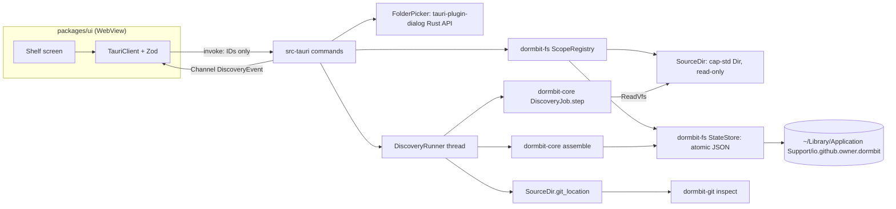
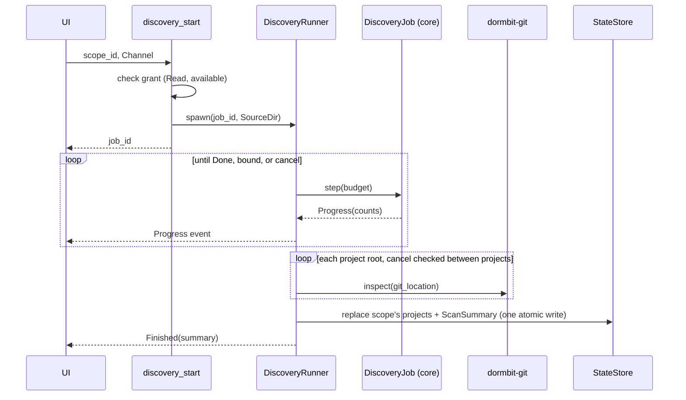

# Design Document

## Overview
This design covers P03 (Tasks 15-18). It adds four pieces:

1. A scope layer in `dormbit-fs`: the `ScopeRegistry` of folder grants, the read-only `SourceDir` handle over `cap-std`, the `GitLocation` check, and the `StateStore` for DORMBIT's own JSON files.
2. A walker in `dormbit-core` that runs over the `ReadVfs` trait. It is bounded, step-based, and cancellable. It honors gitignore rules through `ignore::gitignore` matchers, finds Project roots, and extracts metadata.
3. A `dormbit-git` crate that reads repositories with `git2` (libgit2), network features off, and never runs the git CLI.
4. Tauri commands and the Shelf screen: `scope_pick`, `scope_list`, `scope_revoke`, `discovery_start`, `discovery_cancel`, `projects_list`, `project_get`, `project_set_dormant`.

The Rust scope layer is the security boundary. Tauri capabilities limit which commands the UI can call, but they don't check paths, so every path check happens in Rust (plan §0, Tauri 2 notes).

## Architecture



**Crate boundaries**

| Crate | Owns | Must not |
|---|---|---|
| `dormbit-core` | `RelPath`, `ReadVfs`, `MemVfs`, `DiscoveryJob` (walker), Manifest_Table, Rebuildable_Table, metadata extraction, `assemble`, shared types (`ScopeGrant`, `ProjectRecord`, `GitSnapshot`, `ScanSummary`) | use `std::fs`, `std::process`, or `unsafe` (`#![forbid(unsafe_code)]`) |
| `dormbit-fs` | `ScopeRegistry`, `SourceDir`, `GitLocation`, `StateStore`, `InstanceLock` | call `ambient_authority()` outside `src/scope/`; expose write methods on `SourceDir` |
| `dormbit-git` | `inspect(&GitLocation) -> GitInspection`, URL redaction, risky-key matching | spawn processes; enable `git2` network features; write to a repository |
| `apps/desktop/src-tauri` | commands, `FolderPicker`, `DiscoveryRunner`, app-state wiring | accept paths from the UI; put absolute paths in errors or logs |
| `packages/schema`, `packages/client`, `packages/ui` | ts-rs output plus Zod, `DormbitClient` methods, Shelf | render raw HTML |

`dormbit-git` depends on `dormbit-fs` only for the `GitLocation` type. The WebAssembly build uses `dormbit-core` with `MemVfs` and gets its Git snapshot from the fixture sidecar (plan §6), so `dormbit-git` is native only.

**Discovery job flow**



## Components and Interfaces

### 1. `dormbit-core`: paths and the read-only Vfs

```rust
// crates/dormbit-core/src/path.rs
/// Validated relative path. "." is the root. Components are UTF-8,
/// non-empty, not "." or "..", and contain no '/' or NUL.
#[derive(Clone, Debug, PartialEq, Eq, Hash, PartialOrd, Ord)]
pub struct RelPath(String);

impl RelPath {
    pub fn root() -> RelPath;
    pub fn parse(s: &str) -> Result<RelPath, DormbitError>; // PATH_UNSAFE on failure
    pub fn join(&self, name: &str) -> Result<RelPath, DormbitError>;
    pub fn components(&self) -> impl Iterator<Item = &str>;
    pub fn depth(&self) -> u32;          // root = 0
    pub fn nfc_key(&self) -> String;     // NFC form, used for project IDs
}
```

```rust
// crates/dormbit-core/src/vfs.rs
pub trait ReadVfs {
    /// Lists one directory. No component of `dir` is followed if it is a symlink.
    fn read_dir(&self, dir: &RelPath) -> Result<Vec<DirEntry>, VfsError>;
    /// Metadata of the entry itself (lstat semantics).
    fn symlink_metadata(&self, path: &RelPath) -> Result<Metadata, VfsError>;
    /// Reads a regular file up to `max_bytes`. Fails with `Unsafe` if any
    /// component is a symlink or the file is not regular.
    fn read_limited(&self, path: &RelPath, max_bytes: u64) -> Result<Limited, VfsError>;
}

pub struct DirEntry { pub name: String, pub kind: EntryKind }
pub enum EntryKind { File, Dir, Symlink, Special }
pub struct Metadata { pub kind: EntryKind, pub len: u64, pub mtime: Timestamp, pub mode: u32 }
pub enum Limited { Complete(Vec<u8>), TooLarge { len: u64 } }
pub enum VfsError { Unsafe, NotFound, PermissionDenied, NotUtf8Name, Other }
```

`ReadVfs` has no write methods. The write half of the Vfs (staging, create-new files) is defined by `capsule-and-verification` and `transactional-restore` as a separate trait, so a `ReadVfs` value can never be used to write. `MemVfs` (in `crates/dormbit-core/src/vfs/mem.rs`) implements `ReadVfs` for tests and for `dormbit-wasm`, including symlink and special-file entries.

`VfsError::Unsafe` maps to `PATH_UNSAFE`. The other variants are counted as `unreadable` by the walker and never reach the UI as raw OS errors.

### 2. `dormbit-core`: the walker (`DiscoveryJob`)

```rust
// crates/dormbit-core/src/discovery/mod.rs
pub struct DiscoveryLimits {
    pub max_depth: u32,
    pub max_entries: u64,
    pub time_budget_ms: u64,
    pub max_read_bytes: u64,
}

pub struct DiscoveryJob<'v, V: ReadVfs> { /* stacks, queues, counts */ }

impl<'v, V: ReadVfs> DiscoveryJob<'v, V> {
    pub fn new(vfs: &'v V, scope_id: ScopeId, limits: DiscoveryLimits, clock: &'v dyn Clock) -> Self;
    /// Visits at most `budget` entries, then returns.
    pub fn step(&mut self, budget: u32) -> StepOutcome;
}

pub enum StepOutcome { Progress(Counts), Done(WalkResult) }
pub struct Counts { pub dirs: u64, pub files: u64, pub symlinks: u64, pub special: u64,
                    pub unreadable: u64, pub projects: u64 }
pub struct WalkResult { pub roots: Vec<WalkedProject>, pub counts: Counts,
                        pub bounds_hit: Vec<Bound>, pub partial: bool }
pub enum Bound { Depth, Entries, Time }
```

**Walk order.** Depth-first with an explicit stack. Each directory listing is sorted by name bytes before use, so the result doesn't depend on the order the OS returns entries (Property 16). Inside a project, `.git` and Rebuildable directories go to a per-project deferred queue that runs after the rest of the project. If a bound hits during the deferred queue, names, docs, manifests, and activity are already complete and only `size.partial` is affected.

**Per entry.**
- `Symlink`: count it, record 0 bytes, never descend or read (Requirement 7.1).
- `Special`: count it, never open (Requirement 7.3).
- `File`: add `len` to the project's size; update `latest_mtime` unless inside `.git/` or a Rebuildable directory; if the name is in the Manifest_Table or is a doc name, record it.
- `Dir`: check for Markers when outside any project; push children unless depth would exceed `max_depth`.

**Bounds.** Before each entry the job checks `entries_visited < max_entries` and `clock.monotonic_ms() - start < time_budget_ms`. Depth is checked when pushing a child. A hit bound is recorded once in `bounds_hit`. Entries and time stop the walk; depth only prunes. Every project whose subtree was pruned or left unvisited gets `partial: true`.

**Root detection.** A directory outside any project is a Project root if it contains a Marker. Once inside a project, Markers are ignored, which gives monorepo-as-one-project. Directories named `node_modules` and other unguarded Rebuildable_Table names are not searched for roots even outside a project.

**Ignore rules.** For each project the job keeps a stack of `ignore::gitignore::Gitignore` matchers, one per directory that has a `.gitignore`, plus one from `.git/info/exclude`. The job reads the file bytes through `ReadVfs::read_limited` and feeds each line to `GitignoreBuilder::add_line`. It never calls `GitignoreBuilder::add(path)`, because that reads from disk with `std::fs`. Global excludes (`core.excludesFile`) are not read. Ignored paths still count toward size, but they are not searched for docs, manifests, or nested Markers.

**Cancellation.** The job holds no thread. The native `DiscoveryRunner` checks an `AtomicBool` before each `step` call and before each Git inspection. The browser build calls `step` in idle callbacks.

### 3. `dormbit-core`: tables and metadata

**Manifest_Table** (`crates/dormbit-core/src/discovery/manifests.rs`)

| File | Stack | Name key |
|---|---|---|
| `package.json` | Node.js | `name` |
| `Cargo.toml` | Rust | `[package].name` |
| `pyproject.toml` | Python | `[project].name` |
| `go.mod` | Go | none |
| `Gemfile` | Ruby | none |
| `composer.json` | PHP | none |
| `pom.xml`, `build.gradle`, `build.gradle.kts` | JVM | none |
| `Package.swift` | Swift | none |

Framework stack findings come from dependency keys in a parsed `package.json`, with a small rule set that covers the Dockline fixture: `react`, `vite`, `typescript` (or a `tsconfig.json` file), `fastify`, `drizzle-orm`, `better-sqlite3`. Each finding uses rule IDs of the form `stack.<ecosystem>.<name>` and cites the manifest key, for example `package.json#dependencies.react`. More frameworks are P1 item 6.

**Rebuildable_Table** (`crates/dormbit-core/src/discovery/rebuildable.rs`)

| Directory name | Guard (must hold in the parent directory unless noted) |
|---|---|
| `node_modules` | none |
| `target` | `Cargo.toml` exists |
| `dist` | `package.json` exists |
| `build` | `package.json`, `build.gradle`, or `build.gradle.kts` exists |
| `.venv`, `venv` | `pyvenv.cfg` exists inside the directory |
| `__pycache__`, `.pytest_cache`, `.mypy_cache`, `.ruff_cache` | none |
| `.next`, `.nuxt`, `.svelte-kit`, `.turbo`, `.parcel-cache` | none |
| `.gradle` | none |

A name match with a failed guard is an ordinary directory (Requirement 11.2). The capture plan's "Excluded: rebuildable" group in `capsule-and-verification` must use this same table so size and plan agree.

**Docs:** root files starting with `README`, `CHANGELOG`, `CONTRIBUTING`, `LICENSE`, `COPYING`; `*.md` under `docs/`.
**Agent artifacts:** `.kiro/`, `AGENTS.md`, `CLAUDE.md`, `.cursor/rules`, `.specstory/`. Presence and path only. Parsing is `intelligence-and-brief` Task 28.

```rust
// crates/dormbit-core/src/discovery/assemble.rs
pub fn project_id(scope_id: &ScopeId, rel_root: &RelPath) -> ProjectId; // hex SHA-256 of scope_id, 0x00, rel_root.nfc_key()
pub fn assemble(scope: &ScopeGrant, walk: WalkResult,
                git: BTreeMap<RelPath, GitInspection>,
                marks: &Marks, scanned_at: Timestamp) -> (Vec<ProjectRecord>, ScanSummary);
```

`assemble` copies `marks.dormant` from `marks.json` by project ID and never computes it (Requirement 12.1). It is pure, so the golden Dockline test can run it on MemVfs and on a real extracted tree.

### 4. `dormbit-fs`: `ScopeRegistry` and `SourceDir`

```rust
// crates/dormbit-fs/src/scope/mod.rs
pub struct ScopeRegistry { grants: BTreeMap<ScopeId, GrantEntry> }
struct GrantEntry { record: ScopeGrantRecord, dir: Option<cap_std::fs::Dir> } // None = unavailable

/// A folder path that came from the native picker. Constructed only in
/// src-tauri/src/picker.rs (checked by a test that greps for the constructor).
pub struct PickedFolder(PathBuf);

impl ScopeRegistry {
    pub fn load(records: Vec<ScopeGrantRecord>) -> Self;              // reopens, checks dev+ino
    pub fn grant(&mut self, kind: GrantKind, picked: PickedFolder,
                 ids: &dyn IdGen, clock: &dyn Clock) -> Result<ScopeGrant, DormbitError>;
    pub fn list(&self) -> Vec<ScopeGrantView>;
    pub fn revoke(&mut self, id: &ScopeId) -> Result<(), DormbitError>; // SCOPE_DENIED if unknown
    pub fn source(&self, id: &ScopeId) -> Result<SourceDir, DormbitError>; // Read + available only
    pub fn records(&self) -> Vec<ScopeGrantRecord>;                     // for StateStore
}
```

`grant` calls `cap_std::fs::Dir::open_ambient_dir(path, ambient_authority())`. This is the only `ambient_authority()` call in the app path (Requirement 5.2). It reads device and inode with `metadata()` on the opened handle, so the identity belongs to the folder actually opened. `root_display` is the picked path with the home prefix replaced by `~`.

```rust
// crates/dormbit-fs/src/scope/source.rs
pub struct SourceDir { root: cap_std::fs::Dir, scope_id: ScopeId }

impl ReadVfs for SourceDir { /* see below */ }

impl SourceDir {
    pub fn scope_id(&self) -> &ScopeId;
    pub fn git_location(&self, project: &RelPath) -> Result<GitLocation, GitIssue>;
}
```

- **Resolving a path.** `SourceDir` walks `RelPath` one component at a time from `root` with `cap_fs_ext::DirExt::open_dir_nofollow`, so no intermediate symlink is followed, even one that stays inside the root. Escapes through `..` or absolute paths are already impossible because `RelPath` rejects them, and `cap-std` rejects them again (spike a1: `cap_std_rejects_parent_traversal`, `cap_std_rejects_absolute_paths`, `cap_std_rejects_symlink_escape`).
- **Reading a file.** Open the final component with `OpenOptions::read(true)`, `OpenOptionsFollowExt::follow(FollowSymlinks::No)`, and `custom_flags(libc::O_NONBLOCK)` so a FIFO swapped in after the listing can't block. Then `fstat` the handle; if it is not a regular file, close it and return `Unsafe`. Read at most `max_bytes + 1` bytes to detect `TooLarge`.
- **No write API.** `SourceDir` has no method that creates, writes, removes, renames, or changes permissions, and it never returns its inner `Dir` or a raw fd. `compile_fail` doc tests in `crates/dormbit-fs/src/scope/source.rs` prove each missing method (Requirement 6.2).

```rust
// crates/dormbit-fs/src/scope/git_location.rs
/// A repository location checked against the grant. Only dormbit-git reads `path`.
pub struct GitLocation { workdir: PathBuf, worktree_external: bool }
impl GitLocation { pub fn workdir(&self) -> &Path; pub fn worktree_external(&self) -> bool; }
```

`git_location` uses `symlink_metadata` through the handle:
- `.git` is a symlink: `Err(GitIssue::GitDirIsSymlink)`.
- `.git` is a directory: `Ok`, `worktree_external: false`.
- `.git` is a file: read it with `read_limited`, parse `gitdir: <path>`, then read `<gitdir>/commondir` if present. Both targets are resolved lexically against the project and must stay inside the Grant root, or the result is `Err(GitIssue::GitDirOutsideGrant)`. Otherwise `Ok`, `worktree_external: true`.

The absolute `workdir` is built from the private grant root path. It never leaves the native process.

### 5. `dormbit-fs`: `StateStore` and `InstanceLock`

```rust
// crates/dormbit-fs/src/state.rs
pub struct StateStore { dir: cap_std::fs::Dir }
impl StateStore {
    pub fn open(app_data_dir: &Path) -> Result<Self, DormbitError>;
    pub fn load<T: DeserializeOwned + Versioned>(&self, name: StateFile) -> Result<Loaded<T>, DormbitError>;
    pub fn save<T: Serialize + Versioned>(&self, name: StateFile, value: &T) -> Result<(), DormbitError>;
}
pub enum StateFile { Scopes, Projects, Marks }      // scopes.json, projects.json, marks.json
pub enum Loaded<T> { Fresh(T), Ok(T), SetAside { renamed_to: String, value: T } }

pub struct InstanceLock(cap_std::fs::File);
impl InstanceLock { pub fn acquire(store: &StateStore) -> Result<Option<Self>, DormbitError>; }
```

- **Atomic save:** create `<name>.tmp-<uuid>` with create-new, write, `sync_all` (uses `F_FULLFSYNC` on macOS), rename over `<name>`. A failure before rename removes only that temp file, which DORMBIT just created.
- **Set aside:** a file that fails to parse is renamed to `<name>.corrupt-<RFC 3339 timestamp>` and never deleted (Requirement 19.6).
- **Lock:** `dormbit.lock` opened once and locked with `std::fs::File::try_lock` (stable since Rust 1.89), which is safe Rust. `acquire` returns `None` when another instance holds it. `main` then shows a Rust-side message dialog and exits before `StateStore::load` runs.

### 6. `dormbit-git`

```rust
// crates/dormbit-git/src/lib.rs
pub enum GitInspection { Snapshot(GitSnapshot), Issue(GitIssue) }
pub fn inspect(loc: &GitLocation) -> GitInspection;
pub fn redact_remote_url(raw: &str) -> String;
pub fn risky_key(name: &str) -> bool;
```

`Cargo.toml`: `git2 = { version = "<pinned>", default-features = false, features = ["vendored-libgit2"] }`. No `https`, `ssh`, or `ssh_key_from_memory` features.

`inspect` steps:
1. `Repository::open_ext(loc.workdir(), RepositoryOpenFlags::NO_SEARCH, &[] as &[&OsStr])`. Failure: `Issue(Unreadable)`.
2. `repo.is_bare()`: `Issue(Bare)`.
3. HEAD: `repo.head()`. `ErrorCode::UnbornBranch` gives `branch` from the symbolic target of `HEAD`, `commit: None`. `repo.head_detached()` sets `detached`. Commit time and `summary()` come from `peel_to_commit`. Any other error: `Issue(Unreadable)`.
4. Status: `StatusOptions` with `include_untracked(true)`, `recurse_untracked_dirs(true)`, `exclude_submodules(true)`, `include_ignored(false)`, and never `update_index(true)`. Flag mapping:

   | Count | libgit2 flags |
   |---|---|
   | `staged` | `INDEX_NEW`, `INDEX_MODIFIED`, `INDEX_DELETED`, `INDEX_RENAMED`, `INDEX_TYPECHANGE` |
   | `modified` | `WT_MODIFIED`, `WT_TYPECHANGE`, `WT_RENAMED` |
   | `deleted` | `WT_DELETED` |
   | `untracked` | `WT_NEW` |
   | `conflicted` | `CONFLICTED` |

   A file counts once in each category it has a flag for.
5. Stash: `repo.stash_foreach` counting entries. It reads `refs/stash` and its reflog only.
6. Upstream: `Branch::upstream()` for the current branch; if found, `repo.graph_ahead_behind(local, upstream)` and the upstream's short name. `as_of_last_fetch` is the mtime of `.git/FETCH_HEAD` (or the common dir's, for a Linked worktree) if present. No remote is contacted, because no transport is compiled in.
7. Submodules: `repo.submodules()` for name and path. `initialized` is true when `.git/modules/<name>` exists. Submodule repositories are never opened.
8. LFS: root `.gitattributes` contains `filter=lfs`, or `.git/lfs` exists.
9. Config: `repo.config()?.open_level(ConfigLevel::Local)` and, when present, `ConfigLevel::Worktree`. Iterate entries; `risky_key` matches `core.fsmonitor`, `core.hookspath`, `core.sshcommand`, `credential.helper`, `credential.<sub>.helper`, and any `filter.<sub>.<var>`, comparing section and variable lowercase and keeping the subsection as written. Only the key name is stored.
10. Remotes: `repo.remotes()`, then `find_remote(name)?.url_bytes()`, passed through `redact_remote_url` before leaving the function.

libgit2 does not run external filter drivers, fsmonitor hooks, or credential helpers during these read calls. The test in Task 17 checks this with a sentinel instead of relying on that statement (Requirement 14.5).

`redact_remote_url` rules, in order:
1. `scheme://[userinfo@]host[:port]/path[?query][#fragment]`: userinfo becomes `***`; query and fragment are dropped.
2. scp-like `[user@]host:path`: user kept unless it contains `:`, then `***`.
3. Local paths (`/...`, `./...`, `file://...`): shown with the home prefix as `~`.
4. Anything else: `(hidden: unrecognized URL format)`.

### 7. `src-tauri`: picker, commands, runner

```rust
// apps/desktop/src-tauri/src/picker.rs
pub trait FolderPicker: Send + Sync {
    fn pick(&self, title: &str) -> Option<PickedFolder>;
}
pub struct NativeFolderPicker { app: tauri::AppHandle }   // app.dialog().file().blocking_pick_folder()
#[cfg(feature = "test-picker")]
pub struct StubFolderPicker { next: Mutex<Option<PathBuf>> }
```

`blocking_pick_folder` runs inside an async command on Tauri's async runtime, not on the main thread. The capability file grants the WebView no `dialog:*` permission (spike a2 used the same setup).

```rust
// apps/desktop/src-tauri/src/commands/scope.rs
#[tauri::command] async fn scope_pick(state: State<'_, App>, kind: GrantKind) -> Result<Option<ScopeGrant>, DormbitError>;
#[tauri::command] fn scope_list(state: State<'_, App>) -> Result<Vec<ScopeGrantView>, DormbitError>;
#[tauri::command] fn scope_revoke(state: State<'_, App>, scope_id: ScopeId) -> Result<(), DormbitError>;

// apps/desktop/src-tauri/src/commands/discovery.rs
#[tauri::command] fn discovery_start(state: State<'_, App>, scope_id: ScopeId,
                                     on_event: tauri::ipc::Channel<DiscoveryEvent>) -> Result<JobId, DormbitError>;
#[tauri::command] fn discovery_cancel(state: State<'_, App>, job_id: JobId) -> Result<(), DormbitError>;

// apps/desktop/src-tauri/src/commands/projects.rs
#[tauri::command] fn projects_list(state: State<'_, App>) -> Result<ProjectsList, DormbitError>;
#[tauri::command] fn project_get(state: State<'_, App>, project_id: ProjectId) -> Result<ProjectRecord, DormbitError>;
#[tauri::command] fn project_set_dormant(state: State<'_, App>, project_id: ProjectId, dormant: bool) -> Result<ProjectRecord, DormbitError>;
```

All eight names are added to `tauri_build::AppManifest::commands` and to the single capability. `ScopeId`, `ProjectId`, and `JobId` deserialize strictly (UUID v4 text for `ScopeId` and `JobId`, 64 lowercase hex characters for `ProjectId`). A malformed ID fails before the handler runs and is returned as `SCOPE_DENIED`.

Command behavior:
- `scope_pick(kind)`: `RestoreTarget` returns `SCOPE_DENIED` (those grants come from `restore_target_pick` in `transactional-restore`). Otherwise open the picker; `None` returns `Ok(None)`; then `ScopeRegistry::grant`, save `scopes.json`, return the grant.
- `scope_revoke(id)`: set the cancel flag of any job on `id`, wait for it to stop, then `registry.revoke`, then save `scopes.json`, `projects.json`, and `marks.json` with that scope's data removed. Return only after all three saves.
- `discovery_start(id)`: `registry.source(id)` (fails for wrong kind or unavailable). If a job for `id` is running, return its `JobId`. Otherwise spawn a `DiscoveryRunner` thread.
- `discovery_cancel(job_id)`: set the flag. Unknown or finished job IDs return `Ok(())`, because there is nothing to cancel.
- `projects_list`: all ProjectRecords with marks merged, plus all ScanSummaries.
- `project_get`, `project_set_dormant`: unknown ID returns `SCOPE_DENIED`.

`DiscoveryRunner` loop: `job.step(512)` (entries per step), send `Progress`, check cancel; after `Done`, inspect Git per root (cancel checked between projects), `assemble`, save `projects.json` once, send `Finished`. On cancel it sends `Cancelled`, returns `CANCELLED` as the job result, and writes nothing.

### 8. TypeScript client and Shelf

```ts
// packages/client/src/DormbitClient.ts (additions)
interface DormbitClient {
  scopePick(kind: 'Read' | 'CapsuleLibrary'): Promise<ScopeGrant | null>;
  scopeList(): Promise<ScopeGrantView[]>;
  scopeRevoke(scopeId: ScopeId): Promise<void>;
  discoveryStart(scopeId: ScopeId, onEvent: (e: DiscoveryEvent) => void): Promise<JobId>;
  discoveryCancel(jobId: JobId): Promise<void>;
  projectsList(): Promise<ProjectsList>;
  projectGet(projectId: ProjectId): Promise<ProjectRecord>;
  projectSetDormant(projectId: ProjectId, dormant: boolean): Promise<ProjectRecord>;
}
```

`TauriClient` parses every response and every Channel message with the Zod schema before returning it. `MockClient` returns Dockline-shaped data for UI work in lane C.

The Shelf (`packages/ui/src/screens/Shelf/`) loads `projectsList` with TanStack Query and does search, sort, and filter on the client with pure functions in `shelfQuery.ts`, so they can be tested with fast-check (Property 23). Rows use TanStack Virtual. Selection follows the React Aria `GridList`/`Table` selection model. The display path is `displayPath(grant.root_display, project.rel_root)` and is middle-truncated with the full text in the accessible name. Bulk "Mark dormant" and "Unmark dormant" call `projectSetDormant` per ID with `Promise.allSettled` and list failures. The Settings screen that calls `scopeRevoke` is `native-experience` Task 35; this spec delivers the command and its tests.

### 9. `dormbit-cli scan`

`dormbit-cli scan <path>` is a dev and test harness. It opens the folder with `SourceDir::open_for_cli(path)`, which is compiled only with the `cli` feature of `dormbit-fs`. `src-tauri` doesn't enable that feature, and the Task 44 check that release builds contain no test features covers it. CLI scans create no `ScopeGrant` and write no state files. Output is JSON (for golden tests) or a short table.

## Data Models

All types are defined in `dormbit-core`, exported with ts-rs to `packages/schema/generated`, and mirrored by Zod schemas (PROP-11 parity tests from `foundation` Task 11). Timestamps are RFC 3339 UTC strings. Fields marked "extension" are additions to §8; see Open questions.

**`ScopeGrant`** (UI-visible)

| Field | Type | Notes |
|---|---|---|
| `id` | `ScopeId` | UUID v4 from `IdGen` |
| `kind` | `"Read" \| "CapsuleLibrary" \| "RestoreTarget"` | fixed at creation |
| `root_display` | string | picked path, home as `~` |
| `granted_at` | Timestamp | from `Clock` |
| `via` | `"NativePicker"` | the only value |

**`ScopeGrantRecord`** (stored in `scopes.json` only; no ts-rs export)

| Field | Type | Notes |
|---|---|---|
| `grant` | `ScopeGrant` | |
| `root_path` | absolute path | needed to reopen at launch; never sent over IPC |
| `dev`, `ino` | u64 | Grant identity |

**`ScopeGrantView`** (extension): `{ grant: ScopeGrant, available: bool }`.

**`ProjectRecord`**

| Field | Type | Notes |
|---|---|---|
| `id` | `ProjectId` | hex SHA-256 of `scope_id`, `0x00`, NFC `rel_root` |
| `scope_id` | `ScopeId` | |
| `rel_root` | string | `.` or a `RelPath` |
| `name` | `{ value: string, source: NameSource }` | `NameSource = { kind: "Manifest", path, key } \| { kind: "FolderName" }` |
| `stacks` | `Finding[]` | status Confirmed, evidence `ManifestKey` or `FileStat` |
| `git` | `GitSnapshot \| null` | |
| `git_issue` | `GitIssue \| null` | extension: `NotARepo` is represented by both `git` and `git_issue` being null |
| `activity` | `{ latest_mtime: Timestamp \| null, scanned: Timestamp, partial: bool }` | `scanned` is when the scan finished |
| `size` | `{ total: u64, rebuildable: u64, partial: bool }` | bytes; `rebuildable <= total` |
| `docs` | `string[]` | relative paths |
| `manifests` | `ManifestRef[]` | `{ path, kind, parsed: bool }` (`parsed` is an extension) |
| `agent_artifacts` | `AgentArtifactRef[]` | `{ kind: "KiroDir" \| "AgentsMd" \| "ClaudeMd" \| "CursorRules" \| "SpecStory", path }` |
| `marks` | `{ dormant: bool }` | from `marks.json` |
| `preservation` | `{ last_capsule: CapsuleId \| null, last_verified_at: Timestamp \| null, last_verified_restore: Timestamp \| null }` | all null until P04/P05 fill them |

**`GitSnapshot`**

| Field | Type | Notes |
|---|---|---|
| `head.branch` | string \| null | null when detached |
| `head.detached` | bool | |
| `head.commit` | string \| null | 40 hex; null for an Unborn branch (optional is an extension) |
| `head.time` | Timestamp \| null | committer time |
| `head.summary` | string \| null | first line of the message |
| `upstream` | `{ name, ahead: u32, behind: u32, as_of_last_fetch: Timestamp \| null } \| null` | `name` is an extension |
| `status` | `{ modified, staged, untracked, deleted, conflicted }` (u32 each) | mapping in Component 6 |
| `stash_count` | u32 | |
| `worktree_external` | bool | `.git` is a file |
| `submodules` | `{ name, path, initialized: bool }[]` | |
| `lfs_detected` | bool | |
| `risky_config` | `{ key: string, level: "Local" \| "Worktree" }[]` | key names only |
| `remotes_redacted` | `{ name: string, url: string }[]` | redacted URL |

**`GitIssue`** (extension): `"GitDirIsSymlink" | "GitDirOutsideGrant" | "Bare" | "Unreadable"`.

**`ScanSummary`** (extension)

| Field | Type |
|---|---|
| `scope_id` | `ScopeId` |
| `finished_at` | Timestamp |
| `partial` | bool |
| `bounds_hit` | `("Depth" \| "Entries" \| "Time")[]` |
| `counts` | `{ dirs, files, symlinks, special, unreadable, projects }` (u64 each) |

**`DiscoveryEvent`** (Channel): `{ type: "Progress", counts, elapsed_ms } | { type: "Finished", summary: ScanSummary } | { type: "Cancelled" } | { type: "Failed", error: DormbitError }`.

**`ProjectsList`**: `{ projects: ProjectRecord[], scans: ScanSummary[] }`.

**State files** (each has `schema_version: 1`)

| File | Contents |
|---|---|
| `scopes.json` | `{ schema_version, grants: ScopeGrantRecord[] }` |
| `projects.json` | `{ schema_version, scans: ScanSummary[], projects: ProjectRecord[] }` (marks stripped) |
| `marks.json` | `{ schema_version, dormant: ProjectId[] }` |
| `dormbit.lock` | empty; held with an exclusive lock |

## Correctness Properties

The first property keeps the plan's number (PROP-9). Properties 13 to 23 are local to this spec. They are numbered above the plan's PROP-1 to PROP-12 so they can't be confused with plan properties.

### Property 9: No access outside granted folders, including through symlinks (PROP-9)
*For any* generated tree under a temp Grant root (files, directories, FIFOs, and symlinks with absolute, relative, chained, and looping targets pointing inside or outside the root), next to a sibling folder outside the root that holds a sentinel file with a random token, and *for any* requested path string (including `..`, absolute paths, NUL bytes, empty components, and paths through symlinked directories), every `SourceDir` operation either returns data from an entry whose real location is inside the Grant root and reached without following a symlink, or fails with `PATH_UNSAFE` or a non-data error. No returned bytes contain the sentinel token.
**Validates: Requirements 5.1, 5.3, 5.4, 7.2, 7.4**

### Property 13: The walker stays in the grant and never traverses a symlink
*For any* generated tree on MemVfs and on a real temp folder, every path the Walker yields is a valid `RelPath`, every ancestor of it is a real directory (not a symlink), every symlink is reported as kind `Symlink` and never descended, every special file is reported as kind `Special` and never opened, and no directory is visited twice.
**Validates: Requirements 7.1, 7.3, 7.5, 8.4**

### Property 14: A bounded walk terminates and reports partial truthfully
*For any* tree (including deep chains and symlink loops), any `DiscoveryLimits`, and a fake Clock that advances by a generated amount per call, the job reaches `Done` within `max_entries + 1` visited entries; no visited entry is deeper than `max_depth`; `partial` is true exactly when `bounds_hit` is non-empty; `bounds_hit` is empty exactly when every reachable entry was visited; `Progress` counts never decrease; and the final counts equal the ScanSummary counts.
**Validates: Requirements 9.1, 9.2, 9.3, 9.4, 9.6, 9.10, 9.11**

### Property 15: Project roots are outermost and unique
*For any* tree with Markers at random depths, no reported Project root is an ancestor of another reported root, every directory with a Marker that has no Marker-holding ancestor (and is not inside a Rebuildable directory) is reported when the walk is not partial, and a Marker in the Grant root yields exactly one project with `rel_root` `.`.
**Validates: Requirements 8.1, 8.2, 8.3**

### Property 16: Discovery is deterministic
*For any* tree, scanning it twice, with MemVfs returning directory entries in two different generated orders, produces identical ProjectRecords (including IDs) and ScanSummary counts.
**Validates: Requirements 8.6, 9.11**

### Property 17: Size accounting is consistent
*For any* tree without a bound hit, `size.total` equals the sum of regular file sizes in the project subtree, `size.rebuildable` equals the sum of those inside Rebuildable directories, `size.rebuildable <= size.total`, and symlinks contribute 0 bytes. When only the deferred queue is cut by a bound, `size.partial` is true and `activity.partial` reflects only the non-deferred part.
**Validates: Requirements 9.5, 11.3, 11.4, 11.5**

### Property 18: Remote URL redaction never leaks a credential
*For any* generated remote URL in scheme form or scp-like form that embeds a random secret token as user, password, or query value, `redact_remote_url` output does not contain the token, and the host and path are preserved.
**Validates: Requirements 18.1, 18.2, 18.3, 18.5**

### Property 19: Git inspection is read-only and runs nothing
*For any* generated small repository (random commits, branches, stashes, staged and unstaged edits, detached or unborn HEAD) whose config sets every Risky config key to a script that writes a sentinel file, running `inspect` leaves every file under the repository with the same bytes, mode, and mtime, and the sentinel file never appears.
**Validates: Requirements 6.5, 14.4, 14.5**

### Property 20: Revocation removes every trace of the grant
*For any* generated sequence of `scope_pick` (stub picker), `discovery_start`, `project_set_dormant`, and `scope_revoke` calls, after `scope_revoke(G)` returns, no state file contains `G`'s ID or the ID of any of its projects, `projects_list` contains none of its projects, every call naming `G` or its projects returns `SCOPE_DENIED`, and the files inside `G`'s root are unchanged.
**Validates: Requirements 4.1, 4.2, 4.4, 4.5, 4.6**

### Property 21: Cancelling leaves stored state unchanged
*For any* tree and *for any* step index `k` at which `discovery_cancel` is called, the job emits `Cancelled`, ends with `CANCELLED`, and the bytes of `projects.json` and `marks.json` equal their bytes before the job started. When `scope_revoke` is called at step `k` instead, the job also emits `Cancelled`, and no ProjectRecord or ScanSummary produced by that job is ever written.
**Validates: Requirements 4.3, 9.7, 9.8**

### Property 22: Dormancy is only ever set by the user
*For any* tree with generated modification times (including very old ones) and *for any* sequence of rescans and `project_set_dormant` calls, `marks.dormant` of each project equals the last value the user set for it, or false if the user never set it.
**Validates: Requirements 12.1, 12.2, 12.4**

### Property 23: Shelf search, sort, and filter are correct
*For any* generated list of ProjectRecords, query string, sort key, and filter set (fast-check), the visible list contains exactly the input records that match the query (case-insensitive, NFC) and every active filter, ordered by the sort key with ties broken by project ID.
**Validates: Requirements 13.1, 13.2, 13.3**

## Error Handling

| Code | When | Retryable | What the UI shows |
|---|---|---|---|
| `SCOPE_DENIED` | malformed, unknown, revoked, or unavailable grant ID; wrong grant kind for the command; unknown project ID; `scope_pick` with `RestoreTarget`; picked folder can't be opened | false | "This folder isn't available to DORMBIT. Pick it again from the Shelf." For unavailable grants, the row says "Folder not found or moved" |
| `PATH_UNSAFE` | a `RelPath` fails validation; a symlink or non-regular file where a regular file was requested; a symlink escape | false | not shown per file during discovery; counted in the scan's `unreadable` or `symlinks` count. Logs record the relative path only |
| `CANCELLED` | `discovery_cancel` or `scope_revoke` stopped a running job | true | Shelf "Scan cancelled" state with a "Scan again" button; previous results stay visible |

Non-error outcomes:
- Picker dismissed: `Ok(None)`, no message.
- `discovery_cancel` on an unknown or finished job: `Ok(())`.
- Unreadable entries: counted in `unreadable`; project `size.partial` set.
- Git problems: `git_issue` on the project ("Git data unavailable: repository can't be read", "Git directory is outside the granted folder", and so on). Never a command error.
- State file that fails to parse: set aside and reported in a notice.

`DormbitError.message` never contains an absolute path. A test runs every command error path with a temp home folder and asserts the home prefix doesn't appear in any message (Requirement 2.5). Persistence I/O failures have no stable code in §8; see Open questions.

## Testing Strategy

- **Unit (Rust):** `RelPath` parsing; Manifest_Table name extraction; Rebuildable_Table guards; doc and agent-artifact matching; `risky_key` case rules; `redact_remote_url` table cases; ID parsing; `StateStore` set-aside and temp-file behavior with a fault-injecting writer.
- **Property (proptest):** Properties 9, 13, 18, 19, and 20 are security properties: 10,000 cases locally and 512 in CI. Properties 14, 15, 16, 17, 21, and 22 use the proptest default of 256 cases locally and in CI. Property 23 uses fast-check in Vitest with its default 100 runs. Counterexamples go to `docs/kiro/usage-log.md`.
- **Escape fixtures:** generated at test time under a temp folder by `fixtures/malicious/scope/` generator code (symlinks and FIFOs are created by the test, not committed): absolute symlink out, relative `../` symlink out, chain of in-root links ending outside, directory symlink loop, symlinked `.git`, `.git` file pointing outside, FIFO named `package.json`, `..` and absolute request paths, NUL in a name. Each has an expected outcome (`PATH_UNSAFE`, `Symlink` entry, `Special` entry, or a `GitIssue`).
- **Git fixtures:** built at test time with `git2` in temp folders: dirty (2 modified, 1 staged, 1 untracked, 1 deleted), conflicted merge, detached HEAD, Unborn branch, Linked worktree inside the grant, Linked worktree outside the grant, submodule (initialized and not), LFS attributes, every Risky config key, `credential` URL tokens, truncated `HEAD`, missing `objects/`, bare repository.
- **Golden (insta):** `dormbit-cli scan --json` on the Dockline tar extracted to a temp folder, and `assemble` over MemVfs loaded from the same tar, both snapshot to the same file. Asserted explicitly: branch `feature/pdf-export`, 2 modified, 1 untracked, 1 stash, `dist/` and `node_modules/` counted as rebuildable, `.kiro/` present in `agent_artifacts`.
- **Command tests (Rust):** in `src-tauri` with `test-picker`: every command rejects malformed IDs with `SCOPE_DENIED`; no command signature has a path parameter (a test inspects the generated TS bindings); errors contain no home prefix; `discovery_start` returns the same job ID twice; capability and allowlist tests from `foundation` Task 10 extended with the eight commands.
- **Read-only checks:** before and after each discovery and Git test, hash every fixture file and record mode and mtime; any difference fails the test (access times excluded).
- **Static checks:** `clippy.toml` `disallowed-methods` for `cap_std::ambient_authority` (allowed only in `dormbit-fs/src/scope/`) and for `git2::Repository::open`, `discover`, and `open_from_env` (only `open_ext` with `NO_SEARCH` is used); `disallowed-types` for `std::process::Command` and, in `dormbit-core`, `std::fs::*`. A `cargo tree -p dormbit-git -e features` check fails if `https` or `ssh` appears.
- **TypeScript:** Vitest and Testing Library for Shelf rows, states, selection, bulk dormant marking, and the "as of last fetch" label; fast-check for Property 23; a test that renders a project name containing HTML and asserts it appears as text.
- **Manual demo:** pick a real folder through the native picker (it needs a human click; spike a2 didn't exercise it) and record a screenshot through `scripts/evidence/run.sh`.

All runs go through `scripts/evidence/run.sh` or CI.

## Security Considerations

- **Trust boundaries.** The WebView is untrusted: it can call only the eight allowlisted commands and pass only IDs, kinds, booleans, and a Channel. File contents (manifests, ignore files, `.git` files, Git config) are untrusted input: reads are size-limited, parsed without executing anything, and rendered as plain text.
- **Only Rust picks folders.** No `dialog`, `fs`, or `shell` permission reaches the WebView. `PickedFolder` is constructed only in `picker.rs`. The stub picker exists only with the `test-picker` feature, which release builds don't enable.
- **Confinement.** Every Source_Dir read goes through a `cap-std` handle and resolves one component at a time with `open_dir_nofollow`, so neither final nor intermediate symlinks are followed. If a directory is swapped for a symlink during a scan, the open fails; `cap-std` would also stop any escape.
- **libgit2 bypasses `cap-std`.** libgit2 opens files by absolute path. The `GitLocation` check (no symlinked `.git`, `gitdir` and `commondir` inside the grant) limits which repository it opens. libgit2 also reads the user's global and system Git config and any `include.path` files, which can be outside the grant. These reads are read-only. Isolating them needs `git2::opts::set_search_path`, which is an `unsafe` function in `git2`; see Open questions. Until decided, this is a stated limit in `docs/security/threat-model.md`.
- **No code execution.** No `std::process::Command` in the four crates. `git2` has no transports. Status never writes the index. The sentinel tests (Property 19) check that no configured command runs.
- **Secrets.** Remote URLs are redacted before they leave `dormbit-git`. Risky config values are never stored. Manifest reads are limited to known manifest files, ignore files, and `.git` pointer files; `.env` files are never opened in this phase.
- **Stated limits.** Scope enforcement happens inside the app; there is no OS sandbox in v1. Reading files can update their access times. Absolute Grant root paths are stored in `scopes.json` because v1 has no security-scoped bookmarks (App Sandbox is P2).

## Open questions

1. **Discovery_Limits defaults.** The plan names the bounds but no values. Task 16 sets defaults for `max_depth`, `max_entries`, `time_budget_ms`, and `max_read_bytes` after timing a scan of the Dockline fixture and a large synthetic tree, and records them in the gate note. Tests use small explicit values, so the requirements stay testable.
2. **Additions to §8 models.** This design adds `ScopeGrantView.available`, `ProjectRecord.git_issue`, `ManifestRef.parsed`, `ScanSummary`, `GitSnapshot.upstream.name`, and makes `head.commit`, `head.time`, and `head.summary` optional for an Unborn branch. It reads `activity.scanned` as the scan finish time and `upstream.as_of_last_fetch` as the `FETCH_HEAD` mtime. Each is the smallest change that keeps the record truthful; confirm before `foundation` Task 11 types are extended.
3. **libgit2 reads outside the grant.** Global and system Git config and include files are read by libgit2. Isolating them needs an `unsafe` call (`git2::opts::set_search_path`), which conflicts with the plan's rule that the only `unsafe` code is one `renameatx_np` call. Conservative default: keep the single-`unsafe` rule and state the limit. The user decides whether a second, reviewed `unsafe` call is acceptable.
4. **`cap-fs-ext` dependency.** `open_dir_nofollow` and `FollowSymlinks::No` come from `cap-fs-ext`, which is from the same project as `cap-std` but isn't in the §6 crate list. Without it, the fallback is check-then-open, which leaves a race that `cap-std` still contains inside the grant. Conservative choice: add `cap-fs-ext`.
5. **Weak Markers at a parent folder.** A folder like `~/code` with its own `AGENTS.md` or `.kiro` becomes one project that swallows every project under it, because the outermost Marker wins. This follows DSC-1 literally. If it shows up in testing, a later change could rank `.git` and manifests above `AGENTS.md` and `.kiro`.
6. **Revoking a `CapsuleLibrary` grant.** This spec clears project records, scan summaries, and marks. It does not remove capsule registry entries (P04), because removing them would make later verification report `NotInRegistry` for capsules that DORMBIT did write. `capsule-and-verification` should confirm.
7. **Overlapping grants.** Granting both `~/code` and `~/code/app` is allowed and can list the same project twice, under two grants. Merging is not specified in the plan and is left out.
8. **Error codes.** Unknown project IDs map to `SCOPE_DENIED` so the UI can't probe for IDs. §8 has no code for a failed state-file write; this design proposes `STATE_IO` (retryable) for the `foundation` error list.
9. **Git inspection and the time bound.** The time budget covers the walk only. Git inspection of a very large working tree can take longer; it is cancellable between projects but not inside one libgit2 status call.
10. **Table contents.** The Manifest_Table, framework rules, and Rebuildable_Table are design choices sized for P0 and the Dockline fixture. Guards keep ambiguous names (`target`, `dist`, `build`, `venv`) from being classed as rebuildable without evidence.
