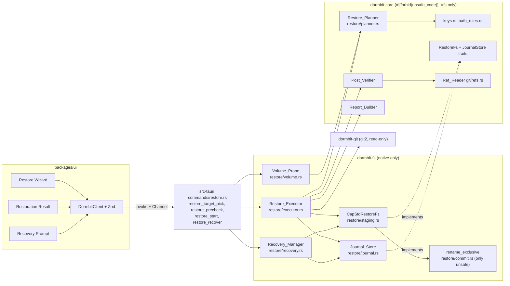

# Design Document

## Overview
A restore turns a verified capsule into a new folder that didn't exist before. It never touches anything else. The design has four parts, matching master plan Tasks 23-26:

1. **Pre-checks (Task 23).** A pure Restore_Planner in `dormbit-core` takes the manifest, the verification report, volume facts, and the destination parent's entry names, and returns a pre-check report plus a restore plan. It writes nothing.
2. **Transactional executor (Task 24).** The Restore_Executor in `dormbit-fs` writes the plan into a fresh staging folder in the destination parent, re-hashing every byte. It verifies the staged tree, then commits with one `renameatx_np(RENAME_EXCL)` call. After commit, the Post_Verifier re-hashes the target through a new handle and the Git_Checker compares HEAD and refs.
3. **Journal and recovery (Task 25).** The Journal_Store records each state (`Staged`, `Written`, `Verified`, `Committed`, `Cleaned`) in Application Support. On the next launch the Recovery_Manager finds unfinished restores and offers to discard or finish them. It deletes only staging folders whose owner token matches.
4. **Report and screens (Task 26).** The Report_Builder produces the RST-7 report, including "writes outside the destination" counted from the write log. The Restore Wizard (screen 9) and Restoration Result (screen 10) show it.

Spike a1 (`docs/evidence/P00-T03-spikes.md`) proved the two primitives on APFS on this machine: `renameatx_np(RENAME_EXCL)` commits when the target is absent and fails with `EEXIST`, leaving an existing directory or file untouched; `cap-std` rejects `..`, absolute paths, and symlink escapes.

## Architecture



**Crate boundaries.**
- `dormbit-core` owns everything that can be pure: path rules, NFC and fold keys, collision detection, planning, the `RestoreFs` and `JournalStore` traits, the Post_Verifier and Ref_Reader (both over `Vfs`), and the Report_Builder. It has `#![forbid(unsafe_code)]` and no `std::fs`.
- `dormbit-fs` owns the native side: the Volume_Probe, the `cap-std` implementation of `RestoreFs`, the executor state machine, the journal files, recovery, and the single `unsafe` block in `restore/commit.rs`. It has `#![deny(unsafe_code)]` with one `#[allow(unsafe_code)]` on `rename_exclusive`.
- `dormbit-git` provides the native working-tree status (git2, network features off, no git CLI) and the risky-config re-read.
- `apps/desktop/src-tauri` exposes the four commands. Inputs are IDs and a name, never paths (SCP-1).

**Folder layout during a restore** (destination parent `~/Projects`, target name `dockline-restored`):

```
~/Projects/
  .dormbit-staging-<op_id>/     created with an exclusive mkdir
    .dormbit-owner              {op_id, owner_token}, create-new, synced
    tree/                       all restored content; renamed to the target at commit
      .git/ …                   (never .git/hooks)
      src/ …
  dockline-restored/            appears only at commit (rename of tree/)
```

Keeping the owner token outside `tree/` means the committed project never contains it. After commit, the staging folder holds only `.dormbit-owner`, and cleanup deletes it after the token check.

**Jobs run in steps** (§6). `RestoreJob::step(budget)` does a bounded amount of work and returns. Natively a background thread drives it and streams `RestoreEvent`s over a Tauri Channel.

## Components and Interfaces

### Keys and path rules (`crates/dormbit-core/src/restore/keys.rs`, `path_rules.rs`)

```rust
/// One validated path component: non-empty, not "." or "..", no '/',
/// no Unicode Cc characters (U+0000-U+001F, U+007F-U+009F), at most 255 UTF-8 bytes.
pub struct SafeName(String);

/// A validated relative path: 1+ SafeName components, at most 1024 UTF-8 bytes total.
pub struct RelPath(Vec<SafeName>);

pub enum PathRule { Absolute, DotOrDotDot, EmptyComponent, ControlChar, ComponentTooLong, PathTooLong }

pub fn validate_entry_path(raw: &str) -> Result<RelPath, PathRule>;          // Req 5.1-5.5
pub fn validate_target_name(raw: &str) -> Result<SafeName, PathRule>;        // Req 1.6 (also rejects ".dormbit-staging-" prefix)

pub fn nfc_key(c: &str) -> String;                                           // NFC
pub fn fold_key(c: &str) -> String;                                          // NFC(lower(upper(NFD(c))))
pub enum KeyMode { Nfc, NfcAndFold }
pub fn path_keys(p: &RelPath, mode: KeyMode) -> Vec<String>;                 // per component
```

`SafeName` and `RelPath` have private fields and are built only by these functions, so the executor can't receive an unchecked name.

### Restore_Planner (`crates/dormbit-core/src/restore/planner.rs`)

```rust
pub struct PlanInput<'a> {
    pub manifest: &'a Manifest,
    pub manifest_sha256_now: Sha256,                 // re-read at pre-check time
    pub verification: Option<&'a VerificationReport>,
    pub target_name: &'a str,
    pub parent_entries: &'a [String],                // names in the destination parent
    pub volume: VolumeFacts,
    pub location: LocationFacts,
    pub options: RestoreOptions,                     // P1 flags, default off
}

pub struct LocationFacts {
    pub parent: Vec<String>,                         // canonical components
    pub source_root: Option<Vec<String>>,            // None: not found on this Mac (Req 3.5)
    pub forbidden_roots: Vec<Vec<String>>,           // CapsuleLibrary roots + capsule file's folder
}

pub struct RestoreOptions { pub restore_internal_symlinks: bool, pub write_brief: bool }

pub struct PrecheckOutcome { pub report: PrecheckReport, pub plan: Option<RestorePlan> }

pub fn plan_restore(input: &PlanInput) -> PrecheckOutcome;
```

`plan_restore` is deterministic. It never sees the disk; the Volume_Probe and the commands gather its inputs. Checks run in a fixed order and all results are reported, so the user sees every problem at once. `plan` is `Some` only when no blocking check failed.

Order of work inside `plan_restore`:
1. Capsule checks: report present and `Verified` (4.1), manifest hash (4.2), `registry_match` (4.3, 4.4).
2. Target name rules (1.6), target variants against `parent_entries` with both keys (2.1, 2.2).
3. Location checks with fold-key component comparison (3.2-3.5).
4. Volume type (4.7). Case mode: `NfcAndFold` unless `volume.case == Sensitive` (4.9, 6.2, 6.3).
5. Every entry path through `validate_entry_path`; any failure refuses the restore (5.1-5.7).
6. Skips: `.git/hooks` by fold key whatever the volume (13.1); symlinks (17.6, or the P1 rules in 17.1, 17.2, 17.5); entries already in `excluded[]` are listed with their capture reason (14.4).
7. Collisions over the planned entries: equal keys and file-versus-parent-folder (6.1-6.4).
8. Directory list (each folder once, parents first), file list with `final_mode = mode & 0o777`, required bytes (4.5), free-space check (4.6).

### Volume_Probe (`crates/dormbit-fs/src/restore/volume.rs`)

```rust
pub enum CaseSensitivity { Sensitive, Insensitive, Unknown }

pub struct VolumeFacts {
    pub fs_type: String,        // f_fstypename, e.g. "apfs", "hfs", "msdos", "smbfs"
    pub block_size: u64,        // f_bsize
    pub free_bytes: u64,        // f_bavail * f_bsize
    pub case: CaseSensitivity,
}

pub fn probe_volume(parent: &cap_std::fs::Dir) -> io::Result<VolumeFacts>;   // Req 4.6-4.8
pub fn list_names(parent: &cap_std::fs::Dir) -> io::Result<Vec<String>>;     // Req 2.1
pub fn location_facts(grants: &ScopeRegistry, target: GrantId, capsule: &CapsuleRef,
                      source: Option<&ProjectRecord>) -> io::Result<LocationFacts>; // Req 3.1
```

- **Filesystem type and free space** come from `fstatfs` on the destination parent's descriptor. This must not add a second `unsafe` block (see Open questions 1).
- **Case sensitivity, read-only** (4.8): pick an entry in the destination parent whose name has an ASCII letter, look up the case-swapped name with `symlink_metadata` (no follow). Found with the same device and inode: `Insensitive`. Not found: `Sensitive`. No suitable entry: `Unknown`, treated as insensitive (4.9).
- **Case sensitivity, confirmed** (7.6): after `.dormbit-owner` exists, look up `.DORMBIT-OWNER` in the staging folder. The executor re-runs collisions with fold keys if this shows `Insensitive` and pre-checks assumed `Sensitive` (7.7).
- **Canonical paths** (3.1) use `std::fs::canonicalize` on the paths behind the grants. Only `dormbit-fs` sees real paths; they never cross IPC.

### RestoreFs trait (`crates/dormbit-core/src/restore/fs.rs`)

```rust
pub enum FsFault { Exists, NotFound, NoSpace, NotSupported, Io(String) }

pub struct EntryMeta { pub kind: EntryKind, pub size: u64, pub mode: u32, pub dev: u64, pub ino: u64 }

/// Proof that the owner token check (Req 12.5) passed for one staging folder.
/// Only `check_owner_token` can build it.
pub struct OwnerTokenProof<D> { /* private: parent dir, staging name, op_id */ }

pub trait RestoreFs {
    type Dir;
    type File;
    fn create_dir_excl(&mut self, parent: &Self::Dir, name: &SafeName) -> Result<Self::Dir, FsFault>;
    fn create_file_new(&mut self, parent: &Self::Dir, name: &SafeName) -> Result<Self::File, FsFault>;
    fn write_all(&mut self, f: &mut Self::File, buf: &[u8]) -> Result<(), FsFault>;
    fn set_mode(&mut self, f: &Self::File, mode: u32) -> Result<(), FsFault>;
    fn sync_file(&mut self, f: &Self::File) -> Result<(), FsFault>;
    fn sync_dir(&mut self, d: &Self::Dir) -> Result<(), FsFault>;
    fn open_dir_nofollow(&self, parent: &Self::Dir, name: &SafeName) -> Result<Self::Dir, FsFault>;
    fn open_read_nofollow(&self, parent: &Self::Dir, name: &SafeName) -> Result<Box<dyn Read + '_>, FsFault>;
    fn lookup_nofollow(&self, parent: &Self::Dir, name: &SafeName) -> Result<Option<EntryMeta>, FsFault>;
    fn list(&self, d: &Self::Dir) -> Result<Vec<(String, EntryMeta)>, FsFault>;
    fn symlink(&mut self, parent: &Self::Dir, name: &SafeName, target: &str) -> Result<(), FsFault>; // P1 only
    fn rename_exclusive(&mut self, from_dir: &Self::Dir, from: &SafeName,
                        to_dir: &Self::Dir, to: &SafeName) -> Result<(), FsFault>;
    fn remove_staging(&mut self, proof: OwnerTokenProof<Self::Dir>) -> Result<(), FsFault>;
}

pub fn check_owner_token<F: RestoreFs>(fs: &F, parent: &F::Dir, journal: &RestoreJournal)
    -> Result<OwnerTokenProof<F::Dir>, OwnerCheckFailure>;           // Req 12.5, 12.6
```

The trait has no "open existing for write", no truncate, no `create_dir_all`, and no general delete (13.2, 13.3, 12.12). The only delete takes an `OwnerTokenProof`. Implementations:
- `CapStdRestoreFs` in `dormbit-fs` (native): `cap_std::fs::Dir` handles rooted at the destination parent; `OpenOptions::create_new(true)`; `Dir::create_dir` (fails on exists); no-follow opens; `File::set_permissions` (fchmod on the open handle); `sync_all`; `remove_staging` uses `Dir::remove_dir_all` on the staging name, which removes symlinks without following them.
- `MemRestoreFs` in `dormbit-core` (tests, and available to the demo): in-memory tree that tracks durable and pending state (see Property 5).
- `FaultFs<F>` in `dormbit-fs` behind the `test-faults` feature (see Property 5).

### The commit call (`crates/dormbit-fs/src/restore/commit.rs`)

This is the only `unsafe` code in the project (§6). It gets a dedicated review in the rust-security → reviewer loop.

```rust
use std::ffi::CString;
use std::io;
use std::os::fd::{AsFd, AsRawFd};

/// Moves `from` (inside `from_dir`) to `to` (inside `to_dir`) only if no entry
/// named `to` exists. Never replaces anything. Maps errno to io::Error.
#[allow(unsafe_code)]
pub(crate) fn rename_exclusive(
    from_dir: &cap_std::fs::Dir, from: &SafeName,
    to_dir: &cap_std::fs::Dir, to: &SafeName,
) -> io::Result<()> {
    let from_c = CString::new(from.as_str())?; // SafeName has no NUL; error kept anyway
    let to_c = CString::new(to.as_str())?;
    let from_fd = from_dir.as_fd();
    let to_fd = to_dir.as_fd();
    // SAFETY:
    // - `from_fd` and `to_fd` are BorrowedFd values from live `Dir` borrows, so both
    //   descriptors are open directory descriptors for the whole call.
    // - `from_c` and `to_c` are NUL-terminated CStrings that outlive the call;
    //   renameatx_np only reads them and keeps no pointer after returning.
    // - Both names are single SafeName components (no '/', not "." or "..",
    //   at most 255 bytes), so the call resolves only inside the two directories.
    // - The flags are exactly RENAME_EXCL: the kernel fails with EEXIST if any entry
    //   named `to` exists (file, dir, or symlink, including a dangling one; the last
    //   component is never followed). Nothing is overwritten.
    // - The callee writes no memory we own. The return value is checked and errno is
    //   read immediately through io::Error::last_os_error().
    let rc = unsafe {
        libc::renameatx_np(from_fd.as_raw_fd(), from_c.as_ptr(),
                           to_fd.as_raw_fd(), to_c.as_ptr(), libc::RENAME_EXCL)
    };
    if rc == 0 { Ok(()) } else { Err(io::Error::last_os_error()) }
}
```

Error mapping in `CapStdRestoreFs::rename_exclusive`: `EEXIST` → `FsFault::Exists` → `RESTORE_DEST_EXISTS` (2.5); `ENOTSUP` → `FsFault::NotSupported` → `RESTORE_VOLUME_UNSUPPORTED` (9.7); anything else → `RESTORE_IO_FAILED`. A test in `crates/dormbit-fs/tests/unsafe_count.rs` reads the workspace's `.rs` files and fails unless there is exactly one `unsafe {` block and it is in `restore/commit.rs`.

### Restore_Executor (`crates/dormbit-fs/src/restore/executor.rs`)

```rust
pub struct RestoreContext {
    pub op_id: OpId,
    pub owner_token: OwnerToken,            // 128 bits from IdGen (OS random natively)
    pub target_grant: GrantId,
    pub target_name: SafeName,
    pub capsule: CapsuleRef,
    pub source_snapshot: Option<SourceSnapshot>,   // Req 14.9
}

pub struct RestoreJob<F: RestoreFs, J: JournalStore, C: CapsuleObjects> { /* … */ }

impl<F: RestoreFs, J: JournalStore, C: CapsuleObjects> RestoreJob<F, J, C> {
    pub fn new(plan: RestorePlan, ctx: RestoreContext, fs: F, journal: J, capsule: C,
               clock: &dyn Clock) -> Self;
    pub fn step(&mut self, budget: StepBudget) -> StepOutcome;    // Progress(RestoreEvent) | Done(RestoreReport)
    pub fn cancel(&mut self) -> CancelResult;                     // Accepted | TooLate (Req 9.11, 9.12)
}

/// Streams one object out of the verified capsule by its manifest hash.
/// Implemented over the capsule-and-verification strict reader; never uses tar names as output paths.
pub trait CapsuleObjects {
    fn open_object(&mut self, stored_sha256: &Sha256) -> Result<Box<dyn Read + '_>, DormbitError>;
}
```

Executor phases, each ending at a step boundary where cancel is checked:

| Phase | Work | Journal after |
|---|---|---|
| Stage | journal `create` (state `Staged`) → `create_dir_excl(parent, staging)` → write and sync `.dormbit-owner` → case confirmation (7.6, 7.7) → `create_dir_excl(staging, "tree")`, record tree ID | `Staged` (written first) |
| Write | for each directory: `create_dir_excl`; for each file: `create_file_new`, stream object (stored hash and size cap, gzip decode, content hash and size cap), `set_mode(final_mode)`, `sync_file`; then `sync_dir` on every staged directory | `Written` |
| Verify staged | new read handles, re-hash, compare size and mode; walk `tree` with no follow and compare the entry set | `Verified` |
| Commit | variant re-check of the target name (2.4) → `rename_exclusive(staging/"tree" → parent/target)` → `sync_dir(parent)` | `Committed` |
| Clean | `check_owner_token` → `remove_staging(proof)` | `Cleaned` |
| Post-verify | Post_Verifier, Git_Checker, source snapshot compare, Report_Builder, `put_report` | (report written) |

Rollback (9.10) runs from any failure or cancel before the commit rename: close handles, `check_owner_token`, `remove_staging`, record `Cleaned`, build a `RolledBack` report. If the token check fails, nothing is deleted and the report says so.

### Post_Verifier and Git_Checker

```rust
// crates/dormbit-core/src/restore/post_verify.rs
pub fn post_verify(vfs: &dyn Vfs, target_root: VfsDir, plan: &RestorePlan) -> PostVerifyResult; // Req 10.1-10.3

// crates/dormbit-core/src/git/refs.rs
pub struct RefSet { pub head: HeadRef, pub refs: BTreeMap<String, Oid> }
pub enum HeadRef { Symbolic(String), Detached(Oid) }
pub fn read_refs(vfs: &dyn Vfs, git_dir: VfsDir, limits: RefLimits) -> Result<RefSet, DormbitError>;

// crates/dormbit-core/src/restore/git_check.rs
pub fn check_refs(found: &RefSet, manifest_git: &ManifestGit) -> RefCheck;   // Match | Mismatch{refs} | NotApplicable

// crates/dormbit-git/src/status.rs (native)
pub fn status_counts(repo_root: &Path) -> Result<StatusCounts, DormbitError>;
pub fn risky_config(repo_root: &Path) -> Result<Vec<RiskyKey>, DormbitError>;
```

- The Post_Verifier opens the target through a fresh read-only `Vfs` handle (natively a new `cap-std` `Dir` opened from the grant) and compares with manifest hashes, not with hashes kept from the write phase (10.1).
- `read_refs` reads `HEAD`, loose refs under `refs/`, and `packed-refs` with no symlink following and byte limits, so it can't be pointed outside `.git`.
- `status_counts` opens the repo with git2 using `Repository::open_ext` with `NO_SEARCH`, network features off. libgit2 doesn't run `core.fsmonitor`, hooks, or external filter drivers; Requirement 13.6 is still proven by a marker-file test, not assumed.

### Journal_Store (`crates/dormbit-fs/src/restore/journal.rs`)

```rust
pub trait JournalStore {                    // trait in dormbit-core, durable impl here
    fn create(&mut self, j: &RestoreJournal) -> Result<(), JournalFault>;
    fn set_state(&mut self, op: &OpId, state: JournalState, patch: JournalPatch) -> Result<(), JournalFault>;
    fn append_write(&mut self, op: &OpId, rec: &WriteRecord) -> Result<(), JournalFault>;
    fn sync_writes(&mut self, op: &OpId) -> Result<(), JournalFault>;
    fn put_report(&mut self, op: &OpId, r: &RestoreReport) -> Result<(), JournalFault>;
    fn list(&self) -> Result<Vec<JournalListing>, JournalFault>;   // includes unreadable files (Req 12.9)
}

pub struct FileJournalStore { root: PathBuf /* <app data>/restores */ }
```

`set_state` calls `sync_writes` first (11.8), then writes `journal.json` atomically (11.2). Files are created with mode `0600` (11.9). The Application Support files are DORMBIT's own state, so the atomic replace of `journal.json` is not a write in the destination and doesn't count toward "writes outside the destination".

### Recovery_Manager (`crates/dormbit-fs/src/restore/recovery.rs`)

```rust
pub enum PendingKind { NotCommitted, CommittedNotCleaned, CleanedNoReport, Unreachable, Unreadable }
pub struct PendingRestore { pub op_id: OpId, pub target_display: String, pub state: Option<JournalState>,
                            pub kind: PendingKind }

pub fn list_pending(js: &impl JournalStore, grants: &ScopeRegistry) -> Vec<PendingRestore>; // Req 12.1
pub fn recover(op: &OpId, /* … */) -> Result<RestoreReport, DormbitError>;                   // Req 12.3-12.10
```

Recovery decides from filesystem evidence, not from the state alone, because a crash can land between the rename and the `Committed` record:

| Staging folder | `tree` in staging | Target with journal's tree ID | Action |
|---|---|---|---|
| present | present | any | not committed: token check, delete staging, `Cleaned`, report `RolledBack` (12.3) |
| present | absent | present | committed: token check, delete staging, `Cleaned`, post-verify (12.4) |
| present | absent | absent | token check, delete staging, `Cleaned`, report `RolledBack` with note "staged tree missing" |
| absent | n/a | present | `Cleaned`, post-verify (12.7) |
| absent | n/a | absent | `Cleaned`, report `RolledBack` (12.7) |
| token check fails | | | delete nothing, show "Not deleted: …" (12.6) |
| grant revoked or unreachable | | | keep journal, delete nothing, "Unreachable" (12.8) |

Recovery never touches the target (12.10). It runs only while the app holds the single-instance lock, so it can't mistake another instance's live restore for a crash (12.1).

### Report_Builder (`crates/dormbit-core/src/restore/report.rs`)

```rust
pub fn build_report(inputs: ReportInputs) -> RestoreReport;   // pure; Req 14.1-14.14
```

`writes_outside_destination` is the count of write log records whose `root` is neither `staging` nor `target` (14.10). Every write goes through `RestoreFs` handles rooted at the staging folder or (for the P1 brief) the target, and every such call appends a record, so the expected count is 0. The integration tests check the count against an independent before/after snapshot of the destination parent, so the number isn't only self-reported.

### Tauri commands (`apps/desktop/src-tauri/src/commands/restore.rs`)

```rust
#[tauri::command]
async fn restore_target_pick(app: AppHandle, st: State<'_, AppState>)
    -> Result<ScopeGrantView, DormbitError>;                                  // Req 1.1, 1.2

#[tauri::command]
async fn restore_precheck(st: State<'_, AppState>, req: RestorePrecheckRequest)
    -> Result<PrecheckReport, DormbitError>;                                  // Req 1.3-1.6, 2-6

#[tauri::command]
async fn restore_start(st: State<'_, AppState>, req: RestoreStartRequest,
                       on_event: Channel<RestoreEvent>)
    -> Result<RestoreStarted, DormbitError>;                                  // Req 4.11, 7-10, 14

#[tauri::command]
async fn restore_recover(st: State<'_, AppState>, req: RecoverRequest)
    -> Result<RecoverResponse, DormbitError>;                                 // Req 12

#[derive(Deserialize, TS)] #[serde(deny_unknown_fields)]
struct RestorePrecheckRequest { capsule_id: CapsuleId, target_grant_id: GrantId, target_name: String }

#[derive(Deserialize, TS)] #[serde(deny_unknown_fields)]
struct RestoreStartRequest { capsule_id: CapsuleId, target_grant_id: GrantId, target_name: String,
                             options: RestoreOptions }

#[derive(Deserialize, TS)] #[serde(tag = "kind", deny_unknown_fields)]
enum RecoverRequest { List, Recover { op_id: OpId } }

struct RestoreStarted { op_id: OpId, job_id: JobId }      // job_id works with job_cancel
enum RecoverResponse { Pending(Vec<PendingRestore>), Recovered(RestoreReport) }
```

All four names are already in the §6 allowlist (`AppManifest::commands`). `restore_target_pick` uses the Rust API of `tauri-plugin-dialog`, as in spike a2; the WebView has no dialog permission.

TypeScript (`packages/client`):

```ts
interface DormbitClient {
  restoreTargetPick(): Promise<ScopeGrantView>;
  restorePrecheck(req: RestorePrecheckRequest): Promise<PrecheckReport>;
  restoreStart(req: RestoreStartRequest, onEvent: (e: RestoreEvent) => void): Promise<RestoreStarted>;
  restoreRecover(req: RecoverRequest): Promise<RecoverResponse>;
}
```

Every response is parsed with its Zod schema from `packages/schema` before the UI uses it (15.10).

### Screens (`packages/ui/src/screens/`)

- `RestoreWizard/`: capsule list (only `Verified` selectable, others with StatusPill glyph and label), destination row ("Choose destination folder…" plus `root_display`), name field, pre-check list (re-run on change, debounced), "Start restore", ProgressSteps for the five states with file and byte counts, Cancel until commit.
- `RestoreResult/`: report sections in RST-7 order, the "Writes outside the destination" line with "from the restore journal", the status banner, and links to the Brief.
- `RecoveryPrompt/`: modal shown at launch from `restore_recover({kind: "List"})`, one row per pending restore with its action.

Components come from the design system (native-experience Task 34). All three screens meet UX-1.

### Restore sequence

```mermaid
sequenceDiagram
  autonumber
  participant UI as Restore Wizard
  participant CMD as src-tauri commands
  participant VP as Volume_Probe
  participant PL as Restore_Planner (core)
  participant EX as Restore_Executor
  participant JS as Journal_Store
  participant D as Destination parent (cap-std)
  participant PV as Post_Verifier + Git_Checker
  participant RB as Report_Builder

  UI->>CMD: restore_target_pick()
  CMD-->>UI: ScopeGrant{id, root_display "~/Projects"}
  UI->>CMD: restore_precheck{capsule_id, grant_id, name}
  CMD->>VP: fstatfs, case lookup, list names, canonical paths (read-only)
  VP-->>CMD: VolumeFacts, names, LocationFacts
  CMD->>PL: plan_restore(PlanInput)
  PL-->>CMD: PrecheckReport (+ RestorePlan)
  CMD-->>UI: PrecheckReport
  UI->>CMD: restore_start{…} + Channel
  CMD->>PL: run every pre-check again (4.11)
  CMD->>EX: RestoreJob::new(plan, ctx)
  EX->>JS: create journal (Staged, staging, owner_token)
  EX->>D: mkdir .dormbit-staging-<op_id> (exclusive)
  EX->>D: create-new .dormbit-owner, sync; lookup .DORMBIT-OWNER
  EX->>D: mkdir tree; record tree ID
  loop every directory and file
    EX->>D: create_dir_excl / create_file_new, stream + hash, set_mode, sync
    EX->>JS: append write record
    EX-->>UI: RestoreEvent{state, files, bytes}
  end
  EX->>D: sync staged directories
  EX->>JS: sync write log, state Written
  EX->>D: re-open and re-hash staged files, walk tree
  EX->>JS: state Verified
  EX->>D: re-check target variants
  EX->>D: renameatx_np(staging/tree → target, RENAME_EXCL)
  EX->>D: sync parent
  EX->>JS: state Committed
  EX->>D: check owner token, remove staging
  EX->>JS: state Cleaned
  EX->>PV: re-hash target (new handle), read refs, status (native)
  PV-->>EX: results
  EX->>RB: build_report(journal, write log, results)
  RB-->>EX: RestoreReport
  EX->>JS: put_report
  EX-->>UI: final RestoreEvent{report}
  Note over EX,D: Any failure before the rename: check token, remove staging, Cleaned, report RolledBack. The target is never created.
```

## Data Models

Fields from §8 are kept as named. Additions are marked "added".

### RestoreJournal (`journal.json`)

```rust
pub struct RestoreJournal {
    pub op_id: OpId,                       // §8
    pub staging: String,                   // §8: ".dormbit-staging-<op_id>"
    pub owner_token: OwnerToken,           // §8: 128-bit, hex
    pub state: JournalState,               // §8: Staged | Written | Verified | Committed | Cleaned
    pub schema_version: u32,               // added: 1
    pub capsule_id: CapsuleId,             // added
    pub manifest_sha256: Sha256,           // added
    pub target_grant_id: GrantId,          // added
    pub target_name: String,               // added
    pub tree_id: Option<DevIno>,           // added: set in Staged once tree exists (Req 7.5)
    pub case_rules: CaseSensitivity,       // added: rules actually applied
    pub totals: Totals,                    // added: planned dirs, files, bytes
    pub history: Vec<StateStamp>,          // added: {state, at}
    pub created_at: Timestamp,             // added
    pub updated_at: Timestamp,             // added
}
```

**Location:** `~/Library/Application Support/io.github.<owner>.dormbit/restores/<op_id>/` (the Tauri app data folder for the bundle ID in Task 10):

```
restores/<op_id>/
  journal.json      atomic JSON, 0600
  writes.jsonl      append-only write log, 0600
  report.json       written when the restore ends, 0600
```

**Example `journal.json`:**

```json
{
  "schema_version": 1,
  "op_id": "4f6c2a9e-1b7d-4e0a-9c35-0d8e2f61a7b4",
  "staging": ".dormbit-staging-4f6c2a9e-1b7d-4e0a-9c35-0d8e2f61a7b4",
  "owner_token": "9a1f3c5e7b2d4f6a8c0e1b3d5f7a9c2e",
  "state": "Written",
  "capsule_id": "c-01J9Z8K3",
  "manifest_sha256": "3b7e…",
  "target_grant_id": "g-restore-02",
  "target_name": "dockline-restored",
  "tree_id": { "dev": 16777230, "ino": 4823117 },
  "case_rules": "Insensitive",
  "totals": { "dirs": 41, "files": 312, "bytes": 1843322 },
  "history": [
    { "state": "Staged", "at": "2026-11-16T18:02:11Z" },
    { "state": "Written", "at": "2026-11-16T18:02:14Z" }
  ],
  "created_at": "2026-11-16T18:02:11Z",
  "updated_at": "2026-11-16T18:02:14Z"
}
```

**Write log record (`writes.jsonl`, one JSON object per line):**

```rust
pub struct WriteRecord {
    pub seq: u64,
    pub op: WriteOp,          // Mkdir | Create | Symlink (P1) | Rename | RemoveStaging
    pub root: WriteRoot,      // Staging | Target | Other (Other must never occur)
    pub path: String,         // relative to the root, e.g. "tree/src/pdf/renderInvoice.ts"
    pub bytes: Option<u64>,
}
```

```json
{"seq":1,"op":"Mkdir","root":"Staging","path":""}
{"seq":2,"op":"Create","root":"Staging","path":".dormbit-owner","bytes":96}
{"seq":3,"op":"Mkdir","root":"Staging","path":"tree"}
{"seq":317,"op":"Rename","root":"Target","path":"","bytes":null}
{"seq":318,"op":"RemoveStaging","root":"Staging","path":""}
```

### RestorePlan and PrecheckReport

```rust
pub struct RestorePlan {
    pub dirs: Vec<RelPath>,                        // parents first, each once
    pub files: Vec<PlannedFile>,
    pub symlinks: Vec<PlannedSymlink>,             // empty unless P1 is on
    pub skipped: Vec<NotRestored>,
    pub case_rules: CaseSensitivity,
    pub required_bytes: u64,
}
pub struct PlannedFile { pub path: RelPath, pub size: u64, pub sha256: Sha256,
                         pub object: ObjectRef, pub final_mode: u32, pub stripped_bits: u32 }

pub struct PrecheckReport {
    pub checks: Vec<PrecheckItem>,                 // fixed order, all reported
    pub volume: VolumeFacts,
    pub required_bytes: u64,
    pub files_total: u64,
    pub bytes_total: u64,
    pub skipped: Vec<NotRestored>,
    pub target_display: String,                    // "~/Projects/dockline-restored"
    pub blocking_failed: bool,
}
pub struct PrecheckItem { pub id: PrecheckId, pub status: CheckStatus /* Pass|Fail|Warn|NotApplicable */,
                          pub code: Option<ErrorCode>, pub detail: String }
```

Pre-check IDs: `capsule_verified`, `manifest_hash`, `registry_match`, `target_name_valid`, `target_absent`, `target_location`, `volume_supported`, `free_space`, `case_sensitivity`, `paths_safe`, `no_collisions`.

### RestoreReport (`report.json`, RST-7)

```rust
pub struct RestoreReport {
    pub schema_version: u32,
    pub op_id: OpId,
    pub capsule_id: CapsuleId,
    pub target_display: String,                    // with "~"
    pub started_at: Timestamp,
    pub finished_at: Timestamp,
    pub status: ReportStatus,                      // Verified | Failed | RolledBack
    pub recovered: bool,                           // finished by the Recovery_Manager
    pub error: Option<DormbitError>,
    pub files_written: Totals,                     // RST-7: files written
    pub files_verified: Totals,                    // RST-7: and verified
    pub mismatches: Vec<Mismatch>,                 // {path, expected_sha256, actual_sha256?, expected_size, actual_size?, expected_mode, actual_mode?}
    pub not_restored: Vec<NotRestored>,            // {path, reason}
    pub risky_git_config: Vec<RiskyKey>,           // {key, value_redacted}
    pub executables: Vec<String>,
    pub stripped_mode_bits: Vec<StrippedBits>,     // {path, removed: setuid|setgid|sticky}
    pub source_unchanged: SourceCheck,             // Unchanged | Changed{paths} | NotChecked{reason}
    pub writes_outside_destination: u64,           // from writes.jsonl; must be 0
    pub git_check: GitCheck,                       // {refs: Match|Mismatch{refs}|NotApplicable|RefsNotRecorded,
                                                   //  worktree: Match|Differs{expected, found}|NotCheckedInBrowser|NotApplicable}
    pub added_files: Vec<AddedFile>,               // P1 brief: {path, size, sha256, note: "Not part of the capsule"}
    pub warnings: Vec<String>,                     // e.g. "Not in this Mac's capsule registry"
    pub limits: Vec<String>,                       // Req 14.13
}
```

`NotRestored.reason` values: `excluded_at_capture:<capture reason code>`, `git_hooks_never_restored`, `symlink_not_restored`, `symlink_unsafe_target` (P1).

### RestoreEvent (Channel)

```rust
pub enum RestoreEvent {
    Progress { op_id: OpId, state: JournalState, files_done: u64, files_total: u64,
               bytes_done: u64, bytes_total: u64, elapsed_ms: u64 },
    CannotCancel { op_id: OpId },                 // "Restore can no longer be cancelled"
    Finished { report: RestoreReport },
}
```

All of these types export to TypeScript through ts-rs into `packages/schema/generated` and have Zod schemas with type-equality tests (PROP-11 setup, Task 11).

## Correctness Properties

### Property 1: No restored path escapes the destination (PROP-1)
*For any* manifest whose entry paths are drawn from a generator mixing valid paths with absolute paths, `..` and `.` components, empty components, NUL and Cc characters, components of 255 and 256 bytes, paths of 1024 and 1025 bytes, NFC/NFD forms, and (when P1 is on) symlink entries with relative, absolute, and escaping targets, the Restore_Planner either refuses with `PATH_UNSAFE` naming an entry that breaks a rule, or every planned path, joined to the target and lexically normalized, stays inside the target. When the plan runs on `MemRestoreFs` or on a temp folder through `CapStdRestoreFs`, every created entry lies under the staging folder before commit and under the target after it; every other entry in the destination parent is unchanged; and the write log has no record with root `Other`.
**Validates: Requirements 5.1, 5.2, 5.3, 5.4, 5.5, 5.6, 5.7, 8.12, 13.4, 17.1, 17.2**

### Property 2: Full round trip (PROP-2)
*For any* generated project tree (nested folders, Unicode names, files of 0 bytes to 1 MiB with random contents, duplicate contents, modes including `0o755`, `0o644`, `0o4755`, `0o2755`, `0o1777`, a `.git` with HEAD and refs, and files under `.git/hooks`), capture → verify → restore into a fresh destination parent yields, for every approved file entry, a file at the same relative path with byte-identical contents and mode equal to the source mode AND `0o777`; no file outside the approved set; no `.git/hooks` entry; a Post_Verifier result of `Verified`; and a Ref_Reader result equal to the manifest's HEAD and refs.
**Validates: Requirements 1.7, 8.2, 8.3, 8.5, 9.2, 10.1, 10.4, 13.1**

### Property 4: No overwrite (PROP-4)
*For any* target name and any existing entry in the destination parent that is the same name, a case variant, an NFC/NFD variant, or both, and that is a file, a directory, a symlink, or a dangling symlink, `restore_precheck` and `restore_start` fail with `RESTORE_DEST_EXISTS`, no journal or staging folder is created, and the existing entry is unchanged in name, type, size, mode, contents, and mtime. *For any* such entry created by a `FaultFs` interleave hook after pre-checks and before the commit rename, the restore fails with `RESTORE_DEST_EXISTS`, rolls back, and leaves that entry unchanged.
**Validates: Requirements 2.1, 2.2, 2.3, 2.4, 2.5, 2.6, 7.3, 13.2**

### Property 5: Atomicity under faults and crashes (PROP-5)
*For any* generated manifest, any fault point `k` among the `N` filesystem and journal operations of a fault-free run, and any fault kind (`Exists`, `NoSpace`, `NotSupported`, `Io`, `Crash`):
- the target exists only if the commit rename completed, and if it exists its contents equal the manifest;
- after an error fault, the job ends with the journal `Cleaned`, a `RolledBack` report, and no staging folder (or, if the fault hit rollback itself, a staging folder that recovery removes);
- after a crash, a new Recovery_Manager over the durable state reaches `Cleaned`, leaves no staging folder whose token matches, never deletes or changes the target, and reports `RolledBack` before commit or runs post-verification after it;
- entries in the destination parent other than the staging folder and the target are never changed;
- a staging folder whose `.dormbit-owner` was altered is never deleted.

**Validates: Requirements 9.10, 11.3, 11.4, 11.5, 11.6, 12.3, 12.4, 12.5, 12.6, 12.7, 12.10, 12.12**

**The fault-injecting Vfs (`FaultFs`).** `FaultFs<F: RestoreFs>` in `crates/dormbit-fs/src/restore/fault.rs`, compiled only with the `test-faults` feature (Task 44 checks release builds don't contain it), wraps any `RestoreFs`. A paired `FaultJournal<J: JournalStore>` shares its operation counter, so journal writes are fault points too.
- **Counting.** Every mutating or syncing call (`create_dir_excl`, `create_file_new`, `write_all`, `set_mode`, `sync_file`, `sync_dir`, `symlink`, `rename_exclusive`, `remove_staging`, and each journal `create`, `set_state`, `append_write`, `sync_writes`, `put_report`) gets the next index. A fault-free run records `N`.
- **Fault plan.** `{at: k, kind}`. At call `k` the wrapper returns the fault instead of calling through. `Exists`, `NoSpace`, `NotSupported`, and `Io(..)` are ordinary errors the executor must handle. A second plan field `also_fail_rollback: bool` keeps failing after `k`, to prove recovery handles a failed rollback.
- **Crash.** `Crash` stops the job at call `k` with nothing after it executed. Over `MemRestoreFs`, the crash also drops pending state: file bytes not followed by `sync_file`, directory entries (including renames) not followed by `sync_dir` on their parent, and journal or write-log data not synced. This checks the sync order, not only the error paths. Over `CapStdRestoreFs` on a temp folder, `Crash` stops the job without dropping anything, since the real disk can't be rolled back.
- **Interleave hooks.** `before(k, f)` runs a closure against the underlying filesystem just before call `k`. PROP-4 uses it to create a target variant just before the rename; PROP-5 uses it to alter `.dormbit-owner`.
- **Coverage.** For trees of up to 8 entries, the test enumerates every `k` in `0..N` for every kind. For larger generated trees, proptest picks `k` and the kind.

### Property 6: Source files are unchanged by restore (PROP-6)
*For any* generated project tree captured into a capsule, with the source copy and the capsule file made read-only (`a-w` on every file and folder) before restore, a restore into a sibling destination parent, whether it succeeds or fails, leaves the source tree and the capsule file unchanged: same paths, types, sizes, modes, mtimes, inodes, and content hashes (access times excluded; §7 states reads can update them). The restore never gets `EACCES` or `EPERM` from a source path, and the report's `source_unchanged` is `Unchanged` and `writes_outside_destination` is 0.
**Validates: Requirements 13.4, 14.8, 14.9, 14.10, 14.11**

### Property 8: Normalization and case collisions are rejected (PROP-8)
*For any* manifest containing two entry paths that are equal under NFC, or equal under fold key, or where one equals a parent folder of another under the key in use, the Restore_Planner refuses with `RESTORE_COLLISION` naming both entries when the key applies: NFC always, fold key on case-insensitive or unknown volumes. *For any* manifest whose paths are distinct under the applicable keys, it reports no collision; on a case-sensitive volume, paths that differ only by case are accepted. *For any* collision the planner misses on a real volume, the staged create fails with `EEXIST` and the restore fails with `RESTORE_COLLISION` and rolls back.
**Validates: Requirements 6.1, 6.2, 6.3, 6.4, 6.5, 7.7**

## Error Handling

Errors are `DormbitError {code, message, retryable}` (§8). Messages never include raw paths; paths in details use `~`.

| Code | When | Retryable | UI shows |
|---|---|---|---|
| `SCOPE_DENIED` | Grant ID unknown, revoked, or wrong kind; capsule ID not available (1.4, 1.5) | No | "Choose the destination folder again." |
| `CANCELLED` | Picker closed (1.2); user cancel before commit (9.11) | Yes | "Restore cancelled. The destination folder was not created." |
| `PATH_UNSAFE` | Target name breaks a rule (1.6); manifest path breaks a rule (5.1-5.5) | No | Target: "Choose another name." Manifest: names the entry and the rule; "This capsule can't be restored safely." |
| `RESTORE_DEST_EXISTS` | Target or a variant exists, at pre-check (2.2) or commit (2.5) | No | Names the existing entry; "Choose another name." |
| `RESTORE_DEST_EXISTS` | Staging name already in use (7.3) | Yes | "Try again." |
| `RESTORE_COLLISION` | NFC, fold, or parent-folder collision (6.1, 6.2, 6.4, 7.7); `EEXIST` in staging (6.5) | No | Names both entries. |
| `RESTORE_VOLUME_UNSUPPORTED` | Filesystem type not `apfs`/`hfs` (4.7); rename returns `ENOTSUP` (9.7) | No | Names the filesystem type; "Choose a folder on an APFS or Mac OS Extended volume." |
| `RESTORE_INSUFFICIENT_SPACE` | Pre-check (4.6); `ENOSPC` while writing (8.10) | Yes | Required and free bytes. |
| `RESTORE_NOT_VERIFIED` (proposed) | No `Verified` report (4.1) | No | "Verify this capsule first." with a Verify button (`verify_start`). |
| `RESTORE_TARGET_FORBIDDEN` (proposed) | Destination inside the source project, a capsule library, or the capsule's folder (3.2, 3.3) | No | Which forbidden folder; "Choose a folder outside it." |
| `CAPSULE_HASH_MISMATCH` | Manifest hash or registry mismatch (4.2, 4.3); stored or content hash mismatch while streaming (8.7) | No | Names the damaged file; "The capsule changed after it was verified. Nothing was restored." |
| `CAPSULE_MALFORMED` | Stored or decoded bytes exceed the manifest sizes (8.6); object missing | No | Names the file. |
| `CAPSULE_TRUNCATED`, `CAPSULE_VERSION_UNSUPPORTED` | The strict reader fails while streaming | No | As the verifier shows them. |
| `RESTORE_VERIFY_FAILED` (proposed) | Staged file differs, or extra or missing staged entry (9.4) | No | Names the entries; "Nothing was restored." |
| `RESTORE_IO_FAILED` (proposed) | Any other I/O error (8.11); journal write failure (11.5, 11.6) | Yes | The OS error kind. After commit: "Recovery will finish this on next launch." |

Failures before the commit rename always roll back (9.10). After the commit there is no rollback: the target is the user's restored project, and DORMBIT never deletes it (10.3, 12.10). Post-commit problems (mismatch, Git `Mismatch`, writes outside > 0) set report status `Failed`, not an error code.

## Testing Strategy

- **Unit (Rust).** Table tests for `validate_entry_path` and `validate_target_name`, one row per rule and boundary (255/256-byte component, 1024/1025-byte path, U+001F, U+007F, U+0085, `.`/`..`/empty). Key tests: `é` NFC vs NFD, `ß`/`SS`, `Σ`/`σ`/`ς`, `İ`/`i`. Required-bytes arithmetic. Report builder from fixed inputs. Ref_Reader on loose refs, packed refs, detached HEAD, and over-size files.
- **Spike port.** The 3 exclusive-rename tests from `spikes/fs-spike` move into `crates/dormbit-fs/tests/commit.rs`, plus a dangling-symlink target case.
- **Property (proptest).** PROP-1, PROP-2, PROP-4, PROP-5, PROP-6, PROP-8. 10,000 cases locally, 512 in CI, set through `PROPTEST_CASES`. Real counterexamples go to `docs/kiro/usage-log.md` (Task 42).
- **Golden (insta).** The Dockline pre-check report and restore report, with timestamps from the fixed demo clock and paths as `~`.
- **Integration (temp folders on APFS).**
  - A native restore of Dockline from `fixtures/dockline/dockline-invoices.tar`: HEAD is `feature/pdf-export` and matches the manifest; working-tree counts match.
  - Crash: `dormbit-cli restore` built with `test-faults` pauses at a named state (`DORMBIT_TEST_PAUSE_AT=Written`); the test sends SIGKILL, then runs recovery and checks the table in the Recovery_Manager section.
  - RST-6 fixtures in `fixtures/malicious/`: a capsule with `.git/hooks/pre-commit` and `.GIT/Hooks/post-checkout`; a `.git/config` with `core.fsmonitor`, `core.hooksPath`, and `filter.x.clean` set to a command that creates a marker file. After restore and the Git check, the marker doesn't exist and the report lists the keys.
  - Volume checks: where `hdiutil` can create disk images on the runner, an `MS-DOS` image gives `RESTORE_VOLUME_UNSUPPORTED` and a case-sensitive APFS image checks the case-sensitive path. Elsewhere, `MemRestoreFs` volume facts cover both.
  - Writes outside: a snapshot of the destination parent before and after equals, except for the target, and matches `writes_outside_destination == 0`.
- **TypeScript.** Vitest and Testing Library for the Wizard, Result, and Recovery Prompt against `MockClient` (every pre-check failure, progress, cancel before and after commit, `RolledBack`, `Failed` after commit). fast-check for the Zod schemas of `PrecheckReport`, `RestoreReport`, and `RestoreEvent`. `@axe-core/playwright` on the three screens.
- **Unsafe count.** `crates/dormbit-fs/tests/unsafe_count.rs` (see the commit section).

All results count only when recorded through `scripts/evidence/run.sh` or CI.

## Security Considerations

- **Single unsafe call.** Reviewed in the rust-security → reviewer loop with the SAFETY comment above. The unsafe-count test keeps it the only one.
- **Type-level limits.** The `RestoreFs` trait has no overwrite, truncate, `create_dir_all`, or general delete. `remove_staging` needs an `OwnerTokenProof`. `SafeName` and `RelPath` can only come from the validators. The source project is reached only through the read-only scope type from `scope-and-discovery` (SCP-2), so restore code has no write API for it.
- **Race windows.**
  - Target created between pre-check and commit: `RENAME_EXCL` fails with `EEXIST` for the exact name. On a case-insensitive volume it also catches case and normalization variants.
  - On a case-sensitive volume, a case variant created after the re-check in 2.4 and before the rename can end up next to the target. Nothing is overwritten. The window is one syscall long.
  - Someone writes into the staging folder: staged verification walks the tree and fails on extra entries (9.3, 9.4).
  - The staging folder is swapped for a symlink: cap-std opens with no follow, and the owner token check requires a real directory.
- **Owner token scope.** The token proves DORMBIT created a folder. It is not a defence against another process running as the same user, which could read Application Support. §7 states there is no OS sandbox in v1.
- **No execution.** No restore code starts a process or runs the git CLI. git2 is used read-only with network features off. Risky keys are flagged in the report (14.5) for the brief's pre-run checks.
- **Archive bombs.** Decoding is capped at the manifest `size` and stored reads at `stored_size` (8.6). Required bytes come from manifest sizes, checked against free space before writing.
- **IPC.** Requests carry IDs and a name only, with `deny_unknown_fields`.

## Open questions
1. **Free space and filesystem type without new unsafe code.** `fstatfs` is needed for 4.6 and 4.7. Calling it through `libc` would add a second `unsafe` block, which §6 doesn't allow. Conservative choice: use the safe `rustix::fs::fstatfs` wrapper. `rustix` is already in the dependency tree through `cap-std`, but it isn't in the §6 crate list, so adding it as a direct dependency needs approval. Task 23 also confirms that `rustix` exposes `f_fstypename` on macOS. If neither is approved, restore can't meet RST-2 and the gap is reported.
2. **Proposed error codes.** `RESTORE_NOT_VERIFIED`, `RESTORE_TARGET_FORBIDDEN`, `RESTORE_VERIFY_FAILED`, `RESTORE_IO_FAILED` (see requirements Open questions 1).
3. **Restore in the browser demo.** Demo steps 8 and 11 run a restore and a rollback over the in-memory filesystem. Conservative choice for this spec: the executor stays in `dormbit-fs`, as the plan says, but is generic over the core `RestoreFs` and `JournalStore` traits, with `MemRestoreFs` in core. Either `dormbit-fs` builds for `wasm32` with its `cap-std` parts behind a `native` feature, or the generic state machine moves into core. The `judge-demo` spec and ADR-006 (staging plus exclusive rename) decide.
4. **Restore history.** §6 has no command for listing past restore reports. Reports come back in the final Channel event and from `restore_recover`. The "Restores" sidebar item (§9) needs a list command; that belongs to `native-experience` and needs a plan update.
5. **Free-space margin.** The formula in 4.5 adds one block per entry and no extra margin, to avoid inventing a number. `ENOSPC` while writing still rolls back cleanly (8.10).
6. **BRF-3 timing.** The brief generator is Task 29 in P06, which runs after P05. This spec builds the post-verification write path and the `added_files` report field. The brief content is wired in during Task 29.
7. **Source project identity.** Requirement 3.2 and 14.9 find the source project through the registry record matching the manifest's project ID. A capsule from another Mac has no such record, so those checks report "Not applicable" or `NotChecked`.
