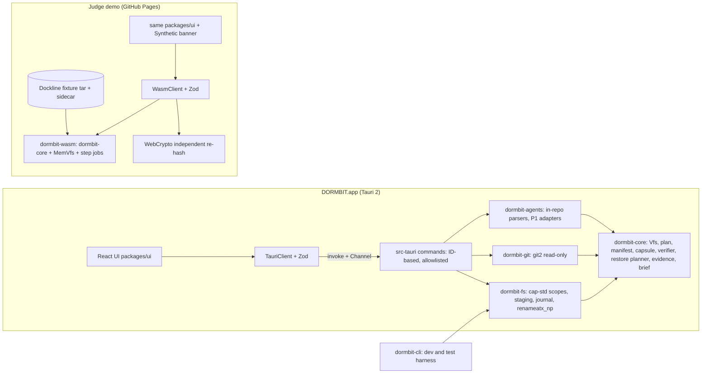
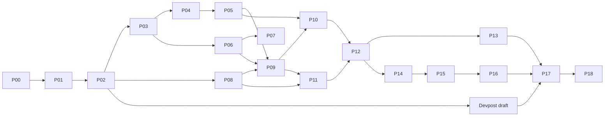

Approved in Kiro Plan mode on Tue Nov 3 17:10:29 PST 2026 (Pacific Time).

# DORMBIT master plan

**Tagline:** Pick up where your project stopped.
**Built for:** Kiroween 2026, Frankenstein category. Deadline Fri Dec 4, 2026, 2:00 PM PT.

## Decisions recorded at approval
- **Signing:** ad-hoc signature (`signingIdentity: "-"`) with no notarization. The web demo is the main path for judges. The README and Devpost testing notes give the Gatekeeper steps (System Settings → Privacy & Security → Open Anyway) and build-from-source instructions.
- **GitHub:** the repo is public from its first push. The owner comes from `gh` and is confirmed with the user before the repo is created. License: MIT.
- **Research:** proceed as researched. Accuracy is validated on public open-source repos. Running DORMBIT on the user's own projects stays optional and needs their consent at that time.
- **Process:** this file was written first, then execution paused for the user's review.

## 0. What was verified during planning

**Environment**
- macOS 26.6.2, Homebrew under `/opt/homebrew` (Apple Silicon).
- Xcode Command Line Tools are installed; Xcode.app is not. Tauri's docs say the Command Line Tools are enough for desktop builds.
- **Rust is not installed.** Installing it is Task 2.
- Node 23.9 (Homebrew) and Node 24.19 LTS (mise) are available. We pin Node 24 LTS.
- Already installed: pnpm, gh, gitleaks, shellcheck, actionlint, ffmpeg/ffprobe, whisper-cli, ImageMagick, exiftool, Netlify CLI.
- Missing or empty: Playwright browsers, MCP servers, Kiro Powers.
- Plan mode couldn't read today's date; Task 1 checks it.

**Hackathon rules** (kiroween.devpost.com, /rules, /details/faqs)
- Submission Period: Oct 30, 2026 9:00 AM PT to Dec 4, 2026 2:00 PM PT. No late entries and no edits after the deadline.
- Judging: Dec 16, 2026 to Jan 29, 2027. The app must stay available and free for the whole judging period.
- Only new work built during the Submission Period counts. Any pre-existing code or work must be disclosed.
- **Required:**
  - a working app URL
  - an English description
  - a public YouTube video under 3:00 showing the app on its target device
  - a public GitHub repo with an open-source license visible in the About section, and `/.kiro` at the root (never gitignored)
  - a Kiro usage write-up
  - exactly one category
- No third-party trademarks or copyrighted music in the video without permission.
- Free 4,000 Kiro credits: request by Dec 1, 12:00 PM PT; redeem by Dec 4.
- Judging has two stages. Stage One is pass/fail on fit and Kiro use. Stage Two scores five criteria at 20% each. "Technological Implementation" measures how well Kiro was used.

**Kiro** (kiro.dev/docs)
- **Specs:** `.kiro/specs/<name>/{requirements.md,design.md,tasks.md}`. Also available: Quick Spec, Analyze Requirements (IDE/CLI), and property-based "Correctness" (IDE only). Independent tasks run in parallel waves.
- **Steering:** `.kiro/steering/*.md` with `inclusion: always | fileMatch | manual | auto`, plus `#[[file:...]]` references. Custom agents only load steering files listed in their `resources`.
- **Hooks:** `.kiro/hooks/*.json` with `version: "v1"`. Triggers include `PostFileSave`, `PreToolUse`, `PostTaskExec`, `PreTaskExec`, and `Stop`.
  - Exit code 2 blocks `PreToolUse` and `PreTaskExec`.
  - Exit code 1 from `Stop` starts another agent turn.
  - File hooks fire only on agent edits. Command hooks receive JSON on stdin.
- **Custom agents:** `.kiro/agents/*.md` or `*.json` with `tools`, `permissions`, and `resources`. The IDE ignores any agent file that contains a `hooks` field.
- **Sub-agents:** run in parallel. Review loops use a trigger word and `max_iterations` (1 to 10).
- **Permissions:** deny > ask > allow. Workspace rules are stored outside the repo in `~/.kiro/workspace-roots/<hash>/permissions.yaml`.
- **MCP:** `.kiro/settings/mcp.json`. Playwright MCP supports `--isolated`, and `--extension` connects it to the user's Chrome through the Playwright extension.
- Plan mode hands off to execution on approval. The model dropdown offers Auto.
- Export Chat writes a zip containing `session.json` and `messages.jsonl`.

**AI agent storage**
- **Claude Code** (official docs): plaintext transcripts at `~/.claude/projects/<project>/<session>.jsonl`. They contain file contents and command output and are deleted after `cleanupPeriodDays` (default 30 days). Credentials (`.credentials.json`) are in the same tree.
- **Codex** (official docs): state under `CODEX_HOME` (default `~/.codex`). `history.jsonl` exists when history persistence is on, and `auth.json` when file-based credential storage is used. The docs don't confirm the per-session file layout.
- **Kiro:** the Export Chat format is documented. Its local session storage isn't documented, so v1 doesn't read it.

**Tauri 2**
- Capabilities and `AppManifest::commands` limit what the UI can call. Tauri's docs say capabilities don't protect against incorrect scope checks in Rust, so DORMBIT's Rust scope layer is the real security boundary.
- macOS WebDriver tests run through `@wdio/tauri-service` with the embedded driver plugin.
- Ad-hoc signing uses `signingIdentity: "-"`. Apple Silicon requires a signature on downloaded apps.

## 1. Executive product assessment

DORMBIT is worth building if it's positioned as **verified project shelving with an evidence-graded handoff**. It shouldn't be positioned as an agent-history viewer or a disk cleaner, because good tools already cover both.

**Strengths:**
1. Judges can test the safety claims themselves: corrupt a capsule in the browser and watch DORMBIT reject it.
2. Every finding is labeled Confirmed, Inferred, Unknown, or Unsupported, and cites its source.
3. The need is concrete. Claude Code deletes local transcripts after 30 days by default, and `git push` leaves behind gitignored files that matter, such as local notes and data files.
4. One Rust core runs both the macOS app and the browser demo (compiled to WebAssembly).

**Main risks:** a broad scope for about five weeks, a first-time Rust setup, WebAssembly integration, Gatekeeper friction from ad-hoc signing, and account automation.

| Assumption in the brief | Decision |
|---|---|
| "Switch to Spec/Default after approval" | The handoff is automatic. Pick Auto in the model dropdown. |
| "Kiro can play the video to verify it" | The agent checks duration and streams (ffprobe), samples frames, measures loudness, and transcribes (whisper-cli). The user watches the final cut. |
| "Browser automation does YouTube and Devpost" | Only through Playwright MCP's Chrome extension in the user's signed-in Chrome, with approval. We don't use the YouTube API, because uploads from unverified API projects are locked to private. Manual steps are the fallback. |
| "Encrypt sensitive data" | Not in v1. Sensitive files and external transcripts are never captured, and the app says so. Encryption is P2. |
| "Kiro and Cursor history adapters" | Kiro: user-exported chat zips, metadata only. Cursor history: Unsupported. In-repo `.kiro/`, `AGENTS.md`, `CLAUDE.md`, `.cursor/rules`, and `.specstory/` are read as ordinary project files. |
| "Track Tested/Verified/Released/Submitted in Kiro tasks" | Kiro checkboxes can't represent those states, so `docs/status/STATUS.md` is the ledger. |
| "Notarized app" | Decided: ad-hoc signing. The web demo is the main path for judges. |
| Third-party names in the video | No third-party logos. Product names appear only as plain text. |
| "Restored project resumes or builds" | Never claimed. The four outcomes are reported separately (BRF-2). |
| "Validate the product hypothesis" | We validate accuracy and the workflow (public repos, demo testing). Adoption can't be validated in five weeks, and the final report says so. |

## 2. Competitive positioning

| Tool | What it does well | What it doesn't do (DORMBIT's gap) |
|---|---|---|
| Agent Sessions (macOS, open source) | Searches 16 agents' local histories; resumes supported CLI sessions | Doesn't preserve projects or prove restores |
| Claude Code History Viewer (Tauri, open source) | Browses 31 assistants' histories offline | Same |
| SpecStory | Saves agent conversations as you work | Doesn't shelve a dormant project or prove a restore |
| Git clients, `git bundle` | Repo state and history | Miss gitignored files that matter; no handoff; no restore proof |
| Time Machine, Arq, restic, Borg | Verified backups | Not project-aware; no capture plan or context |
| kondo, npkill, disk cleaners | Reclaim space (kondo's README calls itself "essentially `rm -rf` with a prompt") | Destructive. DORMBIT only reads, and uses similar classification to shape the capture plan. |

**The unmet need:** "Can I shelve this project now and resume later, knowing exactly what I'll get back?" DORMBIT doesn't claim to be the first tool to archive projects, inspect Git, or browse histories. Its claim is that it combines them: it understands the project's state, preserves the approved content, independently proves the restore, and writes an accurate handoff.

**Frankenstein rationale:** DORMBIT stitches together several parts:
- local developer intelligence (filesystem, Git, manifests)
- AI-agent context awareness
- a cryptographic capsule format
- a transactional restore
- one Rust core shared by a native macOS app and a WebAssembly browser demo

The parts depend on each other. The evidence engine shapes what the capsule must contain, and the verifier backs the brief's "files restored" claim.

**Validation metrics:**
- On 5 public open-source repos with different stacks, at least 90% of Confirmed findings are judged correct against the source, and every Inferred finding cites evidence.
- 100% of restores in the test corpus are byte-verified, and no malicious fixture is accepted.
- A first-time user completes all 12 demo steps without help. This is checked by a Playwright run plus one manual walkthrough by the user.

## 3. Scope

**P0 (must ship):**
- Discovery limited to folders the user picks, plus Git snapshot and project metadata.
- Evidence View with the four statuses, including in-repo agent files.
- An editable capture plan with explicit approval.
- Capsule format v1, a separate verification pass, and transactional restore with crash recovery.
- The Resurrection Brief exported as Markdown.
- All 12 native screens, plus the judge demo (WebAssembly core) with corruption tests and reset.
- Property tests and malicious fixtures.
- CI, the public repo, the deployed demo, the ad-hoc-signed DMG release, the video, and the Devpost submission.

**P1 (ship if feasible; cut in this order when behind):**
1. Claude Code, Codex, and Kiro-export metadata adapters, including the "context at risk" warning.
2. Writing the brief into the restored project as `RESURRECTION_BRIEF.md`, optionally also as a Kiro steering file.
3. Safe restore of internal relative symlinks.
4. Native end-to-end tests through WebdriverIO (test builds only).
5. Universal (Intel plus Apple Silicon) binary.
6. Detection of more frameworks.
7. Accuracy validation on public repos (Task 48).

**P2 (future):**
- Encrypted capture (age plus Keychain).
- Deeper session analysis and opt-in local AI summaries.
- Cursor and Gemini adapters, and reading Kiro's local session store if it gets documented.
- Ed25519 capsule signing.
- The macOS App Sandbox with security-scoped bookmarks.
- A storage-analysis view and a dark theme.
- A DORMBIT MCP server so agents can read briefs.
- Sync, team workspaces, and cross-platform builds.
- Partial salvage of damaged capsules.
- Notarized builds.

## 4. Feature requirements (EARS style; these seed the Kiro specs)

**Scope and discovery**
- **SCP-1:** Folder access SHALL come only from native folder pickers opened by Rust. The UI SHALL refer to folders by grant ID, never by raw path.
- **SCP-2:** All filesystem access SHALL go through `cap-std` directory handles for granted folders, and discovery SHALL never follow symlinks. Source folders SHALL be read-only at the type level, meaning no write API exists for them.
- **DSC-1:** WHEN a scan runs, the system SHALL detect project roots by markers (`.git`, package manifests, `.kiro`, `AGENTS.md`) and SHALL treat a monorepo as one project.
- **DSC-2:** Scans SHALL be bounded by depth, file count, and time, SHALL be cancellable, and SHALL report progress. WHEN a bound is hit, the result SHALL be marked partial.
- **DSC-3:** Each project SHALL show:
  - name and where the name came from
  - path, with the home folder shown as `~`
  - detected stack, with evidence
  - Git branch, HEAD, dirty-file counts, stash count, and upstream (marked "as of last fetch")
  - latest file modification time
  - size, split into rebuildable and other
  - docs and manifests found
  - whether agent context is available
  - preservation status: last capsule, last verified, last verified restore
- **DSC-4:** The system SHALL NOT infer abandonment from timestamps. Dormancy SHALL be a manual mark.
- **DSC-5:** The Shelf SHALL support search, sort, filter, and multi-select.
- **GIT-1:** Git SHALL be read with libgit2 (`git2`, network features off), and the git CLI SHALL never be run. Config keys that can run commands (`core.fsmonitor`, `core.hooksPath`, `filter.*`, `core.sshCommand`, `credential.helper`) SHALL be flagged, and credentials in remote URLs SHALL be hidden.

**Project intelligence**
- **INT-1:** Every finding SHALL have a status, a rule ID, and at least one evidence reference (a file and line range, a Git object, a manifest key, or a file stat). The statuses are:
  - Confirmed: read directly from a cited source.
  - Inferred: derived by a named rule from confirmed facts.
  - Unknown: no evidence either way.
  - Unsupported: the source is something DORMBIT can't read.
- **INT-2:** Rules SHALL cover:
  - manifests and stack
  - documented commands (listed, never run)
  - toolchain files (`.nvmrc`, `rust-toolchain.toml`, `engines`)
  - key names in `.env.example`, never values
  - TODO/FIXME comments and skipped tests
  - uncommitted changes, WIP commits, feature branches, and stashes
  - unchecked tasks in `.kiro/specs/*/tasks.md`
  - `AGENTS.md`, `CLAUDE.md`, and `.cursor/rules`
  - `.specstory/` (presence, counts, and dates only)
  - a standing list of Unknowns: why the project paused, whether it builds, where it deploys
- **INT-3:** The system SHALL NOT state intent or history that it has no evidence for.

**Agent adapters (P1)**
- **AGT-1:** Each adapter SHALL require explicit consent and its own folder grant. It SHALL stay read-only, extract metadata only (session ID, working directory, timestamps, branch, tool version), discard message content, never open credential files, and report Supported or Unsupported for each file format.
- **AGT-2:** Session references SHALL be labeled "not resumed by DORMBIT".

**Capture plan**
- **CAP-1:** The plan SHALL sort files into these groups: Included, Excluded: rebuildable, Excluded: sensitive, Needs decision, Unreadable, Unsupported. Each item SHALL have a reason code and an editable flag.
- **CAP-2:** Sensitive files (`.env*` except example files, private keys, `.pem`, `.p12`, credential files) SHALL be excluded, with no override in v1.
- **CAP-3:** WHEN file contents look like secrets, the system SHALL warn and require acknowledgment before capture. Test strings for this check SHALL be generated at runtime and never committed.
- **CAP-4:** Gitignored files that aren't rebuildable SHALL be shown for review. Data files (`*.sqlite`, `*.db`, database dumps) SHALL require a decision.
- **CAP-5:** `.git` SHALL be captured, except `hooks/`, lock files, and fsmonitor state. A working-tree-only option SHALL exist.
- **CAP-6:** Symlinks SHALL be recorded but not restored (P0). Special files SHALL be excluded.
- **CAP-7:** The plan SHALL have a digest. Approval SHALL record the digest and the user's acknowledgments. Capture SHALL include only approved paths, and files that appeared after approval SHALL be reported as not captured.

**Capsule and verification**
- **CPS-1:** Capture SHALL run in three steps:
  1. Hash and compress each approved file into a temporary object store.
  2. Re-read and re-hash every source file. Any mismatch fails the capture with `FILE_CHANGED_DURING_CAPTURE`.
  3. Assemble the capsule with the manifest first, re-hashing stored objects as they're copied in.
- **CPS-2:** The capsule SHALL be written to a temp file, synced with `sync_all` (which uses `F_FULLFSYNC` on macOS), and renamed into place only if no file of that name exists. It SHALL then be recorded in the local registry with its whole-file SHA-256 and manifest SHA-256.
- **VER-1:** A separate verifier SHALL reopen the file and parse it strictly, checking:
  - the marker and format version
  - tar header checksums and fields, and zero padding
  - each object's stored hash and content hash
  - that the manifest and object set match exactly: every referenced object present once, no unreferenced objects, no duplicate entries
  - safe paths and no collisions
  - that the trailer is present
  - the registry match. A capsule that isn't in the registry is reported as Unknown, not Failed.
- **VER-2:** The verifier SHALL report Verified, Failed (naming the damaged files), or Unsupported. It SHALL state its limits: SHA-256 shows integrity, not authorship, and the OS cache may serve the bytes it reads.

**Restore**
- **RST-1:** The user SHALL choose a capsule, a destination parent folder, and a new folder name. Restore SHALL be refused if the target already exists in any case or Unicode-normalization variant, or if it's inside the source project or the capsule library.
- **RST-2:** Pre-checks SHALL cover:
  - the capsule is verified
  - there is enough free disk space
  - the destination volume supports exclusive rename (APFS, HFS+). Otherwise restore fails with `RESTORE_VOLUME_UNSUPPORTED`.
  - whether the volume is case-sensitive
  - every path is relative, has no `..`, no NUL or control characters, components of at most 255 bytes, and a total length of at most 1024 bytes
  - no collisions after NFC normalization (always checked) or case-folding (checked on case-insensitive volumes)
- **RST-3:** Restore SHALL write into a fresh staging folder in the same parent, containing an owner token. Files SHALL be created with create-new semantics through `cap-std`, with setuid, setgid, and sticky bits stripped (executable bits kept). Files SHALL be re-hashed while writing and synced. The staged tree SHALL be verified, then committed with `renameatx_np(RENAME_EXCL)`.
- **RST-4:** After commit, the system SHALL re-hash the restored files independently and check Git: HEAD and refs must match the manifest (in both builds), and the working-tree status must match (native only).
- **RST-5:** A journal SHALL record each step. After a crash, the next launch SHALL offer recovery. The only thing DORMBIT ever deletes is its own staging folders, and only after checking the owner token.
- **RST-6:** The system SHALL never restore `.git/hooks/*`, never overwrite anything, and never execute restored content.
- **RST-7:** The restore report SHALL list:
  - files written and verified
  - mismatches
  - what wasn't restored and why
  - risky Git config
  - executable files
  - the source-unchanged check
  - writes outside the destination, which must be 0 (taken from the journal)

**Resurrection Brief**
- **BRF-1:** The brief SHALL be structured JSON rendered to Markdown, with these sections: identity, technologies, repo state, docs, verified content, unfinished work, evidence-backed next steps, context references, missing information, first steps, and pre-run checks (lifecycle scripts, editor auto-run configs, risky Git config). Every line SHALL cite a finding ID.
- **BRF-2:** The brief SHALL report four outcomes separately:
  - Files restored and verified.
  - Context reconstructed (inferred from evidence).
  - AI session resumed: not performed.
  - Builds/runs: unknown (never executed).
- **BRF-3 (P1):** Writing `RESURRECTION_BRIEF.md` into the restored project SHALL happen after verification, as a separate, reported write. The restore report SHALL list it as an added file that isn't part of the capsule.

**Native app and UX**
- **NAT-1:** The WebView SHALL have no `fs` or `shell` plugin. Commands SHALL be allowlisted, the CSP SHALL be strict, and devtools SHALL be off in release builds.
- **NAT-2:** Untrusted project text SHALL be rendered without raw HTML. Logs SHALL hide sensitive details. There SHALL be no telemetry.
- **UX-1:** All 13 screens SHALL support keyboard access, VoiceOver labels, and reduced motion, and SHALL never use color as the only signal.

**Judge demo**
- **DEM-1:** The demo SHALL always show "Synthetic Demo — No Local Files Accessed". It SHALL run the real Rust core, compiled to WebAssembly, over an in-memory filesystem and implement the 12 steps in §5. It SHALL include corruption tests, a destination-collision test, reset, and downloads of the capsule and the brief.
- **DEM-2:** The folder picker SHALL be a labeled mock. The hashes shown SHALL be real, and the independent re-hash SHALL use WebCrypto, a different SHA-256 implementation from the one the writer uses. Any pacing added for readability SHALL be labeled with the real elapsed time.
- **DEM-3 (Dockline Invoices fixture):** a fictional invoicing app: React + Vite + TypeScript frontend, a Fastify API, and SQLite via Drizzle (manifests only, nothing installed). It contains:
  - about 24 commits with fixed authors and fictional dates in spring 2025
  - branches `main` and `feature/pdf-export` (checked out), with 2 modified files, 1 untracked note, and 1 stash
  - README, `docs/ROADMAP.md`, and CHANGELOG
  - the unfinished PDF export: TODO/FIXME in `src/pdf/renderInvoice.ts`, a skipped test, and `.kiro/specs/pdf-export/tasks.md` with 3 of 7 tasks done
  - a `.env` with obviously fake values, plus a `.env.example`
  - `data/dev.sqlite` (needs a decision)
  - placeholder `dist/` and `node_modules/` folders (rebuildable)
  - a synthetic Claude Code store and a Kiro export zip (metadata only)
  - expected hashes and a prepared corrupted capsule

  The generated tree is committed once as `fixtures/dockline/dockline-invoices.tar`. That tar is the single source for golden tests, both natively and in the browser. When the fixture is regenerated, it's compared on every file except `.git/index`, which holds machine-specific stat data.

## 5. User journeys

1. **First launch:** Welcome → Privacy (what DORMBIT does and doesn't do: local-only, no deletion, consent for agent histories) → pick a parent folder → scan with live progress → Shelf.
2. **Understand:** open a project → Evidence View → filter by status → jump to the source of any finding.
3. **Preserve:** Plan → resolve "Needs decision" items → acknowledge warnings → choose a capsule library folder → Approve → Capture (live state machine) → separate verification pass → the capsule seal appears.
4. **Re-verify later:** open a capsule from an external drive → Verify → registry comparison.
5. **Restore and resume:** Restore Wizard → pre-checks → staging → commit → result → Brief → export (P1: also written into the restored project for an agent to read).
6. **Corruption:**
   - A damaged capsule fails verification, and restore is blocked.
   - Damage introduced after verification is caught during the restore. The restore rolls back, and the destination is never created.
7. **Agent consent (P1):** Settings → enable the Claude Code adapter → pick `~/.claude/projects` → session metadata appears with the "context at risk" note.
8. **Judge demo:** open the URL → banner → guided rail through the 12 steps:
   1. Discover Dockline.
   2. Open its details.
   3. Inspect the stack and the unfinished work.
   4. Review the plan.
   5. Approve it.
   6. Run the capture state machine.
   7. Verify integrity.
   8. Restore to a virtual destination (including a refused collision with an existing folder).
   9. Inspect the independent verification.
   10. Read the brief.
   11. Run a corruption test.
   12. Observe the failure, then reset.
9. **Revoke:** Settings → remove a folder grant or consent. Cached data for it is cleared.
10. **Crash recovery:** on the next launch, DORMBIT detects the unfinished restore and offers to discard its staging folder.

## 6. Architecture

- **Repo layout:**
  - `apps/desktop` (React entry plus `src-tauri`) and `apps/demo`
  - `crates/` for `dormbit-core`, `dormbit-fs`, `dormbit-git`, `dormbit-agents`, `dormbit-wasm`, `dormbit-cli`
  - `packages/` for `schema` (ts-rs output plus Zod), `client` (`DormbitClient`, `MockClient`), and `ui` (design system and screens)
  - `fixtures/` (Dockline generator and tar, golden outputs, malicious-fixture generators) and `e2e/`
  - `docs/` (product, architecture, adr, security, status, evidence, release, submission, kiro), `scripts/`, `.github/workflows/`, `.githooks/`, `.kiro/`
- **The core never touches the disk directly.** `dormbit-core` uses only a `Vfs` trait plus injected `Clock` and `IdGen`, and has `#![forbid(unsafe_code)]`. That keeps it deterministic and buildable for WebAssembly. A small ref reader in core (`.git/HEAD`, `refs/`, `packed-refs`) runs the HEAD check in both builds. git2 runs natively only, and the demo's Git snapshot is precomputed from the fixture repo. The only `unsafe` code in the project is one `renameatx_np` call in `dormbit-fs`, and it gets a dedicated review.
- **Jobs run in steps.** Capture, verify, and restore expose `step(budget)`. Natively, a background thread runs them and streams progress over Tauri Channels. In the browser, they run during idle callbacks. Progress always reflects real file and byte counts.
- **Local state** is atomic JSON in Application Support (scopes, marks, capsule registry, restore journals and history, consent records), with a single-instance lock.
- **Commands (allowlisted):** `app_info`, `scope_pick`, `scope_list`, `scope_revoke`, `discovery_start`, `discovery_cancel`, `projects_list`, `project_get`, `project_set_dormant`, `evidence_get`, `plan_create`, `plan_set_decision`, `plan_approve`, `capture_start`, `job_cancel`, `capsule_pick`, `capsules_list`, `verify_start`, `restore_target_pick`, `restore_precheck`, `restore_start`, `restore_recover`, `brief_get`, `brief_export`, `settings_get`, `settings_set`, `consent_set`, `adapters_list`.
- **Rust crates:** `git2` (vendored, no network), `cap-std`, `ignore` (gitignore matching inside our own walker), `tar`, `flate2` (pure-Rust miniz_oxide backend), `sha2`, `unicode-normalization`, `serde`/`serde_json`, `thiserror`, `uuid`, `ts-rs`, `proptest`, `insta`, `libc`, `wasm-bindgen`.
- **UI:** React 19, React Router, TanStack Query, Zod 4, React Aria Components, TanStack Virtual, react-markdown (no raw HTML), Lucide icons.
- **Platform:** minimum macOS 13; tested on macOS 26.6.2.
- **Fallback:** if WebAssembly fails the spike in Task 3, the demo uses a TypeScript port that must pass the same golden fixtures.

## 7. Security model

**What we protect:** user projects, agent transcripts, secrets inside projects, capsules, restored output, and the accuracy of what DORMBIT reports.

**Trust boundaries:** the WebView (it renders untrusted project text), the IPC layer, Rust (trusted), file contents and capsules (untrusted input), and agent stores (sensitive).

| Threat | Mitigation | Proven by |
|---|---|---|
| Path traversal or absolute paths in a capsule | Tar entry names are never used as output paths; manifest paths are validated | PROP-1, malicious fixtures |
| Escape through symlinks | `cap-std`, no link following, staging created fresh | PROP-9, escape fixtures |
| Overwriting an existing project, or a race for it | Existence and normalized-collision checks, create-new writes, `RENAME_EXCL` | PROP-4, PROP-8 |
| Archive bombs or malformed tar | Allowlists for entry types and names, manifest sizes enforced, limits on entry count and expansion ratio | Malicious fixtures |
| Tampering | Hashes plus registry match; limits stated honestly | PROP-3 |
| Partial restore after a crash | Journal, verify before commit, atomic commit, recovery | PROP-5, fault-injecting `Vfs` |
| Changes to source files | Read-only source access by type; before/after snapshots | PROP-6, read-only copies |
| Secret leakage | Sensitive files excluded, content scanning, hidden in logs, no telemetry | Unit tests, gitleaks |
| XSS from READMEs or commit messages | React escaping, no raw HTML, CSP, lint rule | CSP and lint tests |
| IPC abuse | Allowlist, ID-based inputs, typed errors | Random-input IPC tests |
| Code running through Git config or hooks | No git CLI; hooks never captured or restored; risky keys flagged in the report and brief | Unit tests |
| A restored repo runs commands later (`core.fsmonitor`, `core.hooksPath`) | Flagged with exact keys in the restore report and brief pre-run checks | Unit tests |
| Agent-store privacy | Consent, separate grant, metadata only, credential files never opened | Adapter tests |
| Supply chain | Lockfiles, pinned versions, cargo-deny, pnpm audit, a small dependency set | CI |
| Public repo leaks private data | gitleaks pre-commit, `~` redaction, raw logs kept in `.scratch/` | Pre-commit and CI gitleaks |
| Dev agent reads real transcripts | Kiro permissions deny `~/.claude/**`, `~/.codex/**`, and credential folders; tests use synthetic fixtures only | Permissions file |

**Stated limits:** scope enforcement happens inside the app; there's no OS sandbox in v1. There's no encryption in v1. Reading files can update their access times.

## 8. Data models and capsule format v1

- `ScopeGrant` `{id, kind: Read|CapsuleLibrary|RestoreTarget, root_display, granted_at, via: NativePicker}`
- `ProjectRecord` `{id, scope_id, rel_root, name{value, source}, stacks[Finding], git?: GitSnapshot, activity{latest_mtime, scanned, partial}, size{total, rebuildable, partial}, docs[], manifests[], agent_artifacts[], marks{dormant}, preservation{last_capsule?, last_verified_at?, last_verified_restore?}}`
- `GitSnapshot` `{head{branch?, detached, commit, time, summary}, upstream?{ahead, behind, as_of_last_fetch}, status{modified, staged, untracked, deleted, conflicted}, stash_count, worktree_external, submodules[], lfs_detected, risky_config[], remotes_redacted[]}`
- `CapturePlan` `{plan_id, items[{path, kind, size, decision, reason, editable, warning?}], groups, git_treatment, totals, digest}`
- `ApprovedPlan` `{digest, approved_at, acks[], overrides[]}`
- `Finding` `{id, rule, statement, status, evidence[EvidenceRef]}`
- `Brief` `{sections[], outcomes{files, context, session, build}, evidence_index}`
- `VerificationReport` `{capsule_id, file_sha256, manifest_sha256, checks[{id, status, detail}], failed_files[], registry_match: Match|Mismatch|NotInRegistry, status}`
- `RestoreJournal` `{op_id, staging, owner_token, state: Staged|Written|Verified|Committed|Cleaned}`
- `RestoreReport` (fields from RST-7)
- `DormbitError` `{code, message, retryable}`. Stable codes include `SCOPE_DENIED`, `PATH_UNSAFE`, `PLAN_DIGEST_MISMATCH`, `FILE_CHANGED_DURING_CAPTURE`, `CAPSULE_MALFORMED`, `CAPSULE_TRUNCATED`, `CAPSULE_HASH_MISMATCH`, `CAPSULE_VERSION_UNSUPPORTED`, `RESTORE_DEST_EXISTS`, `RESTORE_COLLISION`, `RESTORE_VOLUME_UNSUPPORTED`, `RESTORE_INSUFFICIENT_SPACE`, `CANCELLED`.

**Capsule (`.dormbit`):** an uncompressed tar file with fixed headers (mtime taken from the manifest, uid/gid 0, mode 0644 or 0755). Entries, in this order:
1. `DORMBIT`: a marker line, `dormbit-capsule/1`.
2. `manifest.json`: `schema_version`, `capsule_id`, `created_at`, app version, project, `plan_digest`, `git`, `entries[]`, `excluded[]`, `warnings[]`, `limitations[]`, `agent_refs[]`, `totals`.
   - File entries: `{path, size, mode, mtime, sha256, object{encoding: gzip|identity, stored_size, stored_sha256}}`.
   - Symlink entries: `{path, target, restored: false}`.
3. `objects/<sha256>`: content-addressed blobs, each gzipped separately so damage can be traced to a single file. Identical files share one object.
4. `END`: a trailer with the manifest digest and object count, used to detect truncation.

Default limits (per-file size, entry count, capsule size) are configurable and documented in `docs/architecture/capsule-format.md`. The same inputs produce byte-identical capsules natively and in WebAssembly (PROP-10).

## 9. UX/UI architecture

- **Layout:** one window with a sidebar (Shelf, Capsules, Restores, Settings). Onboarding is a full-window flow. The title bar overlays the content, with inset traffic lights. Minimum window size is 1100×720.
- **Screens:**
  1. Welcome
  2. Privacy & Permissions
  3. Folder Selection
  4. Shelf: dense rows with name, middle-truncated path, stack chips, branch and dirty marks, activity, size, and capsule seal
  5. Evidence View: tabs for Overview, Evidence, Files, Git, Agent context, History
  6. Preservation Plan: groups plus a summary rail
  7. Capsule Creation: step state machine
  8. Integrity Verification
  9. Restore Wizard
  10. Restoration Result
  11. Resurrection Brief
  12. Settings: scopes, consent, defaults, data and privacy, about and licenses
  13. Judge Demo: guided rail, "what's real" panel, reset
- **Color tokens:** the brief's palette, with text colors adjusted for contrast. Contrast ratios on Paper `#F4F1E9`, computed with the WCAG formula and re-checked by automated tests in Task 34:

  | Color | Ratio | Use |
  |---|---|---|
  | Ink `#222B29` | 12.9:1 | Body text |
  | Evergreen `#315C4F` | 6.7:1 | Primary actions and Verified status |
  | Slate `#75817D` | 3.6:1 | Input borders and icons only; fails as body text |
  | Copper `#B77F55` | 3.0:1 | Fills only |
  | Error `#B35C50` | 4.1:1 | Large text and icons only |
  | Sage `#8DA99A` | 2.2:1 | Fills only, with Ink text on top (5.7:1) |
  | Border `#DDDCD3` | — | Dividers and cards only |

  New text tokens:

  | Token | Ratio |
  |---|---|
  | `--text-muted #5E6A66` | 5.0:1 |
  | `--copper-text #8E5A33` | 5.1:1 |
  | `--error-text #9A4639` | 5.6:1 |
- **Type:** system UI font with Inter as the fallback, Newsreader for headings and the brief, JetBrains Mono for paths and hashes. All are OFL fonts, bundled with their licenses, and loaded with no web-font requests.
- **Spacing and motion:** 4px grid, corner radius 6/10/14, three elevation levels, motion of 120–200 ms ease-out, and no motion under reduced-motion settings.
- **Status markers:** each status pairs a glyph with a label:
  - Verified ✓ (Evergreen)
  - Needs decision ◆ (Copper)
  - Failed ✕ (Error)
  - Unknown ? (Slate)
  - Unsupported ⊘ (Slate)
- **Capsule seal:** a fingerprint pattern drawn from the real capsule ID. It's shown "pressed" only after verification passes.
- **States and gallery:** every screen has loading, empty, error, partial, and cancelled states. Components are documented on a dev-only `/gallery` route that has screenshot tests.

## 10. Kiro steering and custom agents

**Steering** (`.kiro/steering/`):
- **Always loaded:**
  - `product.md`: truthfulness, the four outcomes, no deletion, no code execution, local-first.
  - `tech.md`: stack, pinned versions, commands.
  - `structure.md`: repo layout and module boundaries.
  - `security.md`: hard rules. No `std::fs` in core, no git CLI, no fs or shell plugins, no raw HTML, no `unwrap` in core, never read real agent stores.
  - `definition-of-done.md`: status vocabulary and evidence rules.
  - `project-status.md`: pulls in `#[[file:docs/status/HANDOFF.md]]`.
- **fileMatch:** `rust.md` (`**/*.rs`), `frontend.md` (`apps/**`, `packages/**`), `ui-design.md` (pulls in the token file), `testing.md` (test files).
- **Manual (slash commands):** `hackathon.md` (rules checklist and approval gates), `release.md`.

**Custom agents** (`.kiro/agents/*.md`):
- Each agent lists the steering files it needs under `resources`.
- No agent has a `model` field, so they use the session's model (Auto).
- No agent has a `hooks` field, because the IDE ignores agents that have one.
- Write limits are set with an `fs_write` deny on `**` that excludes the agent's allowed paths.

| Agent | Can write | Shell | Purpose |
|---|---|---|---|
| `architect` | `docs/adr/**`, `docs/architecture/**`, `.kiro/specs/**` | none | Design decisions and consistency across crates |
| `rust-security` | `crates/**`, `fixtures/malicious/**`, `docs/security/**` | `cargo *` | The only writer for scope, capsule, verify, and restore code |
| `frontend` | `apps/**`, `packages/**` (not `schema/generated`) | `pnpm *` | UI, plus visual checks through Playwright MCP |
| `qa` | test folders, `e2e/**`, `docs/evidence/**` | test commands | Writes and runs tests; records evidence |
| `release` | `.github/**`, `docs/release/**`, `docs/submission/**`, `media/**`, `README.md` | build commands, and `gh` (ask first) | Packaging and submission |
| `reviewer` | read-only | test commands | Returns `APPROVED` or `NEEDS_CHANGES` |

- **Single-writer rule:** permissions enforce it in the other custom agents. For the main agent it's a steering rule: delegate security modules to `rust-security`.
- **Review loops:** implementer → reviewer → back to the implementer on `NEEDS_CHANGES`, with `max_iterations: 3`.
- **Parallel lanes:**
  - A: `rust-security` (P03 → P05)
  - B: main agent and `architect` (Git, metadata, intelligence, brief)
  - C: `frontend` (design system and screens against `MockClient`)
  - D: `qa`
  - E: `release`

  Generated files (ts-rs output, golden fixtures) are regenerated only by the main agent, at merge points.

## 11. Hooks, MCP, Powers, skills, and permissions

| Hook (`.kiro/hooks/*.json`) | Trigger | Action |
|---|---|---|
| `format` | `PostFileSave`, matcher `\.(rs\|ts\|tsx\|css\|json\|md)$` | `scripts/hooks/format.sh` reads the path from the stdin JSON, checks it's inside the repo, then runs rustfmt or prettier on that file. No path is interpolated into a shell string. |
| `stop-gate` | `Stop` | `scripts/hooks/stop-gate.sh` runs `cargo check --workspace` and the TypeScript typecheck. Exit 1 sends errors back to the agent. It gives up after 3 failures in a row (counter in `.scratch/`) and exits 0 when the toolchain or workspace isn't set up yet. |
| `secret-scan` | `PreToolUse`, matcher `write` | `scripts/hooks/secret-scan.sh` pipes the content being written to gitleaks; exit 2 blocks the write. |
| `security-tests` | `PostFileSave` on security-module paths | Runs the fast security test subset and reports failures. |
| `task-tests` | `PostTaskExec` | Runs the task's spec tests through the evidence runner. |
| `review-reminder` | `PostTaskExec` (agent prompt) | "Run the reviewer sub-agent on this task's diff and record the verdict in STATUS.md." |
| `release-gate` | `PreTaskExec` | Exit 2 blocks release tasks (P12 and later) unless the latest evidence is green, gitleaks is clean, LICENSE exists, and `.kiro` isn't ignored. |

- **Payload check:** hook payload fields are confirmed in Task 4 before any hook relies on them. If the `PreTaskExec` and `PostTaskExec` payloads don't identify the task, `release-gate` and `task-tests` become skills that the release and QA agents run explicitly. No hook ever touches folders the user picks inside DORMBIT.
- **Git pre-commit:** separate from the Kiro hooks, `.githooks/pre-commit` runs gitleaks on staged changes. It's enabled locally with `core.hooksPath=.githooks`.
- **MCP** (`.kiro/settings/mcp.json`):
  - `playwright`: `@playwright/mcp` at a pinned version, `--isolated`, output to `.scratch/playwright`. Allowed origins are limited to localhost and the Pages site; per its docs, that's a convenience filter, not a security boundary.
  - `playwright-chrome` (`--extension`): stays disabled until the user approves it for YouTube and Devpost.
  - GitHub work uses the `gh` CLI, so no GitHub MCP server is added.
- **Powers:** review the catalog in Task 4. Install one only if it replaces planned work; otherwise the write-up says none were used.
- **Skills:** `.kiro/skills/{visual-qa,release-gate,demo-video}/SKILL.md`, with the format verified in Task 4.
- **Kiro Workflows:** evaluate them for the release checks in Task 4, and adopt only if they work.
- **`.kiroignore`:** `target/`, `node_modules/`, `media/raw/`, `.scratch/`.
- **Workspace permissions:** the recommended file lives at `docs/kiro/recommended-permissions.yaml`. It's applied to `~/.kiro/workspace-roots/<hash>/permissions.yaml` only with the user's approval. Patterns are tested in Task 13.
  - allow: `cargo *`, `pnpm *`, local git commands, `git push origin main`
  - ask: `gh *`, `brew *`, `rustup *`, `curl *`, `npx *`, `pip *`, any other push
  - deny: `sudo *`, `git reset --hard*`, force pushes, writes outside the workspace, and reads of `~/.claude/**`, `~/.codex/**`, `~/.ssh/**`, `~/.aws/**`, `~/.config/gh/**`, `~/.netrc`

## 12. Kiro specs and dependencies

| Spec (`.kiro/specs/`) | Phases | Property tests |
|---|---|---|
| `foundation` | P02 | none |
| `scope-and-discovery` | P03 | PROP-9 |
| `capsule-and-verification` | P04 | PROP-2, 3, 7, 10, 11 |
| `transactional-restore` | P05 | PROP-1, 4, 5, 6, 8 |
| `intelligence-and-brief` (includes agent adapters) | P06, P07 | PROP-12 |
| `native-experience` | P08, P11 | none (UI) |
| `judge-demo` | P09 | PROP-10 (native/WebAssembly parity) |
| `release-and-submission` | P10, P12–P18 | none |

The two security specs are `capsule-and-verification` and `transactional-restore`. At the P01 gate, the user runs Analyze Requirements on both, then the design-phase Correctness step.

## 13–14. Phased roadmap, tasks, and exit criteria

**Status ledger** (`docs/status/STATUS.md`):

| Status | Meaning |
|---|---|
| Planned | Not started |
| In progress | Being worked on |
| Implemented | Merged and builds |
| Tested | Its tests pass in a recorded run |
| Verified | Reviewer approved, and demonstrated with a log or screenshot |
| Released | In a tag or deployment |
| Submitted | Part of the final submission |

**Recording rules:**
- `scripts/evidence/run.sh` records the command, exit code, counts, git SHA, and time, with the home path written as `~`.
- Every commit message names its task ID.
- Each phase gate writes `docs/status/gates/PXX.md` (what works, what's missing, what's next) and updates `HANDOFF.md`.
- Notable Kiro usage goes into `docs/kiro/usage-log.md` with links. That covers specs, hook catches, property-test counterexamples, and review verdicts.

### Phase 00: Feasibility and research
- **Depends on:** nothing.
- **Exit:** the date is inside the Submission Period, the toolchain works, both spikes have a recorded go/no-go, Kiro formats are confirmed, and the public repo exists.
- **Risks:** Rust or WebAssembly setup.
- **Approvals:** toolchain installs; the repo target.
- **Evidence:** `docs/status/environment.md`, ADRs, `docs/kiro/feature-probe.md`, gate note.

**Task 1: P00-T01 · Eligibility, environment, local repo (P0)**
- Objective: confirm the date is inside the Submission Period, record the environment, and start the local Git repo.
- Guidance:
  - If the Pacific Time date is before Oct 30, 2026 9:00 AM, stop and tell the user.
  - Write tool versions to `docs/status/environment.md`.
  - Check `git config user.name` and `user.email`. If the email looks personal, ask whether to use the GitHub noreply address for this repo.
  - Run `git init`. Add a `.gitignore` that never ignores `.kiro` and does ignore `.scratch/`.
  - Add `.githooks/pre-commit` (gitleaks on staged changes).
  - Make the first commit, containing this plan.
- Tests: the version commands run; `git check-ignore .kiro` prints nothing.
- Demo: the environment report and the first commit.

**Task 2: P00-T02 · Toolchain install (P0, needs approval)**
- Objective: install what the build needs.
- Guidance:
  - rustup stable with the `aarch64-apple-darwin`, `x86_64-apple-darwin`, and `wasm32-unknown-unknown` targets
  - `wasm-bindgen-cli` pinned to the crate version, cargo-deny, binaryen (`wasm-opt`)
  - Node 24 LTS and pnpm pinned in `.mise.toml`
  - Playwright browsers are installed later, in Task 12.
- Tests: `rustc -V`, `cargo -V`, `wasm-bindgen -V`.
- Demo: every tool reports its version.

**Task 3: P00-T03 · Feasibility spikes (P0)**
- Objective: prove the two riskiest pieces work before building on them.
- Guidance: work in `spikes/`, removed in Task 9 with a commit that records the result.
  - (a) A Tauri 2 + React app built with only the Command Line Tools, with a folder picker opened from Rust, and `cap-std` plus `renameatx_np(RENAME_EXCL)` working on a temp folder.
  - (b) A `wasm32-unknown-unknown` crate using `sha2`, `tar`, `flate2` (miniz_oxide), `ignore::gitignore`, `unicode-normalization`, and `uuid` with a JS random source, loaded in a Vite page.
- Tests: both spikes build and run; the exclusive rename refuses an existing target.
- Demo: the picker returns a folder; the browser shows a SHA-256 computed in WebAssembly. Record ADR-001 (WebAssembly core go/no-go) and ADR-002 (capsule container).

**Task 4: P00-T04 · Kiro feature probe and research record (P0)**
- Objective: confirm Kiro's formats work as documented and save the research.
- Guidance:
  - Add a temporary hook per trigger type that logs its stdin payload to `.scratch/`. Commit only a field summary, as `docs/kiro/feature-probe.md`.
  - Load one test agent. Check the Skills format and Workflows. Launch Playwright MCP. Review the Powers catalog.
  - Write `docs/product/research.md`: competitors, agent storage formats with sources, and the rules checklist.
  - Remind the user to register on Devpost and request the Kiro credits.
- Tests: each probe hook fired once.
- Demo: the probe summary.

**Task 5: P00-T05 · Public GitHub repo (P0, confirm the target first)**
- Objective: publish the repo on day one.
- Guidance:
  - Run `gh auth status`. If signed out, the user runs `gh auth login` themselves.
  - Read the login with `gh api user --jq .login`. Check that `dormbit` is available (fallback: `dormbit-app`).
  - Show the user the exact `owner/name` and wait for confirmation.
  - Add an MIT `LICENSE` (copyright holder: the owner's GitHub display name) and a README stub with the tagline and a work-in-progress note.
  - Run gitleaks on the full history.
  - Run `gh repo create <owner>/dormbit --public --source . --push` and set the About description.
- Tests: `gh repo view --json visibility,licenseInfo` shows PUBLIC and MIT, and the license appears in About.
- Demo: the repo URL.

### Phase 01: Requirements and design
- **Depends on:** P00.
- **Exit:** the PRD, architecture, threat model, capsule format spec, ADRs, and 8 specs exist. The user has reviewed the specs and run Analyze Requirements and Correctness on the two security specs.
- **Approvals:** spec review.
- **Evidence:** the documents and the gate note.

**Task 6: P01-T01 · PRD and user journeys**
- Objective: write `docs/product/PRD.md` from §1–5.
- Tests: n/a.
- Demo: the document.

**Task 7: P01-T02 · Architecture, threat model, capsule format, ADRs**
- Objective: write `docs/architecture/overview.md`, `docs/security/threat-model.md`, `docs/architecture/capsule-format.md`, and ADR-003 to ADR-010:
  - Vfs-based core
  - git2 without the git CLI
  - ID-based IPC
  - staging plus exclusive rename
  - no encryption in v1
  - metadata-only adapters
  - GitHub Pages hosting
  - ad-hoc signing
- Tests: n/a.
- Demo: the documents.

**Task 8: P01-T03 · Kiro specs and status ledger**
- Objective: create the 8 specs in Kiro's format, plus `docs/status/STATUS.md`, `docs/status/HANDOFF.md`, `docs/release/checklist.md`, `docs/submission/checklist.md`, and `docs/kiro/usage-log.md`.
- Guidance: requirements in EARS style come from §4, design from §6–9, and tasks from this section (keep the task IDs and dependencies). Check Kiro's feature-spec docs for the exact `tasks.md` format first. Ask the user to open the two security specs in the Specs panel, run Analyze Requirements, then run the design-phase Correctness step. Apply the results.
- Tests: the specs appear in the Specs panel and their tasks can be started.
- Demo: the Specs panel.

### Phase 02: Engineering foundation
- **Depends on:** P01.
- **Exit:** CI is green on macOS, a command round-trips from the UI to Rust, the Dockline tar exists, and the steering, agents, hooks, and MCP all work.
- **Risks:** hook payloads differing from the docs.
- **Approvals:** the workspace permissions file; the Playwright browser download.
- **Evidence:** CI run link, hook summary, gate note.

**Task 9: P02-T01 · Monorepo scaffold**
- Objective: pnpm and Cargo workspaces with pinned versions.
- Guidance:
  - TypeScript `strict`, `noUncheckedIndexedAccess`, and `exactOptionalPropertyTypes`.
  - ESLint with jsx-a11y, react-hooks, and a ban on `dangerouslySetInnerHTML`; Prettier.
  - rustfmt and clippy with `-D warnings`; `#![forbid(unsafe_code)]` in core.
  - Remove `spikes/`.
- Tests: lint and typecheck pass.
- Demo: `pnpm -r build` and `cargo build --workspace` both succeed.

**Task 10: P02-T02 · Hardened Tauri shell**
- Objective: the desktop app, with NAT-1 in place from the start.
- Guidance:
  - CSP, minimal capabilities, the `AppManifest` command allowlist, no fs or shell plugins, devtools off in release.
  - Bundle ID `io.github.<owner>.dormbit`, `signingIdentity: "-"`, minimum macOS 13.
  - An `app_info` command that streams over a Channel.
- Tests: a test fails if any plugin permission or unlisted command appears.
- Demo: the window opens and shows the version reported by Rust.

**Task 11: P02-T03 · Shared contracts**
- Objective: one definition of every type, shared by Rust and TypeScript.
- Guidance: ts-rs exports into `packages/schema/generated`; Zod schemas with type-equality tests; the `DormbitClient` interface plus `MockClient`; `DormbitError` codes.
- Tests: schema parity tests (PROP-11 setup).
- Demo: the UI shows mock data validated by Zod.

**Task 12: P02-T04 · Test setup and the Dockline fixture**
- Objective: test tooling and the synthetic project.
- Guidance:
  - proptest, insta, Vitest, Testing Library, fast-check, Playwright (install its browsers, with approval), and `@axe-core/playwright`.
  - `scripts/evidence/run.sh`.
  - A deterministic generator that builds Dockline (DEM-3) and writes the tar plus a JSON sidecar.
- Tests: regenerating matches the committed tar on every file except `.git/index`.
- Demo: the fixture extracted under `.scratch/`.

**Task 13: P02-T05 · Kiro setup**
- Objective: put §10–11 in place: steering, agents, hooks, skills, MCP config, `.kiroignore`, and the recommended permissions file.
- Guidance: use the formats confirmed in Task 4. Ask before applying the workspace permissions file. Test a deliberately denied write.
- Tests: each hook fires once with the expected result, and secret-scan blocks a generated fake secret.
- Demo: format-on-save runs, and secret-scan blocks the fake secret.

**Task 14: P02-T06 · CI and Devpost draft**
- Objective: CI on every push, and an early submission draft.
- Guidance:
  - `.github/workflows/ci.yml` on `macos-15`: Rust (fmt, clippy, tests), TypeScript (lint, typecheck, tests), WebAssembly build, Playwright, gitleaks, cargo-deny, and pnpm audit.
  - Add `SECURITY.md`.
  - Write `docs/submission/devpost-draft.md`. Ask the user about teammates and which bonus prizes they qualify for. The user saves the draft on Devpost.
- Tests: the first CI run is green.
- Demo: the CI badge and the draft.

### Phase 03: Discovery engine
- **Depends on:** P02.
- **Exit:** picking a real folder shows Dockline and other projects with grounded data.
- **Risks:** slow scans on big trees.
- **Evidence:** test logs and a screenshot.

**Task 15: P03-T01 · Scope enforcement (rust-security)**
- Objective: implement SCP-1 and SCP-2.
- Guidance: the `ScopeGrant` registry, folder pickers opened from Rust, `cap-std` handles, and a read-only source type.
- Tests: PROP-9; fixtures for symlink escape and `..` paths.
- Demo: grant a folder in the app.

**Task 16: P03-T02 · Walker and metadata**
- Objective: implement DSC-1 to DSC-3 (the non-Git parts).
- Guidance: a walker in core over `Vfs` that honors gitignore, is bounded and cancellable, and detects roots, monorepos, stack, docs, activity, and size (with rebuildable classification).
- Tests: synthetic trees and golden Dockline output.
- Demo: `dormbit-cli scan` lists the projects.

**Task 17: P03-T03 · Git inspection**
- Objective: implement GIT-1 and `GitSnapshot`.
- Tests: synthetic repos that are dirty, detached, empty, a linked worktree, or have submodules, LFS, or risky config.
- Demo: the CLI shows `feature/pdf-export` with dirty counts.

**Task 18: P03-T04 · Shelf wired to the UI**
- Objective: implement DSC-4 and DSC-5 in the UI.
- Guidance: the scope, discovery-job, projects, and dormant-mark commands; persistence; a working Shelf.
- Tests: Vitest and Rust command tests.
- Demo: pick a folder and watch discovery fill the Shelf.

### Phase 04: Capsule system
- **Depends on:** P03.
- **Exit:** Dockline is preserved natively and confirmed by the separate verifier. Every malicious capsule fixture is rejected.
- **Risks:** changes to the capsule format.
- **Evidence:** test logs and a capsule listing.

**Task 19: P04-T01 · Capture plan engine**
- Objective: implement CAP-1 to CAP-7.
- Tests: the golden Dockline plan (`.env` excluded, `data/dev.sqlite` needs a decision); the digest changes when a decision changes.
- Demo: `dormbit-cli plan`.

**Task 20: P04-T02 · Manifest and writer (rust-security)**
- Objective: implement CPS-1 and CPS-2.
- Tests: PROP-2 (writing side), PROP-7, PROP-10 (native golden bytes), PROP-11.
- Demo: a capsule on disk that `tar -tvf` can list.

**Task 21: P04-T03 · Verifier and malicious fixtures (rust-security)**
- Objective: implement VER-1 and VER-2.
- Tests: PROP-3, plus fixtures for each of these: traversal, absolute path, symlink entry, duplicate entry, truncation, missing trailer, archive bomb, bad marker, unknown version, manifest/object mismatch.
- Demo: the CLI verifies a good capsule and names the damaged file in a bad one.

**Task 22: P04-T04 · Plan, Capture, and Verification screens**
- Objective: connect the capsule system to the UI.
- Guidance: decision editing, acknowledgments, approval, the capture state machine over a Channel, cancel, the verification report, and the capsule seal.
- Tests: component and command tests.
- Demo: preserve Dockline end to end in the app.

### Phase 05: Safe restoration
- **Depends on:** P04.
- **Exit:**
  - A verified restore works.
  - A damaged capsule is blocked.
  - Damage introduced mid-restore rolls back.
  - A simulated crash recovers.
- **Risks:** filesystem edge cases.
- **Evidence:** property-test logs and report screenshots.

**Task 23: P05-T01 · Restore pre-checks**
- Objective: implement RST-1 and RST-2.
- Tests: PROP-4, PROP-8.
- Demo: the CLI refuses an existing target and a case-variant of it.

**Task 24: P05-T02 · Transactional executor (rust-security)**
- Objective: implement RST-3 and RST-4.
- Tests: PROP-1 and PROP-2 (full round trip).
- Demo: a restored Dockline whose HEAD matches the manifest.

**Task 25: P05-T03 · Journal and recovery**
- Objective: implement RST-5.
- Tests: PROP-5, with a fault-injecting `Vfs` failing at every step.
- Demo: kill the app mid-restore, relaunch it, and recover.

**Task 26: P05-T04 · Restore report and screens**
- Objective: implement RST-6 and RST-7, plus the Restore Wizard and Result screens.
- Tests: PROP-6 on read-only copies.
- Demo: a full native restore.

### Phase 06: Project intelligence
- **Depends on:** P03 (rules) and P05 (verified content for the brief).
- **Exit:** Dockline's Evidence View shows the unfinished PDF export with line references, and the brief exports.
- **Evidence:** golden files and screenshots.

**Task 27: P06-T01 · Evidence model and rules**
- Objective: implement INT-1 to INT-3.
- Tests: PROP-12 and golden findings.
- Demo: `dormbit-cli evidence`.

**Task 28: P06-T02 · In-repo agent files**
- Objective: parse `.kiro/specs/*/tasks.md`, steering files, `AGENTS.md`, `CLAUDE.md`, `.cursor/rules`, and `.specstory/` metadata.
- Tests: fixture parsing.
- Demo: Dockline shows "3 of 7 tasks complete".

**Task 29: P06-T03 · Brief generator**
- Objective: implement BRF-1 and BRF-2, with export through a save dialog opened by Rust. Implement BRF-3 if P1 allows.
- Tests: golden Markdown.
- Demo: open the exported brief.

**Task 30: P06-T04 · Evidence View and Brief screens**
- Objective: connect intelligence to the UI.
- Tests: component tests.
- Demo: both screens show real data.

### Phase 07: Agent adapters (P1, cut first)
- **Depends on:** P06.
- **Exit:** the adapters work on synthetic stores only. The dev agent never reads the user's real stores.

**Task 31: P07-T01 · Adapter framework**
- Objective: implement AGT-1 and AGT-2: consent records, separate grants, the credential deny-list, and Supported/Unsupported reporting.
- Tests: the deny-list and discarding of message content.
- Demo: the consent screen in Settings.

**Task 32: P07-T02 · Claude Code and Codex adapters**
- Objective: read session metadata from both tools.
- Guidance:
  - Claude Code: use the documented path and match sessions by working directory. Show a retention-risk note based on the documented 30-day default; the user's own setting shows as Unknown.
  - Codex: first confirm the current file layout from official sources. Otherwise read `history.jsonl` metadata or report Unsupported.
  - If field names can't be confirmed from docs, offer the user a keys-only schema probe they run themselves (it prints field names and types, not values).
- Tests: synthetic fixtures.
- Demo: session metadata in the Evidence View.

**Task 33: P07-T03 · Kiro export adapter and wiring**
- Objective: read `session.json` metadata from exported zips and add references to the brief.
- Tests: a fixture zip.
- Demo: a session reference in the brief.

### Phase 08: Complete native UI
This phase runs in parallel from P02, against `MockClient`.
- **Exit:** all 12 native screens work, every state is covered, and axe reports no critical issues.

**Task 34: P08-T01 · Design system**
- Objective: tokens, fonts, and these components, all shown on `/gallery`:
  - Button, Field, Checkbox, Tabs
  - virtualized List and Table, Tree
  - StatusPill, EvidenceChip, ProgressSteps
  - Toast, Dialog, Sheet
  - Empty, Error, and Skeleton states
  - CapsuleSeal
- Tests: Playwright screenshot tests of the gallery, and automated contrast tests.
- Demo: the gallery.

**Task 35: P08-T02 · App shell, onboarding, Settings**
- Objective: Welcome, Privacy, Folder Selection, Settings, native menus, and keyboard shortcuts.
- Tests: component tests.
- Demo: the first-launch flow.

**Task 36: P08-T03 · Polish Shelf, Evidence, Plan, Capture, Verification**
- Objective: density, keyboard support, and real progress and error states.
- Tests: component tests.
- Demo: the polished preservation flow.

**Task 37: P08-T04 · Polish Restore, Result, Brief**
- Objective: empty, loading, error, partial, and cancelled states on every screen.
- Tests: component tests.
- Demo: the full native journey.

### Phase 09: Public judge demo
- **Depends on:** P05, P06, P08.
- **Exit:** the 12-step flow passes on Chromium, WebKit, and Firefox, and a preview is live on Pages.

**Task 38: P09-T01 · WebAssembly bindings**
- Objective: `dormbit-wasm` with an in-memory filesystem, step jobs, and the WebCrypto re-hash.
- Guidance: the CSP needs `'wasm-unsafe-eval'`. Verify WebKit with it.
- Tests: PROP-10: the capsule bytes built in WebAssembly equal the native golden bytes.
- Demo: a capsule built in the browser.

**Task 39: P09-T02 · Dataset and demo shell**
- Objective: load the Dockline tar and sidecar (Git snapshot, synthetic agent metadata, fixed demo clock). Add the banner, guided rail, "what's real" panel, and labeled mock picker.
- Tests: Vitest.
- Demo: demo steps 1–5.

**Task 40: P09-T03 · Corruption tests, collision, reset, downloads**
- Objective: complete the destructive-path demos and downloads.
- Guidance:
  - Three corruption controls: damage a stored file, damage the capsule bytes, and damage after verification (the restore rolls back).
  - A refused restore into an existing folder.
  - Reset.
  - Capsule and brief downloads.
  - Any pacing is labeled with the real elapsed time.
- Tests: Vitest.
- Demo: demo steps 6–12.

**Task 41: P09-T04 · E2E tests and Pages preview**
- Objective: Playwright tests for all 12 steps, responsive layouts, and axe; `pages.yml` with Vite `base: '/dormbit/'`.
- Tests: the E2E suite.
- Demo: the live URL.

### Phase 10: Security and engineering tests
- **Depends on:** P05, P09.
- **Exit:** every suite is green on the final CI run, the security review is approved, and evidence is linked.

**Task 42: P10-T01 · Malicious fixtures and property-test campaign**
- Objective: at least 25 attack fixtures, each with an expected error code. Property tests run at 10,000 cases locally and 512 in CI.
- Guidance: record real counterexamples in the Kiro usage log.
- Tests: the full security suite.
- Demo: the report.

**Task 43: P10-T02 · Integration tests**
- Objective: CLI smoke tests on 6 project types, crash and recovery, read-only source checks, and (P1) native E2E with WebdriverIO's embedded driver behind a test-only feature flag.
- Tests: these suites.
- Demo: the evidence logs.

**Task 44: P10-T03 · Supply chain and IPC**
- Objective: cargo-deny, pnpm audit, a full-history gitleaks scan, a CSP test, random-input IPC tests, and a check that release builds contain no test features.
- Tests: CI.
- Demo: green CI.

**Task 45: P10-T04 · Security review**
- Objective: write `docs/security/review.md`, iterating through the reviewer loop until it returns `APPROVED`.
- Tests: n/a.
- Demo: the document.

### Phase 11: UX refinement
- **Depends on:** P08, P09.
- **Exit:** the defect log is closed, accessibility meets WCAG AA, and the copy audit passes.

**Task 46: P11-T01 · Visual QA**
- Objective: screenshot every screen and state natively (`screencapture` plus a small Swift window-ID helper) and on the web (Playwright MCP), at 1x and 2x. Fix the defect log.
- Tests: screenshot comparisons.
- Demo: before and after images.

**Task 47: P11-T02 · Accessibility**
- Objective: axe, a keyboard-only walkthrough, a VoiceOver spot check, and reduced motion.
- Tests: axe in CI.
- Demo: the accessibility report.

**Task 48: P11-T03 · Copy audit and accuracy validation (validation is P1)**
- Objective: check all wording against the four outcomes so nothing is overclaimed. Validate accuracy on 5 public open-source repos with different stacks.
- Guidance: use shallow clones with LFS smudge skipped, into `.scratch/validation/`, and never run their code. Score Confirmed findings, target at least 90% correct. Write `docs/product/validation.md`. Running DORMBIT on the user's own projects is optional, with consent.
- Tests: the scoring sheet.
- Demo: the validation report.

### Phase 12: Packaging and deployment
- **Depends on:** P10, P11.
- **Exit:** a browser-downloaded DMG opens through the Gatekeeper steps, and the full flow works with fresh app data. The production demo passes its smoke test.

**Task 49: P12-T01 · Release build**
- Objective: icon, ad-hoc signature, universal binary (P1, otherwise Apple Silicon only, stated clearly), and DMG. Build with a tag-triggered `release.yml` and also locally.
- Tests: `codesign -dv` shows the ad-hoc signature.
- Demo: the DMG.

**Task 50: P12-T02 · Clean-install run**
- Objective: download the DMG through a browser (so quarantine is set), install it, follow the documented Open Anyway steps, and run the whole workflow with DORMBIT's app data reset. Testing on a separate macOS user account is optional and done by the user.
- Tests: the manual checklist.
- Demo: the evidence log.

**Task 51: P12-T03 · Production web deploy**
- Objective: deploy to Pages production, smoke-test production, and add a daily scheduled smoke test through Jan 29, 2027 that opens an issue on failure.
- Tests: the smoke test.
- Demo: the live URL.

### Phase 13: GitHub release
- **Exit:** a fresh clone builds and tests by following the README, and the license shows in About.
- **Approvals:** publishing the release.

**Task 52: P13-T01 · Repository audit and fresh clone**
- Objective: confirm everything a judge needs is in the repo and works from a clean clone.
- Guidance: `.kiro` is present; the README covers the demo URL, DMG and Gatekeeper steps, build from source, architecture, security, and Kiro usage; third-party notices and font licenses are included; disclosures are written (planning date, templates used). Then clone fresh and follow the README.
- Tests: the fresh-clone run.
- Demo: the evidence log.

**Task 53: P13-T02 · Release v1.0.0**
- Objective: tag the release, publish the DMG with `SHA256SUMS`, and set the repo topics and website (with approval).
- Tests: checksum verification.
- Demo: the release page.

### Phase 14: Screenshots

**Task 54: P14-T01 · Capture and select**
- Objective: capture real-state shots with paths shown as `~`. Pick the best 6–8 for the Devpost gallery, README hero image, and thumbnail base.
- Tests: none (it's a review step). Each image is checked against the live app.
- Demo: `docs/media/`.

### Phase 15: Demonstration video
- **Exit:** under 3:00 (target 2:35–2:45), verified, and approved by the user.
- **Approvals:** Screen Recording permission; voiceover choice (the user's own voice, Kokoro-82M (Apache-2.0, installed with approval), or captions only). macOS `say` voices are excluded because their license limits them to personal, non-commercial use.

**Task 55: P15-T01 · Script and shot list**
- Objective: write the script and a timed shot list:
  - 0:00–0:15: the problem
  - native discovery and Evidence View
  - Plan
  - Capture and Verify
  - Restore
  - corruption and rollback
  - the Brief and the four outcomes
  - 2:20–2:40: architecture and how Kiro was used
  - end card
- Tests: user review.
- Demo: the approved script.

**Task 56: P15-T02 · Recording and editing**
- Objective: produce the final MP4, thumbnail, and captions.
- Guidance:
  - Native takes: the user drives while the agent runs the recorder and resets fixtures.
  - Web takes: scripted in Playwright.
  - Title cards: HTML rendered to PNG.
  - Edit: scripted ffmpeg, with no music.
  - Captions: whisper-cli (model downloaded with approval), corrected against the script.
  - Audio: loudness normalized to −14 LUFS.
- Tests: none at this step; Task 57 verifies the output.
- Demo: the MP4, thumbnail, and SRT file.

**Task 57: P15-T03 · Video verification**
- Objective: check the finished video before it goes to YouTube.
- Guidance: ffprobe for duration and resolution, sampled frames, a loudness check, and a transcript-versus-script comparison. Then the user watches it and approves.
- Tests: the automated checks above.
- Demo: the verification report.

### Phase 16: YouTube

**Task 58: P16-T01 · Upload and verify**
- Objective: publish the video.
- Guidance:
  - Metadata: title, description, chapters, captions, thumbnail. Custom thumbnails need a phone-verified YouTube account.
  - Upload as Unlisted, check it, then switch to Public after the user approves.
  - Confirm it plays in a logged-out browser.
- Tests: the logged-out playback check.
- Demo: the public URL.

### Phase 17: Devpost

**Task 59: P17-T01 · Final content**
- Objective: write the submission content.
- Guidance: the story sections, a Kiro write-up that cites repo paths and measured numbers only, judge testing instructions (web demo first, then the DMG with Gatekeeper steps), the Frankenstein rationale, built-with tags, and the gallery.
- Tests: the copy audit.
- Demo: the draft.

**Task 60: P17-T02 · Fill in, approve, submit, verify**
- Objective: fill in the form through the user's signed-in Chrome, with approval, or give the user exact manual steps. Show the user every field. Submit only after their approval, targeting Wed Dec 2, 12:00 PM PT. Then check the public submission page.
- Tests: the public page shows the submission.
- Demo: the submission URL.

### Phase 18: Final audit

**Task 61: P18-T01 · Delivery audit**
- Objective: check every deliverable and write `docs/status/FINAL_REPORT.md`, covering what works, its limits, and what's next.
- Guidance: check every URL, the license in About, `.kiro`, demo uptime, the DMG checksum, video length and visibility, the Devpost category and links, green tests on the final commit, and that the README matches actual behavior.
- Tests: the audit checklist.
- Demo: the report.

## 15. Test strategy

**Properties:**

| ID | Property |
|---|---|
| PROP-1 | Path safety: no restored path escapes the destination, and every unsafe path is rejected. |
| PROP-2 | Round trip: capture → verify → restore gives byte-identical files and modes for every approved entry. |
| PROP-3 | Any single-byte flip or truncation fails verification. |
| PROP-4 | No overwrite: restore never succeeds when the target or a variant of it exists, and existing files are unchanged. |
| PROP-5 | Atomicity: a failure at any step leaves no final folder, and staging is cleaned up or recoverable. |
| PROP-6 | Source files are unchanged after capture and after restore. |
| PROP-7 | The capsule contains exactly the approved set. |
| PROP-8 | Paths that collide after normalization or case-folding are rejected. |
| PROP-9 | No access outside granted folders, including through symlinks. |
| PROP-10 | Byte-identical capsules natively and in WebAssembly. |
| PROP-11 | Schema round trip: Rust values parse in Zod and serialize back to the same value. |
| PROP-12 | Every finding has evidence that resolves, and every line of the brief cites an existing finding. |

**Test layers:**
- Rust unit and integration tests on temporary synthetic repos
- golden snapshots (insta)
- TypeScript unit and component tests (Vitest, Testing Library, fast-check)
- Playwright on the demo (3 browsers, responsive layouts, axe) and on the desktop UI using the mock or WebAssembly client
- CLI smoke tests
- native E2E (P1)
- a manual native QA checklist

A result counts only if it was recorded through the evidence runner or CI.

## 16–17. Deployment and GitHub

- **Demo hosting:** a static site on GitHub Pages at `https://<owner>.github.io/dormbit/`. The CSP is set in a meta tag (with `'wasm-unsafe-eval'`), and there are no analytics.
- **Native downloads:** the DMG and `SHA256SUMS` go on GitHub Releases.
- **CI:** runs on `macos-15`, which is free for public repos. A daily smoke test runs through Jan 29, 2027.
- **Repo:** public from the first push, MIT licensed, `.kiro` committed. Commits go directly to `main` and each names a task ID. No force pushes. gitleaks runs before every commit and in CI.

## 18–19. Video, YouTube, and Devpost automation

- **Video:** handled in Phase 15.
- **Account automation:** Playwright MCP in extension mode, in the user's own Chrome, after approval. The user signs in themselves.
- **When automation fails:** the agent gives exact manual steps, and never reports an upload or submission it hasn't seen confirmed.

## 20. Risk register

| Risk | Likelihood / impact | Mitigation | Trigger |
|---|---|---|---|
| Schedule overrun | High / High | Cut P1 in the §3 order; daily gate notes | Any phase more than a day late |
| WebAssembly core fails | Medium / High | Spike in Task 3, then a TypeScript port held to the golden fixtures | Spike fails, or bindings slip past Nov 18 |
| Rust setup problems | Medium / Medium | Install on day 1, then the spike | Build errors |
| Gatekeeper friction (ad-hoc signing) | High / Medium | Web demo as the main path, clear Open Anyway steps, build-from-source instructions | n/a |
| Agent storage formats change | Medium / Low | Tolerant parsers, an Unsupported state, synthetic fixtures | Parse failures |
| Security bug in restore | Medium / High | Single writer, property tests, malicious fixtures, review loop | Any failing property |
| Stop hook loops | Medium / Medium | Hook gives up after 3 failures in a row | Repeated turns |
| Public repo leaks something private | Low / High | gitleaks pre-commit, `~` redaction, `.scratch/` for raw logs | A gitleaks finding |
| Account automation blocked | High / Low | Manual steps prepared | Login blocked |
| Trademark rule in the video | Medium / Medium | No third-party logos | Review in Phase 15 |
| Kiro credits run out | Medium / Medium | Request on day 1; use the Auto model | Usage over 70% |
| Video quality | Medium / High | Scripted takes; user approval | Phase 15 verification |
| Demo goes down during judging | Low / High | Static hosting plus a daily smoke test | Smoke test fails |
| Claims in the submission go beyond reality | Low / High | Steering rules, an evidence-only write-up, a copy audit | The audit |

## 21. Timeline (working back from Fri Dec 4, 2:00 PM PT)

| Dates (2026) | Work |
|---|---|
| Fri Oct 30 – Tue Nov 3 | P00 (public repo by Task 5), P01; request credits; register on Devpost |
| Wed Nov 4 – Sat Nov 7 | P02, Devpost draft |
| Sun Nov 8 – Wed Nov 11 | P03 (P08 design system in parallel) |
| Thu Nov 12 – Sun Nov 15 | P04 (P06 rules start in lane B) |
| Mon Nov 16 – Wed Nov 18 | P05; WebAssembly bindings start Nov 18 |
| Thu Nov 19 – Sun Nov 22 | P06 done, P09, P07 if on track, P08 done |
| Mon Nov 23 – Wed Nov 25 | P10, P11 |
| Thu Nov 26 | Thanksgiving buffer |
| Fri Nov 27 – Sat Nov 28 | P12, P13, P14 |
| Sun Nov 29 – Mon Nov 30 | P15 |
| Tue Dec 1 | P16; final Devpost review; credit request deadline at noon |
| Wed Dec 2 | Submit by 12:00 PM PT; first audit |
| Thu Dec 3 | Second audit; freeze at 6:00 PM PT |
| Fri Dec 4 | Deadline at 2:00 PM PT; critical fixes only |

If work starts after Nov 2, spend the buffer days first, then cut P1 in the §3 order.

## 22. Next steps and approval gates

1. Done: plan approved, and this file written.
2. The user selects **Auto** in the model dropdown and says "go".
3. The agent starts Task 1. User actions early on:
   - request the Kiro credits
   - register on Devpost
   - approve the toolchain install (Task 2)
   - confirm the repo target (Task 5)
   - review the specs and run Analyze Requirements and Correctness (Task 8)
   - approve the workspace permissions file (Task 13)
4. After that, the agent works without asking about routine coding decisions. It stops only at these approvals:
   - installs outside the repo
   - writes outside the workspace
   - the repo target
   - the release
   - Screen Recording permission
   - the Chrome extension
   - making the video public
   - the final Devpost submit
