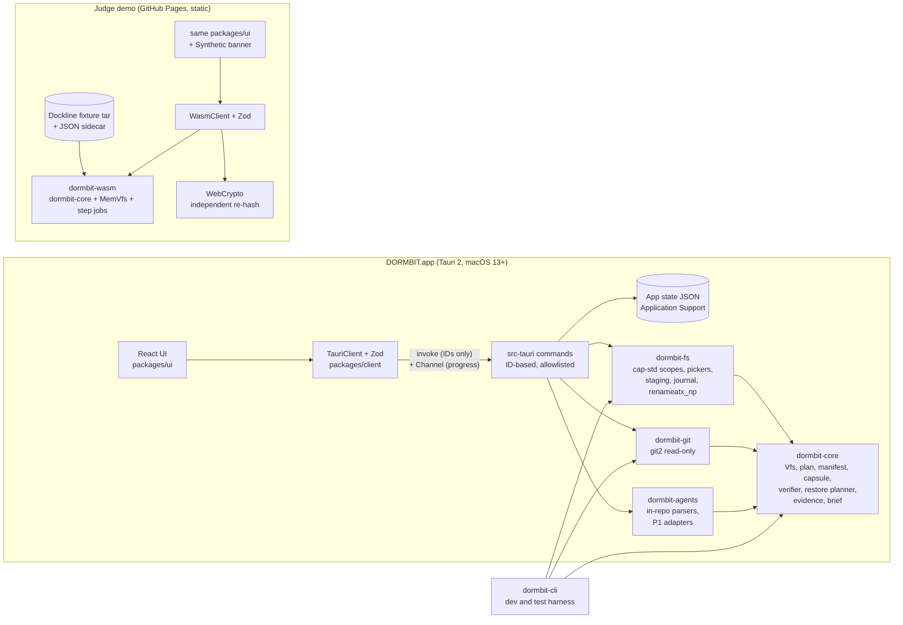

# DORMBIT architecture overview

- **Task:** P01-T02 (Task 7)
- **Source of truth:** [`docs/MASTER_PLAN.md`](../MASTER_PLAN.md) §6–8. Related: [capsule format](capsule-format.md), [threat model](../security/threat-model.md), ADR-001 to ADR-010 in [`docs/adr/`](../adr/).

## 1. Components



The UI code is shared. Only the client implementation changes: `TauriClient` in the app, `WasmClient` in the demo, `MockClient` for UI work and tests. All three implement one `DormbitClient` interface from `packages/client`.

## 2. Repository layout

| Path                                                     | Contents                                                                                     |
| -------------------------------------------------------- | -------------------------------------------------------------------------------------------- |
| `apps/desktop`                                           | React entry plus `src-tauri` (commands, capabilities, state store)                           |
| `apps/demo`                                              | Judge demo entry (Vite, `base: '/dormbit/'`)                                                 |
| `crates/`                                                | `dormbit-core`, `dormbit-fs`, `dormbit-git`, `dormbit-agents`, `dormbit-wasm`, `dormbit-cli` |
| `packages/schema`                                        | ts-rs output (`packages/schema/generated`) plus Zod schemas                                  |
| `packages/client`                                        | `DormbitClient` interface, `TauriClient`, `WasmClient`, `MockClient`                         |
| `packages/ui`                                            | Design system and the 13 screens                                                             |
| `fixtures/`                                              | Dockline generator and tar, golden outputs, malicious-fixture generators                     |
| `e2e/`                                                   | Playwright suites (demo and desktop UI)                                                      |
| `docs/`                                                  | product, architecture, adr, security, status, evidence, release, submission, kiro            |
| `scripts/`, `.github/workflows/`, `.githooks/`, `.kiro/` | Tooling, CI, git hooks, Kiro config                                                          |

## 3. Crate and package responsibilities

| Unit                            | Owns                                                                                                                                                                                                                                                                                                   | Must not                                                                                                                                |
| ------------------------------- | ------------------------------------------------------------------------------------------------------------------------------------------------------------------------------------------------------------------------------------------------------------------------------------------------------ | --------------------------------------------------------------------------------------------------------------------------------------- |
| `dormbit-core`                  | `Vfs`/`Clock`/`IdGen` traits; walker and project detection; capture plan and digest; manifest; capsule writer; verifier; restore planner and pre-check logic; small Git ref reader (`.git/HEAD`, `refs/`, `packed-refs`); evidence rules; brief model and Markdown renderer; step jobs; `DormbitError` | Touch the disk, clock, or RNG directly; use `std::fs`; use `unsafe` (`#![forbid(unsafe_code)]`); `unwrap`                               |
| `dormbit-fs`                    | Native `Vfs` over `cap-std` handles; `ScopeGrant` registry; folder and file pickers opened from Rust; read-only source type; staging folders with owner tokens; restore journal; the one `renameatx_np(RENAME_EXCL)` call; volume checks                                                               | Follow symlinks during discovery; expose a write API for source folders; contain any `unsafe` other than the single `renameatx_np` call |
| `dormbit-git`                   | `GitSnapshot` via `git2` (vendored, network features off); risky-config detection; remote URL redaction; post-restore working-tree status check                                                                                                                                                        | Spawn the git CLI; fetch; write to a repository                                                                                         |
| `dormbit-agents`                | Parsers for in-repo agent files (`.kiro/specs/*/tasks.md`, steering, `AGENTS.md`, `CLAUDE.md`, `.cursor/rules`, `.specstory/` metadata). P1: Claude Code, Codex, and Kiro-export metadata adapters                                                                                                     | Keep message content; open credential files; read a store without consent and its own grant                                             |
| `dormbit-wasm`                  | `wasm-bindgen` bindings; `MemVfs`; loading the Dockline tar and sidecar; idle-callback job driver hooks                                                                                                                                                                                                | Access anything outside the in-memory filesystem                                                                                        |
| `dormbit-cli`                   | Dev and test harness (`scan`, `plan`, `evidence`, `verify`, restore demos). Takes paths as arguments because the developer running it is the trust root                                                                                                                                                | Ship in the DMG                                                                                                                         |
| `src-tauri` (in `apps/desktop`) | Command handlers, `AppManifest::commands` allowlist, capability file, CSP, state store, single-instance lock, Channels                                                                                                                                                                                 | Grant the WebView `fs`, `shell`, or dialog permissions; accept raw paths from the UI                                                    |
| `packages/schema`               | One definition of every IPC type: ts-rs output plus Zod schemas with type-equality tests (PROP-11)                                                                                                                                                                                                     | Be edited by hand in `generated/`                                                                                                       |
| `packages/client`               | `DormbitClient` and its three implementations; Zod validation of every response                                                                                                                                                                                                                        | Bypass Zod                                                                                                                              |
| `packages/ui`                   | React 19 screens and components; renders untrusted text without raw HTML                                                                                                                                                                                                                               | Use `dangerouslySetInnerHTML` (lint-banned)                                                                                             |

## 4. The Vfs / Clock / IdGen boundary

`dormbit-core` never touches the disk, the clock, or the RNG. Hosts inject all three ([ADR-003](../adr/ADR-003-vfs-core.md)). This keeps core deterministic (PROP-10), buildable for `wasm32-unknown-unknown` ([ADR-001](../adr/ADR-001-wasm-core.md)), and testable with a fault-injecting filesystem (PROP-5).

Indicative shape (final signatures are set in the `foundation` and `scope-and-discovery` specs):

```rust
/// Read side. Source folders only ever get this.
pub trait VfsRead {
    fn read_dir(&self, dir: &RelPath) -> Result<Vec<DirEntry>, VfsError>;
    /// Like lstat: never follows symlinks.
    fn metadata(&self, path: &RelPath) -> Result<Metadata, VfsError>;
    fn open_read(&self, path: &RelPath) -> Result<Box<dyn Read + '_>, VfsError>;
    fn read_link(&self, path: &RelPath) -> Result<String, VfsError>;
}

/// Write side. Only staging folders, the capsule library temp file,
/// and DORMBIT's own state get this.
pub trait VfsWrite: VfsRead {
    fn create_dir(&self, path: &RelPath) -> Result<(), VfsError>;
    /// Fails if the path exists (create-new semantics).
    fn create_new(&self, path: &RelPath, mode: u32) -> Result<Box<dyn WriteSync + '_>, VfsError>;
    /// Fails with AlreadyExists if `to` exists. Native: renameatx_np(RENAME_EXCL).
    fn rename_exclusive(&self, from: &RelPath, to: &RelPath) -> Result<(), VfsError>;
    fn remove_owned_staging(&self, path: &RelPath, owner_token: &str) -> Result<(), VfsError>;
}

pub trait Clock { fn now(&self) -> Timestamp; }
pub trait IdGen { fn new_id(&self) -> Uuid; }
```

| Implementation                     | Where          | Used by                                          |
| ---------------------------------- | -------------- | ------------------------------------------------ |
| `CapVfs` (`cap-std` `Dir` handles) | `dormbit-fs`   | Native app, CLI, integration tests               |
| `MemVfs` (in-memory tree)          | `dormbit-wasm` | Judge demo; core unit tests (see Open questions) |
| Fault-injecting `Vfs`              | test code      | PROP-5: fails at every step of a restore         |
| System clock / fixed demo clock    | host           | `Clock`                                          |
| OS RNG / `crypto.randomUUID()`     | host           | `IdGen` (core needs no `getrandom` backend)      |

`RelPath` is a validated relative path type. It can only be built by the path rules in [capsule-format.md §6](capsule-format.md#6-path-rules), so core code cannot express `..`, absolute paths, or NUL bytes.

## 5. Jobs: the `step(budget)` model

Capture, verify, and restore (and discovery) are resumable state machines:

```rust
pub enum StepOutcome<T> {
    Progress(Progress),          // real counts only
    Done(T),
    Failed(DormbitError),
}

pub struct Progress {
    pub phase: Phase,            // e.g. Hashing, Rehashing, Assembling, Verifying, Staging, Committing
    pub files_done: u64, pub files_total: u64,
    pub bytes_done: u64, pub bytes_total: u64,
}

pub trait Job<T> {
    /// Do at most `budget` work units, then return.
    fn step(&mut self, budget: Budget) -> StepOutcome<T>;
    fn cancel(&mut self);        // next step returns Failed(CANCELLED)
}
```

- **Budget is work, not time.** A budget is a byte and item count. The same inputs produce the same outputs whatever the budget, so native and WebAssembly runs stay byte-identical (PROP-10).
- **Native driver:** a background thread calls `step` in a loop and streams each `Progress` to the UI over a Tauri Channel. `job_cancel` sets the cancel flag.
- **Browser driver:** `requestIdleCallback` sizes a budget from the idle deadline and calls `step`. Any extra pacing added for readability is labeled with the real elapsed time (DEM-2).
- **Progress is real.** Counts come from files and bytes actually processed. No synthetic percentages.

## 6. IPC model

Full rationale: [ADR-005](../adr/ADR-005-id-based-ipc.md).

- **IDs, not paths.** The UI refers to folders, projects, plans, capsules, jobs, and restore operations by opaque IDs. Every path enters the system through a picker opened by Rust (`scope_pick`, `capsule_pick`, `restore_target_pick`). Responses carry display paths with the home folder shown as `~`.
- **Two narrow string inputs.** `plan_set_decision` takes a plan item path, accepted only if it exactly matches an item already in that plan. `restore_start` takes a new folder name, accepted only as a single path component that passes the path rules.
- **Allowlist.** `tauri_build::AppManifest::commands` lists exactly the commands below, and the capability file grants only those plus `core:default`. A test fails if any plugin permission or unlisted command appears (Task 10). Capabilities are not the security boundary; the Rust scope layer is.
- **Validation on both sides.** Rust deserializes with strict serde types. The client validates every response with Zod (PROP-11).
- **Errors.** Every failure is `DormbitError { code, message, retryable }` with stable codes (plan §8).
- **Progress.** Long jobs return a job ID and stream `Progress` over a Channel.

**Allowlisted commands (28):**

| Command               | Purpose                                                                                    |
| --------------------- | ------------------------------------------------------------------------------------------ |
| `app_info`            | App version and build info (streams over a Channel)                                        |
| `scope_pick`          | Open a native folder picker from Rust; returns a `ScopeGrant` ID                           |
| `scope_list`          | List grants with display paths                                                             |
| `scope_revoke`        | Remove a grant and clear its cached data                                                   |
| `discovery_start`     | Start a bounded scan of a grant; returns a job ID                                          |
| `discovery_cancel`    | Cancel a scan                                                                              |
| `projects_list`       | List discovered projects                                                                   |
| `project_get`         | One `ProjectRecord`                                                                        |
| `project_set_dormant` | Set or clear the manual dormant mark                                                       |
| `evidence_get`        | Findings for a project                                                                     |
| `plan_create`         | Build a `CapturePlan` for a project                                                        |
| `plan_set_decision`   | Change one item's decision (item must exist in the plan)                                   |
| `plan_approve`        | Record the digest and acknowledgments as an `ApprovedPlan`                                 |
| `capture_start`       | Start capture into a `CapsuleLibrary` grant; returns a job ID                              |
| `job_cancel`          | Cancel any running job                                                                     |
| `capsule_pick`        | Open a native file picker from Rust for an existing capsule                                |
| `capsules_list`       | List registered capsules                                                                   |
| `verify_start`        | Start the separate verifier; returns a job ID                                              |
| `restore_target_pick` | Open a native folder picker for the destination parent; returns a `RestoreTarget` grant ID |
| `restore_precheck`    | Run RST-1/RST-2 checks for capsule + target + name                                         |
| `restore_start`       | Start a transactional restore; returns an op ID                                            |
| `restore_recover`     | Offer or perform recovery of an unfinished restore                                         |
| `brief_get`           | The structured brief for a project or restore                                              |
| `brief_export`        | Export Markdown through a save dialog opened by Rust                                       |
| `settings_get`        | Read settings                                                                              |
| `settings_set`        | Write settings                                                                             |
| `consent_set`         | Record or revoke consent for an agent adapter (P1)                                         |
| `adapters_list`       | List adapters and their Supported/Unsupported state (P1)                                   |

## 7. State storage

- **Where:** `~/Library/Application Support/<bundle id>/`, bundle ID `io.github.<owner>.dormbit`.
- **What:** scopes (grants), marks, the capsule registry, restore journals and history, consent records, and settings. Each is a JSON file.
- **How:** atomic writes: write a temp file in the same folder, `sync_all` (which uses `F_FULLFSYNC` on macOS), then rename over the old file. This is DORMBIT's own data, so a plain rename is correct here. User-facing destinations always use exclusive rename.
- **Registry:** for each capsule, its capsule ID, whole-file SHA-256, manifest SHA-256, and the time it was last verified. The verifier compares against it (VER-1).
- **Journals:** one per restore operation (`RestoreJournal`: `op_id`, staging, `owner_token`, state `Staged | Written | Verified | Committed | Cleaned`). Read at launch for crash recovery (RST-5).
- **Single instance:** a lock file in the same folder prevents two app instances from writing state at once.
- **Revoke:** `scope_revoke` and consent revocation clear cached data tied to that grant.
- **Demo:** all state is in memory. Reset discards it.

## 8. Native and WebAssembly builds

| Concern                | Native app                                                                         | Judge demo                                                   |
| ---------------------- | ---------------------------------------------------------------------------------- | ------------------------------------------------------------ |
| Filesystem             | `CapVfs` over `cap-std` handles for granted folders                                | `MemVfs` over the Dockline fixture tar                       |
| Folder picking         | Native pickers opened by Rust                                                      | Labeled mock picker (DEM-2)                                  |
| Git snapshot           | `git2` in `dormbit-git`                                                            | Precomputed from the fixture repo (JSON sidecar)             |
| Post-restore Git check | HEAD and refs (core ref reader) + working-tree status (`git2`)                     | HEAD and refs only (core ref reader)                         |
| Exclusive commit       | `renameatx_np(RENAME_EXCL)`                                                        | `MemVfs::rename_exclusive`                                   |
| Hashing                | `sha2`                                                                             | `sha2` in WebAssembly, plus an independent WebCrypto re-hash |
| Job driver             | Background thread + Tauri Channel                                                  | `requestIdleCallback`                                        |
| Clock                  | System clock                                                                       | Fixed demo clock from the sidecar                            |
| IDs                    | OS RNG                                                                             | `crypto.randomUUID()`                                        |
| State                  | JSON in Application Support                                                        | In memory; reset clears it                                   |
| Agent adapters         | P1, with consent                                                                   | Synthetic metadata from the sidecar                          |
| CSP                    | Strict, set in Tauri config                                                        | Meta tag with `'wasm-unsafe-eval'`                           |
| Banner                 | none                                                                               | "Synthetic Demo — No Local Files Accessed", always shown     |
| Distribution           | Ad-hoc-signed DMG on GitHub Releases ([ADR-010](../adr/ADR-010-ad-hoc-signing.md)) | GitHub Pages ([ADR-009](../adr/ADR-009-github-pages.md))     |

The same inputs produce byte-identical capsules in both builds (PROP-10). The spike already showed this for a capsule-shaped tar ([ADR-001](../adr/ADR-001-wasm-core.md)).

## 9. Dependencies

Versions come from [`docs/status/environment.md`](../status/environment.md) (crates.io at install time, Nov 3–4, 2026) unless the Source column says otherwise. Exact pins are set in Task 9 (P02-T01).

**Toolchain**

| Tool                     | Version                                                                 |
| ------------------------ | ----------------------------------------------------------------------- |
| Rust (`rustc`, `cargo`)  | 1.99.1 (`rust-toolchain.toml`)                                          |
| Rust targets             | `aarch64-apple-darwin`, `x86_64-apple-darwin`, `wasm32-unknown-unknown` |
| `wasm-bindgen-cli`       | 0.2.130 (must equal the crate version)                                  |
| cargo-deny               | 0.20.2                                                                  |
| binaryen (`wasm-opt`)    | 133                                                                     |
| Node                     | 24.19.0 (`.mise.toml`)                                                  |
| pnpm                     | 11.23.0 (`.mise.toml`)                                                  |
| Xcode Command Line Tools | 26.5.0 (Xcode.app not needed)                                           |

**Rust crates**

| Crate                   | Version          | Used in                    | Notes                                         |
| ----------------------- | ---------------- | -------------------------- | --------------------------------------------- |
| `tauri`                 | 2.12.5           | `src-tauri`                |                                               |
| `tauri-build`           | 2.7.4            | `src-tauri`                | `AppManifest::commands` allowlist             |
| `tauri-cli`             | 2.12.4           | build                      |                                               |
| `tauri-plugin-dialog`   | 2.8.4            | `dormbit-fs` / `src-tauri` | Rust API only. Source: spike `Cargo.toml`     |
| `cap-std`               | 4.0.3            | `dormbit-fs`               |                                               |
| `git2`                  | 0.21.0           | `dormbit-git`              | vendored libgit2, network features off        |
| `sha2`                  | 0.11.1           | core                       |                                               |
| `tar`                   | 0.4.46           | core                       | `default-features = false`                    |
| `flate2`                | 1.1.10           | core                       | `rust_backend` (miniz_oxide) only             |
| `ignore`                | 0.4.34           | core                       | gitignore matcher only, inside our own walker |
| `unicode-normalization` | 0.1.26           | core                       |                                               |
| `uuid`                  | 1.29.0           | core                       | no RNG features                               |
| `ts-rs`                 | 12.0.1           | core, `src-tauri`          | exports to `packages/schema/generated`        |
| `wasm-bindgen`          | =0.2.130         | `dormbit-wasm`             | exact pin                                     |
| `libc`                  | 0.2.191          | `dormbit-fs`               | `renameatx_np`. Source: spike `Cargo.toml`    |
| `serde`                 | 1.0.229          | all                        | Source: spike `Cargo.toml`                    |
| `serde_json`            | pinned in Task 9 | all                        |                                               |
| `thiserror`             | pinned in Task 9 | all                        |                                               |
| `proptest`              | 1.12.0           | dev                        |                                               |
| `insta`                 | 1.49.0           | dev                        |                                               |
| `tempfile`              | 3.27.0           | dev                        | Source: spike `Cargo.toml`                    |

**JavaScript packages**

| Package                                                                                                                  | Version                  | Notes                        |
| ------------------------------------------------------------------------------------------------------------------------ | ------------------------ | ---------------------------- |
| `react`, `react-dom`                                                                                                     | 19.3.1                   | Source: spike `package.json` |
| `@tauri-apps/api`                                                                                                        | 2.12.4                   | Source: spike `package.json` |
| `@tauri-apps/cli`                                                                                                        | 2.12.4                   | Source: spike `package.json` |
| `vite`                                                                                                                   | 8.3.5                    | Source: spike `package.json` |
| `@vitejs/plugin-react`                                                                                                   | 6.2.1                    | Source: spike `package.json` |
| `typescript`                                                                                                             | 7.0.2                    | Source: spike `package.json` |
| React Router, TanStack Query, Zod 4, React Aria Components, TanStack Virtual, react-markdown (no raw HTML), Lucide icons | pinned in Task 9         | UI (plan §6)                 |
| Vitest, Testing Library, fast-check, Playwright, `@axe-core/playwright`, `@wdio/tauri-service` (P1)                      | pinned in Tasks 9 and 12 | Tests                        |
| `@playwright/mcp`                                                                                                        | pinned in Task 13        | Kiro MCP, dev only           |

## Open questions

- **`MemVfs` location.** Plan §6 places `MemVfs` in `dormbit-wasm`, but core's own unit tests also need an in-memory filesystem. Options: a test-only module in core, or a small shared crate. To be settled in the `foundation` spec. Either way, one implementation should back both, so tests exercise the demo's filesystem.
- **Discovery as a step job.** Plan §6 names capture, verify, and restore as step jobs. DSC-2 requires discovery to be bounded, cancellable, and to report progress, so this document treats discovery as a step job too.
