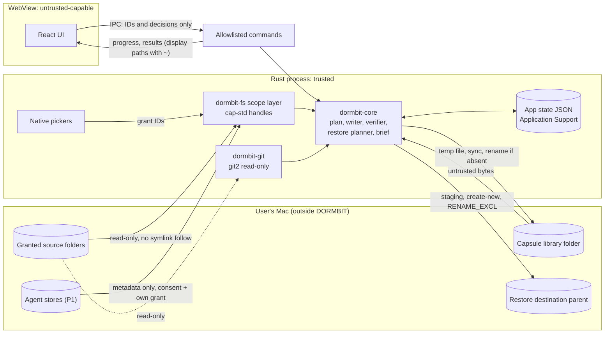

# DORMBIT threat model

- **Task:** P01-T02 (Task 7)
- **Source of truth:** [`docs/MASTER_PLAN.md`](../MASTER_PLAN.md) §7, with requirements from §4 and properties from §15.
- **Related:** [architecture overview](../architecture/overview.md), [capsule format](../architecture/capsule-format.md), ADR-003 to ADR-010.
- **Review:** the full security review is Task 45 (`docs/security/review.md`). This document is its input.

## 1. Scope

In scope: the native app (`DORMBIT.app`), the judge demo, the `.dormbit` capsule format, the restore engine, local state, the release artifacts, and the development process for this public repo.

Out of scope: an attacker who already runs code as the user (they can read everything DORMBIT can), physical access to an unlocked Mac, and vulnerabilities in macOS itself.

## 2. Assets

| Asset                                                                                                              | Why it matters                                                           |
| ------------------------------------------------------------------------------------------------------------------ | ------------------------------------------------------------------------ |
| User projects (source folders)                                                                                     | DORMBIT must never change or delete them (PROP-6)                        |
| Existing folders at restore destinations                                                                           | Must never be overwritten (PROP-4)                                       |
| Agent transcripts (`~/.claude/projects/`, `~/.codex/`)                                                             | Plaintext; contain file contents and command output                      |
| Credentials near agent stores (`~/.claude/.credentials.json`, `~/.codex/auth.json`) and in projects (`.env`, keys) | Direct account compromise if leaked                                      |
| Capsules                                                                                                           | Hold the approved project content; unencrypted in v1                     |
| Restored output                                                                                                    | Must equal what was approved, byte for byte (PROP-2)                     |
| Local state (grants, registry, journals, consent)                                                                  | Controls what DORMBIT may touch and what it trusts                       |
| Accuracy of what DORMBIT reports                                                                                   | Findings, verification results, and the four outcomes must not overclaim |
| The public repo and release artifacts                                                                              | Must not leak the developer's private data; must not ship test features  |

## 3. Trust boundaries

| Boundary                           | Trust level              | Notes                                                                                                          |
| ---------------------------------- | ------------------------ | -------------------------------------------------------------------------------------------------------------- |
| WebView (React UI)                 | Untrusted-capable        | Renders untrusted project text (READMEs, commit messages). Treated as possibly compromised                     |
| IPC layer (Tauri commands)         | Boundary                 | Allowlisted, ID-based inputs, typed errors ([ADR-005](../adr/ADR-005-id-based-ipc.md))                         |
| Rust process (`src-tauri`, crates) | Trusted                  | The real security boundary. Tauri's docs say capabilities don't protect against incorrect scope checks in Rust |
| File contents and capsules         | Untrusted input          | Any byte may be hostile, including capsules the user made earlier and later stored on an external drive        |
| Agent stores                       | Sensitive                | Read only with consent and a separate grant, metadata only (P1)                                                |
| Restored projects                  | Untrusted output         | DORMBIT never executes them; risky Git config is flagged                                                       |
| Judge demo page                    | Sandboxed by the browser | Synthetic data only; no local file access                                                                      |
| Development agents (Kiro)          | Constrained              | Workspace permissions deny real agent stores and credential folders                                            |

## 4. Data flow

Boundary crossings that carry untrusted data: source file contents into core, capsule bytes into the verifier and restore, project text into the WebView, and IPC arguments into Rust.

## 5. Threats and mitigations

T-01 to T-16 are the rows of plan §7. T-17 to T-24 restate mitigations the plan already requires elsewhere (the "Source" column cites them).

| ID   | Threat                                                                               | Mitigation                                                                                                                                                    | Proven by                                                                                                                                   | Source                     |
| ---- | ------------------------------------------------------------------------------------ | ------------------------------------------------------------------------------------------------------------------------------------------------------------- | ------------------------------------------------------------------------------------------------------------------------------------------- | -------------------------- |
| T-01 | Path traversal or absolute paths in a capsule                                        | Tar entry names are never used as output paths; manifest paths are validated against the path rules                                                           | PROP-1, malicious fixtures (traversal, absolute path)                                                                                       | §7                         |
| T-02 | Escape through symlinks                                                              | `cap-std` handles, no link following, staging created fresh                                                                                                   | PROP-9, escape fixtures; spike tests `cap_std_rejects_symlink_escape`, `cap_std_rejects_parent_traversal`, `cap_std_rejects_absolute_paths` | §7                         |
| T-03 | Overwriting an existing project, or a race for the destination                       | Existence and normalized-collision checks, create-new writes, `RENAME_EXCL` commit                                                                            | PROP-4, PROP-8; spike test `exclusive_rename_refuses_existing_target_and_leaves_it_untouched`                                               | §7                         |
| T-04 | Archive bombs or malformed tar                                                       | Allowlists for entry types and names, manifest sizes enforced, limits on entry count and expansion ratio, decoding stops at declared size + 1                 | Malicious fixtures (archive bomb, bad marker, duplicate entry, symlink entry)                                                               | §7                         |
| T-05 | Tampering with a capsule                                                             | Stored and content hashes per object, manifest digest in the trailer, registry match; limits stated honestly                                                  | PROP-3                                                                                                                                      | §7                         |
| T-06 | Partial restore after a crash                                                        | Journal, verify before commit, atomic commit, recovery on next launch                                                                                         | PROP-5, fault-injecting `Vfs`                                                                                                               | §7                         |
| T-07 | Changes to source files                                                              | Read-only source access by type (no write API), before/after snapshots                                                                                        | PROP-6 on read-only copies                                                                                                                  | §7                         |
| T-08 | Secret leakage                                                                       | Sensitive files excluded with no override, content scanning with acknowledgment, hidden in logs, no telemetry                                                 | Unit tests, gitleaks                                                                                                                        | §7                         |
| T-09 | XSS from READMEs or commit messages                                                  | React escaping, react-markdown with no raw HTML, CSP, lint ban on `dangerouslySetInnerHTML`                                                                   | CSP and lint tests                                                                                                                          | §7                         |
| T-10 | IPC abuse from a compromised WebView                                                 | Allowlist, ID-based inputs, strict deserialization, typed errors                                                                                              | Random-input IPC tests (Task 44); allowlist test (Task 10)                                                                                  | §7                         |
| T-11 | Code running through Git config or hooks during inspection                           | No git CLI; `git2` read-only; hooks never captured or restored; risky keys flagged                                                                            | Unit tests                                                                                                                                  | §7                         |
| T-12 | A restored repo runs commands later (`core.fsmonitor`, `core.hooksPath`)             | Flagged with exact keys in the restore report and the brief's pre-run checks                                                                                  | Unit tests                                                                                                                                  | §7                         |
| T-13 | Agent-store privacy                                                                  | Consent, separate grant, metadata only, credential files never opened                                                                                         | Adapter tests: deny-list, message content discarded                                                                                         | §7                         |
| T-14 | Supply chain                                                                         | Lockfiles, pinned versions, cargo-deny, pnpm audit, a small dependency set                                                                                    | CI                                                                                                                                          | §7                         |
| T-15 | Public repo leaks private data                                                       | gitleaks pre-commit, `~` redaction, raw logs kept in `.scratch/`                                                                                              | Pre-commit and CI gitleaks                                                                                                                  | §7                         |
| T-16 | Dev agent reads real transcripts                                                     | Kiro permissions deny `~/.claude/**`, `~/.codex/**`, and credential folders; tests use synthetic fixtures only                                                | Permissions file                                                                                                                            | §7                         |
| T-17 | Source file changes during capture, so the capsule holds a mix of old and new bytes  | Every source file is re-read and re-hashed after the first pass; any mismatch fails with `FILE_CHANGED_DURING_CAPTURE`                                        | Capture tests that modify a file between passes                                                                                             | CPS-1                      |
| T-18 | Capsule damaged after verification, before or during restore                         | Restore re-hashes every object while writing and verifies the staged tree before commit; a mismatch rolls back and the destination is never created           | Demo corruption control 3 (Task 40); PROP-5                                                                                                 | RST-3, journey 6           |
| T-19 | Capture includes files the user didn't approve                                       | Plan digest recorded at approval; capture writes only approved paths; later files reported as not captured                                                    | PROP-7                                                                                                                                      | CAP-7                      |
| T-20 | Recovery deletes something that isn't DORMBIT's                                      | The only deletion is of DORMBIT's own staging folders, after checking the owner token                                                                         | PROP-5; recovery tests with a foreign folder of the same name                                                                               | RST-5                      |
| T-21 | Restore inside the source project or the capsule library (recursion, self-overwrite) | Refused at pre-check                                                                                                                                          | Pre-check tests                                                                                                                             | RST-1                      |
| T-22 | Name collisions on the destination volume (case or Unicode variants)                 | NFC check always; case-fold check on case-insensitive volumes; `RENAME_EXCL` refuses existing targets                                                         | PROP-8                                                                                                                                      | RST-2                      |
| T-23 | Restored content executes (setuid binaries, hooks, auto-run configs)                 | setuid, setgid, and sticky bits stripped; hooks never restored; nothing executed; executable files and editor auto-run configs listed in the report and brief | Unit tests                                                                                                                                  | RST-3, RST-6, RST-7, BRF-1 |
| T-24 | The demo misleads judges about local access, or about speed                          | Permanent "Synthetic Demo — No Local Files Accessed" banner; labeled mock picker; pacing labeled with real elapsed time                                       | Demo E2E tests (Task 41)                                                                                                                    | DEM-1, DEM-2               |

## 6. Stated limits

These are shown to users where they apply (Privacy screen, verification report, brief), as the plan requires:

- **Scope enforcement happens inside the app.** There is no OS sandbox in v1. A bug in DORMBIT's Rust scope layer would not be caught by macOS. (App Sandbox with security-scoped bookmarks is P2.)
- **No encryption in v1.** Anyone with the capsule file can read it ([ADR-007](../adr/ADR-007-no-encryption-v1.md)).
- **Reading files can update their access times.** DORMBIT changes no file contents, but `atime` may change on volumes that track it.
- **SHA-256 shows integrity, not authorship.** It detects accidental and casual damage. It can't prove who made a capsule.
- **The OS cache may serve the bytes the verifier reads.** A pass shows the bytes the OS returned were correct.

## 7. Residual risks

| Risk                                             | Why it remains                                                                                                                              | Current handling                                                                                                    |
| ------------------------------------------------ | ------------------------------------------------------------------------------------------------------------------------------------------- | ------------------------------------------------------------------------------------------------------------------- |
| Forged capsule that verifies                     | Someone who can write both the capsule and the registry can make a self-consistent capsule. Unregistered capsules verify with REG-1 Unknown | Stated limit; Ed25519 signing is P2                                                                                 |
| Secrets inside captured `.git` history           | Commits may contain secrets. Content scanning reads working files; compressed Git objects are not scanned in v1                             | Sensitive working files are excluded; this gap goes into the security review (Task 45) and the Open questions below |
| Secrets in files the scanner misses              | Pattern scanning can miss secrets in unusual formats                                                                                        | Warning plus acknowledgment (CAP-3); capsule marked not encrypted                                                   |
| Unencrypted capsules on external drives          | v1 has no encryption                                                                                                                        | Stated in the app and in `limitations` in every manifest                                                            |
| User runs a restored project with risky config   | DORMBIT can flag, not prevent                                                                                                               | Exact keys listed in the restore report and brief pre-run checks                                                    |
| WebView or renderer vulnerability                | A browser-engine bug could let hostile text run script                                                                                      | CSP, no raw HTML, no `fs`/`shell` plugins, ID-only IPC limit the damage                                             |
| Bug in the single `unsafe` call (`renameatx_np`) | Only `unsafe` in the project                                                                                                                | Dedicated review; spike tests; one call site                                                                        |
| libgit2 behavior on unusual repositories         | New repository formats or extensions may parse wrongly                                                                                      | Reported as Unsupported; never written to                                                                           |
| Ad-hoc signature has no publisher identity       | No Developer ID, no notarization ([ADR-010](../adr/ADR-010-ad-hoc-signing.md))                                                              | `SHA256SUMS` on the release; build-from-source instructions                                                         |
| Compromised dependency                           | Pinning and audits reduce but don't remove it                                                                                               | cargo-deny, pnpm audit, small dependency set                                                                        |
| Local attacker edits app state JSON              | State files are ordinary user files                                                                                                         | Out of scope (same-user attacker); journals are re-checked with owner tokens before any deletion                    |

## 8. Development-process risks

The repo is public from its first push, and AI agents do much of the work. Two risks get their own controls.

### 8.1 Public repo leaks private data (T-15)

- `.githooks/pre-commit` runs gitleaks on staged changes. It's enabled locally with `core.hooksPath=.githooks`. CI runs gitleaks too, and Task 44 scans the full history.
- The planned `secret-scan` Kiro hook pipes content an agent is about to write through gitleaks and blocks the write (exit 2).
- Paths in docs, logs, and evidence are written with the home folder as `~`. `scripts/evidence/run.sh` redacts the home path.
- Raw logs and probe output stay in `.scratch/`, which `.gitignore` excludes. `.kiro` is never ignored.
- The repo uses a GitHub noreply address for commits, so the personal email stays out of history (`docs/status/environment.md`).
- Secret-detection test strings are generated at runtime and never committed (CAP-3).
- Fixtures are synthetic. Dockline's `.env` has obviously fake values.

### 8.2 Dev agent reads real transcripts or credentials (T-16)

- The recommended permissions file (`docs/kiro/recommended-permissions.yaml`) denies reads of `~/.claude/**`, `~/.codex/**`, `~/.ssh/**`, `~/.aws/**`, `~/.config/gh/**`, and `~/.netrc`, and denies writes outside the workspace. It is applied to `~/.kiro/workspace-roots/<hash>/permissions.yaml` only with the user's approval (Task 13).
- Adapter tests use synthetic stores only. Phase 07's exit criterion is that the dev agent never reads the user's real stores.
- If adapter field names can't be confirmed from docs, the user runs a keys-only schema probe themselves. It prints field names and types, not values (Task 32).
- Playwright MCP's origin filter is a convenience, not a security boundary. The `playwright-chrome` server, which drives the user's signed-in Chrome, stays disabled until the user approves it.
- Accuracy validation uses shallow clones of public repos in `.scratch/validation/` and never runs their code (Task 48). Running DORMBIT on the user's own projects needs their consent at that time.

## Open questions

- **Scanning `.git` content.** The plan scans file contents for secrets (CAP-3) but doesn't say whether that covers Git objects. This document treats captured history as unscanned and lists it as a residual risk. The `capsule-and-verification` spec should decide whether to scan loose objects or warn that history is captured unscanned.
- **Registry mismatch.** Treated as Failed (see [capsule-format.md](../architecture/capsule-format.md#open-questions)).
- **Rows T-17 to T-24** are not in plan §7's table. They restate mitigations already required by §4 so each has a named test. No new features were added.
